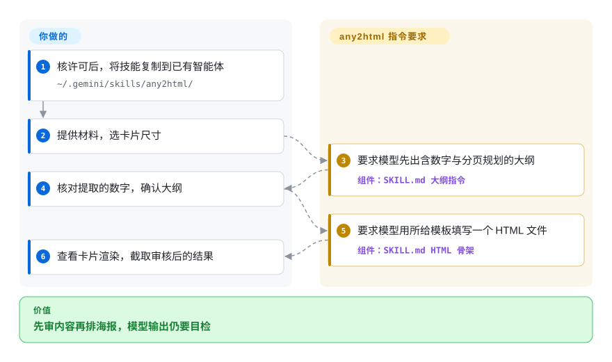

# any2html

长文章或对比表塞进社交卡片，字小了、数字也丢了。any2html 给智能体一套先审大纲、再套复古 HTML 模板的指令，让你在排版前确认内容。

## 何时使用

你要把含多组数字的中文文章做成小红书卡片或文章配图，一次性设计提示词却总为塞进一页而删指标。需要特定复古配色、并在生成 HTML 前审核大纲时，选这个小技能，而非整套内容生产工具或网页幻灯片。它是给已有智能体读的 Markdown 指令，不是文档解析框架或独立渲染器。

## 何时不用

- **你需要确定的复用／分发许可。** 先取得作者许可，或用有许可的 [Frontend Slides](../agent-skills/slides-ppt/frontend-slides.zh.md) 做网页演示。此仓没有许可证文件或授权声明；公开可读不等于获准开源复用。
- **你要保证分页、不裁字或可重复印刷构建。** 用 [Typst](../typesetting/typst.zh.md) 加审过的模板。这里由模型估容量，固定高度和 `overflow:hidden` 可能隐藏错误，而非验证内容。
- **你要可交互的演示幻灯片。** 用 Frontend Slides；此技能面向截图海报，不提供演示导航。
- **图表必须服从无矛盾规则。** 用自己审过的图表模板，或更广的 [Baoyu Skills](../agent-skills/ai-writing/content-production/baoyu-skills.zh.md) 工作流。SKILL 在规划／生成段要求 ECharts，结尾却禁止添加；使用前应明确处理冲突。
- **材料必须离线。** 改用本地文本、自控模型、浏览器和字体。URL 处理提出第三方抓取服务，HTML 骨架还从远端加载 Tailwind 与 Google Fonts。

## 横向对比

| 替代品 | 是否收录 | 我们的评价 | 取舍 |
|---|---|---|---|
| [Frontend Slides](../agent-skills/slides-ppt/frontend-slides.zh.md) | ✅ | 浏览器演示和视觉预览选它；解决许可问题后，只要狭窄复古海报流程时再选 any2html。 | 演示导航与预览选择，对比固定海报尺寸与大纲审核。 |
| [Baoyu Skills](../agent-skills/ai-writing/content-production/baoyu-skills.zh.md) | ✅ | 要翻译／排版／发布整条链时选 Baoyu；只要此卡片模板并接受许可缺口时选 any2html。 | 更多流程与辅助工具，对比一个小型、主张明确的 Markdown 技能。 |
| [Typst](../typesetting/typst.zh.md) | ✅ | 审过的源文件要产可重复排版结果时选 Typst；要模型提炼内容、产可编辑 HTML 草稿时选 any2html。 | 排版编译器对比智能体生成 HTML，都不会自动核验文章事实。 |

## 快速上手

[README 安装段](https://github.com/blockpanda/any2html/blob/4aac2a1eda45e30a951ba112cd2e28d75a2010fd/README.md#L76-L81) 将仓库复制到已有智能体技能目录，例如 `~/.gemini/skills/any2html/`；采用前先取得复用许可。给智能体文本／表格或 URL，请它使用 any2html，并指定竖版、横版或插图尺寸。指令要求先输出包含数字和分页／图表规划的大纲，等你确认后生成一个 HTML 文件。模型和工具环境由你提供，你还要核对数字、查看渲染边界、替换模板署名并自行截图。模型费用、可选抓取和浏览器资源归宿主环境负责；本仓没有运行引擎或截图导出器。它提出的自动打开浏览器和 ECharts 矛盾都需要你明确处理，不能照技能文字盲执行。

<!-- flow-steps:begin (generated from flows/any2html.json by tools/flow_card.py — do not edit) -->

流程文字版

1. **你**：核许可后，将技能复制到已有智能体 — `~/.gemini/skills/any2html/`
2. **你**：提供材料，选卡片尺寸
3. **any2html**：要求模型先出含数字与分页规划的大纲 — 组件：`SKILL.md 大纲指令`
4. **你**：核对提取的数字，确认大纲
5. **any2html**：要求模型用所给模板填写一个 HTML 文件 — 组件：`SKILL.md HTML 骨架`
6. **你**：查看卡片渲染，截取审核后的结果

**价值**：先审内容再排海报，模型输出仍要目检

<!-- flow-steps:end -->

## 技术要点

- **先审内容，再做布局。** [`SKILL.md:40–84`](https://github.com/blockpanda/any2html/blob/4aac2a1eda45e30a951ba112cd2e28d75a2010fd/SKILL.md#L40-L84) 要求模型保留数字、估算模块／页数，再输出固定大纲并停止等待确认。这让你能在设计前查遗漏，但它是提示词约束，不是强制执行闸门。
- **围绕三种明确画布规划。** [`SKILL.md:17–23`](https://github.com/blockpanda/any2html/blob/4aac2a1eda45e30a951ba112cd2e28d75a2010fd/SKILL.md#L17-L23) 区分竖版多卡、可增长横版和固定插图；[`SKILL.md:97–107`](https://github.com/blockpanda/any2html/blob/4aac2a1eda45e30a951ba112cd2e28d75a2010fd/SKILL.md#L97-L107) 指定分页与留白。模型估算不是像素测量，仍要人工看渲染。
- **用已有 HTML 骨架限制输出。** [`SKILL.md:131–174`](https://github.com/blockpanda/any2html/blob/4aac2a1eda45e30a951ba112cd2e28d75a2010fd/SKILL.md#L131-L174) 给出字体、配色、弹性布局和固定尺寸，同时加载远端 Tailwind／字体并隐藏溢出。它减少设计选择，却不能证明内容全部可见。[`SKILL.md:91–96`](https://github.com/blockpanda/any2html/blob/4aac2a1eda45e30a951ba112cd2e28d75a2010fd/SKILL.md#L91-L96) 的 ECharts 要求与 [`SKILL.md:240–245`](https://github.com/blockpanda/any2html/blob/4aac2a1eda45e30a951ba112cd2e28d75a2010fd/SKILL.md#L240-L245) 的禁止条款相反。

## 健康度与可持续性

- **维护（2026-10-13）：** 未归档，无 GitHub release，main 最后更新于 2026-04-26。仓库年龄 173 天，其中 171 天没有 main 提交，关注量不能证明持续开发。
- **机器画像：** 综合 D（4/5 轴有分）；维护／长青度 C，治理 D，许可风险 E。响应按 skill-pack 的 `type_na` 规则保持未知；采用因无计量安装渠道为 N/A。这是评分器类型分支，不是成功测得响应或采用。既有 skill-pack 豁免还取消了原无许可综合封顶，`capped: true` 变为 `false`；许可风险仍 E，没有新增复用许可。
- **支持与采用：** 个人仓库，本轮测得一个活跃维护者、33 个 star；三文件树中未见独立基金会／厂商支持。[推断：依据是短年龄、安静主线和单维护者] 更适合当模板线索，不宜当长期发布依赖。
- **许可和输出风险：** 没有发现 LICENSE 或复用授权声明。ECharts 冲突和模型容量估计需要审查；隐藏溢出不证明渲染完整。

## 存疑（未验证）

- [未验证：未执行智能体或卡片生成] 激活、数字保全、不裁字渲染和截图质量未实测；源码指令不能保证这些结果。
- [未验证：上游规则自相矛盾] SKILL 第 57 行与 91–96 行要求 ECharts，第 243 行禁止；本次复核没有暗定优先级。
- [推断：依据是安静主线、173 天年龄和单维护者] 长期支持尚未建立；应先取得复用许可，不能从公开访问推导授权。
- [推断：功能源码只有 README／SKILL] 按已登记裁决，将原 framework 更正为 skill-pack；保留历史 document-parsing 目录，不表示它有解析器能力。
