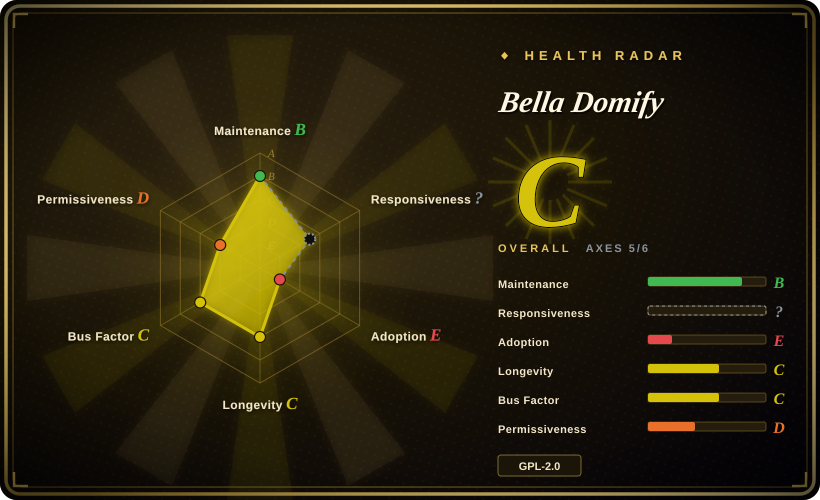
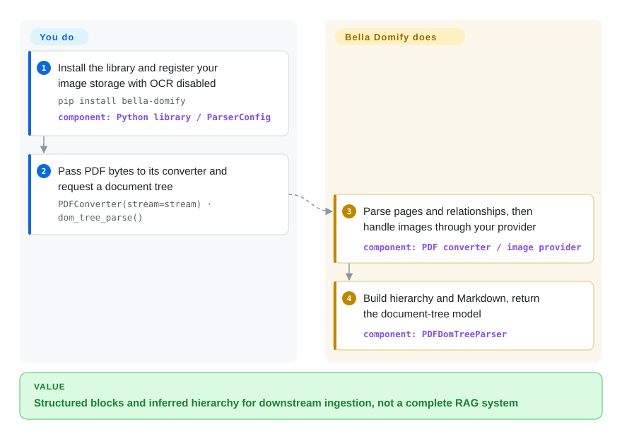

# Bella Domify

Flattening a PDF leaves tables detached from their headings; Bella Domify builds a rule-based document tree, but requires your image-storage adapter and has unresolved license and runtime declarations.

> **License conflict:** the repository's actual `LICENSE` file contains GNU GPL version 2, while `setup.py` declares `license="GPL v3"`. The frontmatter follows the license file as `GPL-2.0-only`; legal review should treat the upstream declaration as unresolved.

## When to use

You're building a Chinese-language knowledge-base or RAG ingestion service and need more than flat text: the application wants PDF blocks, sections, tables, images, headers and footers represented as a detailed document tree, then converted to a standard DOM or Markdown. You are willing to implement the required image-storage provider and, if image OCR is enabled, supply an OpenAI-compatible vision model provider and user context. Bella Domify can run as an imported Python package for direct conversion or as a FastAPI service with asynchronous workers.

Choose it over MarkItDown when PDF layout, tables, DOM-tree structure, watermark/header/footer handling, and evaluation fixtures matter more than minimal installation. Choose it over a cloud-only parser wrapper when you want the born-digital PDF and Office parsing logic in your own process, while accepting that image understanding can still call an external vision model.

## When NOT to use

- **You need an unambiguous license for commercial redistribution.** Use [Docling](docling.md) or [Unstructured](unstructured.md) instead; Bella Domify's GPL v2 license file conflicts with the GPL v3 declaration in `setup.py`.
- **All document processing must stay offline.** Prefer a configured local [Docling](docling.md) pipeline. Disabling Bella's OCR does not remove its image-provider calls: image storage is invoked separately, and enabled OCR sends an image URL to a vision endpoint.
- **You want a parser with tagged releases and a longer public stability record.** Use [Docling](docling.md) or [Unstructured](unstructured.md); Bella Domify has no GitHub releases, and its last observed default-branch update was in 2026-08, not the old 2025-11 date.
- **You do not want to implement storage/model providers or operate service infrastructure.** Use [MarkItDown](markitdown.md) for simple conversion or [Docling](docling.md) for an in-process parser; Bella Domify's library configuration requires an image provider, while its service path wires S3, Kafka, and a File API.
- **You only need quick Office-to-Markdown conversion.** Use [MarkItDown](markitdown.md); Bella Domify installs PyMuPDF, OpenCV, database, Kafka, cloud SDK, and service dependencies that are unnecessary for that narrower job.
- **You need independently reproducible accuracy claims before selection.** Benchmark Docling and Bella Domify on your own corpus; the repository's graphic is based on a limited internal evaluation set and was not reproduced here.

## Comparison

| Alternative | In index | Our verdict | Tradeoff |
|---|---|---|---|
| [Docling](docling.md) | ✅ | Pick Docling when license clarity, release maturity, local model-backed parsing, and standard RAG integrations matter most; pick Bella Domify when its pdf2docx-derived DOM model and provider-based service integration match an existing Bella-style stack. | Docling is more established and MIT-licensed; Bella Domify exposes detailed PDF internals and service hooks but has a license conflict and younger public history. |
| [Unstructured](unstructured.md) | ✅ | Pick Unstructured for production document ETL, connectors, partitioning, and enrichment; pick Bella Domify for a narrower Python parser with a custom DOM tree and Beike-oriented service adapters. | Unstructured has a broader ingestion ecosystem; Bella Domify offers more application-specific provider and worker code at the cost of infrastructure coupling. |
| [MarkItDown](markitdown.md) | ✅ | Pick MarkItDown for a small conversion dependency and predictable Markdown output; pick Bella Domify when PDF layout, table objects, sections, and image handling justify a heavier stack. | MarkItDown is easy to install but less layout-aware; Bella Domify is structurally richer but operationally much heavier. |

## Quick start

The documented library path starts with `pip install bella-domify` ([README.md:55–85](https://github.com/LianjiaTech/bella-domify/blob/d81f784e6cb398a7f229d0182878fb41f1b1824c/README.md#L55-L85)); first resolve the GPL and Python-floor conflicts for your deployment. Implement an `ImageStorageProvider`—your adapter that stores extracted image bytes—and register a `ParserConfig` with `parser_context.register_all_config`; the README's abstract `ImageStorageProvider()` is a placeholder, not an instantiable implementation. For an initial text-layer PDF path, set `ocr_enable=False`, keeping image storage under your control; turning off OCR alone does not establish an offline boundary. Supply PDF bytes with `PDFConverter(stream=stream)` and call `dom_tree_parse(remove_watermark=True, parse_stream_table=False)` to obtain a document-tree model. The parser reconstructs blocks and hierarchy; you own storage, error inspection, downstream retrieval and any later vision-model account, billing and image-egress policy. This documents the source-visible path, not a successfully executed package installation.

<!-- flow-steps:begin (generated from flows/bella-domify.json by tools/flow_card.py — do not edit) -->

Text version of the flow

1. **You**: Install the library and register your image storage with OCR disabled — `pip install bella-domify` — component: `Python library / ParserConfig`
2. **You**: Pass PDF bytes to its converter and request a document tree — `PDFConverter(stream=stream) · dom_tree_parse()`
3. **Bella Domify**: Parse pages and relationships, then handle images through your provider — component: `PDF converter / image provider`
4. **Bella Domify**: Build hierarchy and Markdown, return the document-tree model — component: `PDFDomTreeParser`

**Value**: Structured blocks and inferred hierarchy for downstream ingestion, not a complete RAG system

<!-- flow-steps:end -->

## Key techniques

- **Infer hierarchy from layout rules instead of flattening everything.** [domtree.py:68–146](https://github.com/LianjiaTech/bella-domify/blob/d81f784e6cb398a7f229d0182878fb41f1b1824c/doc_parser/dom_parser/domtree/domtree.py#L68-L146) checks catalogue/title relationships, font size, boldness and list types to decide parentage. [domtree_parser.py:123–164](https://github.com/LianjiaTech/bella-domify/blob/d81f784e6cb398a7f229d0182878fb41f1b1824c/doc_parser/dom_parser/parsers/pdf/domtree_parser.py#L123-L164) merges continued paragraphs and walks a parent stack before generating Markdown. The output preserves inferred grouping, but these heuristics do not guarantee correct reading order on every layout.
- **Treat image storage as a separate stage from OCR.** [domtree_parser.py:43–64](https://github.com/LianjiaTech/bella-domify/blob/d81f784e6cb398a7f229d0182878fb41f1b1824c/doc_parser/dom_parser/parsers/pdf/domtree_parser.py#L43-L64) submits image handlers to an eight-worker thread pool. [image_provider.py:47–60](https://github.com/LianjiaTech/bella-domify/blob/d81f784e6cb398a7f229d0182878fb41f1b1824c/doc_parser/dom_parser/provider/image_provider.py#L47-L60) uploads and retrieves the image before asking for optional OCR. This permits custom storage integration, but provider failures can become empty OCR text; the abstract download contract and its URL-shaped use also need version-specific integration validation.
- **Gate optional model calls, then report usage separately.** [ocr.py:13–27](https://github.com/LianjiaTech/bella-domify/blob/d81f784e6cb398a7f229d0182878fb41f1b1824c/doc_parser/dom_parser/parsers/pdf/common/ocr.py#L13-L27) requires OCR enabled, a model, user and image URL. [ocr.py:39–96](https://github.com/LianjiaTech/bella-domify/blob/d81f784e6cb398a7f229d0182878fb41f1b1824c/doc_parser/dom_parser/parsers/pdf/common/ocr.py#L39-L96) sends that URL to chat completions with a 30-second timeout and up to three rate-limit attempts, then calls usage reporting. This bounds one call path, not all package network activity; an exhausted call yields a failure marker rather than trustworthy extracted text.

## Tech stack

- **Language and packaging:** Python package `bella-domify`; Docker uses Python 3.9.19, the README requires Python `>=3.9`, while `setup.py` declares `>=3.6`.
- **PDF core:** a substantial pdf2docx-derived object model over PyMuPDF, representing pages, blocks, spans, paths, images, sections, columns, rows, cells, and tables.
- **Other formats:** adapters cover DOC/DOCX, XLS/XLSX, CSV, PPTX, text, Markdown, JSON-like text, HTML, and common image formats.
- **OCR path:** images are uploaded through an `ImageStorageProvider`; optional OCR calls an OpenAI-compatible chat-completions vision model and can emit text, Markdown tables, or Mermaid descriptions.
- **Service mode:** FastAPI/uvicorn endpoints, Kafka consumer workers, S3-compatible image/cache providers, File API integration, and configuration through INI files and environment variables.

## Dependencies

- **Python runtime:** PyMuPDF, OpenCV, Pillow, Shapely, python-docx, python-pptx, openpyxl, xlrd, FastAPI, uvicorn, Pydantic, SQLAlchemy/SQLModel, boto3, OpenAI, Kafka, and utility packages.
- **System tools:** the Dockerfile installs build tools, MySQL client headers, OpenGL/glib libraries, and `unoconv` for office conversion.
- **Library providers:** callers must supply an `ImageStorageProvider`; OCR additionally needs a vision model list/provider, model name, and user context.
- **Service infrastructure:** the included Compose stack uses LocalStack S3, Zookeeper, Kafka, a document-parser container, and external File API/OpenAI-compatible endpoints.
- **Network boundary:** born-digital parsing can run locally, but enabled image OCR and the default service integrations make outbound calls.

## Ops difficulty

**Medium as a carefully configured library; high as the included service.** Direct library use avoids Kafka and the bundled service workers, but still requires provider implementations and a large dependency set. The supplied service starts a Kafka consumer, uses S3-compatible storage and result caching, depends on external file and vision-model APIs, and includes environment-specific INI values that must be replaced rather than copied. Teams must also resolve the Python-version and license declarations, pin all dependencies, and decide which features are permitted to send document images outside the deployment boundary.

## Health & viability

- **Measured signals (2026-10-14):** B/?/E/C/C/D, overall C with 5/6 axes scored. The old `no_window_signal` remains: the 90-day response window ends 9 days before scoring and has no qualifying response despite traffic; this is not an API failure or evidence of slow support.
- **Maintenance:** not archived; the current default branch was updated in 2026-08, 58 days before scoring. There are no GitHub releases; 0.1.6.8 is fallback package metadata, not a verified release artifact.
- **Governance:** the repository belongs to the LianjiaTech organization and recent commits came from several accounts. Contributor totals are partly inherited from the pdf2docx-derived history, so they are not a clean measure of current Bella Domify bus factor.
- **Age and Lindy:** created in 2025-08, measured age 422 days. This is over a year, not the previous claim of less than a year, but still a short public record for a parser dependency.
- **Adoption:** 92 stars indicate limited attention; the scorer found 0 ecosystem packages and reports E. A README installation command does not independently prove a published wheel works in your environment.
- **Risk flags:** the GPL v2/GPL v3 conflict is a selection blocker for license-sensitive use. The checked-in Compose and production INI also contain environment-specific endpoints and credential-like example values that must not be treated as production defaults.

## Caveats (unverified)

- [未验证：抽样窗口无合格首响] Actual support speed is unknown: `no_window_signal` in the 90-day window ending 9 days before 2026-10-14 scoring; the failed measurement is not silently replaced by a grade.
- [未验证：未运行库或服务] Provider URL/bytes behavior, import/configuration ordering, the installed wheel's imports and effective Python floor need execution checks. OCR disabling does not remove storage-provider calls; image-model and usage-reporting egress depend on your configuration.

- [未验证] Upstream legal intent is unresolved: `LICENSE` contains GPL version 2, while `setup.py` declares GPL v3. The page records `GPL-2.0-only` from the actual license file but does not resolve the conflict.
- [未验证] The repository's limited-set accuracy graphic and comparisons were not reproduced or independently audited.
- [未验证] Library-only operation with OCR disabled was not executed end to end to prove which Bella-specific packages and network integrations can be removed.
- [推断] Organization ownership and multiple recent commit authors reduce the appearance of a pure solo project, but the short public history and inherited contributor data leave current bus factor uncertain.
- [未验证] The README, `setup.py`, and Dockerfile disagree on the effective Python floor; validate the published package against the intended runtime before adoption.
