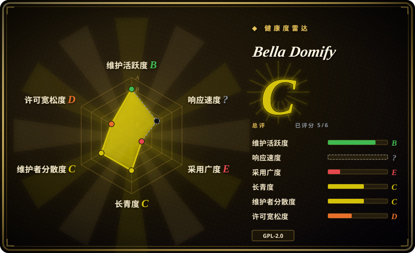
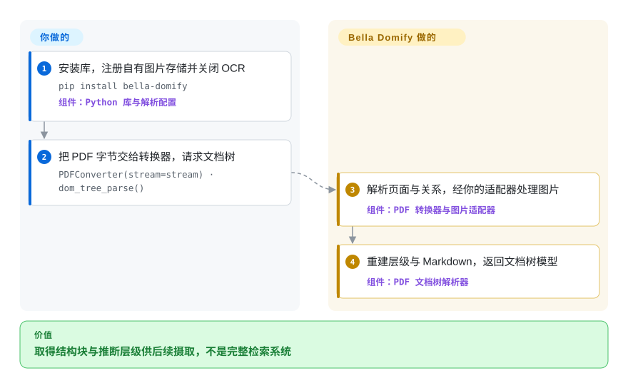
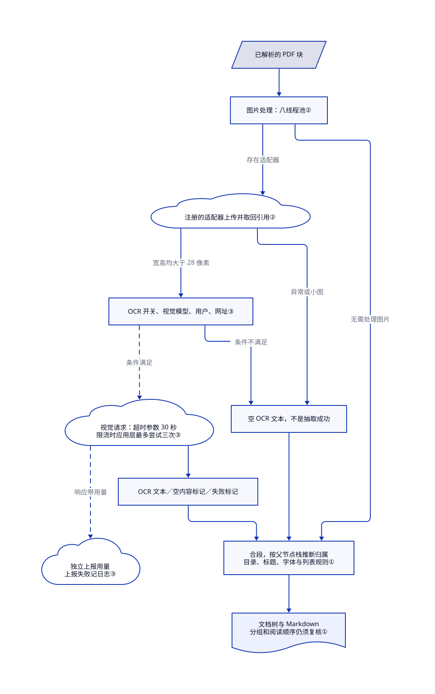

# Bella Domify

PDF 摊平成文本后，表格和所属标题分了家；Bella Domify 用规则重建文档树，但你须实现图片存储适配器，并处理许可和运行时声明冲突。

> **许可证冲突：** 仓库实际 `LICENSE` 文件是 GNU GPL version 2 正文，而 `setup.py` 声明 `license="GPL v3"`。Frontmatter 按许可证文件记录为 `GPL-2.0-only`；法律审查应把上游声明视为尚未解决。

## 何时使用

你在搭建中文知识库或 RAG 摄取服务，需要的不只是纯文本：应用希望把 PDF block、section、table、image、header 和 footer 表示为详细文档树，再转换成标准 DOM 或 Markdown。你愿意实现必需的图片存储 provider；如果启用图片 OCR，还会提供 OpenAI-compatible 视觉模型 provider 和用户上下文。Bella Domify 可以作为 Python 包直接转换，也可以通过 FastAPI 服务和异步 worker 运行。

如果 PDF 版面、表格、DOM tree、水印与页眉页脚处理以及评测 fixture 比最小安装更重要，选它而不是 MarkItDown。如果你想把 born-digital PDF 与 Office 的解析逻辑放进自己的进程，同时接受图片理解仍可能调用外部视觉模型，也可以选它而不是纯云端 parser wrapper。

## 何时不用

- **商业分发需要无歧义许可证。** 请改用 [Docling](docling.zh.md) 或 [Unstructured](unstructured.zh.md)；Bella Domify 的 GPL v2 许可证文件与 `setup.py` 中 GPL v3 声明冲突。
- **所有文档处理必须离线。** 优先配置本地 [Docling](docling.zh.md) 管线。关闭 Bella 的 OCR 不会移除图片存储调用；存储独立调用，启用的 OCR 还把图片网址发送给视觉端点。
- **需要发布标签与更长公开稳定记录。** 使用 [Docling](docling.zh.md) 或 [Unstructured](unstructured.zh.md)；Bella Domify 没有 GitHub 发布，最后观察到的主分支更新在 2026-08，不是旧页的 2025-11。
- **不想实现存储/模型 provider，也不想运维服务基础设施。** 简单转换请用 [MarkItDown](markitdown.zh.md)，进程内解析可用 [Docling](docling.zh.md)；Bella Domify 的 library 配置要求 image provider，service 路径还连接 S3、Kafka 和 File API。
- **只需要快速 Office 转 Markdown。** 请改用 [MarkItDown](markitdown.zh.md)；Bella Domify 会安装 PyMuPDF、OpenCV、数据库、Kafka、云 SDK 和服务依赖，对更窄的任务没有必要。
- **选型前必须取得可复现准确率。** 在自己的语料上比较 Docling 和 Bella Domify；仓库图表基于有限内部评测集，本轮未复现。

## 横向对比

| 替代品 | 是否收录 | 我们的评价 | 取舍 |
|---|---|---|---|
| [Docling](docling.zh.md) | ✅ | 许可证清晰、release 更成熟、本地模型解析和标准 RAG 集成最重要时选 Docling；pdf2docx 衍生 DOM 模型和 provider 式服务集成正好匹配现有 Bella 风格技术栈时选 Bella Domify。 | Docling 更成熟且为 MIT；Bella Domify 暴露详细 PDF 内部结构与服务 hook，但许可证冲突且公开历史更短。 |
| [Unstructured](unstructured.zh.md) | ✅ | 需要生产文档 ETL、connector、partition 和 enrichment 时选 Unstructured；需要较窄的 Python parser、自定义 DOM tree 和贝壳式 service adapter 时选 Bella Domify。 | Unstructured 的 ingestion 生态更广；Bella Domify 提供更偏应用的 provider 与 worker 代码，代价是基础设施耦合。 |
| [MarkItDown](markitdown.zh.md) | ✅ | 需要小型转换依赖和可预期 Markdown 输出时选 MarkItDown；PDF 版面、table object、section 和 image handling 值得引入重栈时选 Bella Domify。 | MarkItDown 易安装但版面感知弱；Bella Domify 结构更丰富，运维也重得多。 |

## 快速上手

文档库路径从 `pip install bella-domify` 开始（[README.md:55–85](https://github.com/LianjiaTech/bella-domify/blob/d81f784e6cb398a7f229d0182878fb41f1b1824c/README.md#L55-L85)），部署前先解决 GPL 与 Python 下限冲突。实现 `ImageStorageProvider`——你负责保存抽取图片字节的适配器——再用 `parser_context.register_all_config` 注册 `ParserConfig`；README 的抽象类 `ImageStorageProvider()` 是示意，不能直接实例化。初次选带文本层的 PDF 路径，设 `ocr_enable=False`，由你控制图片存储；只关闭 OCR 不等于全离线。把 PDF 字节交给 `PDFConverter(stream=stream)`，调用 `dom_tree_parse(remove_watermark=True, parse_stream_table=False)` 取得文档树模型。解析器重建块与层级；存储、错误检查、后续检索，以及将来视觉模型的账号、费用和图片外发策略都由你负责。本段描述源码可见路径，不宣称已成功执行安装。

<!-- flow-steps:begin (generated from flows/bella-domify.json by tools/flow_card.py — do not edit) -->

流程文字版

1. **你**：安装库，注册自有图片存储并关闭 OCR — `pip install bella-domify` — 组件：`Python 库与解析配置`
2. **你**：把 PDF 字节交给转换器，请求文档树 — `PDFConverter(stream=stream) · dom_tree_parse()`
3. **Bella Domify**：解析页面与关系，经你的适配器处理图片 — 组件：`PDF 转换器与图片适配器`
4. **Bella Domify**：重建层级与 Markdown，返回文档树模型 — 组件：`PDF 文档树解析器`

**价值**：取得结构块与推断层级供后续摄取，不是完整检索系统

<!-- flow-steps:end -->

## 技术要点

<!-- mechanism:begin (generated from mechanisms/bella-domify.json by tools/mechanism_card.py; do not edit) -->

机制文字版

- 已解析的 PDF 块
- 图片处理：八线程池②
- 注册的适配器上传并取回引用②
- OCR 开关、视觉模型、用户、网址③
- 空 OCR 文本，不是抽取成功
- 视觉请求：超时参数 30 秒 限流时应用层最多尝试三次③
- 独立上报用量 上报失败记日志③
- OCR 文本／空内容标记／失败标记
- 合段，按父节点栈推断归属 目录、标题、字体与列表规则①
- 文档树与 Markdown 分组和阅读顺序仍须复核①

- 已解析的 PDF 块 → 图片处理：八线程池②
- 图片处理：八线程池② → 注册的适配器上传并取回引用②（存在适配器）
- 注册的适配器上传并取回引用② → OCR 开关、视觉模型、用户、网址③（宽高均大于 28 像素）
- 注册的适配器上传并取回引用② → 空 OCR 文本，不是抽取成功（异常或小图）
- OCR 开关、视觉模型、用户、网址③ → 空 OCR 文本，不是抽取成功（条件不满足）
- OCR 开关、视觉模型、用户、网址③ → 视觉请求：超时参数 30 秒 限流时应用层最多尝试三次③（条件满足）〔可选／兜底〕
- 视觉请求：超时参数 30 秒 限流时应用层最多尝试三次③ → 独立上报用量 上报失败记日志③（响应带用量）〔可选／兜底〕
- 视觉请求：超时参数 30 秒 限流时应用层最多尝试三次③ → OCR 文本／空内容标记／失败标记
- OCR 文本／空内容标记／失败标记 → 合段，按父节点栈推断归属 目录、标题、字体与列表规则①
- 空 OCR 文本，不是抽取成功 → 合段，按父节点栈推断归属 目录、标题、字体与列表规则①
- 图片处理：八线程池② → 合段，按父节点栈推断归属 目录、标题、字体与列表规则①（无需处理图片）
- 合段，按父节点栈推断归属 目录、标题、字体与列表规则① → 文档树与 Markdown 分组和阅读顺序仍须复核①

<!-- mechanism:end -->

### 1. 用文档线索重建父子树

- **解决：** 纯文本会丢掉标题与其下段落、列表之间的归属关系。
- **做法：** 父节点检查结合目录和标题约束、字号、粗体、列表类型，挂节点前先合并连续段落；父节点栈保存树中当前路径，不适合就逐层退出，找到父节点后再挂入，最后生成 Markdown 和文档树模型。
- **边界：** 这些是版面启发式规则，不保证每份 PDF 的分组或阅读顺序都正确。
- **源码：** [domtree.py:68–146](https://github.com/LianjiaTech/bella-domify/blob/d81f784e6cb398a7f229d0182878fb41f1b1824c/doc_parser/dom_parser/domtree/domtree.py#L68-L146)、[domtree_parser.py:123–164](https://github.com/LianjiaTech/bella-domify/blob/d81f784e6cb398a7f229d0182878fb41f1b1824c/doc_parser/dom_parser/parsers/pdf/domtree_parser.py#L123-L164)。

### 2. 先存图片，再决定是否识别

- **解决：** 应用即使关掉 OCR，也就是图片文字识别，仍可能需要保留提取出的图片。
- **做法：** 构树之前，解析器用八线程池调度图片处理；注册的存储适配器先上传图片、取回引用，再进入可选 OCR。适配器只让宽和高都超过 28 像素的图片通过尺寸检查。
- **边界：** 关 OCR 不会关闭存储调用，也不能保证离线；适配器异常会变成空 OCR 文本，不是提取成功。抽象下载接口承诺返回字节，但调用方把返回值当图片网址，适配器兼容性仍须按版本验证。
- **源码：** [domtree_parser.py:43–64](https://github.com/LianjiaTech/bella-domify/blob/d81f784e6cb398a7f229d0182878fb41f1b1824c/doc_parser/dom_parser/parsers/pdf/domtree_parser.py#L43-L64)、[image_provider.py:8–60](https://github.com/LianjiaTech/bella-domify/blob/d81f784e6cb398a7f229d0182878fb41f1b1824c/doc_parser/dom_parser/provider/image_provider.py#L8-L60)、[TextBlockExtend.py:137–143](https://github.com/LianjiaTech/bella-domify/blob/d81f784e6cb398a7f229d0182878fb41f1b1824c/doc_parser/dom_parser/parsers/pdf/extend/text/TextBlockExtend.py#L137-L143)。

### 3. 视觉请求设门槛，失败标记不冒充正文

- **解决：** 可选图片识别不能缺配置就调用模型，也不能把请求耗尽当成抽取成功。
- **做法：** OCR 路径要求开关开启、有受支持的视觉模型、用户和图片网址，再把网址交给对话补全，超时参数为 30 秒；应用层循环在限流时最多尝试三次。响应带用量时另调统计上报，上报失败会记日志。
- **边界：** 这些限制只描述此路径，不覆盖整个包的网络行为，也不是总耗时上限，限流还会等待。无响应或候选答案返回图片 OCR 失败标记，空内容另有标记，都不能当可信文档正文。
- **源码：** [ocr.py:13–105](https://github.com/LianjiaTech/bella-domify/blob/d81f784e6cb398a7f229d0182878fb41f1b1824c/doc_parser/dom_parser/parsers/pdf/common/ocr.py#L13-L105)、[视觉模型检查：108–124](https://github.com/LianjiaTech/bella-domify/blob/d81f784e6cb398a7f229d0182878fb41f1b1824c/doc_parser/dom_parser/parsers/pdf/common/ocr.py#L108-L124)。

## 技术栈

- **语言与打包：** Python 包 `bella-domify`；Docker 使用 Python 3.9.19，README 要求 Python `>=3.9`，而 `setup.py` 声明 `>=3.6`。
- **PDF 核心：** 基于 PyMuPDF 的大规模 pdf2docx 衍生对象模型，表示 page、block、span、path、image、section、column、row、cell 和 table。
- **其他格式：** adapter 覆盖 DOC/DOCX、XLS/XLSX、CSV、PPTX、文本、Markdown、JSON 类文本、HTML 和常见图片格式。
- **OCR 路径：** 图片通过 `ImageStorageProvider` 上传；可选 OCR 调用 OpenAI-compatible chat-completions 视觉模型，可输出文本、Markdown 表格或 Mermaid 描述。
- **服务模式：** FastAPI/uvicorn endpoint、Kafka consumer worker、S3-compatible 图片/缓存 provider、File API 集成，以及 INI 文件和环境变量配置。

## 依赖

- **Python 运行时：** PyMuPDF、OpenCV、Pillow、Shapely、python-docx、python-pptx、openpyxl、xlrd、FastAPI、uvicorn、Pydantic、SQLAlchemy/SQLModel、boto3、OpenAI、Kafka 和工具包。
- **系统工具：** Dockerfile 安装 build tool、MySQL client header、OpenGL/glib 库，以及用于 Office 转换的 `unoconv`。
- **Library provider：** 调用方必须提供 `ImageStorageProvider`；OCR 还需要视觉模型列表/provider、模型名和用户上下文。
- **服务基础设施：** 自带 Compose stack 使用 LocalStack S3、Zookeeper、Kafka、document-parser container，以及外部 File API/OpenAI-compatible endpoint。
- **网络边界：** born-digital 解析可以本地运行，但启用图片 OCR 和默认 service integration 后会产生出站调用。

## 运维难度

**谨慎配置的 library 为中，自带 service 为高。** 直接 library 使用可以避开 Kafka 和自带 worker，但仍需 provider 实现和较大的依赖集合。附带 service 会启动 Kafka consumer，使用 S3-compatible 存储与结果缓存，依赖外部文件和视觉模型 API，并包含必须替换而不能直接复制的环境特定 INI 值。团队还要解决 Python 版本与许可证声明冲突、锁定全部依赖，并决定哪些功能可以把文档图片发送到部署边界之外。

## 健康度与可持续性

- **实测信号（2026-10-14）：** B/?/E/C/C/D，整体 C，覆盖 5/6 轴。原 `no_window_signal` 保留：截止评分前 9 天的 90 天响应窗口有流量却无合格首响；不是接口失败，也不能据此认定支持慢。
- **维护：** 未归档，当前主分支更新于 2026-08，距评分 58 天。没有 GitHub 发布；0.1.6.8 是包元数据回退值，不是已验证发布产物。
- **治理：** 仓库属于 LianjiaTech 组织，近期 commit 来自多个账号。Contributor 总量部分继承自 pdf2docx 衍生历史，不能干净地表示 Bella Domify 当前 bus factor。
- **年龄与 Lindy：** 创建于 2025-08，实测年龄 422 天，已超过一年，不再是旧页所称的不足一年；但对解析依赖而言公开记录仍短。
- **采用度：** 92 star 表示有限关注；评分器找到 0 个生态包，给 E。README 的安装命令不能独立证明发布轮子能在你的环境工作。
- **风险标记：** GPL v2/GPL v3 冲突会阻断许可证敏感选型。已提交的 Compose 与生产 INI 还包含环境特定 endpoint 和类似凭据的示例值，不能当作生产默认值。

## 存疑（未验证）

- [未验证：抽样窗口无合格首响] 实际支持速度未知：截止 2026-10-14 评分前 9 天的 90 天窗口为 `no_window_signal`；没有用人工档位替代缺失测量。
- [未验证：未运行库或服务] 存储接口的网址／字节行为、导入与配置顺序、安装轮子的依赖导入及有效 Python 下限都需运行核对。关闭 OCR 不会移除存储调用；视觉模型和使用量上报的外发取决于你的配置。

- [未验证] 上游法律意图尚未解决：`LICENSE` 是 GPL version 2 正文，`setup.py` 却声明 GPL v3。本页按实际许可证文件记录 `GPL-2.0-only`，但没有解决冲突。
- [未验证] 仓库有限评测集上的准确率图和对比没有被复现或独立审计。
- [未验证] 本次没有端到端运行关闭 OCR 的纯 library 模式，因此尚未证明哪些 Bella-specific 包与网络集成可以移除。
- [推断] 组织所有权和多个近期 commit author 降低了纯单人项目的表象，但公开历史短、contributor 数据又包含继承历史，当前 bus factor 仍不确定。
- [未验证] README、`setup.py` 与 Dockerfile 对有效 Python 下限意见不一致；采用前应在目标 runtime 上验证已发布包。
