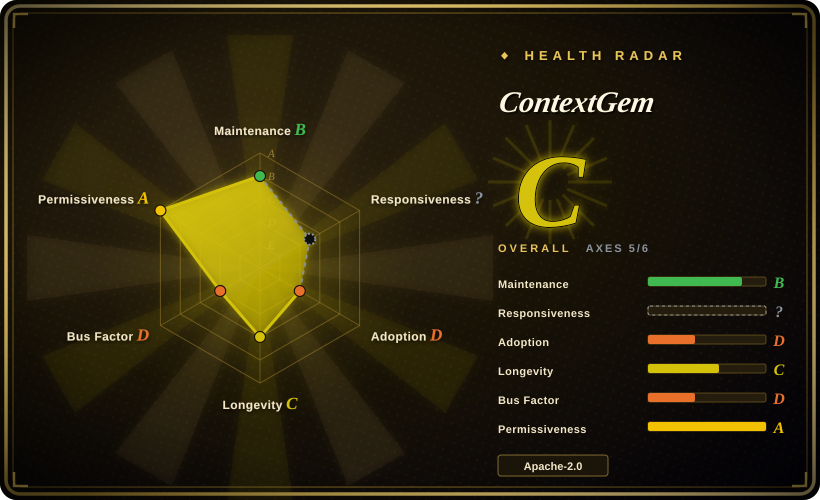
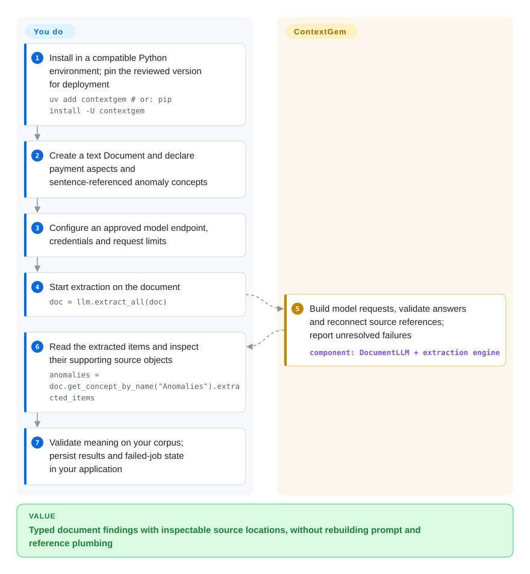
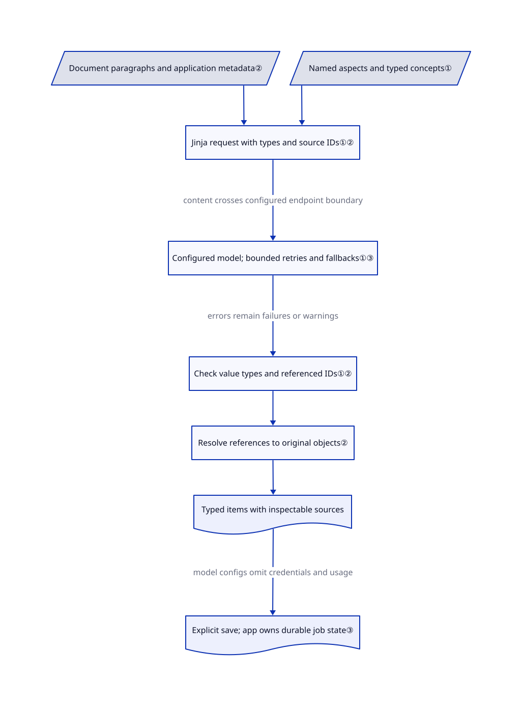

# ContextGem

Your contract extractor returns a budget but cannot show which clause supports it. ContextGem turns named extraction requirements into model requests, validates typed results and can attach the original paragraphs or sentences for inspection.

## When to use

You are building a Python intake job for statements of work, contracts or policies. Each incoming document must yield the same project details, payment clauses or anomaly list, and a reviewer must be able to open the supporting passage. Your current model call returns plausible JSON, but every field needs its own prompt, validator and source-matching code. Choose ContextGem when you want to declare reusable **aspects** (relevant passages) and **concepts** (typed values or conclusions), then let the library assemble prompts, check results and reconnect source objects.

You still choose the model, approve data disclosure, define the extraction meaning and evaluate output on your own documents. This is semantic extraction rather than a PDF layout parser or retrieval index. Use Docling first when file conversion is the problem; use ContextGem after conversion when the question is “which clauses concern payment, what do they say, and where did that answer come from?”

## When NOT to use

- **You only need reading order, tables or OCR.** Choose [Docling](docling.md). ContextGem can consume a Docling document through an optional extra, but typed model extraction is an additional step, not a replacement for reliable input conversion.
- **You want typed elements and section-aware chunks for RAG, not domain fields.** Choose [unstructured](unstructured.md). Its element model serves ingestion; ContextGem spends model requests on your named aspects and concepts.
- **You are building searchable question answering over a corpus.** Choose [LlamaIndex](../agent-frameworks/workflow-builders/llamaindex.md). ContextGem returns extraction results inside document objects; it does not provide that framework's index, retriever or query-engine pipeline.
- **The fields follow a stable deterministic rule.** Use regular expressions or your existing parser plus ordinary validation. ContextGem's generated requests, retries and provider dependence are unnecessary for exact identifiers in a fixed template.
- **You need citations to prove factual correctness.** Use deterministic source checks and domain acceptance tests, with human review for consequential decisions. ContextGem checks reference IDs and data shape, not whether a cited passage logically entails an inferred answer. Image concepts explicitly disallow source references.
- **You cannot send documents outside your boundary.** Select and validate a permitted local endpoint, or use a local deterministic parser. Cloud extraction sends text and possibly images through LiteLLM to configured providers; fallback models are additional data recipients, not a privacy-neutral recovery option.
- **You need a durable batch queue with exactly-once results.** Add an application-owned job store, checkpoints and idempotent writes, or use your existing scheduler. ContextGem retains completed chunks for an in-process retry and can serialize results, but that is not a crash-resumable task service.
- **Your budget logic treats unknown prices as zero cost.** Supply model pricing or escalate `UnknownPricesWarning` before enabling budget enforcement. The documented unknown-price path leaves estimated costs at zero; retries and fallback requests still consume provider quota.

## Comparison

| Alternative | In index | Our verdict | Tradeoff |
| --- | --- | --- | --- |
| [Docling](docling.md) | Indexed | Choose Docling to reconstruct file layout and text; choose ContextGem to extract domain values and relevant passages from that text. | Often complementary: ContextGem's optional Docling path adds semantic extraction, model billing and a second layer to validate. |
| [unstructured](unstructured.md) | Indexed | Choose unstructured for typed elements and chunking across mixed files; choose ContextGem for named concepts, typed answers and optional source-object references. | A document's structural elements are not the same as a contract's payment terms. ContextGem adds model-based interpretation rather than just normalized blocks. |
| [LlamaIndex](../agent-frameworks/workflow-builders/llamaindex.md) | Indexed | Choose LlamaIndex for a corpus index and retrieval-time questions; choose ContextGem for a repeatable extraction schema applied to each document. | Retrieval infrastructure and integration breadth versus a narrower declarative extraction API. Neither generated citations nor schema validity substitute for evaluating answers. |

## Quick start

The reviewed package is `1.4.1` and requires Python `>=3.11,<3.15`. The documented installation is `uv add contextgem`, or `pip install -U contextgem`; pin the reviewed version in a real deployment. Add `contextgem[docling]` only if you need its file-conversion integration. Nothing in this review installs or executes either path.

Start with text you are allowed to disclose. The [complete developer example](https://github.com/shcherbak-ai/contextgem/blob/90974fbb78f71a48274a67018721b00b0070568f/dev/usage_examples/docs/quickstart/quickstart_concept_document_text.py#L10-L65) builds a `Document`, defines `JsonObjectConcept(name="Project Details", ...)` with a dictionary of Python field types, enables paragraph references, then calls `doc.add_concepts([doc_concept])`. It configures `DocumentLLM` with a provider/model and a key read from an environment variable; `llm.extract_concepts_from_document(doc)` returns extracted concepts. Read their `extracted_items`, or look up the document's copy by name, not the original concept object: assignment copies extraction definitions.

The flow below follows the README's contract example instead: payment passages plus sentence-referenced anomalies. You supply inputs, extraction descriptions, keys or local endpoint, rate limits and review criteria. ContextGem supplies request construction, typed parsing and reference resolution. Persist the results you need with the serialization API, record failed jobs in your application and verify answer meaning before writing downstream business records.

For removal, first stop or cancel the **application tasks** that call the library; removing a Python package is not a task-cancellation mechanism. Remove the package through the environment's package manager after saving needed results. Separately review serialized documents, app logs/backups, downloaded SaT or optional Docling model caches, any model server you operate, and provider-side retention. Model serialization excludes credentials, but a document export still contains document content and extracted results. The reviewed sources do not document a universal purge, rollback or provider-erasure operation; uninstalling cannot retract completed requests or restore overwritten business data.

<!-- flow-steps:begin (generated from flows/contextgem.json by tools/flow_card.py — do not edit) -->

Text version of the flow

1. **You**: Install in a compatible Python environment; pin the reviewed version for deployment — `uv add contextgem             # or: pip install -U contextgem`
2. **You**: Create a text Document and declare payment aspects and sentence-referenced anomaly concepts
3. **You**: Configure an approved model endpoint, credentials and request limits
4. **You**: Start extraction on the document — `doc = llm.extract_all(doc)`
5. **ContextGem**: Build model requests, validate answers and reconnect source references; report unresolved failures — component: `DocumentLLM + extraction engine`
6. **You**: Read the extracted items and inspect their supporting source objects — `anomalies = doc.get_concept_by_name("Anomalies").extracted_items`
7. **You**: Validate meaning on your corpus; persist results and failed-job state in your application

**Value**: Typed document findings with inspectable source locations, without rebuilding prompt and reference plumbing

<!-- flow-steps:end -->

## Key techniques

<!-- mechanism:begin (generated from mechanisms/contextgem.json by tools/mechanism_card.py; do not edit) -->

Text version of the mechanism

- Document paragraphs and application metadata②
- Named aspects and typed concepts①
- Jinja request with types and source IDs①②
- Configured model; bounded retries and fallbacks①③
- Check value types and referenced IDs①②
- Resolve references to original objects②
- Typed items with inspectable sources
- Explicit save; app owns durable job state③

- Document paragraphs and application metadata② → Jinja request with types and source IDs①②
- Named aspects and typed concepts① → Jinja request with types and source IDs①②
- Jinja request with types and source IDs①② → Configured model; bounded retries and fallbacks①③ (content crosses configured endpoint boundary)
- Configured model; bounded retries and fallbacks①③ → Check value types and referenced IDs①② (errors remain failures or warnings)
- Check value types and referenced IDs①② → Resolve references to original objects②
- Resolve references to original objects② → Typed items with inspectable sources
- Typed items with inspectable sources → Explicit save; app owns durable job state③ (model configs omit credentials and usage)

<!-- mechanism:end -->

### 1. Generate extraction requests from typed requirements

- **Problem:** Repeating a prompt, output model and parser for each business field creates inconsistent extraction behavior.
- **How:** Concepts specify names, descriptions and output types. A JSON-object concept formats its declared structure into the Jinja prompt and creates a dynamic Pydantic validator for returned values. The template includes concept IDs, type rules and optional evidence fields; the LLM adapter sends the rendered messages through `litellm.acompletion` with the selected endpoint and credentials.
- **Limits:** Shape validation is not a truth check. The template permits inferred values; its Boolean rules distinguish false from insufficient evidence, which still requires corpus-specific evaluation. The library's Apache license does not authorize document disclosure or grant rights to any chosen model or API service.
- **Source:** [Typed structure and validation](https://github.com/shcherbak-ai/contextgem/blob/90974fbb78f71a48274a67018721b00b0070568f/contextgem/internal/base/concepts.py#L478-L556), [prompt requirements](https://github.com/shcherbak-ai/contextgem/blob/90974fbb78f71a48274a67018721b00b0070568f/contextgem/internal/prompts/extract_concept_items.j2#L137-L194), [prompt values and source input](https://github.com/shcherbak-ai/contextgem/blob/90974fbb78f71a48274a67018721b00b0070568f/contextgem/internal/prompts/extract_concept_items.j2#L355-L474), [provider call](https://github.com/shcherbak-ai/contextgem/blob/90974fbb78f71a48274a67018721b00b0070568f/contextgem/internal/base/llms.py#L1765-L1805).

### 2. Resolve reference IDs to original document objects

- **Problem:** Matching a model's quoted text back to a document confuses repeated clauses and loses application record IDs.
- **How:** Extraction prompts enumerate paragraphs and optionally sentences. Output IDs are parsed, checked against the current chunk and deduplicated by stable object IDs; successful items hold the actual paragraph or sentence objects. Applications can attach record metadata in `custom_data` and use reference objects to retrieve it. Deserialized documents relink copied references to their originals by unique ID.
- **Limits:** A valid ID establishes a location, not that the location supports the answer. Paragraph versus sentence granularity changes what is requested; sentence segmentation can download a SaT model. Image concepts reject references rather than fabricating coordinates. Preserve the document's own IDs instead of joining on duplicate text.
- **Source:** [Reference validation and mapping](https://github.com/shcherbak-ai/contextgem/blob/90974fbb78f71a48274a67018721b00b0070568f/contextgem/internal/base/models.py#L2896-L3044), [reference relinking](https://github.com/shcherbak-ai/contextgem/blob/90974fbb78f71a48274a67018721b00b0070568f/contextgem/internal/base/documents.py#L69-L101), [image restriction](https://github.com/shcherbak-ai/contextgem/blob/90974fbb78f71a48274a67018721b00b0070568f/contextgem/internal/base/concepts.py#L142-L155), [metadata and copied definitions](https://github.com/shcherbak-ai/contextgem/blob/90974fbb78f71a48274a67018721b00b0070568f/docs/source/before_you_build.rst#L9-L10).

### 3. Separate transport retries, invalid answers and durable state

- **Problem:** A malformed answer, provider outage and process crash require different recovery actions and cost accounting.
- **How:** The adapter retries transient API errors with capped backoff and jitter, while non-transient failures escape. The extraction engine separately retries invalid or refused answers, then tries configured fallbacks; an in-memory partial result keeps valid earlier chunks from being resent during that retry. The document can be explicitly serialized with results and processed flags; model exports omit credentials and usage/cost statistics.
- **Limits:** Defaults allow three invalid-data retries per model, plus separate transport retries; configure budgets and recipients. Suppressing extraction exceptions produces warnings, not a successful answer. Re-extracting processed components is rejected unless explicitly overwriting; serialization is not automatic checkpointing or exactly-once recovery. Restore credentials/endpoints and application job state deliberately after a restart.
- **Source:** [API retry policy](https://github.com/shcherbak-ai/contextgem/blob/90974fbb78f71a48274a67018721b00b0070568f/contextgem/internal/base/llms.py#L1725-L1805), [in-process chunk state](https://github.com/shcherbak-ai/contextgem/blob/90974fbb78f71a48274a67018721b00b0070568f/contextgem/internal/base/models.py#L2460-L2476), [invalid-answer and fallback retry](https://github.com/shcherbak-ai/contextgem/blob/90974fbb78f71a48274a67018721b00b0070568f/contextgem/internal/base/models.py#L3361-L3438), [processed-state check](https://github.com/shcherbak-ai/contextgem/blob/90974fbb78f71a48274a67018721b00b0070568f/contextgem/internal/base/models.py#L1674-L1701), [persistence and redaction](https://github.com/shcherbak-ai/contextgem/blob/90974fbb78f71a48274a67018721b00b0070568f/docs/source/serialization.rst#L20-L65), [defaults and exception behavior](https://github.com/shcherbak-ai/contextgem/blob/90974fbb78f71a48274a67018721b00b0070568f/docs/source/before_you_build.rst#L11-L14).

## Tech stack

- **Python API:** `Document`, `Aspect`, typed concepts, extraction pipelines, `DocumentLLM`, decision models and model groups; public facades expose internal implementations. This is an in-process library, not a managed document service.
- **Validation and generation:** Pydantic v2, fastjsonschema and Jinja2; typed values, paragraph/sentence objects and optional justifications compose the result model.
- **Model transport and runtime:** LiteLLM and the OpenAI client, asynchronous requests and rate limiting through aiolimiter; optional local endpoints still need a separately operated model server. Decision-model integration is a supported alternative for closed questions, not proof that its probabilities are calibrated on your data.

## Dependencies

- **Environment:** Python `>=3.11,<3.15`; the manifest pins LiteLLM `1.105.2`, OpenAI `2.54.0` and genai-prices `0.1.13`. These are the reviewed requirements, not a blanket certification of transitive dependencies.
- **Model access:** provide approved provider credentials or a local endpoint. Selected fallbacks need their own authorized access. Model weights, inference costs, API terms and retention remain separate from ContextGem's license.
- **Segmentation:** wtpsplit-lite and ONNX-based SaT sentence/paragraph segmentation when requested; model files can be downloaded from Hugging Face on first use. Simple newline paragraph segmentation is the default.
- **Optional conversion:** the `docling` extra installs Docling and docling-core. Depending on the conversion path, its own models, OCR and system dependencies add footprint and license obligations; this is not required just to extract from existing text.

## Ops difficulty

**Medium for a library-backed production job.** No ContextGem database or server is required, but you own task persistence, idempotent downstream writes, source/result retention and model access. Bound concurrency and per-call document size, handle refusal separately from empty findings, keep unknown prices visible and evaluate retries against a real budget. Offline use requires preparing both the local model endpoint and segmentation/conversion caches; local extraction alone is not an air-gap guarantee. The [security policy](https://github.com/shcherbak-ai/contextgem/blob/90974fbb78f71a48274a67018721b00b0070568f/SECURITY.md#L30-L38) documents additional public-data fetches for pricing and segmentation, while document requests go to configured models.

## Health & viability

- **Maintenance, 2026-10-27:** public, non-fork, not archived. Release v1.4.1 was published October 26; the reviewed main snapshot is `90974fb`. The [security policy](https://github.com/shcherbak-ai/contextgem/blob/90974fbb78f71a48274a67018721b00b0070568f/SECURITY.md#L3-L17) supports new 1.x releases rather than patching every old release; 0.x is no longer maintained.
- **Governance and backing:** developed by Sergii Shcherbak at Shcherbak AI AS, not a foundation. Contributions require the [contributor agreement](https://github.com/shcherbak-ai/contextgem/blob/90974fbb78f71a48274a67018721b00b0070568f/CONTRIBUTING.md#L9-L17). The scorer finds three active contributors, with 98.9% of commits from the top contributor, grading governance D. Treat concentration and release churn as risks, not a service-level commitment.
- **Age and adoption:** created October 11, 2024, 746 days old and still active; this is a short-to-moderate Lindy record, not decades of production validation. The scorer records 11,835 PyPI downloads in the last month, grading adoption D; downloads are not unique deployments. Overall C covers five of six axes: maintenance B, longevity C, governance D and license A, with responsiveness unknown. Stars and package adoption do not measure domain accuracy.
- **License and provenance:** the actual [LICENSE](https://github.com/shcherbak-ai/contextgem/blob/90974fbb78f71a48274a67018721b00b0070568f/LICENSE#L69-L154) is Apache-2.0, consistent with package metadata and [NOTICE](https://github.com/shcherbak-ai/contextgem/blob/90974fbb78f71a48274a67018721b00b0070568f/NOTICE#L1-L17). The notice separately attributes borrowed test fixtures and dependencies; their presence is not evidence that the core is copied. Redistribution must retain required license/notice material. This grant does not relicense third-party models, optional CUDA components or hosted services.
- **Quality and supply-chain signal:** source contains validation, property-test and recorded-response workflows, but test presence is not a measured accuracy result. The dependency manifest pins selected SDKs and documents a release cooldown for its development lockfile. That does not force every consumer's fresh install to use that lockfile. The dependency-license report is upstream's analysis, not a legal audit performed for this page.

## Caveats (unverified)

- [Unverified: upstream execution, installation and model downloads were prohibited] No extraction, reference-accuracy, refusal recovery, performance or cost experiment was run. Examples and tests are inspected source, not this review's runtime evidence.
- [Unverified: no independent corpus evaluation] The README's reliability, speed and model-selection guidance is upstream's characterization; this page establishes no accuracy improvement or calibrated confidence for a particular domain.
- [Unverified: selected request paths, not every transitive package or endpoint audited] Upstream states it collects no telemetry, but this review does not certify all LiteLLM/provider behavior or offline operation. Provider terms, retention and credentials require their own review.
- [Unverified: no uninstall, cancellation or recovery experiment] Application tasks, serialized documents, logs/backups and model caches need separate cleanup. No universal purge or recovery guarantee was established.
