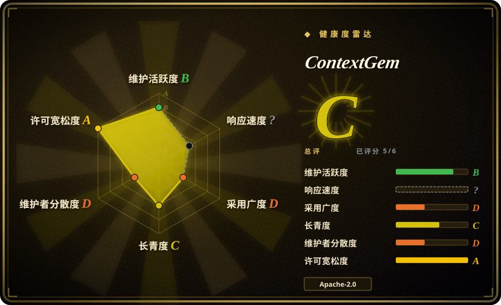
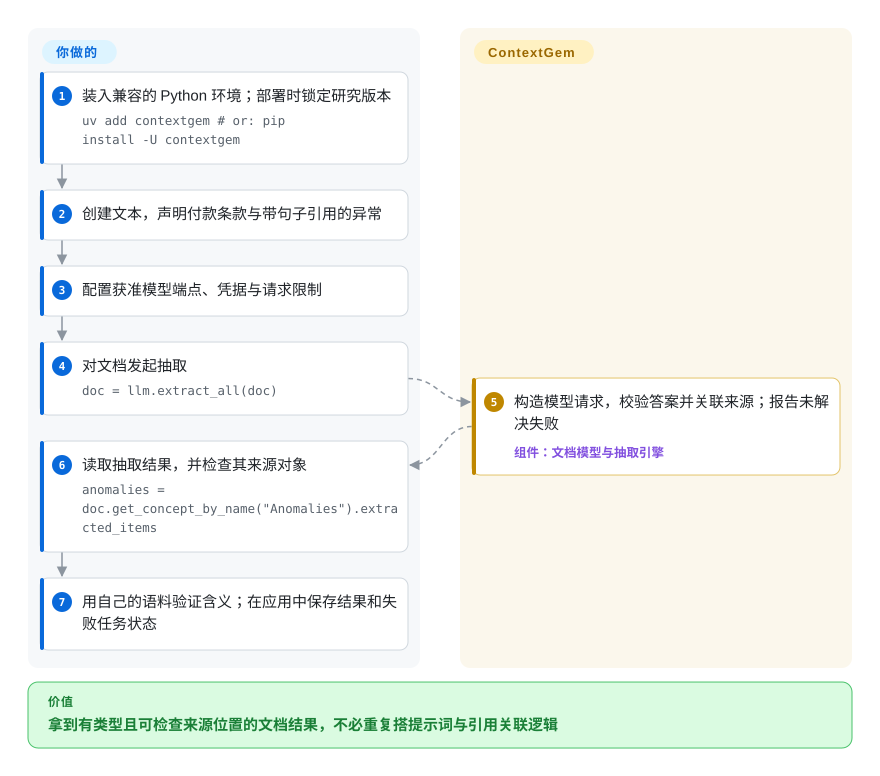
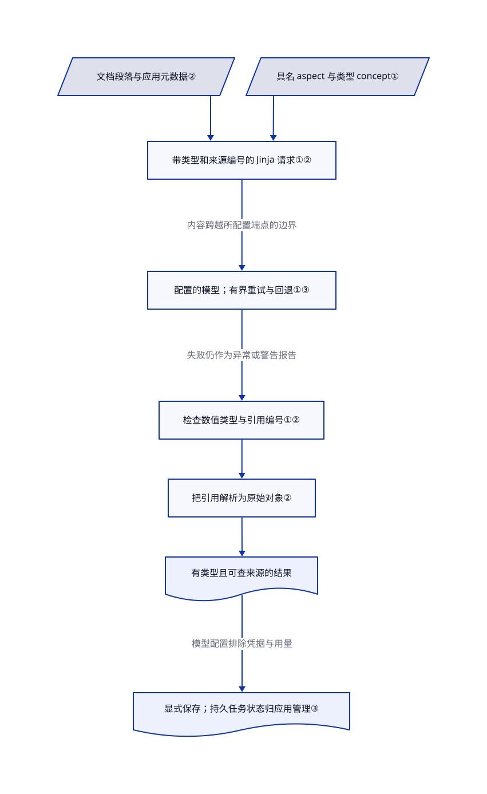

# ContextGem

合同抽取器返回了预算，却说不清哪条原文支持它。ContextGem 把具名抽取要求变成模型请求，校验类型，并可附上原始段落或句子供人检查。

## 何时使用

你在为工作说明书、合同或政策搭建 Python 受理任务。每份文档都要给出同一套项目资料、付款条款或异常清单，审查者还要能打开依据段落。现有模型调用能返回看似合理的 JSON，但每个字段都要自写提示词、校验器和来源匹配代码。希望声明可复用的 **aspect**（相关段落）与 **concept**（有类型的数值或结论），让库处理提示词、结果检查和来源对象关联时，选 ContextGem。

你仍需选模型、批准数据外发、定义抽取含义，并用自己的文档评估结果。它做语义抽取，不是 PDF 布局解析器，也不是检索索引。难点是文件转换时先用 Docling；转换后要回答“哪些条款涉及付款、具体怎么约定、答案来自哪里”，再用 ContextGem。

## 何时不用

- **你只需要阅读顺序、表格或 OCR。** 选 [Docling](docling.zh.md)。ContextGem 可通过可选扩展接收 Docling 文档，但模型语义抽取是额外一步，不能替代可靠的输入转换。
- **你要的是 RAG 的有类型元素与按章节切块，不是业务字段。** 选 [unstructured](unstructured.zh.md)。它的元素模型服务于摄取；ContextGem 则为具名 aspect 和 concept 消耗模型请求。
- **你要建立可搜索的语料问答。** 选 [LlamaIndex](../agent-frameworks/workflow-builders/llamaindex.zh.md)。ContextGem 把抽取结果放进文档对象，不提供那套索引、检索器和查询引擎链路。
- **字段遵循稳定的确定性规则。** 用正则或现有解析器，加普通数据校验。固定模板中的精确编号，不值得引入生成请求、重试和模型提供商依赖。
- **你要求引用证明事实正确。** 用确定性原文检查与领域验收，重要决策再加人工审查。ContextGem 校验引用编号与数据形状，不证明被引段落在逻辑上支持推断结果；图像 concept 明确不允许来源引用。
- **你不能向边界外发送文档。** 选并验证获准的本地端点，或用本地确定性解析器。云端抽取通过 LiteLLM 向配置的提供商发送文本，可能还发图像；回退模型也是新增接收方，不是隐私中性的恢复选项。
- **你要持久批任务队列与恰好一次结果。** 加应用自己的任务库、检查点和幂等写入，或用已有调度器。ContextGem 为进程内重试保留已完成分块，也能序列化结果，但不是崩溃可恢复的任务服务。
- **你的预算规则把未知价格当零费用。** 先补模型价格，或把 `UnknownPricesWarning` 升级成预算错误。文档说明未知价格时估算费用仍是零；重试和回退请求却照样消耗提供商额度。

## 横向对比

| 替代品 | 是否收录 | 我们的评价 | 取舍 |
| --- | --- | --- | --- |
| [Docling](docling.zh.md) | 已收录 | 重建文件布局和文本时选 Docling；从文本提取领域数值与相关段落时选 ContextGem。 | 两者常可配合。ContextGem 的 Docling 扩展增加语义抽取、模型账单和另一层待验收逻辑。 |
| [unstructured](unstructured.zh.md) | 已收录 | 混合文件要转有类型元素并切块，选 unstructured；要具名概念、有类型答案与可选来源对象引用，选 ContextGem。 | 文档结构元素不等于合同付款条款。ContextGem 增加模型解释，不只是统一内容块。 |
| [LlamaIndex](../agent-frameworks/workflow-builders/llamaindex.zh.md) | 已收录 | 要语料索引与检索时提问，选 LlamaIndex；要把同一抽取结构逐份用于文档，选 ContextGem。 | 检索基础设施和集成广度，对比更窄的声明式抽取 API。生成引用和类型有效，都不能替代答案评估。 |

## 快速上手

研究版本为 `1.4.1`，要求 Python `>=3.11,<3.15`。文档安装方式是 `uv add contextgem`，或 `pip install -U contextgem`；真实部署应锁定研究版本。需要文件转换集成时才加 `contextgem[docling]`。本轮未安装或执行任一路径。

先拿允许外发的文本。[完整开发者样例](https://github.com/shcherbak-ai/contextgem/blob/90974fbb78f71a48274a67018721b00b0070568f/dev/usage_examples/docs/quickstart/quickstart_concept_document_text.py#L10-L65) 先建 `Document`，再用 Python 字段类型字典定义 `JsonObjectConcept(name="Project Details", ...)`，启用段落引用，调用 `doc.add_concepts([doc_concept])`。然后用提供商、模型和从环境变量读取的密钥配置 `DocumentLLM`；`llm.extract_concepts_from_document(doc)` 返回抽取概念。读取其 `extracted_items`，或按名称找文档中的副本，不读原始 concept 对象，因为分配时会复制抽取定义。

下图则沿用 README 的合同样例，抽付款段落与带句子引用的异常。你提供输入、抽取描述、密钥或本地端点、速率限制与审查标准；ContextGem 提供请求构造、类型解析与引用解析。用序列化 API 保存所需结果，在应用中记录失败任务；向下游业务系统写入之前，还要验证答案含义。

卸载前先停止或取消**应用任务**，移除 Python 包不是任务取消机制。保存所需结果后，通过环境的包管理器移除库。另行检查序列化文档、应用日志与备份、下载的 SaT 或可选 Docling 模型缓存、自营模型服务，以及提供商留存。模型序列化会排除凭据，但文档导出仍含原文与抽取结果。所读源码没有记载通用清除、回滚或提供商擦除操作；卸载不能撤回已完成请求，也不能恢复已覆盖的业务数据。

<!-- flow-steps:begin (generated from flows/contextgem.json by tools/flow_card.py — do not edit) -->

流程文字版

1. **你**：装入兼容的 Python 环境；部署时锁定研究版本 — `uv add contextgem             # or: pip install -U contextgem`
2. **你**：创建文本，声明付款条款与带句子引用的异常
3. **你**：配置获准模型端点、凭据与请求限制
4. **你**：对文档发起抽取 — `doc = llm.extract_all(doc)`
5. **ContextGem**：构造模型请求，校验答案并关联来源；报告未解决失败 — 组件：`文档模型与抽取引擎`
6. **你**：读取抽取结果，并检查其来源对象 — `anomalies = doc.get_concept_by_name("Anomalies").extracted_items`
7. **你**：用自己的语料验证含义；在应用中保存结果和失败任务状态

**价值**：拿到有类型且可检查来源位置的文档结果，不必重复搭提示词与引用关联逻辑

<!-- flow-steps:end -->

## 技术要点

<!-- mechanism:begin (generated from mechanisms/contextgem.json by tools/mechanism_card.py; do not edit) -->

机制文字版

- 文档段落与应用元数据②
- 具名 aspect 与类型 concept①
- 带类型和来源编号的 Jinja 请求①②
- 配置的模型；有界重试与回退①③
- 检查数值类型与引用编号①②
- 把引用解析为原始对象②
- 有类型且可查来源的结果
- 显式保存；持久任务状态归应用管理③

- 文档段落与应用元数据② → 带类型和来源编号的 Jinja 请求①②
- 具名 aspect 与类型 concept① → 带类型和来源编号的 Jinja 请求①②
- 带类型和来源编号的 Jinja 请求①② → 配置的模型；有界重试与回退①③（内容跨越所配置端点的边界）
- 配置的模型；有界重试与回退①③ → 检查数值类型与引用编号①②（失败仍作为异常或警告报告）
- 检查数值类型与引用编号①② → 把引用解析为原始对象②
- 把引用解析为原始对象② → 有类型且可查来源的结果
- 有类型且可查来源的结果 → 显式保存；持久任务状态归应用管理③（模型配置排除凭据与用量）

<!-- mechanism:end -->

### 1. 从类型要求生成抽取请求

- **解决：** 每个业务字段都重复写提示词、输出模型和解析器，容易让抽取行为不一致。
- **做法：** concept 声明名称、描述和输出类型。JSON 对象 concept 把结构格式化进 Jinja 提示词，并动态创建 Pydantic 校验器检查返回值。模板带概念编号、类型规则和可选证据字段；LLM 适配器再通过 `litellm.acompletion` 把渲染消息发往所选端点，并传入凭据。
- **边界：** 形状校验不是事实检查。模板允许推断值，布尔规则还区分否定与证据不足，这都需要自己的语料评估。库的 Apache 许可不授权文档外发，也不授予所选模型或 API 服务的使用权。
- **源码：** [类型结构与校验](https://github.com/shcherbak-ai/contextgem/blob/90974fbb78f71a48274a67018721b00b0070568f/contextgem/internal/base/concepts.py#L478-L556)、[提示词要求](https://github.com/shcherbak-ai/contextgem/blob/90974fbb78f71a48274a67018721b00b0070568f/contextgem/internal/prompts/extract_concept_items.j2#L137-L194)、[字段与来源输入](https://github.com/shcherbak-ai/contextgem/blob/90974fbb78f71a48274a67018721b00b0070568f/contextgem/internal/prompts/extract_concept_items.j2#L355-L474)、[提供商调用](https://github.com/shcherbak-ai/contextgem/blob/90974fbb78f71a48274a67018721b00b0070568f/contextgem/internal/base/llms.py#L1765-L1805)。

### 2. 把引用编号解析为原始文档对象

- **解决：** 用模型引用的文字反查文档，会混淆重复条款，也容易丢失应用记录编号。
- **做法：** 提示词给段落和可选句子编号。返回编号经解析后，对照当前分块检查，并按稳定对象编号去重；成功的结果直接持有原始段落或句子对象。应用可把记录元数据放进 `custom_data`，通过引用对象取回；反序列化文档再按唯一编号把引用副本连回原对象。
- **边界：** 编号有效只确定位置，不证明该处支持答案。段落与句子粒度会改变请求，句子切分可能下载 SaT 模型；图像 concept 会拒绝引用，而不是捏造坐标。保留文档自己的编号，不要按重复文本关联。
- **源码：** [引用校验与映射](https://github.com/shcherbak-ai/contextgem/blob/90974fbb78f71a48274a67018721b00b0070568f/contextgem/internal/base/models.py#L2896-L3044)、[引用重连](https://github.com/shcherbak-ai/contextgem/blob/90974fbb78f71a48274a67018721b00b0070568f/contextgem/internal/base/documents.py#L69-L101)、[图像限制](https://github.com/shcherbak-ai/contextgem/blob/90974fbb78f71a48274a67018721b00b0070568f/contextgem/internal/base/concepts.py#L142-L155)、[元数据与定义副本](https://github.com/shcherbak-ai/contextgem/blob/90974fbb78f71a48274a67018721b00b0070568f/docs/source/before_you_build.rst#L9-L10)。

### 3. 分开传输重试、无效答案与持久状态

- **解决：** 答案格式错误、提供商故障与进程崩溃，需要不同的恢复和费用记账方式。
- **做法：** 适配器用有上限的退避与抖动重试临时 API 错误，非临时错误直接抛出。抽取引擎另行重试无效或被拒答案，再试配置的回退模型；内存中的部分结果让这次重试不必重发之前已有效的分块。文档可显式序列化结果与处理标记；模型导出则排除凭据及用量、费用统计。
- **边界：** 默认每个模型允许三次无效数据重试，另有独立传输重试，需配置预算与接收方。抑制抽取异常只会产生警告，不代表得到有效答案。已处理组件再次抽取会被拒绝，除非明确覆盖；序列化不是自动检查点或恰好一次恢复。重启后要主动恢复凭据、端点和应用任务状态。
- **源码：** [API 重试策略](https://github.com/shcherbak-ai/contextgem/blob/90974fbb78f71a48274a67018721b00b0070568f/contextgem/internal/base/llms.py#L1725-L1805)、[进程内分块状态](https://github.com/shcherbak-ai/contextgem/blob/90974fbb78f71a48274a67018721b00b0070568f/contextgem/internal/base/models.py#L2460-L2476)、[无效答案与回退重试](https://github.com/shcherbak-ai/contextgem/blob/90974fbb78f71a48274a67018721b00b0070568f/contextgem/internal/base/models.py#L3361-L3438)、[已处理状态检查](https://github.com/shcherbak-ai/contextgem/blob/90974fbb78f71a48274a67018721b00b0070568f/contextgem/internal/base/models.py#L1674-L1701)、[持久化与凭据排除](https://github.com/shcherbak-ai/contextgem/blob/90974fbb78f71a48274a67018721b00b0070568f/docs/source/serialization.rst#L20-L65)、[默认值与异常行为](https://github.com/shcherbak-ai/contextgem/blob/90974fbb78f71a48274a67018721b00b0070568f/docs/source/before_you_build.rst#L11-L14)。

## 技术栈

- **Python API：** `Document`、`Aspect`、有类型的 concept、抽取流水线、`DocumentLLM`、决策模型与模型组；公开外观类暴露内部实现。这是进程内库，不是托管文档服务。
- **校验与生成：** Pydantic v2、fastjsonschema、Jinja2；有类型的值、段落和句子对象、可选理由组成结果模型。
- **模型传输与运行：** LiteLLM、OpenAI 客户端、异步请求与 aiolimiter 速率限制。本地端点仍需单独运营模型服务；决策模型是封闭问题的可选集成，不证明其概率在你的数据上已校准。

## 依赖

- **环境：** Python `>=3.11,<3.15`；清单锁定 LiteLLM `1.105.2`、OpenAI `2.54.0`、genai-prices `0.1.13`。这是研究时的依赖要求，不是对传递依赖的全面认证。
- **模型访问：** 提供获准的提供商凭据或本地端点，回退模型也需要授权。权重、推理费用、API 条款和留存均独立于 ContextGem 许可。
- **切分：** 按需调用 wtpsplit-lite 与 ONNX SaT 句段切分，首次使用可能从 Hugging Face 下载模型。简单按换行分段是默认值。
- **可选转换：** `docling` 扩展安装 Docling 与 docling-core；所选转换路径还会带模型、OCR 和系统依赖，以及各自许可义务。只抽现有文本时不需要该扩展。

## 运维难度

**库驱动的生产任务为中等。** 不需要 ContextGem 专属数据库或服务，但任务持久化、下游幂等写入、原文与结果留存、模型访问都归你管理。限制并发与每次请求的文档大小，区分拒答和空发现，显露未知价格，并用真实预算评估重试。离线使用需同时准备本地模型端点、切分与转换缓存；仅把抽取放本地，不保证隔离网运行。[安全政策](https://github.com/shcherbak-ai/contextgem/blob/90974fbb78f71a48274a67018721b00b0070568f/SECURITY.md#L30-L38) 列出价格和切分的公共数据请求；文档请求则发给配置的模型。

## 健康度与可持续性

- **维护，截至 2026-10-27：** 公开、非 fork、未归档。v1.4.1 于 10 月 26 日发布，研究 main 快照为 `90974fb`。[安全政策](https://github.com/shcherbak-ai/contextgem/blob/90974fbb78f71a48274a67018721b00b0070568f/SECURITY.md#L3-L17) 支持新的 1.x 发布，而不是为每个旧版补丁；0.x 已不维护。
- **治理与背景：** 由 Shcherbak AI AS 的 Sergii Shcherbak 开发，不是基金会项目。贡献需要签[贡献者协议](https://github.com/shcherbak-ai/contextgem/blob/90974fbb78f71a48274a67018721b00b0070568f/CONTRIBUTING.md#L9-L17)。评分器找到三名活跃贡献者，首位占提交的 98.9%，治理为 D。集中度与版本变化是风险，不是服务承诺。
- **年龄与采用：** 2024 年 10 月 11 日创建，746 天且仍活跃；Lindy 记录处于短到中等阶段，不是数十年生产验证。评分器记录上月 PyPI 下载 11,835 次，采用为 D，下载不等于独立部署。综合 C，六轴中五轴有分；维护 B、长期性 C、治理 D、许可 A，响应度未知。星标与包采用量均不衡量领域准确性。
- **许可与来源：** 真实 [LICENSE](https://github.com/shcherbak-ai/contextgem/blob/90974fbb78f71a48274a67018721b00b0070568f/LICENSE#L69-L154) 为 Apache-2.0，与包元数据和 [NOTICE](https://github.com/shcherbak-ai/contextgem/blob/90974fbb78f71a48274a67018721b00b0070568f/NOTICE#L1-L17) 一致。声明另列借用测试样本和依赖，不能据此认定核心代码复制。再分发需保留必要许可与声明；该授权不会重新许可第三方模型、可选 CUDA 组件或托管服务。
- **质量与供应链信号：** 源码有校验、属性测试与录制响应流程，但有测试不等于准确性实测。清单锁定部分 SDK，并为开发锁文件记载新发布冷却期；这不强制消费者的新安装使用同一锁文件。依赖许可报告属于上游分析，不是本页执行的法律审计。

## 存疑（未验证）

- [未验证：本轮禁止执行、安装与模型下载] 没有做抽取、引用准确率、拒答恢复、性能或费用实验。样例与测试是所读源码，不是本轮运行证据。
- [未验证：没有独立语料评估] README 的可靠性、速度与模型选型描述属于上游陈述；本页没有建立任何领域的准确率改善或置信度校准证据。
- [未验证：只审部分请求路径，未审计全部传递依赖与端点] 上游声明不收集遥测，但本轮不认证 LiteLLM、提供商的全部行为或离线能力。提供商条款、留存与凭据需要另审。
- [未验证：未做卸载、取消或恢复实验] 应用任务、序列化文档、日志备份和模型缓存需要分别清理；没有建立通用清除或恢复保证。
