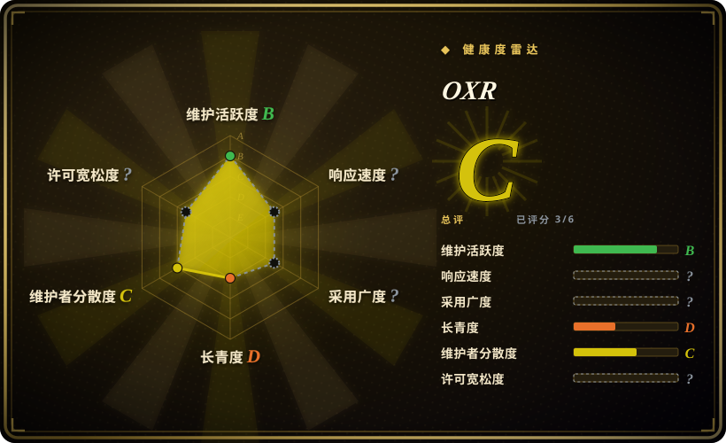
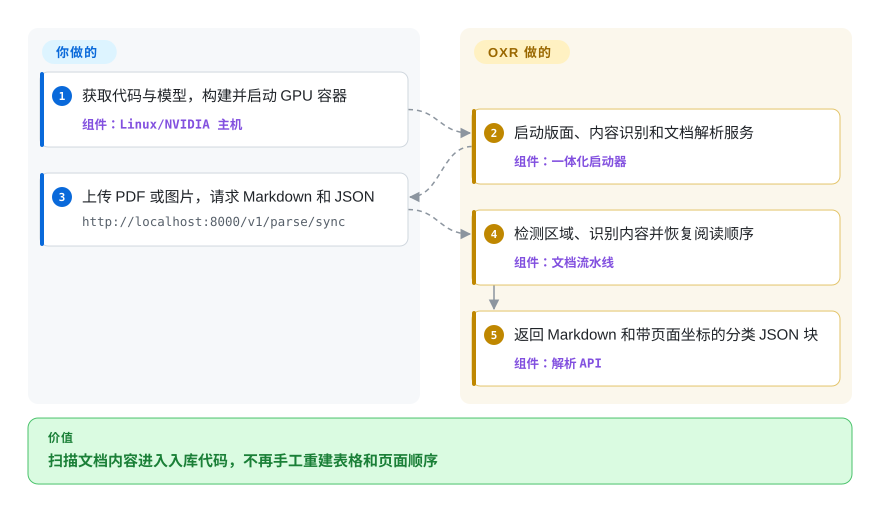
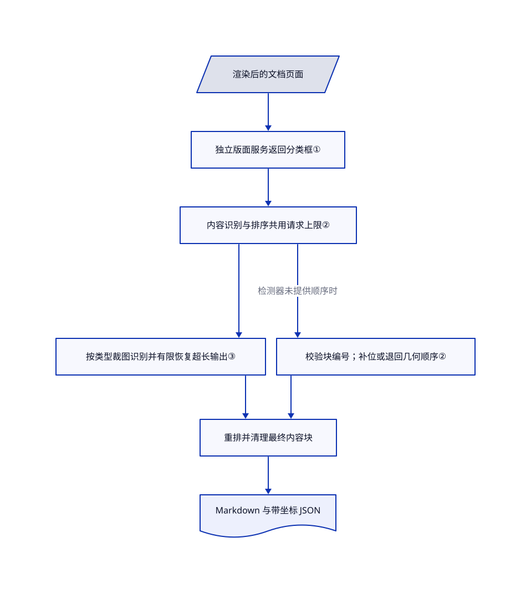

# OXR

扫描化学论文转成文字后，表格散了，公式坏了，两栏内容串到一起。OXR 先单独找出版面区域，再识别内容和阅读顺序，输出 Markdown 与带坐标的 JSON。

## 何时使用

你在做科研 PDF 或文档图片的内部入库服务。两栏论文被抽成交错句子，公式只剩标点，表格单元格也丢了。你想独立调整区域检测器，同时让一个 OXR 模型服务负责内容识别和阅读顺序。相比 Docling 的 Office 格式覆盖，或 PaddleOCR 的多种 OCR 流水线，你更看重这个可替换的版面边界与分类识别路径。

选用前先过许可和基础设施两道关，不要先看榜单。你需要接受自定义商业限制，并维护 Linux/NVIDIA 模型服务。它解析 PDF 和图片，不是通用文件转换器、检索引擎，也没有交付宣传中的自我改进训练闭环。

## 何时不用

- **你需要不受门槛限制的商用，或要做竞争性托管解析 API。** 优先考虑 [Docling](../docling.zh.md) 或 [PaddleOCR](../../ocr/paddleocr.zh.md)，并另查所选模型的许可。[OXR 许可](https://github.com/SoMarkAI/OXR/blob/62fbca8ef6c7c63b75b799fc8081f3eb6e667553/LICENSE#L9-L46)规定，合并口径累计融资或年收入超过 200 万美元，就要另取商业许可。竞争性文档／OCR 托管 API 无论规模都须事先取得书面授权，对外在线服务还须显著署名。这是源码可见许可，不是原样的 Apache-2.0。
- **你只有 CPU，或要直接处理 Office 文件。** 混合 Office/PDF 入库选 [Docling](../docling.zh.md)。OXR 的本地文档要求 Linux、支持 BF16 的 NVIDIA GPU、兼容 CUDA 13 的驱动；低并发起步标为 24 GB 显存，长文档或更高并发推荐至少 48 GB。
- **你需要持久化、多进程共享的批处理队列。** 大规模语料工作流可看 [olmOCR](olmocr.zh.md)，同时考虑其已记录的维护停滞。OXR 异步任务放在进程内存中，重启会丢状态，多个 API worker 也不共享任务。生产任务需另配持久化调度层。
- **你要逐词坐标，不是区域坐标。** 评估 [PaddleOCR](../../ocr/paddleocr.zh.md) 及其识别粒度选项。OXR 输出的是版面块坐标；[issue #4](https://github.com/SoMarkAI/OXR/issues/4) 仍在请求逐词框，核验时尚无回复。
- **你想买托管生产保障。** 有支持承诺的托管解析服务是另一种采购，不要拿 OXR 免费演示 API 替代。README 明说不保证生产稳定性。若数据要留在本地，且不想依赖演示服务，优先自托管 [Docling](../docling.zh.md)。

## 横向对比

| 替代品 | 是否收录 | 我们的评价 | 取舍 |
|---|---|---|---|
| [Docling](../docling.zh.md) | ✅ | 混合 Office/PDF 或 CPU 部署选 Docling；只有独立替换区域检测器值得一套专用 GPU 服务时，才选 OXR。 | Docling 的文档模型与格式更广；OXR 聚焦 PDF／图片识别，并显式拆出版面服务边界。 |
| [PaddleOCR](../../ocr/paddleocr.zh.md) | ✅ | 文本检测、多语言 OCR 和多种文档流水线选 PaddleOCR；要聚焦检测器加识别器，并显式处理阅读顺序，才考虑 OXR。 | PaddleOCR 的模型与后端选择更多；OXR 拓扑较集中，但增加自定义许可和单独安装的 vLLM 插件。 |
| [olmOCR](olmocr.zh.md) | ✅ | 工作目录／S3 语料任务选 olmOCR；要 HTTP 返回分类区域和坐标，且能自建持久化任务层时选 OXR。 | olmOCR 自带语料编排，但索引记录其上游自 2026 年 3 月起安静；OXR 最近活跃，却还没有长期运维履历。 |

## 快速上手

获取代码与完整 OXR-1.0 模型目录，在文档要求的 Linux/NVIDIA 主机上按 README 构建并启动 Docker。权重目录带版面模型和 vLLM 插件；该插件负责向模型服务引擎注册 OXR，运行下载的模型代码前应锁定代码提交与模型版本。容器会一起启动版面、内容识别和解析 API 三个服务。向 `http://localhost:8000/v1/parse/sync` 提交 PDF 或图片，填写 `file`、`api_key=dummy`，并用重复的 `output_formats` 字段请求 `markdown` 和 `json`，响应会返回结构化内容。你负责 GPU 容量、许可核准、网络隔离与结果验收；OXR 负责页面渲染、识别、排序和序列化。本页核对了这些用法的源码，但没有实际安装或运行推理。

用法来源：[README 本地部署与请求示例](https://github.com/SoMarkAI/OXR/blob/62fbca8ef6c7c63b75b799fc8081f3eb6e667553/README.md#L166-L278)。

<!-- flow-steps:begin (generated from flows/oxr.json by tools/flow_card.py — do not edit) -->

流程文字版

1. **你**：获取代码与模型，构建并启动 GPU 容器 — 组件：`Linux/NVIDIA 主机`
2. **OXR**：启动版面、内容识别和文档解析服务 — 组件：`一体化启动器`
3. **你**：上传 PDF 或图片，请求 Markdown 和 JSON — `http://localhost:8000/v1/parse/sync`
4. **OXR**：检测区域、识别内容并恢复阅读顺序 — 组件：`文档流水线`
5. **OXR**：返回 Markdown 和带页面坐标的分类 JSON 块 — 组件：`解析 API`

**价值**：扫描文档内容进入入库代码，不再手工重建表格和页面顺序

<!-- flow-steps:end -->

## 技术要点

<!-- mechanism:begin (generated from mechanisms/oxr.json by tools/mechanism_card.py; do not edit) -->

机制文字版

- 渲染后的文档页面
- 独立版面服务返回分类框①
- 内容识别与排序共用请求上限②
- 按类型裁图识别并有限恢复超长输出③
- 校验块编号；补位或退回几何顺序②
- 重排并清理最终内容块
- Markdown 与带坐标 JSON

- 渲染后的文档页面 → 独立版面服务返回分类框①
- 独立版面服务返回分类框① → 内容识别与排序共用请求上限②
- 内容识别与排序共用请求上限② → 按类型裁图识别并有限恢复超长输出③
- 内容识别与排序共用请求上限② → 校验块编号；补位或退回几何顺序②（检测器未提供顺序时）
- 按类型裁图识别并有限恢复超长输出③ → 重排并清理最终内容块
- 校验块编号；补位或退回几何顺序② → 重排并清理最终内容块
- 重排并清理最终内容块 → Markdown 与带坐标 JSON

<!-- mechanism:end -->

### 1. 把区域检测与内容识别拆开

- **解决：** 不同业务要调整区域边界，不应被迫替换整套识别组件。
- **做法：** 独立 HTTP 版面客户端批量发送页面图片，将检测结果转换成分类块。编排层再把这些块交给识别；如果检测器声明已提供阅读顺序，就跳过 OXR 的排序请求。
- **边界：** 替换检测器要满足响应契约和类别映射，改个 URL 不会自动兼容任意格式。默认会过滤页眉、页脚，除非主动请求保留。
- **源码：** [版面批处理](https://github.com/SoMarkAI/OXR/blob/62fbca8ef6c7c63b75b799fc8081f3eb6e667553/oxr/pipeline/layout.py#L14-L93)、[版面客户端](https://github.com/SoMarkAI/OXR/blob/62fbca8ef6c7c63b75b799fc8081f3eb6e667553/oxr/model/layout_client.py)、[编排逻辑](https://github.com/SoMarkAI/OXR/blob/62fbca8ef6c7c63b75b799fc8081f3eb6e667553/oxr/pipeline/orchestrator.py#L136-L180)。

### 2. 共用推理额度，并校验阅读顺序

- **解决：** 区域识别与页面排序同时请求同一模型，可能挤爆服务，或漏掉内容块。
- **做法：** 两类任务并行运行，共用客户端的信号量，也就是同时请求数上限。排序结果必须恰好包含全部块编号；少量遗漏用 XY-Cut++ 几何顺序补位，异常排序重试耗尽后还可退回整页几何排序。
- **边界：** 几何排序只是回退，不证明语义正确。网络调用失败在重试后仍会抛出流水线错误，不保证每次模型失败都能返回结果。
- **源码：** [共享限流](https://github.com/SoMarkAI/OXR/blob/62fbca8ef6c7c63b75b799fc8081f3eb6e667553/oxr/model/client.py#L76-L89)、[并行任务](https://github.com/SoMarkAI/OXR/blob/62fbca8ef6c7c63b75b799fc8081f3eb6e667553/oxr/pipeline/orchestrator.py#L156-L180)、[校验与回退](https://github.com/SoMarkAI/OXR/blob/62fbca8ef6c7c63b75b799fc8081f3eb6e667553/oxr/pipeline/reading_order.py#L47-L280)。

### 3. 按类型识别裁图，并有限恢复超长输出

- **解决：** 表格、公式和正文要用不同输出指令，长内容还可能触及生成长度上限。
- **做法：** 对每个检测区域裁图，分别选正文、表格、公式、代码或化学结构提示词。遇到长度终止，表格缩为原图的 75% 后重试，正文类提高重复惩罚后重试；再按类型执行后处理。
- **边界：** 恢复后仍触及上限，代码可能保留截断内容，部分类型没有恢复路径。可选的表格图片还原失败时可能返回图片，而不是可编辑表格；入库前要看警告并验收结果。
- **源码：** [分流与长度恢复](https://github.com/SoMarkAI/OXR/blob/62fbca8ef6c7c63b75b799fc8081f3eb6e667553/oxr/pipeline/recognition.py#L70-L218)、[分类提示词](https://github.com/SoMarkAI/OXR/blob/62fbca8ef6c7c63b75b799fc8081f3eb6e667553/oxr/model/prompts.py)。

## 技术栈

- Python 编排，使用 FastAPI/Uvicorn、Typer 命令行、Pydantic 配置、HTTPX 和兼容 OpenAI 协议的模型客户端。
- SoPDF 把 PDF 渲染成图片，OpenCV 处理图片与裁图。内置版面模型来自 D-FINE；内容识别和阅读顺序由 OXR 负责。
- vLLM 通过独立插件加载另行下载的 OXR 权重。模型仓库包含自定义配置和模型代码，启动器启用 `--trust-remote-code`。
- JSON 包含页面尺寸、分类块和坐标；Markdown 包含正文、LaTeX 公式、表格与图片引用。公开推理源码没有交付宣传中的 RSI 后训练系统。

## 依赖

- **主机：** 文档指定 Linux/NVIDIA BF16 环境、兼容 CUDA 13 的驱动；推荐容器路径还需要 Docker GPU 支持。基础包允许 Python 3.10+，支持的模型插件实际要求 Python 3.12+。
- **模型运行时：** vLLM `0.25.1`、Transformers `5.13.1`，文档运行环境为 PyTorch `2.11.0+cu130`。代码启动器、插件和模型版本要配套，不能只升级其中一项。
- **模型产物：** OXR-1.0 权重、自定义模型与插件代码，以及 `layout_analysis/last.pth` 和对应元数据。[代码许可](https://github.com/SoMarkAI/OXR/blob/62fbca8ef6c7c63b75b799fc8081f3eb6e667553/LICENSE)与[模型许可](https://huggingface.co/SoMarkAI/OXR-1.0/blob/520bed7e90f8f4ffa110db47bdb64d5cf80ccfba/LICENSE)都含 OXR 自定义限制。
- **服务拓扑：** 解析 API 用 8000 端口，OXR 用 8080，版面分析用 8081。示例配置将模型地址指向本机；改成其他主机，就可能把文档图片发往该主机。不需要数据库，[异步任务状态存内存](https://github.com/SoMarkAI/OXR/blob/62fbca8ef6c7c63b75b799fc8081f3eb6e667553/oxr/server/queue/memory_store.py#L17-L50)。

## 运维难度

**生产服务为高。** 一体容器简化了启动，没有解决 GPU 容量、模型与运行时配套升级、任务持久化。已读路由接收占位 API key，却不验证它；不要直接对公网开放，应自配认证、请求限制和 TLS 网关。下载的模型代码具有模型服务进程权限，应审查并锁版本，隔离运行时，不挂载凭据。演示缓存默认一小时失效，异步任务状态也无法跨进程重启保留。[推断：难度来自已读拓扑和生命周期，未进行部署实测。]

## 健康度与可持续性

- **自动雷达，2026-10-22：** C，仅测得六轴中的三轴。响应轴报告 `type_na`，采用轴为 `no_package_structural`，许可轴为 `license_unparsed`。这些是结构性测量缺口，不是网络请求失败，也不证明许可安全；下文许可判断来自实际阅读两份许可文件。
- **维护，截至 2026-10-22：** GitHub 仓库创建于 2026-10-05，未归档，默认分支最新提交为 2026-10-19。无 GitHub release 或 tag；包版本是 `0.1.0`，模型名为 OXR-1.0。应锁定提交，而非假定已有稳定发布渠道。
- **治理与背书：** SoMarkAI 组织持有，版权署 SoMark Team，可见贡献者两名。已读树中没有治理文件、安全政策或贡献指南。路线由供应商主导，没有已记录的基金会治理。
- **年龄与采用：** 公开 GitHub 历史仅 17 天，102 星、10 fork。模型 API 在核验时报告 88 次下载；这些数字不证明生产采用。[推断：近期活跃是正面信号，但 17 天历史几乎不能提供持续维护的林迪证据。]
- **响应：** 2026-10-21 创建的 issue #4 仍开放，评论为零。可见三条 PR 已合并，但一条新 issue 未获回复，不足以推导支持响应常态。
- **许可风险：** 标识应为 `LicenseRef-OXR`，不能只写 Apache-2.0。融资／收入门槛、署名义务与托管竞争限制直接影响选型，自动雷达不能替代阅读具体条款。

## 存疑（未验证）

- [未验证：本次收录未获准运行 GPU 推理、安装包或执行模型。] 没有复现准确率、吞吐、显存下限，也没有测试未见文档集。作者的[评测协议](https://github.com/SoMarkAI/OXR/blob/62fbca8ef6c7c63b75b799fc8081f3eb6e667553/docs/benchmark.md#L105-L117)用了 96 GB RTX PRO 6000，不能把速度数字直接套到 24 GB 显卡。
- [推断：依据是三服务拓扑、内存任务、未验证的 API key 字段和可执行模型插件。] 生产运维成本较高；本页不是安全审计，也不证明所有下载产物都安全。
- [推断：依据是创建日期、近期提交、两名可见贡献者以及尚无 GitHub 发布。] 供应商长期投入和持续维护仍缺证据，短期历史不构成林迪优势。
