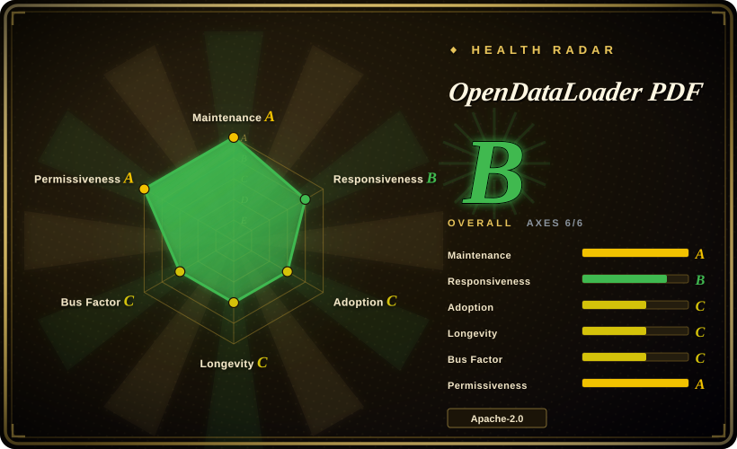
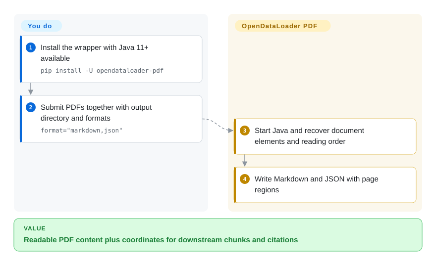
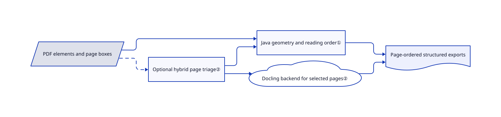

# OpenDataLoader PDF

Your PDF text arrives in interleaved columns, and a retrieved answer cannot point back to its page region. OpenDataLoader PDF exports ordered Markdown and coordinate-bearing JSON, with a Java fast path and optional model-backed page processing.

## When to use

You build a PDF ingestion job and need both readable text and page coordinates for source highlighting. Most documents have a usable text layer, but some contain scans or complex tables. Choose OpenDataLoader when a CPU-only Java baseline plus selective Docling processing fits better than running a model over every page. It also writes Tagged PDFs, useful when a downstream accessibility workflow needs a starting structure rather than only extracted text.

## When NOT to use

- **Your corpus is mostly Office, HTML or email.** Choose [MarkItDown](markitdown.md) for lightweight conversion or [Docling](docling.md) for richer multi-format structures; this project accepts PDFs, not a general Office corpus.
- **You cannot ship Java.** Choose [Docling](docling.md) or another Python-native pipeline. The Python package is a wrapper around the Java CLI, not a JVM-free implementation.
- **Scans need OCR but you want only the base package.** Use [Marker](model-backed-pdf/marker.md), after reviewing its weight terms, or enable this project's hybrid extra/server. The fast Java path is not the advertised model-backed OCR path.
- **Free auto-tagging must equal certified PDF/UA export.** Do not equate them. Use a separately validated remediation workflow or budget the project's enterprise add-on; PDF/UA export and the accessibility studio are outside the free core.
- **You expect parsing to make PDF instructions trustworthy.** Keep a sandbox and instruction/data separation around any parser, including [Docling](docling.md). Hidden-text filtering cannot rule out visible malicious instructions.

## Comparison

| Alternative | In index | Our verdict | Tradeoff |
|---|---|---|---|
| [Docling](docling.md) | ✅ | Pick Docling directly for a unified multi-format model pipeline; pick OpenDataLoader for a Java PDF baseline, coordinate exports and Tagged PDF output. | OpenDataLoader's hybrid mode itself uses Docling, so these are partly composable rather than competing independent models. |
| [MarkItDown](markitdown.md) | ✅ | Pick MarkItDown for light mixed-format Markdown conversion; pick OpenDataLoader when PDF geometry and reading order are selection requirements. | No mandatory JVM versus PDF-specific structure and a heavier runtime. |
| [Marker](model-backed-pdf/marker.md) | ✅ | Pick Marker for an existing PDF/OCR workflow with its model stack; pick OpenDataLoader for a Java fast path and a separately enabled Docling backend. | Both need corpus tests; compare deployment and model-weight terms rather than vendor headline rankings. |

## Quick start

Provide Java 11+ and Python 3.10+, then install `pip install -U opendataloader-pdf`. Pass all input files or folders to one `opendataloader_pdf.convert(...)` call with `output_dir` and `format="markdown,json"`; each call starts a JVM process, so one call per page wastes startup work. The converter writes files; you still choose chunking, indexing and citation mapping. For scans, install the hybrid extra, start `opendataloader-pdf-hybrid --port 5002 --force-ocr`, and select `hybrid="docling-fast"` in conversion. You own the backend address, model downloads, document-data boundary, resource limits and sample-based output checks.

<!-- flow-steps:begin (generated from flows/opendataloader-pdf.json by tools/flow_card.py — do not edit) -->

Text version of the flow

1. **You**: Install the wrapper with Java 11+ available — `pip install -U opendataloader-pdf`
2. **You**: Submit PDFs together with output directory and formats — `format="markdown,json"`
3. **OpenDataLoader PDF**: Start Java and recover document elements and reading order
4. **OpenDataLoader PDF**: Write Markdown and JSON with page regions

**Value**: Readable PDF content plus coordinates for downstream chunks and citations

<!-- flow-steps:end -->

## Key techniques

<!-- mechanism:begin (generated from mechanisms/opendataloader-pdf.json by tools/mechanism_card.py; do not edit) -->

Text version of the mechanism

- PDF elements and page boxes
- Optional hybrid page triage②
- Java geometry and reading order①
- Docling backend for selected pages②
- Page-ordered structured exports

- PDF elements and page boxes → Java geometry and reading order①
- PDF elements and page boxes → Optional hybrid page triage② [optional/fallback]
- Optional hybrid page triage② → Java geometry and reading order①
- Optional hybrid page triage② → Docling backend for selected pages②
- Java geometry and reading order① → Page-ordered structured exports
- Docling backend for selected pages② → Page-ordered structured exports

<!-- mechanism:end -->

### 1. Reconstruct order from page geometry

- **Problem:** Sorting text only by vertical position interleaves multiple columns.
- **How:** The XY-Cut++ implementation filters objects lacking boxes, chooses a split-axis preference from density, recursively segments regions and merges any identified cross-layout objects. Output objects retain geometry for source mapping.
- **Limits:** The source calls this a simplified geometric implementation without semantic-type priorities. Its default cross-layout width multiplier is 2.0, effectively disabling that detection stage; do not infer perfect title/column handling from the algorithm name.
- **Source:** [Sorter implementation and defaults](https://github.com/opendataloader-project/opendataloader-pdf/blob/7f5d574cefe5e92868af0a86851bd52d480eb7b7/java/opendataloader-pdf-core/src/main/java/org/opendataloader/pdf/processors/readingorder/XYCutPlusPlusSorter.java#L25-L185).

### 2. Route selected pages through a model backend

- **Problem:** Running expensive layout/OCR processing on every clean digital page wastes work.
- **How:** Hybrid processing filters content, triages pages into Java or backend paths, sends backend pages in chunks and merges page-order results. It checks backend availability first; Java fallback requires the configured fallback option.
- **Limits:** Triage may miss difficult regions; full mode trades selectivity for more inference. Static “last run” metadata is overwritten across calls, so concurrent callers cannot treat it as isolated per-document telemetry. Issue #803 reports dropped nested Docling groups.
- **Source:** [Routing, availability and metadata contract](https://github.com/opendataloader-project/opendataloader-pdf/blob/7f5d574cefe5e92868af0a86851bd52d480eb7b7/java/opendataloader-pdf-core/src/main/java/org/opendataloader/pdf/processors/HybridDocumentProcessor.java#L70-L260), [triage](https://github.com/opendataloader-project/opendataloader-pdf/blob/7f5d574cefe5e92868af0a86851bd52d480eb7b7/java/opendataloader-pdf-core/src/main/java/org/opendataloader/pdf/hybrid/TriageProcessor.java).

## Tech stack

Java 11 core and CLI using veraPDF WCAG algorithms, PDFBox, Jackson and OkHttp. Python and Node wrappers expose batch conversion. The optional Python backend uses Docling/EasyOCR, FastAPI and Uvicorn; an MCP package is also present.

## Dependencies

- Java runtime 11+; Python wrapper requires Python 3.10+ and has no base Python runtime dependencies in its manifest, but includes a Java artifact.
- Hybrid adds model packages/downloads and a reachable backend server. CPU operation is supported; OCR engine choices may require Tesseract, platform libraries or CUDA separately.
- Writable output/temp storage. Java source builds resolve veraPDF artifacts from the declared Open Preservation repository, not only Maven Central.

## Ops difficulty

**Low to medium locally; medium as an ingestion service.** Batch the JVM wrapper calls. Hybrid operation adds model installation, a server and resource controls; picture descriptions can serialize expensive inference. Keep services private and enforce upload limits before the parser, since a conversion-work limit does not itself bound upload bandwidth. Inspect representative pages, tables and output coordinates before trusting a corpus run.

## Health & viability

- **2026-10-18 — active release train.** v2.5.13 shipped 2026-10-13, following releases on October 1 and September 22. Source is already 2.5.14-SNAPSHOT; distinguish unreleased fixes from the published package.
- **Backing and governance.** NOTICE names Hancom, Inc.; the contributor snapshot includes several substantial human contributors. This is vendor-backed, not proof of independent foundation governance.
- **Age and Lindy.** Created 2025-05-13, about seventeen months old and still active. More history than a launch-week demo, but not a decades-tested PDF stack by itself.
- **Licensing and product split.** Apache-2.0 from 2.0 onward, earlier versions MPL-2.0. Free extraction/auto-tagging coexist with enterprise PDF/UA export and editing. Open issues #801/#803 identify structure-tree and hybrid edge cases worth including in corpus acceptance tests.

## Caveats (unverified)

- [未验证] No upstream conversion or benchmark was run. README accuracy/speed rankings are first-party claims, not independent evidence used for this recommendation.
- [未验证] No OCR or accessibility validator was run. OCR quality, auto-tagging usefulness and PDF/UA conformance need document-specific tests; tagging is not a compliance certificate.
- [推断] Based on vendor attribution and enterprise feature boundaries, roadmap priorities may follow Hancom's commercial services; the current Apache core does not guarantee future product parity.
