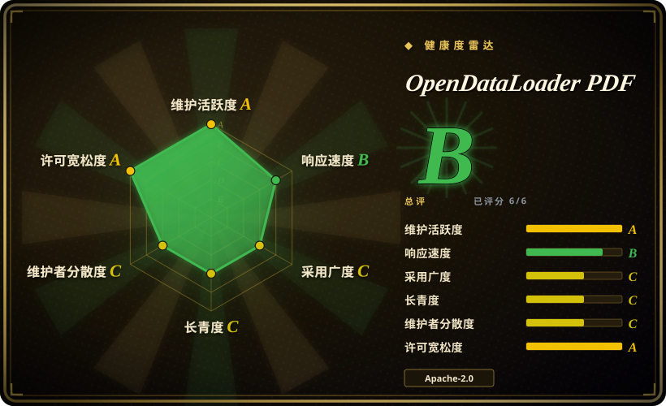
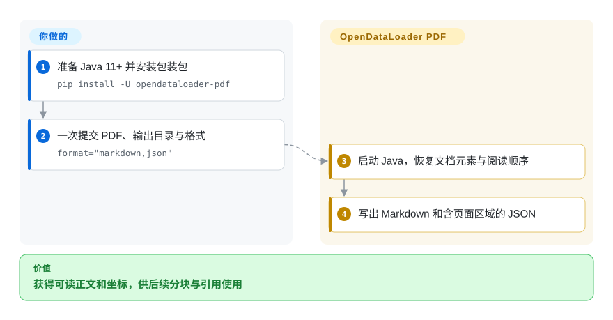
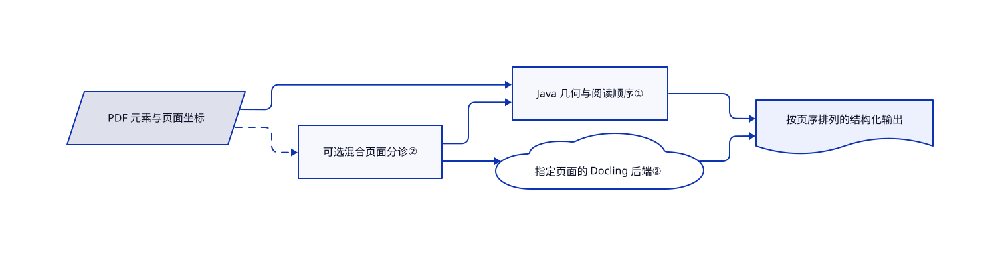

# OpenDataLoader PDF

PDF 两栏文字混在一起，检索答案又无法指回原页区域。OpenDataLoader PDF 导出有序 Markdown 和带坐标 JSON，普通页面走 Java，复杂页面可交模型后端。

## 何时使用

你在做 PDF 入库任务，既要可读正文，也要坐标以高亮答案出处。多数文档有可用文本层，少数含扫描页或复杂表格。CPU Java 基线加选择性 Docling 处理，比每页都跑模型更符合你的部署约束时，考虑本项目。它还可以生成带结构标签的 PDF，给后续无障碍修复提供起点，而不只是抽取文字。

## 何时不用

- **资料主要是 Office、HTML 或邮件。** 轻量转换选 [MarkItDown](markitdown.zh.md)，丰富多格式结构选 [Docling](docling.zh.md)；本项目只接收 PDF。
- **不能部署 Java。** 选 [Docling](docling.zh.md) 等 Python 原生管线。Python 包是 Java 命令行包装，不是免 JVM 实现。
- **扫描件要识字，却只想装基础包。** 可评估 [Marker](model-backed-pdf/marker.zh.md) 并审查权重条款，或启用本项目混合扩展和服务。Java 快速路径不是宣传中的模型识字路径。
- **免费自动标签必须等于 PDF/UA 合规导出。** 两者不能等同。采用独立验证的修复流程，或预算项目企业扩展；PDF/UA 导出和可视化修复台不属于免费核心。
- **期待解析后 PDF 指令就可信。** 对包括 [Docling](docling.zh.md) 在内的解析器都保留沙箱和指令、数据隔离。隐藏文字过滤不能排除可见恶意指令。

## 横向对比

| 替代品 | 是否收录 | 我们的评价 | 取舍 |
|---|---|---|---|
| [Docling](docling.zh.md) | ✅ | 统一多格式模型管线选 Docling；Java PDF 基线、坐标导出和标签 PDF 输出选本项目。 | 混合模式本身就使用 Docling，两者部分可组合，不是完全独立的竞争模型。 |
| [MarkItDown](markitdown.zh.md) | ✅ | 轻量多格式 Markdown 转换选 MarkItDown；PDF 几何和阅读顺序是硬条件时选本项目。 | 免强制 JVM，或用较重运行时换取 PDF 专用结构。 |
| [Marker](model-backed-pdf/marker.zh.md) | ✅ | 已有 PDF 识字模型体系可选 Marker；需要 Java 快速路径和独立启用的 Docling 后端时选本项目。 | 两者都需语料测试，应比较部署与权重条款，不照抄厂商排名。 |

## 快速上手

准备 Java 11+ 和 Python 3.10+，运行 `pip install -U opendataloader-pdf`。把全部文件或目录交给一次 `opendataloader_pdf.convert(...)`，指定 `output_dir` 和 `format="markdown,json"`；每次调用都会启动 JVM，不宜逐页反复调用。转换器输出文件，分块、建索引和引用映射仍由你负责。扫描件需安装混合扩展，启动 `opendataloader-pdf-hybrid --port 5002 --force-ocr`，转换时选 `hybrid="docling-fast"`。你负责后端地址、模型下载、文档数据边界、资源限额和抽样检查。

<!-- flow-steps:begin (generated from flows/opendataloader-pdf.json by tools/flow_card.py — do not edit) -->

流程文字版

1. **你**：准备 Java 11+ 并安装包装包 — `pip install -U opendataloader-pdf`
2. **你**：一次提交 PDF、输出目录与格式 — `format="markdown,json"`
3. **OpenDataLoader PDF**：启动 Java，恢复文档元素与阅读顺序
4. **OpenDataLoader PDF**：写出 Markdown 和含页面区域的 JSON

**价值**：获得可读正文和坐标，供后续分块与引用使用

<!-- flow-steps:end -->

## 技术要点

<!-- mechanism:begin (generated from mechanisms/opendataloader-pdf.json by tools/mechanism_card.py; do not edit) -->

机制文字版

- PDF 元素与页面坐标
- 可选混合页面分诊②
- Java 几何与阅读顺序①
- 指定页面的 Docling 后端②
- 按页序排列的结构化输出

- PDF 元素与页面坐标 → Java 几何与阅读顺序①
- PDF 元素与页面坐标 → 可选混合页面分诊②〔可选／兜底〕
- 可选混合页面分诊② → Java 几何与阅读顺序①
- 可选混合页面分诊② → 指定页面的 Docling 后端②
- Java 几何与阅读顺序① → 按页序排列的结构化输出
- 指定页面的 Docling 后端② → 按页序排列的结构化输出

<!-- mechanism:end -->

### 1. 用页面几何恢复阅读顺序

- **解决：** 只按纵坐标排文字，会把多栏内容交错拼接。
- **做法：** XY-Cut++ 实现先过滤无坐标对象，根据密度选择切分轴，再递归分区，最后合并识别出的跨布局对象。结果对象保留几何信息，支持回指原文。
- **边界：** 源码明确称其为不含语义类型优先级的简化几何实现。默认跨布局宽度倍数为 2.0，实际上禁用了该检测阶段，不能凭算法名保证标题与分栏完美。
- **源码：** [排序器与默认参数](https://github.com/opendataloader-project/opendataloader-pdf/blob/7f5d574cefe5e92868af0a86851bd52d480eb7b7/java/opendataloader-pdf-core/src/main/java/org/opendataloader/pdf/processors/readingorder/XYCutPlusPlusSorter.java#L25-L185)。

### 2. 选择页面送模型后端

- **解决：** 干净的电子页面没必要全部承担布局模型与识字开销。
- **做法：** 混合处理先过滤内容，再将页面分到 Java 或后端路径，分块发送后端页面并按页序合并。开始前先检查后端可用性，只有配置回退选项才会降到 Java。
- **边界：** 分诊可能漏掉复杂区域，全量模式则增加推理。静态“最近一次运行”元数据会被后续调用覆盖，并发调用不能把它当独立文档遥测。#803 报告嵌套 Docling 分组内容丢失。
- **源码：** [路由、可用性与元数据契约](https://github.com/opendataloader-project/opendataloader-pdf/blob/7f5d574cefe5e92868af0a86851bd52d480eb7b7/java/opendataloader-pdf-core/src/main/java/org/opendataloader/pdf/processors/HybridDocumentProcessor.java#L70-L260)、[页面分诊](https://github.com/opendataloader-project/opendataloader-pdf/blob/7f5d574cefe5e92868af0a86851bd52d480eb7b7/java/opendataloader-pdf-core/src/main/java/org/opendataloader/pdf/hybrid/TriageProcessor.java)。

## 技术栈

Java 11 核心与命令行，使用 veraPDF 无障碍算法、PDFBox、Jackson 和 OkHttp。Python、Node 包装提供批量转换。可选 Python 后端使用 Docling、EasyOCR、FastAPI 和 Uvicorn，仓库另有 MCP 包。

## 依赖

- Java 11+；Python 包要求 Python 3.10+，清单没有基础 Python 运行依赖，但包含 Java 构件。
- 混合模式增加模型包、模型下载和可达后端服务。支持 CPU，具体识字引擎可能另需 Tesseract、平台库或 CUDA。
- 可写输出与临时目录。Java 源码构建除 Maven Central，还从声明的 Open Preservation 仓库解析 veraPDF 构件。

## 运维难度

**本地低到中，入库服务为中。** 合并 JVM 包装调用。混合模式要管理模型、服务和资源；图片描述推理可能串行占用很长时间。服务保持私有，并在解析器之前设上传限制，因为转换工作量限制不能单独限制上传带宽。跑全库之前，检查代表性页面、表格与坐标。

## 健康度与可持续性

- **2026-10-18：持续发版。** v2.5.13 发布于 2026-10-13，之前为十月一日和九月二十二日。源码已是 2.5.14-SNAPSHOT，未发布修复不能当成安装包已有行为。
- **背书与治理。** NOTICE 署名 Hancom，贡献快照有多位实质贡献者。属于厂商支持，不代表独立基金会治理。
- **年龄与林迪判断。** 创建于 2025-05-13，约十七个月且仍活跃，比首发演示更有积累，但本项目本身并非几十年验证过的 PDF 栈。
- **许可与产品划分。** 2.0 起 Apache-2.0，此前 MPL-2.0。免费抽取、自动标签与企业 PDF/UA 导出、编辑并存。#801、#803 的结构树、混合路径边界适合进入语料验收样本。

## 存疑（未验证）

- [未验证：未执行上游转换与基准] README 准确率和速度排名来自第一方基准，本次推荐不以其为独立证据。
- [未验证：未运行识字与无障碍验证器] 识字质量、自动标签效果和 PDF/UA 合规须用你的文档测试，打标签不是合规证书。
- [推断：依据是厂商署名与企业功能划分] 长期路线可能跟随 Hancom 商业服务，当前 Apache 核心不保证未来产品层级功能一致。
