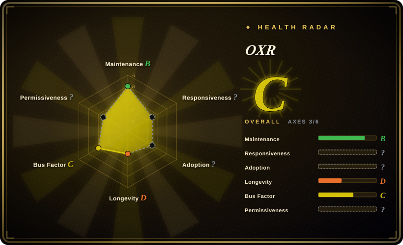
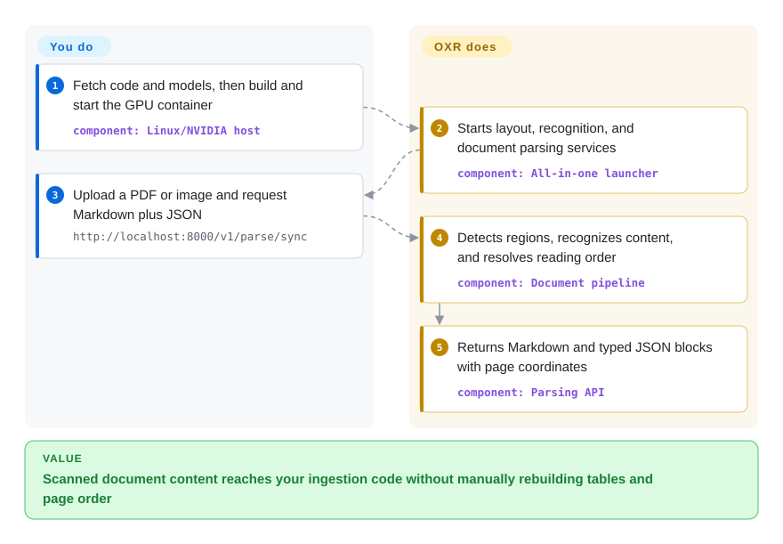
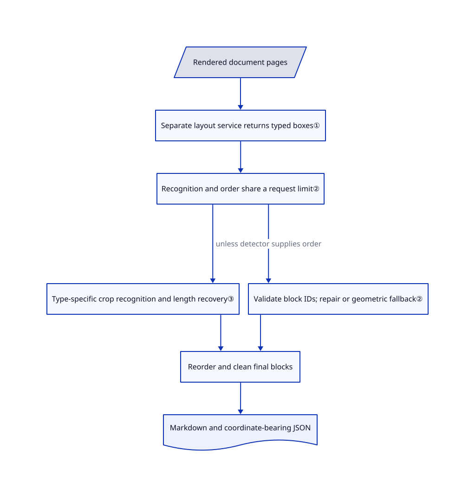

# OXR

Your scanned chemistry paper loses table cells, equations, and column order during text extraction. OXR detects page regions separately, then recognizes their contents and reading order into Markdown and coordinate-bearing JSON.

## When to use

You build an internal document-ingestion service for scientific PDFs or document images. A two-column page becomes interleaved sentences, a formula becomes plain punctuation, and a table's cells disappear. You want separate control over region detection while keeping recognition and reading order on one OXR model service. Choose OXR when this replaceable layout boundary and typed recognition matter more than Docling's broader Office-file support or PaddleOCR's larger catalogue of OCR pipelines.

The adoption gate is permission and infrastructure, not the README's leaderboard claim. You must accept its custom commercial restrictions and operate Linux/NVIDIA model services. This is a PDF/image parser, not a general file converter, retrieval engine, or reproduction of the advertised self-improvement training loop.

## When NOT to use

- **You need unrestricted commercial use or a competing hosted parser.** Prefer [Docling](docling.md) or [PaddleOCR](../ocr/paddleocr.md), after checking the selected model licenses. The [OXR license](https://github.com/SoMarkAI/OXR/blob/62fbca8ef6c7c63b75b799fc8081f3eb6e667553/LICENSE#L9-L46) requires a separate license if consolidated funding or annual revenue exceeds USD 2 million. A competing hosted document/OCR API needs written authorization regardless of size, and third-party online services must display attribution. This is source-available licensing, not unmodified Apache-2.0.
- **You have only a CPU or need Office formats directly.** Choose [Docling](docling.md) for mixed Office/PDF ingestion. OXR's documented local stack requires Linux, a BF16-capable NVIDIA GPU, a CUDA-13-compatible driver, and 24 GB GPU memory for initial low-concurrency trials; the recommendation rises to at least 48 GB for longer documents or higher concurrency.
- **You need a durable multi-worker batch queue.** Consider [olmOCR](olmocr.md) for corpus-oriented workspace/S3 processing, while accounting for its documented maintenance lull. OXR's async task store is process-local memory; a restart loses task state, and several API workers do not share it. Build durable scheduling outside OXR before relying on it for production jobs.
- **You need word-level boxes rather than region boxes.** Evaluate [PaddleOCR](../ocr/paddleocr.md) and its recognition-granularity options. OXR emits layout-block coordinates; [issue #4](https://github.com/SoMarkAI/OXR/issues/4) requests word-level boxes and had no response at verification time.
- **You want a managed production guarantee.** A supported hosted parser is a different purchase; do not substitute OXR's free demo API. Its README explicitly disclaims production stability. Prefer self-hosted [Docling](docling.md) when keeping document data local and avoiding that demo dependency matters most.

## Comparison

| Alternative | In index | Our verdict | Tradeoff |
|---|---|---|---|
| [Docling](docling.md) | ✅ | Pick Docling for mixed Office/PDF inputs or CPU deployment; pick OXR when independently replacing the region detector is worth a specialized GPU service stack. | Docling offers a broader document model and format surface; OXR concentrates on PDF/image recognition and exposes a distinct layout-service boundary. |
| [PaddleOCR](../ocr/paddleocr.md) | ✅ | Pick PaddleOCR for text spotting, multilingual OCR, and a choice of document pipelines; pick OXR for a focused detector-plus-recognizer architecture with explicit reading-order handling. | PaddleOCR brings a larger model/backend matrix; OXR narrows the topology but adds a custom license and a separately installed vLLM plugin. |
| [olmOCR](olmocr.md) | ✅ | Pick olmOCR for workspace/S3 corpus jobs; pick OXR for an HTTP parser returning typed regions and coordinates, provided you supply durable job handling. | olmOCR has corpus-oriented orchestration but the indexed upstream has been quiet since March 2026; OXR is newly active and lacks that operational track record. |

## Quick start

Fetch the code and complete OXR-1.0 model directory, then use the README's Docker build/run path on the documented Linux/NVIDIA host. The weights include the layout checkpoint and the vLLM plugin, which registers OXR with the model-serving engine; pin both the code commit and model revision before running downloaded model code. The container starts the layout service, recognition service, and parsing API together. Send a PDF or image to `http://localhost:8000/v1/parse/sync` with `file`, `api_key=dummy`, and repeated `output_formats` fields for `markdown` and `json`; receive structured content in the response. You supply GPU capacity, license clearance, network isolation, and output validation; OXR performs page rendering, recognition, ordering, and serialization. These are source-verified instructions, not an installation or inference run performed for this page.

Usage source: [README local deployment and request example](https://github.com/SoMarkAI/OXR/blob/62fbca8ef6c7c63b75b799fc8081f3eb6e667553/README.md#L166-L278).

<!-- flow-steps:begin (generated from flows/oxr.json by tools/flow_card.py — do not edit) -->

Text version of the flow

1. **You**: Fetch code and models, then build and start the GPU container — component: `Linux/NVIDIA host`
2. **OXR**: Starts layout, recognition, and document parsing services — component: `All-in-one launcher`
3. **You**: Upload a PDF or image and request Markdown plus JSON — `http://localhost:8000/v1/parse/sync`
4. **OXR**: Detects regions, recognizes content, and resolves reading order — component: `Document pipeline`
5. **OXR**: Returns Markdown and typed JSON blocks with page coordinates — component: `Parsing API`

**Value**: Scanned document content reaches your ingestion code without manually rebuilding tables and page order

<!-- flow-steps:end -->

## Key techniques

<!-- mechanism:begin (generated from mechanisms/oxr.json by tools/mechanism_card.py; do not edit) -->

Text version of the mechanism

- Rendered document pages
- Separate layout service returns typed boxes①
- Recognition and order share a request limit②
- Type-specific crop recognition and length recovery③
- Validate block IDs; repair or geometric fallback②
- Reorder and clean final blocks
- Markdown and coordinate-bearing JSON

- Rendered document pages → Separate layout service returns typed boxes①
- Separate layout service returns typed boxes① → Recognition and order share a request limit②
- Recognition and order share a request limit② → Type-specific crop recognition and length recovery③
- Recognition and order share a request limit② → Validate block IDs; repair or geometric fallback② (unless detector supplies order)
- Type-specific crop recognition and length recovery③ → Reorder and clean final blocks
- Validate block IDs; repair or geometric fallback② → Reorder and clean final blocks
- Reorder and clean final blocks → Markdown and coordinate-bearing JSON

<!-- mechanism:end -->

### 1. Separate region detection from content recognition

- **Problem:** Changing a domain's region boundaries should not require replacing every recognition component.
- **How:** A dedicated HTTP layout client batches page images and converts detector output into typed blocks. The orchestrator then sends those blocks to recognition; if the detector declares that it already supplies reading order, OXR skips its own ordering request.
- **Limits:** A replacement detector must match the layout response contract and class mapping; setting another URL alone does not adapt arbitrary output. Defaults filter headers and footers unless requested.
- **Source:** [Layout batches](https://github.com/SoMarkAI/OXR/blob/62fbca8ef6c7c63b75b799fc8081f3eb6e667553/oxr/pipeline/layout.py#L14-L93), [layout client](https://github.com/SoMarkAI/OXR/blob/62fbca8ef6c7c63b75b799fc8081f3eb6e667553/oxr/model/layout_client.py), [orchestration](https://github.com/SoMarkAI/OXR/blob/62fbca8ef6c7c63b75b799fc8081f3eb6e667553/oxr/pipeline/orchestrator.py#L136-L180).

### 2. Share one inference budget and validate the returned order

- **Problem:** Simultaneous region recognition and page-order requests can overload the same model or silently omit blocks.
- **How:** Both tasks run concurrently behind the model client's shared semaphore, a limit on simultaneous requests. Reading-order output must be a permutation of block IDs; small omissions are inserted using XY-Cut++ geometry, while exhausted malformed-order retries can fall back to the full geometric order.
- **Limits:** Geometry is a fallback, not proof of correct semantic order. Transport failures still raise a pipeline error after retries; the fallback is not a guarantee that every failed model call produces output.
- **Source:** [Shared limiter](https://github.com/SoMarkAI/OXR/blob/62fbca8ef6c7c63b75b799fc8081f3eb6e667553/oxr/model/client.py#L76-L89), [concurrent tasks](https://github.com/SoMarkAI/OXR/blob/62fbca8ef6c7c63b75b799fc8081f3eb6e667553/oxr/pipeline/orchestrator.py#L156-L180), [validation and fallback](https://github.com/SoMarkAI/OXR/blob/62fbca8ef6c7c63b75b799fc8081f3eb6e667553/oxr/pipeline/reading_order.py#L47-L280).

### 3. Route each crop by type, with bounded length recovery

- **Problem:** Tables, equations, and text need different output instructions, and long generations can hit a token ceiling.
- **How:** Recognition crops each detected region and selects a text, table, formula, code, or chemical-structure prompt. On a length stop, tables retry at 75% image scale and text-like blocks retry with a stronger repetition penalty; each type then has its own postprocessor.
- **Limits:** The code can preserve truncated output after recovery still reaches the ceiling, and some types have no recovery. Optional table-image restoration can fall back to an image rather than editable table content; inspect warnings and validate outputs before ingestion.
- **Source:** [Routing and recovery](https://github.com/SoMarkAI/OXR/blob/62fbca8ef6c7c63b75b799fc8081f3eb6e667553/oxr/pipeline/recognition.py#L70-L218), [type prompts](https://github.com/SoMarkAI/OXR/blob/62fbca8ef6c7c63b75b799fc8081f3eb6e667553/oxr/model/prompts.py).

## Tech stack

- Python orchestration with FastAPI/Uvicorn, Typer CLI, Pydantic settings, HTTPX and an OpenAI-compatible model client.
- SoPDF rasterizes PDFs; OpenCV handles images and crops. D-FINE supplies the included layout detector; OXR performs recognition and reading-order prediction.
- vLLM serves the separately downloaded OXR weights through an out-of-tree plugin. The model repository contains custom configuration/model code; the launcher uses `--trust-remote-code`.
- JSON contains page sizes, typed blocks and coordinates; Markdown carries text, LaTeX formulas, tables, and image references. The public inference tree does not contain the advertised RSI post-training system.

## Dependencies

- **Host:** documented Linux/NVIDIA BF16 stack, CUDA 13.0-compatible driver, Docker GPU support for the recommended route. The package manifest allows Python 3.10+, but the supported model plugin requires Python 3.12+.
- **Model runtime:** vLLM `0.25.1`, Transformers `5.13.1`, with the documented PyTorch `2.11.0+cu130` environment. Keep the code launcher, plugin, and model revision matched rather than upgrading one independently.
- **Artifacts:** OXR-1.0 weights, custom model/plugin code, and `layout_analysis/last.pth` plus its metadata. Both the [code license](https://github.com/SoMarkAI/OXR/blob/62fbca8ef6c7c63b75b799fc8081f3eb6e667553/LICENSE) and [model license](https://huggingface.co/SoMarkAI/OXR-1.0/blob/520bed7e90f8f4ffa110db47bdb64d5cf80ccfba/LICENSE) contain the custom OXR restrictions.
- **Service topology:** parsing API on 8000, OXR on 8080, layout analysis on 8081. Example configuration points both model URLs at loopback; changing them can send document images to another host. No database is required; [async task state is in memory](https://github.com/SoMarkAI/OXR/blob/62fbca8ef6c7c63b75b799fc8081f3eb6e667553/oxr/server/queue/memory_store.py#L17-L50).

## Ops difficulty

**High for a production service.** The all-in-one image simplifies startup, but not GPU sizing, matched model/runtime upgrades, or durable task execution. The API accepts a dummy key without validating it in the reviewed routes, so put authentication, request limits, and TLS at your own gateway rather than exposing it directly. Downloaded model code runs with the model service's permissions; review and pin artifacts, isolate the runtime, and avoid mounting credentials. The demo cache expires after one hour by default, and async task state does not survive process restarts. [推断：the operations rating follows the reviewed topology and lifecycle, not a deployment trial.]

## Health & viability

- **Automated radar, 2026-10-22:** C with 3/6 axes scored. Responsiveness reports `type_na`, adoption reports `no_package_structural`, and license reports `license_unparsed`. These structural measurement gaps are not failing network calls or evidence of safe licensing; the license assessment below comes from reading both actual license files.
- **Maintenance, 2026-10-22:** created 2026-10-05, not archived, latest default-branch commit 2026-10-19. GitHub exposes no releases or tags; the package says `0.1.0` and model artifact says OXR-1.0. Pin revisions rather than expecting a stable release channel.
- **Governance and backing:** SoMarkAI organization ownership, SoMark Team copyright, and two visible contributors. No governance, security policy, or contributor guide appears in the reviewed tree. This is vendor-directed, not documented foundation governance.
- **Age and adoption:** only 17 days of public GitHub history, 102 stars and 10 forks. The model API reported 88 downloads at verification time; neither count establishes production adoption. [推断：recent activity is encouraging, but a 17-day project provides little Lindy evidence of continued maintenance.]
- **Responsiveness:** issue #4, opened 2026-10-21, remained open with zero comments. Three visible PRs were merged, but one recent unanswered issue is not enough to establish a support-response norm.
- **License risk:** `LicenseRef-OXR`, not Apache-2.0 alone. Revenue/funding thresholds, attribution, and the hosted-competition restriction apply to adoption; the automated radar does not replace reading those clauses.

## Caveats (unverified)

- [未验证：no GPU inference, package installation, or model execution was authorized for this intake.] Accuracy, throughput, GPU-memory sufficiency, and behavior on an unseen document corpus were not reproduced. The author's [benchmark protocol](https://github.com/SoMarkAI/OXR/blob/62fbca8ef6c7c63b75b799fc8081f3eb6e667553/docs/benchmark.md#L105-L117) used a 96 GB RTX PRO 6000; do not transfer its speed numbers to a 24 GB card.
- [推断：based on the three-service topology, in-memory jobs, unvalidated API-key field, and executable model plugin.] Production operations are high effort; this page is not a security audit or evidence that every download is safe.
- [推断：based on creation date, recent commits, two visible contributors, and no GitHub releases.] Long-term vendor commitment and maintenance continuity remain unproven; short public history does not establish a Lindy advantage.
