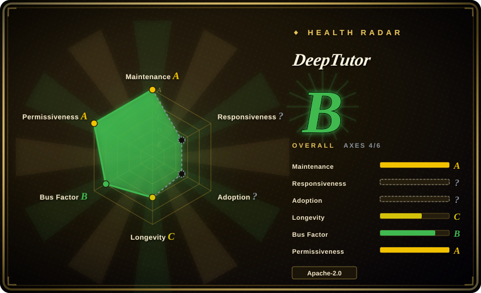
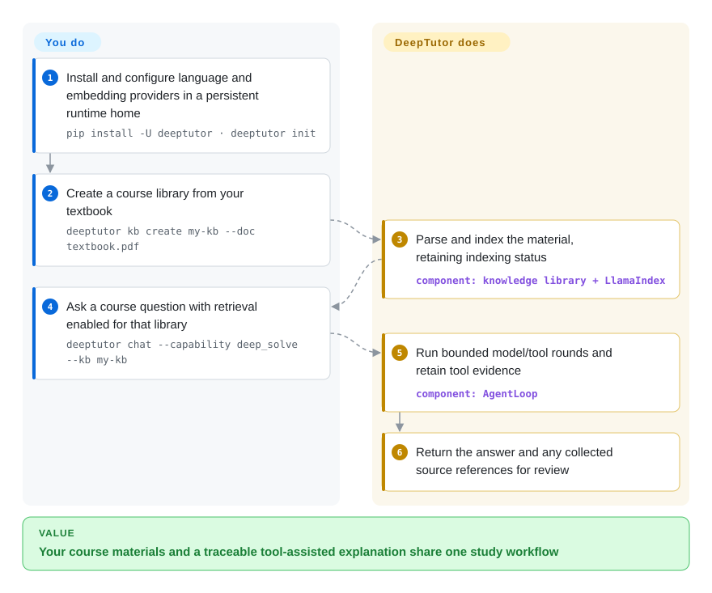

# DeepTutor

Your textbook, notes and practice questions sit in separate tabs, while a generic chatbot answers without looking at them. DeepTutor puts document libraries, tool-assisted answers and study workflows in one self-hosted learning workspace.

## When to use

You are studying a course from uploaded textbooks, asking why a derivation works and turning the same material into practice or reading sessions. Choose DeepTutor when document-grounded chat should live alongside course study, quizzes, reading and saved learning context, rather than building that product around a retrieval library. Its app/CLI and shared agent loop provide those surfaces; the model and retrieved material still determine answer quality.

## When NOT to use

- **You only need a shared chat front end over local models and files.** Choose [Open WebUI](../llm-chat-ui/open-webui.md); DeepTutor's course, practice, memory and tool surfaces add configuration you may not need.
- **You want to publish business workflows behind an API.** Choose [Dify](../agent-frameworks/workflow-builders/dify.md), subject to its license conditions, rather than adapting a learner-oriented product.
- **You need exact control over ingestion/retrieval and a small application surface.** Build with [LlamaIndex](../agent-frameworks/workflow-builders/llamaindex.md); DeepTutor's full package brings the Web/server/model/document stack, not just one query function.
- **Course materials must not leave your system.** Use locally hosted language/embedding models and local parsing, or a smaller local retrieval stack. Self-hosting the UI does not keep excerpts private when configured providers or parsing/search services are remote.
- **Correct grading, teaching efficacy or hostile multi-tenant isolation is a hard guarantee.** Use instructor-reviewed assessment and independently audited deployment controls. Workspace separation is useful, but account settings/credentials/memory remain shared between that account's workspaces, and some execution fallback is documented as best effort.

## Comparison

| Alternative | In index | Our verdict | Tradeoff |
|---|---|---|---|
| [Open WebUI](../llm-chat-ui/open-webui.md) | ✅ | Choose Open WebUI for a general local-model/document chat portal; choose DeepTutor when reading, practice and course study belong in the same workspace. | Less education-specific surface versus more learning workflow configuration; check Open WebUI's branding/license constraints. |
| [Dify](../agent-frameworks/workflow-builders/dify.md) | ✅ | Choose Dify to design and publish reusable business LLM apps; choose DeepTutor for the learner-facing study experience. | Canvas/API product delivery versus built-in study modes; Dify has its own hosting/license conditions. |
| [LlamaIndex](../agent-frameworks/workflow-builders/llamaindex.md) | ✅ | Choose LlamaIndex when engineers must own each retrieval stage; choose DeepTutor when a study app and CLI are more valuable than minimal integration code. | Fine-grained Python control versus a ready learning product; neither removes provider costs or factual validation. |

## Quick start

For the full local package, use Python `>=3.11,<3.15` and Node.js 20+, choose a persistent runtime-home folder, then follow [README:322–336](https://github.com/HKUDS/DeepTutor/blob/6cf793bd868ba5ecbe64722936d4be8fab5a01df/README.md#L322-L336): `pip install -U deeptutor`, `deeptutor init`, and `deeptutor start` for the Web app. Configure a language-model provider and an embedding provider — the latter turns text into numeric vectors for search — before indexing course material. The [documented CLI path](https://github.com/HKUDS/DeepTutor/blob/6cf793bd868ba5ecbe64722936d4be8fab5a01df/README.md#L531-L539) uses `deeptutor kb create my-kb --doc textbook.pdf` and `deeptutor chat --capability deep_solve --tool rag --kb my-kb`; RAG means retrieving passages to supply to the model. DeepTutor parses/indexes the file and runs a tool-assisted answer loop; you supply the material, provider credentials and question, inspect indexing status and verify the answer against its collected sources. You also own persistent data backups, model/embedding charges or local hardware, and any optional parser/search/tool services. Workspaces scope study data, not every account-level setting or memory, as [the workspace guide](https://github.com/HKUDS/DeepTutor/blob/6cf793bd868ba5ecbe64722936d4be8fab5a01df/docs-for-user/workspaces.md#L7-L19) explains.

<!-- flow-steps:begin (generated from flows/deeptutor.json by tools/flow_card.py — do not edit) -->

Text version of the flow

1. **You**: Install and configure language and embedding providers in a persistent runtime home — `pip install -U deeptutor · deeptutor init`
2. **You**: Create a course library from your textbook — `deeptutor kb create my-kb --doc textbook.pdf`
3. **DeepTutor**: Parse and index the material, retaining indexing status — component: `knowledge library + LlamaIndex`
4. **You**: Ask a course question with retrieval enabled for that library — `deeptutor chat --capability deep_solve --tool rag --kb my-kb`
5. **DeepTutor**: Run bounded model/tool rounds and retain tool evidence — component: `AgentLoop`
6. **DeepTutor**: Return the answer and any collected source references for review

**Value**: Your course materials and a traceable tool-assisted explanation share one study workflow

<!-- flow-steps:end -->

## Key techniques

- **Journal interrupted indexing instead of inventing completion.** [`indexing_run.py:85–162`](https://github.com/HKUDS/DeepTutor/blob/6cf793bd868ba5ecbe64722936d4be8fab5a01df/deeptutor/knowledge/indexing_run.py#L85-L162) validates durable run/cancellation records and projects a dead owner's pending work as unknown/interrupted. [`indexing_run.py:209–250`](https://github.com/HKUDS/DeepTutor/blob/6cf793bd868ba5ecbe64722936d4be8fab5a01df/deeptutor/knowledge/indexing_run.py#L209-L250) acquires a per-library OS lock before creating a new run. This makes indexing failure inspectable; interrupted uncheckpointed work still has to restart.
- **Read document inventory separately from semantic retrieval.** [`manifest.py:147–239`](https://github.com/HKUDS/DeepTutor/blob/6cf793bd868ba5ecbe64722936d4be8fab5a01df/deeptutor/knowledge/manifest.py#L147-L239) walks actual document roots, counts before truncating the displayed list and distinguishes missing/remote roots from zero documents. This helps answer “did I upload this file?” without guessing from similar passages; inventory is not proof that every file successfully entered the index.
- **Keep tools and their results in one bounded answer loop.** [`agent_loop.py:403–451`](https://github.com/HKUDS/DeepTutor/blob/6cf793bd868ba5ecbe64722936d4be8fab5a01df/deeptutor/agents/loop/agent_loop.py#L403-L451) applies exploration and settlement budgets; [`agent_loop.py:705–743`](https://github.com/HKUDS/DeepTutor/blob/6cf793bd868ba5ecbe64722936d4be8fab5a01df/deeptutor/agents/loop/agent_loop.py#L705-L743) dispatches requested tools, collects sources and feeds tool messages/user replies into later rounds. This connects retrieved evidence to the ongoing task, but bounds and traces do not guarantee a correct explanation or grade.

## Tech stack

- **Python backend/CLI:** FastAPI, Typer, Pydantic, provider SDKs and shared agent/capability runtimes; main `__version__.py` is 1.6.14.
- **Web:** TypeScript, Next.js 16 and React 19, served through the full package or container.
- **Retrieval/storage:** LlamaIndex with FAISS/BM25 integrations and multiple optional engine connectors; SQLite-backed local state and file-based indexes/settings. The manifest includes server, document and model libraries by default.

## Dependencies

- **Full local install:** Python 3.11–3.14 and Node.js 20+; source development recommends Node 22. Docker bundles the app runtime, but requires a persistent data volume. The separate source CLI-only package omits Web assets/server dependencies.
- **Working model configuration:** a language model for answers and embeddings for ordinary indexed document retrieval; remote providers need credentials and send relevant content outside the app host. Local models need the corresponding hardware/service.
- **Data and integrations:** preserve runtime home and workspace/index storage. Parsing engines, search, GraphRAG/LightRAG, external knowledge stores, speech and agent tools have their own optional packages/services; not every advertised connector is part of the base experience.

## Ops difficulty

**Medium to high.** One local app/container is easy to try, but a reliable course workspace needs provider setup, embedding/index compatibility, parser failure recovery and backups. Shared or remotely reachable deployment adds authentication, grants, network isolation and tool permissions. Do not expose a default trial as a hardened school service; the README distinguishes actual sandbox enforcement from a best-effort local subprocess fallback.

## Health & viability

- **Maintenance (2026-10-13):** unarchived HKUDS repository; default-branch commit and latest release v1.6.14 are from 2026-10-08. README release history shows frequent feature/fix updates, so pin and test upgrades rather than assuming stable behavior from the version number.
- **Machine profile:** overall B (5/6 scored axes); maintenance/responsiveness A, longevity C, governance B and license risk A. Responsiveness measured 29.9 hours across 32 qualifying issues. Adoption remains unknown because the scorer could not attribute a canonical package/install counter, not because no package exists.
- **Adoption / backing:** 41298 stars; PyPI exposes `deeptutor` 1.6.14, but its metadata has no project URLs and this run returned `no_package_structural`. The published package and stars establish availability/attention, not measured classroom use or efficacy.
- **Age / license:** created 2025-12-28, 289 days old; HKUDS ownership and a contributor base do not establish a multi-year support history. Apache-2.0 is verified from LICENSE and manifest. [推断：young age and frequent feature changes] Budget for integration churn and instructor review.

## Caveats (unverified)

- [未验证：no application/model/indexing run was performed] Installation, parser accuracy, generated answers and educational outcomes were checked only as source/API claims, not exercised with a course dataset.
- [未验证：scorer lacks attributable installation metrics] The existing adoption unknown persists despite a published PyPI package; this page does not infer usage from stars or replace the machine grade.
- [推断：289-day age and rapid release history] Its study/tool surface will need upgrade tests and sustained instructor oversight; account/workspace boundaries are not an independently audited isolation guarantee.
