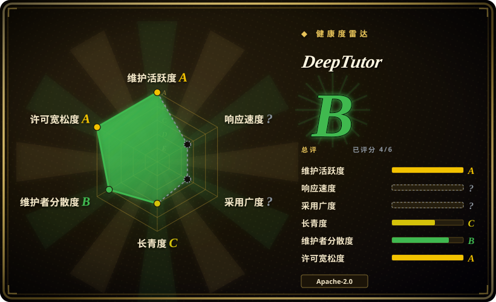
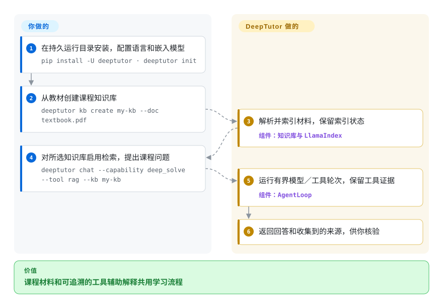
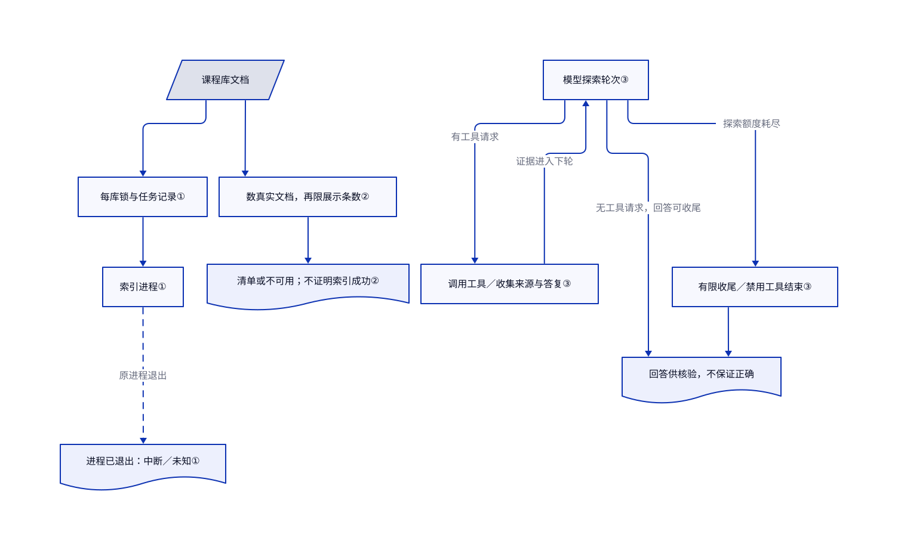

# DeepTutor

教材、笔记和练习散在不同窗口，普通聊天模型回答时又不看材料。DeepTutor 把文档库、工具辅助回答和学习流程放进同一个自托管工作区。

## 何时使用

你用上传教材学一门课，要问清推导为什么成立，还想用同一材料做练习或阅读。需要文档问答与课程、测验、阅读和学习上下文一起保存时，选 DeepTutor，而不是围绕检索库自建产品。它的应用／CLI 与共享智能体循环提供这些入口；回答质量仍取决于模型和找回的材料。

## 何时不用

- **你只要给本地模型和文件加共享聊天页面。** 用 [Open WebUI](../llm-chat-ui/open-webui.zh.md)；DeepTutor 的课程、练习、记忆和工具入口会增加不必要配置。
- **你要通过 API 发布业务流程。** 核对许可后用 [Dify](../agent-frameworks/workflow-builders/dify.zh.md)，而非改造学习者产品。
- **你要精确控制入库／检索，减少应用表面。** 用 [LlamaIndex](../agent-frameworks/workflow-builders/llamaindex.zh.md) 自建；DeepTutor 完整包带网页、服务、模型和文档栈，不只是一个查询函数。
- **课程材料不得外传。** 用自托管语言／嵌入模型与本地解析，或更小的本地检索栈。网页自托管不等于内容留在本地，远端模型、解析和搜索服务仍可能接收片段。
- **正确评分、教学效果或恶意多租户隔离必须有保证。** 用教师审核的评估和独立审计的部署控制。工作区有用，但同账号的设置／凭据／记忆仍共享，部分执行回退还被文档标为尽力而为。

## 横向对比

| 替代品 | 是否收录 | 我们的评价 | 取舍 |
|---|---|---|---|
| [Open WebUI](../llm-chat-ui/open-webui.zh.md) | ✅ | 通用本地模型／文档聊天入口选 Open WebUI；阅读、练习和课程要共用工作区时选 DeepTutor。 | 更少教学专用表面，对比更多学习流程配置；须核 Open WebUI 的署名／许可条件。 |
| [Dify](../agent-frameworks/workflow-builders/dify.zh.md) | ✅ | 设计并发布复用业务应用选 Dify；学习者直接使用的学习体验选 DeepTutor。 | 画布／API 产品交付对比内置学习模式；Dify 另有部署和许可条件。 |
| [LlamaIndex](../agent-frameworks/workflow-builders/llamaindex.zh.md) | ✅ | 工程师要掌控各检索阶段时选 LlamaIndex；更看重现成学习应用和 CLI 时选 DeepTutor。 | 精细 Python 控制对比学习产品，两者都不免除模型费用和事实核验。 |

## 快速上手

完整本地包需要 Python `>=3.11,<3.15` 和 Node.js 20+，先选持久运行目录，再按 [README:322–336](https://github.com/HKUDS/DeepTutor/blob/6cf793bd868ba5ecbe64722936d4be8fab5a01df/README.md#L322-L336) 执行 `pip install -U deeptutor`、`deeptutor init`，网页应用用 `deeptutor start` 启动。入库课程材料前，配置回答用的语言模型和嵌入提供方，后者把文本变成供搜索使用的数字向量。用 `deeptutor kb create my-kb --doc textbook.pdf` 建库，再用 `deeptutor chat --capability deep_solve --kb my-kb`；RAG 指找回文档段落交给模型。README 仍带 `--tool rag`，但 [CLI 指南](https://github.com/HKUDS/DeepTutor/blob/6cf793bd868ba5ecbe64722936d4be8fab5a01df/deeptutor_cli/README.md#L65-L75) 和[工具装配代码](https://github.com/HKUDS/DeepTutor/blob/6cf793bd868ba5ecbe64722936d4be8fab5a01df/deeptutor/agents/_shared/tool_composition.py#L186-L211) 按所附知识库挂载检索，不需要这个额外开关。DeepTutor 解析／索引文件并运行工具辅助回答循环，你提供材料、凭据和问题，查看索引状态，再对照收集到的来源核答案。持久数据备份、模型／嵌入费用或本地硬件，以及可选解析／搜索／工具服务都由你负责。[工作区指南](https://github.com/HKUDS/DeepTutor/blob/6cf793bd868ba5ecbe64722936d4be8fab5a01df/docs-for-user/workspaces.md#L7-L19) 说明工作区划分学习数据，不划分全部账号设置和记忆。

<!-- flow-steps:begin (generated from flows/deeptutor.json by tools/flow_card.py — do not edit) -->

流程文字版

1. **你**：在持久运行目录安装，配置语言和嵌入模型 — `pip install -U deeptutor · deeptutor init`
2. **你**：从教材创建课程知识库 — `deeptutor kb create my-kb --doc textbook.pdf`
3. **DeepTutor**：解析并索引材料，保留索引状态 — 组件：`知识库与 LlamaIndex`
4. **你**：对所选知识库启用检索，提出课程问题 — `deeptutor chat --capability deep_solve --kb my-kb`
5. **DeepTutor**：运行有界模型／工具轮次，保留工具证据 — 组件：`AgentLoop`
6. **DeepTutor**：返回回答和收集到的来源，供你核验

**价值**：课程材料和可追溯的工具辅助解释共用学习流程

<!-- flow-steps:end -->

## 技术要点

<!-- mechanism:begin (generated from mechanisms/deeptutor.json by tools/mechanism_card.py; do not edit) -->

机制文字版

- 课程库文档
- 每库锁与任务记录①
- 索引进程①
- 进程已退出：中断／未知①
- 数真实文档，再限展示条数②
- 清单或不可用；不证明索引成功②
- 模型探索轮次③
- 调用工具／收集来源与答复③
- 有限收尾／禁用工具结束③
- 回答供核验，不保证正确

- 课程库文档 → 每库锁与任务记录①
- 每库锁与任务记录① → 索引进程①
- 索引进程① → 进程已退出：中断／未知①（原进程退出）〔可选／兜底〕
- 课程库文档 → 数真实文档，再限展示条数②
- 数真实文档，再限展示条数② → 清单或不可用；不证明索引成功②
- 模型探索轮次③ → 调用工具／收集来源与答复③（有工具请求）
- 调用工具／收集来源与答复③ → 模型探索轮次③（证据进入下轮）
- 模型探索轮次③ → 有限收尾／禁用工具结束③（探索额度耗尽）
- 有限收尾／禁用工具结束③ → 回答供核验，不保证正确

<!-- mechanism:end -->

### 1. 记录谁在索引，明确标出中断

- **解决：** 索引进程崩溃后，不能把“进行中”当作完成，也不能让两个进程同时写同一库。
- **做法：** 新任务先取每库操作系统锁，持久记录任务进度和取消请求。状态读取器发现原进程已退出，就把未完成文档显示为未知，把任务显示为中断。
- **边界：** 故障可查不等于任意位置都能续跑；重试复用已校验的解析结果和已完成分片，但没有保存检查点的中断阶段仍需重做。
- **源码：** [`indexing_run.py:85–162`](https://github.com/HKUDS/DeepTutor/blob/6cf793bd868ba5ecbe64722936d4be8fab5a01df/deeptutor/knowledge/indexing_run.py#L85-L162)、[`indexing_run.py:209–250`](https://github.com/HKUDS/DeepTutor/blob/6cf793bd868ba5ecbe64722936d4be8fab5a01df/deeptutor/knowledge/indexing_run.py#L209-L250)。

### 2. 直接数文档，不靠相似段落猜清单

- **解决：** 检索到相似段落，不能可靠回答某个文件是否已经上传。
- **做法：** 文档清单遍历真实文档根，先统计匹配数，再限制展示条数。目录缺失或远端库无法列举时，返回不可用，不报成空库。
- **边界：** 远端有专用读取器时从服务列清单；本地清单不能证明每个列出的文件都成功入索引。
- **源码：** [`manifest.py:147–239`](https://github.com/HKUDS/DeepTutor/blob/6cf793bd868ba5ecbe64722936d4be8fab5a01df/deeptutor/knowledge/manifest.py#L147-L239)、[`manifest.py:242–254`](https://github.com/HKUDS/DeepTutor/blob/6cf793bd868ba5ecbe64722936d4be8fab5a01df/deeptutor/knowledge/manifest.py#L242-L254)。

### 3. 把工具证据带回有界回答循环

- **解决：** 模型每轮若看不到之前的工具结果，就会丢失已找回的材料和用户补充。
- **做法：** 循环把工具请求、返回消息和收集到的来源接回当前任务，也保留工具向用户追问的答复。探索额度耗尽后进入有限收尾轮次，必要时禁用工具强制结束。
- **边界：** 预算限制工具探索；保留证据并最终给出回答，不保证解释或评分正确。
- **源码：** [`agent_loop.py:403–451`](https://github.com/HKUDS/DeepTutor/blob/6cf793bd868ba5ecbe64722936d4be8fab5a01df/deeptutor/agents/loop/agent_loop.py#L403-L451)、[`agent_loop.py:705–743`](https://github.com/HKUDS/DeepTutor/blob/6cf793bd868ba5ecbe64722936d4be8fab5a01df/deeptutor/agents/loop/agent_loop.py#L705-L743)。

## 技术栈

- **Python 后端／CLI：** FastAPI、Typer、Pydantic、提供方 SDK 和共享智能体／能力运行时；main 的 `__version__.py` 为 1.6.14。
- **网页：** TypeScript、Next.js 16 和 React 19，通过完整包或容器提供。
- **检索／存储：** LlamaIndex 搭配 FAISS／BM25 集成与可选引擎连接器；本地状态使用 SQLite，索引／设置保存在文件中。manifest 默认纳入服务、文档和模型库。

## 依赖

- **完整本地安装：** Python 3.11–3.14 与 Node.js 20+，源码开发推荐 Node 22。Docker 打包应用运行时，但要持久数据卷。另一个源码 CLI-only 包省略网页产物与服务依赖。
- **有效模型配置：** 回答需要语言模型，普通文档索引需要嵌入模型；远端提供方需要凭据，相关内容会离开应用宿主。本地模型需要对应硬件／服务。
- **数据和集成：** 保存运行目录与工作区／索引存储。解析引擎、搜索、GraphRAG／LightRAG、外部知识库、语音和智能体工具各有可选包／服务；不是每个宣传的连接器都包含在基础体验里。

## 运维难度

**中到高。** 单个本地应用／容器容易试用，但可靠课程工作区需要配置提供方、保持嵌入／索引兼容、恢复解析失败并备份。共享或远端部署另需认证、授权、网络隔离和工具权限。不能把默认试用直接公开为安全学校服务；README 区分真实沙箱控制与尽力而为的本地子进程回退。

## 健康度与可持续性

- **维护（2026-10-17）：** HKUDS 仓库未归档，默认分支提交与最新 release v1.6.14 都在 2026-10-08。README 记录密集功能／修复发布，应固定并测试升级，不能从版本号推定行为稳定。
- **机器画像：** 综合 B（4/6 轴有分）；维护 A，长青度 C，治理 B，许可风险 A。响应现为未知（`no_window_signal`）：抽样 90 天内无符合条件的 issue／PR 回复信号，属未知，不是慢。采用保持未知，因为评分器没有归属到规范包／安装计数，不是因为没有发布包。
- **采用与支持：** 41531 个 star；最新 release 发布 v1.6.14，但评分器对采用返回 `no_package_structural`。版本可获取和 star 不能证明课堂使用量或教学效果。
- **年龄与许可：** 创建于 2025-12-28，已有 293 天；HKUDS 归属和贡献者不构成多年支持历史。LICENSE 与 manifest 确认 Apache-2.0。[推断：依据是年轻项目和频繁功能变动] 应预留集成升级和教师审核成本。

## 存疑（未验证）

- [未验证：未运行应用、模型或索引] 安装、解析准确性、生成回答和教学结果仅对照源文件／API，没有课程数据集执行证据。
- [未验证：评分器缺可归属的安装指标] PyPI 包已经发布，原采用未知仍保留；本页不从 star 推使用量，不替换机器等级。
- [未验证：抽样 90 天内没有合格 issue／PR 回复信号] 响应速度未知，不能据此认定维护者回复慢。
- [推断：依据是 293 天年龄和密集发布历史] 学习／工具表面需要升级测试和持续教师审查；账号／工作区边界不等于独立审计的隔离保证。
