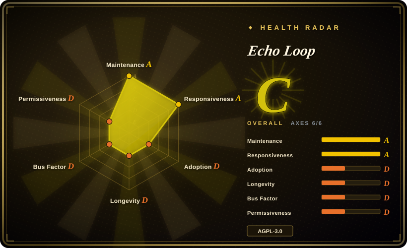
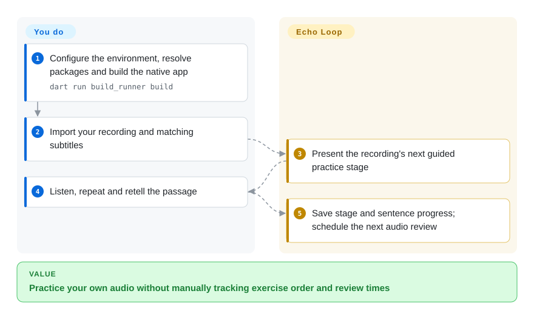
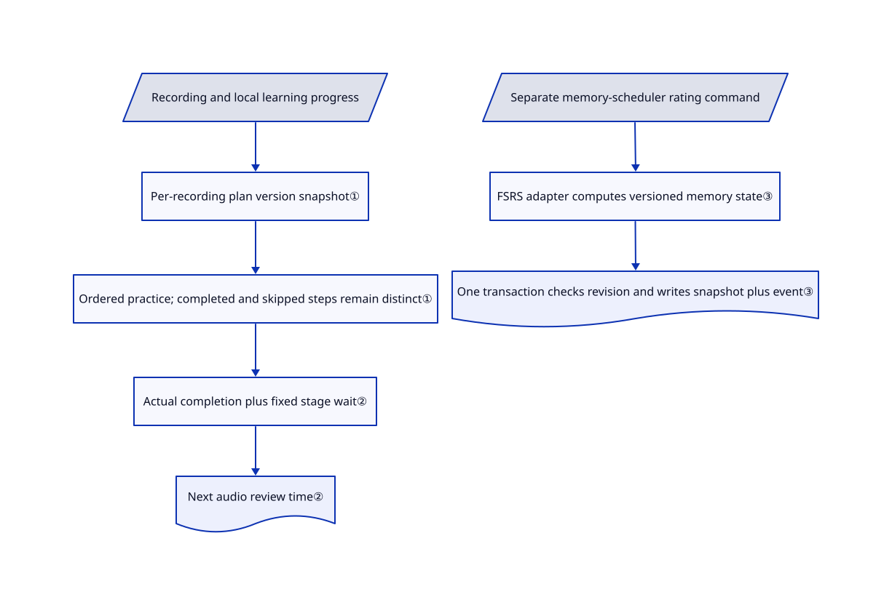

# Echo Loop

You keep collecting English podcasts but still cannot retell one short passage. Echo Loop turns your own recordings into guided listening, repetition, retelling and scheduled review instead of another playlist.

## When to use

You are building or choosing a mobile English practice app for learners who already have recordings and subtitles. They replay the same sentence, switch to a recorder, then forget which passages need review. You want one app to guide that sequence and remember the current stage and sentence. Echo Loop supplies the Flutter application, local progress storage and a versioned practice plan; you supply suitable material and actually perform the exercises.

Choose it over a general flashcard app when sustained listening and spoken retelling of your own audio matter more than freely designing card types. Choose it over a browser translator when the desired outcome is completing practice, not understanding today's web page. The primary released targets are iOS and Android; this is application source, not a drop-in speech SDK or a complete self-hosted cloud service.

## When NOT to use

- **You require no analytics or session recording.** Prefer a separately audited local Anki setup, or remove Echo Loop's analytics before distributing a fork. Release channel selection uses PostHog, whose `isConfigured` is always true; consent defaults to true. Its setup enables lifecycle capture and session replay with text/image blanket masking disabled. The business-event consent check does not guard SDK initialization. These are [source settings](https://github.com/echo-loop/Echo-Loop/blob/2a8716b2b31481c6a41049f1b4e46e55390abeaf/lib/analytics/channels/posthog_channel.dart#L24-L51), not a measured capture of device traffic.
- **You need arbitrary decks or a released native desktop study platform.** Choose Anki. Echo Loop's README lists macOS as in development, Windows as planned and no web release plan; checked-in desktop/web scaffolding does not mean supported releases.
- **You want to use your own model key in a browser reading workflow.** Choose [Read Frog](../reading-tools/read-frog.md). Echo Loop's cloud explanation, transcription and evaluation paths use its backend and subscription quota; overriding an API base URL is not equivalent to supplying an OpenAI-compatible model key. [Issue #61](https://github.com/echo-loop/Echo-Loop/issues/61) requests BYOK.
- **You want a ready-made illustrated IELTS word corpus, not your own listening material.** Choose [Word Atlas](word-atlas.md), while checking its backup and cache warnings. Echo Loop's strength is the audio practice sequence, not an included authoritative vocabulary course.
- **You need closed-source redistribution without copyleft obligations.** Do not embed this app under an assumed permissive grant. Consider Word Atlas's MIT code for a vocabulary-only application, respecting its separate content license. Echo Loop's root license is AGPL v3; vendored components and downloaded models/media retain their own terms.

## Comparison

| Alternative | In index | Our verdict | Tradeoff |
|---|---|---|---|
| [Anki](https://github.com/ankitects/anki) | not indexed | Choose Anki for general desktop spaced-repetition cards; choose Echo Loop when the product must guide practice around a complete imported recording. | Anki leaves audio exercise sequencing and material assembly to you; Echo Loop trades that flexibility for a ready mobile listening-to-speaking workflow. Not added in this tab batch. |
| [Read Frog](../reading-tools/read-frog.md) | ✅ | Choose Read Frog for bilingual browser reading with configurable model providers; choose Echo Loop when rehearsing and retelling a passage is the task. | Read Frog works where web content is read; Echo Loop brings local media and progress into a separate app, with its own cloud quota and telemetry trust boundary. |
| [Word Atlas](word-atlas.md) | ✅ | Choose Word Atlas to start with an illustrated English–Chinese IELTS corpus; choose Echo Loop when learners bring audio and need sentence practice plus retelling. | Word Atlas reduces content preparation but narrows the corpus and uses browser-local progress; Echo Loop requires suitable recordings and native app operation. |

## Quick start

Prepare Flutter and a supported native development environment; the manifest requires Dart `^3.9.2`, not a Flutter version numbered 3.9.2. Clone the repository, copy `.dev.env.template` to `.dev.env`, run `flutter pub get`, then `dart run build_runner build`. The README starts the app with `flutter run -d <ios|android|macos> --dart-define-from-file=.dev.env`; choose the actual device target rather than typing the alternatives literally. Supply authentication and backend configuration for online features; the template points at development services, so review endpoints before sending real material. Import a recording with a matching SRT/VTT/LRC subtitle, complete the guided practice and return for due reviews; the app stores progress locally, while you own content rights, backups, signing and any cloud service costs. This intake inspected the [documented commands](https://github.com/echo-loop/Echo-Loop/blob/2a8716b2b31481c6a41049f1b4e46e55390abeaf/README.md#L367-L393) without executing them.

<!-- flow-steps:begin (generated from flows/echo-loop.json by tools/flow_card.py — do not edit) -->

Text version of the flow

1. **You**: Configure the environment, resolve packages and build the native app — `dart run build_runner build`
2. **You**: Import your recording and matching subtitles
3. **Echo Loop**: Present the recording's next guided practice stage
4. **You**: Listen, repeat and retell the passage
5. **Echo Loop**: Save stage and sentence progress; schedule the next audio review

**Value**: Practice your own audio without manually tracking exercise order and review times

<!-- flow-steps:end -->

## Key techniques

<!-- mechanism:begin (generated from mechanisms/echo-loop.json by tools/mechanism_card.py; do not edit) -->

Text version of the mechanism

- Recording and local learning progress
- Per-recording plan version snapshot①
- Ordered practice; completed and skipped steps remain distinct①
- Actual completion plus fixed stage wait②
- Next audio review time②
- Separate memory-scheduler rating command
- FSRS adapter computes versioned memory state③
- One transaction checks revision and writes snapshot plus event③

- Recording and local learning progress → Per-recording plan version snapshot①
- Per-recording plan version snapshot① → Ordered practice; completed and skipped steps remain distinct①
- Ordered practice; completed and skipped steps remain distinct① → Actual completion plus fixed stage wait②
- Actual completion plus fixed stage wait② → Next audio review time②
- Separate memory-scheduler rating command → FSRS adapter computes versioned memory state③
- FSRS adapter computes versioned memory state③ → One transaction checks revision and writes snapshot plus event③

<!-- mechanism:end -->

### 1. Freeze the exercise plan per recording

- **Problem:** Changing the exercise order during an upgrade can disrupt a learner's partially completed recording.
- **How:** A per-stage version map is stamped into each recording's progress. The plan derives ordered substeps from that snapshot; current new recordings use intensive listening, repetition, blind listening and retelling, while old snapshots preserve their earlier order.
- **Limits:** Existing recordings need an explicit migration to adopt a changed plan. The first entry step cannot be skipped, but later steps can; progress percentage includes skipped steps and is not evidence of mastery.
- **Source:** [Version map and plan derivation](https://github.com/echo-loop/Echo-Loop/blob/2a8716b2b31481c6a41049f1b4e46e55390abeaf/lib/models/learning_plan.dart#L10-L82), [skip rules and percentage](https://github.com/echo-loop/Echo-Loop/blob/2a8716b2b31481c6a41049f1b4e46e55390abeaf/lib/models/learning_progress.dart#L193-L213), [handled versus completed](https://github.com/echo-loop/Echo-Loop/blob/2a8716b2b31481c6a41049f1b4e46e55390abeaf/lib/models/learning_progress.dart#L284-L324).

### 2. Anchor audio reviews to actual stage completion

- **Problem:** A learner who finishes late needs an actionable next review time, not a calendar label mistaken for an elapsed interval.
- **How:** `nextReviewAt` adds the current stage's waiting hours to the previous stage completion. At this SHA the seven waits are 6, 18, 24, 48, 72, 168 and 336 hours; manual unlock can make a review available early.
- **Limits:** These are fixed audio-stage waits, not adaptive FSRS intervals. The README table instead says 6 hours then 1/2/4/7/14/28 days between reviews; use the implementation for this snapshot, not its claimed eight-week total. Completion delays shift subsequent due dates.
- **Source:** [Actual intervals](https://github.com/echo-loop/Echo-Loop/blob/2a8716b2b31481c6a41049f1b4e46e55390abeaf/lib/database/enums.dart#L163-L175), [due-time calculation and unlock](https://github.com/echo-loop/Echo-Loop/blob/2a8716b2b31481c6a41049f1b4e46e55390abeaf/lib/models/learning_progress.dart#L202-L250), [conflicting README table](https://github.com/echo-loop/Echo-Loop/blob/2a8716b2b31481c6a41049f1b4e46e55390abeaf/README.md#L148-L161).

### 3. Isolate adaptive memory scheduling behind transactional state

- **Problem:** A separate reusable memory scheduler must not lose a rating or apply a retried rating twice.
- **How:** The FSRS adapter translates application-owned ratings and versioned state to the pinned `fsrs` package. The Drift repository updates a schedule and inserts its review event in one transaction, checking revisions and operation IDs before accepting a write.
- **Limits:** This is separate scheduling infrastructure, not proof that every audio stage uses FSRS. Replays with different payloads or a no-longer-current revision fail; the adapter computes dates, not learning efficacy.
- **Source:** [FSRS boundary and parameter validation](https://github.com/echo-loop/Echo-Loop/blob/2a8716b2b31481c6a41049f1b4e46e55390abeaf/lib/features/memory_scheduler/adapters/fsrs/fsrs_memory_model_adapter.dart#L54-L95), [atomic review and replay checks](https://github.com/echo-loop/Echo-Loop/blob/2a8716b2b31481c6a41049f1b4e46e55390abeaf/lib/features/memory_scheduler/data/drift_memory_schedule_repository.dart#L112-L231), [explicitly unchanged audio stages](https://github.com/echo-loop/Echo-Loop/blob/2a8716b2b31481c6a41049f1b4e46e55390abeaf/docs/memory-scheduler-infrastructure-plan.md#L58-L77).

## Tech stack

Dart and Flutter; Riverpod state management; Drift/SQLite plus shared preferences for local state. The manifest includes just_audio and media_kit playback, sherpa_onnx local speech processing, native speech integration, Dio networking, Supabase authentication, subscription SDKs and PostHog analytics. FSRS is pinned to package version 2.0.1. The declared `charset_converter` override is vendored with its BSD notice intact.

## Dependencies

- **Build:** Flutter with Dart `^3.9.2`, native platform toolchains, code generation and package resolution. iOS distribution requires the normal signing setup; this repository does not remove that responsibility.
- **Local practice:** usable audio/subtitles, storage, playback support and microphone permission when recording. Local transcription additionally requires a separately downloaded model; no model was downloaded for this review.
- **Online features:** configured Supabase/Google credentials as applicable, vendor API access and cloud quota. RevenueCat/payment configuration is needed for the corresponding subscription paths. The repository is the client app, not a one-command replacement for the hosted backend.
- **Privacy and rights:** review the default API endpoints, release analytics and permissions. The root AGPL grant does not license your imported podcasts, all third-party dependencies or every downloaded model.

## Ops difficulty

**Low for installing a released mobile app; medium for a local fork; high for reproducing the full hosted offering.** A fork needs native toolchains, code generation, signing and explicit endpoint/telemetry configuration. Local progress requires a tested backup-and-restore routine before reinstalling or changing devices. Replacing backend URLs alone does not supply authentication, cloud AI quota enforcement or billing services; disabling networking also does not establish that every platform speech recognizer is offline.

## Health & viability

- **As of 2026-10-28:** created 2026-05-07, unarchived and pushed on the verification date. GitHub's latest published release is v1.0.43 from October 25; the reviewed manifest is already 1.0.44. Five recent releases span October 11–25, so this is active but moving quickly.
- The contributors endpoint returns one account, `echo-loop`, with 1,750 contributions. That is a concentrated contribution signal, not proof that only one person exists behind the project. The README describes paid AI usage funding service costs; this is not foundation governance.
- About six months of history supplies little Lindy evidence despite 4,547 stars and 470 forks. Mobile release assets and extensive checked-in tests show distribution and test investment, not demonstrated educational outcomes or an independent runtime audit.
- The root AGPL v3 text is present; the declared third-party charset plugin retains its BSD license. Selection risks include cloud feature quotas, default release telemetry, unreleased desktop targets and documentation drifting from scheduling code.
- **[Inference: active releases but short history, concentrated contributions and source-confirmed privacy/documentation boundaries]** Treat it as a promising inspectable mobile practice app, not a proven long-term learning platform or a privacy-neutral default.

## Caveats (unverified)

- [Unverified: upstream execution and dependency/model installation were explicitly forbidden] No app build, upstream tests, real practice session, backup restore or device traffic capture was performed. Speech accuracy, offline behavior and runtime capture contents remain untested.
- [Unverified: source configuration is observable but store binaries and native runtime behavior were not audited] PostHog replay and unmasked-text/image settings establish a privacy risk, not proof of which screens or recordings a distributed binary transmits. The consent facade's event filter must not be mistaken for an SDK-wide disable switch.
- [Unverified: no controlled learning-outcome evidence was supplied] The README's improvement and scientific-effectiveness claims were not established by this source review. Fixed waits and adaptive card dates do not prove retention gains.
- [Inference: repository age, contributor API and release history only] Long-term maintenance, human team size and economic sustainability are uncertain. The license check covered the root and declared vendored plugin, not exhaustive rights clearance for every dependency, font, model or imported recording.
