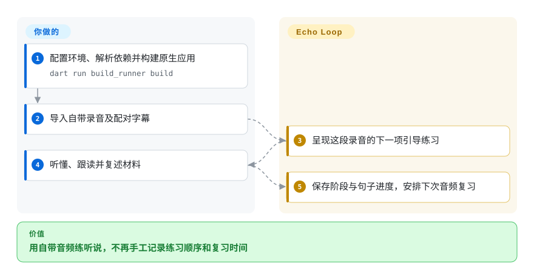
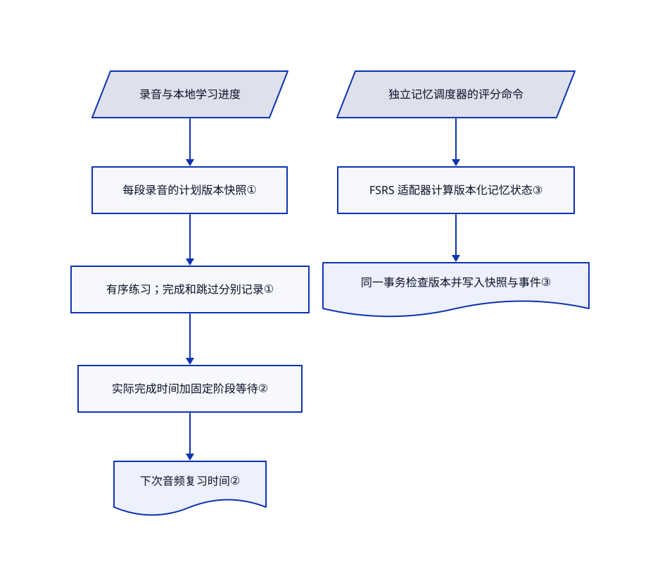

# Echo Loop

播客收藏了一堆，你却讲不出其中一小段。Echo Loop 把自带音频串成精听、跟读、复述与定时复习，不再只添一张播放列表。

## 何时使用

你在开发或选择手机英语练习应用，学习者已经有音频和字幕。他们反复播放同一句，切到录音工具跟读，过几天又忘了该复习哪段。你需要应用安排练习顺序，记住当前阶段和句子。Echo Loop 提供 Flutter 应用、本地进度存储和带版本的练习计划；你负责选择合适素材，并真正完成练习。

比起通用闪卡应用，当目标是围绕整段自带音频持续听练与口头复述，而非自由设计卡型时选它。比起浏览器翻译工具，当目标是完成练习，而非看懂今天的网页时选它。正式发布的主力是 iOS 和 Android；这是应用源码，不是可直接嵌入的语音 SDK，也不是完整的自托管云服务。

## 何时不用

- **你要求不采集分析事件或录制会话。** 优先评估经过独立审查的本地 Anki 配置，或先移除本应用的分析模块再分发。发布模式选择 PostHog，其 `isConfigured` 恒为真，同意状态默认也为真。配置开启生命周期事件和会话回放，并关闭文字及图片的全量遮罩；业务事件同意检查并不保护 SDK 初始化。这些是[源码设置](https://github.com/echo-loop/Echo-Loop/blob/2a8716b2b31481c6a41049f1b4e46e55390abeaf/lib/analytics/channels/posthog_channel.dart#L24-L51)，不是设备流量实测。
- **你要任意牌组或已发布的原生桌面学习平台。** 选 Anki。README 写明 macOS 开发中、Windows 规划中，网页端暂无发布计划；目录中有桌面和网页脚手架，不等于已支持正式版本。
- **你要在浏览器阅读时自带模型密钥。** 选[Read Frog](../reading-tools/read-frog.zh.md)。Echo Loop 的云端讲解、转录和评估走自身后端与订阅额度；覆盖 API 地址，不等于填入兼容 OpenAI 的模型密钥。[议题 #61](https://github.com/echo-loop/Echo-Loop/issues/61) 正在请求 BYOK 支持。
- **你要现成的雅思插画词库，而非自带听力素材。** 选[Word Atlas](word-atlas.zh.md)，同时检查其备份与缓存警告。Echo Loop 的强项是音频练习流程，不是内置权威词汇课程。
- **你要求闭源分发且不接受 copyleft 义务。** 不要把本应用当宽松许可代码嵌入。仅做背词应用时，可考虑 Word Atlas 的 MIT 代码，但须另守内容许可。Echo Loop 根许可是 AGPL v3；第三方组件、下载模型和媒体仍有各自条款。

## 横向对比

| 替代品 | 是否收录 | 我们的评价 | 取舍 |
|---|---|---|---|
| [Anki](https://github.com/ankitects/anki) | 未收录 | 通用桌面间隔闪卡选 Anki；产品必须围绕整段导入录音引导练习时选 Echo Loop。 | Anki 需要你自己组装素材和音频练习顺序；Echo Loop 用自由度换现成的手机听说流程。未加入本轮。 |
| [Read Frog](../reading-tools/read-frog.zh.md) | 已收录 | 浏览器双语阅读且需自选模型服务时选 Read Frog；要反复练习并复述一段材料时选 Echo Loop。 | Read Frog 留在阅读网页的现场；Echo Loop 将本地媒体和进度搬入独立应用，同时引入自身云端额度和遥测信任边界。 |
| [Word Atlas](word-atlas.zh.md) | 已收录 | 想直接获得中英雅思插画词库时选 Word Atlas；学习者自带音频且需逐句训练与复述时选 Echo Loop。 | Word Atlas 减少内容准备，但词库范围更窄，进度留在浏览器；Echo Loop 需要合适录音和原生应用维护。 |

## 快速上手

准备 Flutter 和目标平台的原生开发环境；清单要求的是 Dart `^3.9.2`，不是名为 3.9.2 的 Flutter 版本。克隆仓库，把 `.dev.env.template` 复制为 `.dev.env`，运行 `flutter pub get`，再运行 `dart run build_runner build`。README 用 `flutter run -d <ios|android|macos> --dart-define-from-file=.dev.env` 启动，需选择真实设备目标，不能把候选项整串照抄。在线功能需认证与后端配置；模板指向开发服务，发送真实素材前应先检查地址。导入录音及同名 SRT／VTT／LRC 字幕，完成引导练习，再回来处理到期复习；应用负责本地记录进度，你负责素材权利、备份、签名和云端费用。本轮只核验[文档命令](https://github.com/echo-loop/Echo-Loop/blob/2a8716b2b31481c6a41049f1b4e46e55390abeaf/README.md#L367-L393)，没有执行。

<!-- flow-steps:begin (generated from flows/echo-loop.json by tools/flow_card.py — do not edit) -->

流程文字版

1. **你**：配置环境、解析依赖并构建原生应用 — `dart run build_runner build`
2. **你**：导入自带录音及配对字幕
3. **Echo Loop**：呈现这段录音的下一项引导练习
4. **你**：听懂、跟读并复述材料
5. **Echo Loop**：保存阶段与句子进度，安排下次音频复习

**价值**：用自带音频练听说，不再手工记录练习顺序和复习时间

<!-- flow-steps:end -->

## 技术要点

<!-- mechanism:begin (generated from mechanisms/echo-loop.json by tools/mechanism_card.py; do not edit) -->

机制文字版

- 录音与本地学习进度
- 每段录音的计划版本快照①
- 有序练习；完成和跳过分别记录①
- 实际完成时间加固定阶段等待②
- 下次音频复习时间②
- 独立记忆调度器的评分命令
- FSRS 适配器计算版本化记忆状态③
- 同一事务检查版本并写入快照与事件③

- 录音与本地学习进度 → 每段录音的计划版本快照①
- 每段录音的计划版本快照① → 有序练习；完成和跳过分别记录①
- 有序练习；完成和跳过分别记录① → 实际完成时间加固定阶段等待②
- 实际完成时间加固定阶段等待② → 下次音频复习时间②
- 独立记忆调度器的评分命令 → FSRS 适配器计算版本化记忆状态③
- FSRS 适配器计算版本化记忆状态③ → 同一事务检查版本并写入快照与事件③

<!-- mechanism:end -->

### 1. 为每段录音冻结练习计划

- **解决：** 升级时改变练习顺序，可能打断尚未完成的录音学习。
- **做法：** 每段录音的进度保存各阶段版本快照，再从快照推导有序子步骤。新录音依次精听、跟读、盲听和复述；旧快照保留原顺序。
- **边界：** 已有录音采用新计划需要显式迁移。首次入口不可跳过，但后续步骤可以；进度百分比计入跳过项，不代表掌握程度。
- **源码：** [版本表与计划推导](https://github.com/echo-loop/Echo-Loop/blob/2a8716b2b31481c6a41049f1b4e46e55390abeaf/lib/models/learning_plan.dart#L10-L82)、[跳过规则与百分比](https://github.com/echo-loop/Echo-Loop/blob/2a8716b2b31481c6a41049f1b4e46e55390abeaf/lib/models/learning_progress.dart#L193-L213)、[已处理与真正完成的区别](https://github.com/echo-loop/Echo-Loop/blob/2a8716b2b31481c6a41049f1b4e46e55390abeaf/lib/models/learning_progress.dart#L284-L324)。

### 2. 从实际完成时间推算音频复习

- **解决：** 学习者延迟完成后，需要可执行的下次时间，不能把阶段名称当作已等待时长。
- **做法：** `nextReviewAt` 在上一阶段完成时间上加当前阶段等待小时数。本次提交的七个间隔是 6、18、24、48、72、168 和 336 小时；手动解锁可提前开放复习。
- **边界：** 这是音频阶段的固定等待，不是自适应 FSRS 间隔。README 表却写距上次为 6 小时及 1／2／4／7／14／28 天；本快照应以实现为准，不能照抄其八周总时长。完成延迟会推后后续到期时间。
- **源码：** [真实间隔](https://github.com/echo-loop/Echo-Loop/blob/2a8716b2b31481c6a41049f1b4e46e55390abeaf/lib/database/enums.dart#L163-L175)、[到期计算与手动解锁](https://github.com/echo-loop/Echo-Loop/blob/2a8716b2b31481c6a41049f1b4e46e55390abeaf/lib/models/learning_progress.dart#L202-L250)、[不一致的 README 表](https://github.com/echo-loop/Echo-Loop/blob/2a8716b2b31481c6a41049f1b4e46e55390abeaf/README.md#L148-L161)。

### 3. 用事务状态隔离自适应记忆调度

- **解决：** 独立可复用的记忆调度器，不能丢掉评分，也不能把重试评分算两遍。
- **做法：** FSRS 适配器把应用自身评分和版本状态转换给固定版本的 `fsrs` 包。Drift 仓储在同一事务内更新调度快照并写入评分事件，写前检查版本号和操作标识。
- **边界：** 这是独立调度基础设施，不表示所有音频阶段都使用 FSRS。重放载荷不同或版本不再对应当前快照时会失败；适配器计算日期，不证明学习效果。
- **源码：** [FSRS 边界与参数校验](https://github.com/echo-loop/Echo-Loop/blob/2a8716b2b31481c6a41049f1b4e46e55390abeaf/lib/features/memory_scheduler/adapters/fsrs/fsrs_memory_model_adapter.dart#L54-L95)、[原子评分与重放检查](https://github.com/echo-loop/Echo-Loop/blob/2a8716b2b31481c6a41049f1b4e46e55390abeaf/lib/features/memory_scheduler/data/drift_memory_schedule_repository.dart#L112-L231)、[明确不改现有音频阶段](https://github.com/echo-loop/Echo-Loop/blob/2a8716b2b31481c6a41049f1b4e46e55390abeaf/docs/memory-scheduler-infrastructure-plan.md#L58-L77)。

## 技术栈

Dart 与 Flutter；Riverpod 管理状态，Drift／SQLite 和共享偏好保存本地数据。清单包含 just_audio 与 media_kit 播放、sherpa_onnx 本地语音处理、原生语音集成、Dio 网络请求、Supabase 认证、订阅 SDK 和 PostHog 分析。FSRS 包固定为 2.0.1。声明覆盖的 `charset_converter` 被放入第三方目录，并保留 BSD 通知。

## 依赖

- **构建。** Flutter 配合 Dart `^3.9.2`、原生平台工具链、代码生成及包解析。iOS 分发仍需正常签名配置，仓库不会代劳。
- **本地练习。** 可用音频和字幕、存储空间、播放支持；录音需麦克风权限。本地转录还要另行下载模型，本轮没有下载。
- **在线功能。** 按功能配置 Supabase／Google 凭据、厂商 API 及云端额度。对应订阅流程还需 RevenueCat 或支付配置。这是客户端，不是能一键替换托管后端的整套服务。
- **隐私与权利。** 检查默认 API 地址、发布遥测和权限。根 AGPL 授权不覆盖你导入的播客、全部第三方依赖或每个下载模型。

## 运维难度

**安装已发布手机应用较低，自建分支中等，重现整套托管服务较高。** 自建需原生工具链、代码生成、签名及明确的地址和遥测配置。重装或换设备前，应先验证本地进度的备份恢复。只替换后端地址，不会自动获得认证、云端 AI 额度和计费服务；断网也不能证明每个平台的系统语音识别都离线运行。

## 健康度与可持续性

- **截至 2026-10-28。** 仓库创建于 2026-05-07，未归档，当天仍有推送。最新 GitHub 发布为 10 月 25 日的 v1.0.43；所读清单已是 1.0.44。最近五次发布覆盖 10 月 11 至 25 日，活跃但变化较快。
- 贡献者接口只返回 `echo-loop`，共 1,750 次贡献。这说明提交来源集中，不能证明幕后只有一人。README 说明付费 AI 收入承担服务成本，并非基金会治理。
- 约六个月历史，尚不足以建立强林迪效应；4,547 星和 470 个分叉不能代替长期记录。手机发布产物和大量已提交测试体现分发与测试投入，不证明学习效果，也不是独立运行审计。
- 根目录有 AGPL v3 全文，声明的第三方字符集插件保留 BSD 许可。主要选型风险是云端功能额度、默认发布遥测、未正式发布的桌面端，以及文档和调度代码不同步。
- **[推断：依据是活跃发布、短历史、集中贡献，以及源码确认的隐私和文档边界]** 可作为值得检查的手机练习应用，不能当成长期效果已证实的平台或隐私中性默认项。

## 存疑（未验证）

- [未验证：用户明确禁止执行上游及安装依赖和模型] 没有构建应用、运行上游测试、进行真机练习、恢复备份或抓取设备流量。语音准确度、离线行为和运行时采集内容尚未实测。
- [未验证：只读取源码配置，没有审计商店二进制和原生运行行为] PostHog 回放及关闭文字图片遮罩的设置构成隐私风险，但不能证明分发版本实际上传哪些屏幕或录音。业务事件过滤器不能当成 SDK 全局关闭开关。
- [未验证：没有提供受控学习效果证据] 本轮源码研究没有证实 README 的进步与科学效果承诺。固定等待和自适应卡片日期，都不能证明记忆提升。
- [推断：仅依据仓库年龄、贡献者接口与发布记录] 长期维护、真实团队人数和经济可持续性仍不确定。许可检查覆盖根目录与声明的第三方插件，不是全部依赖、字体、模型和导入录音的权利清查。
