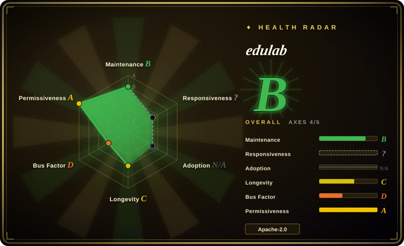
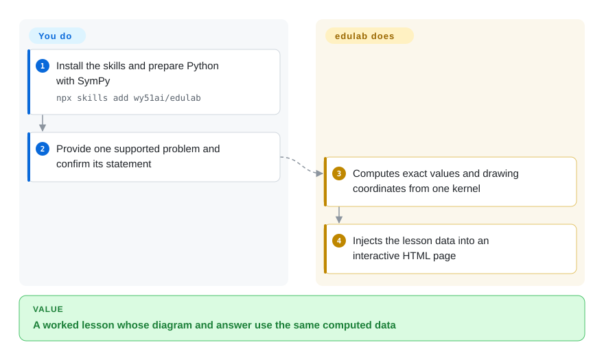
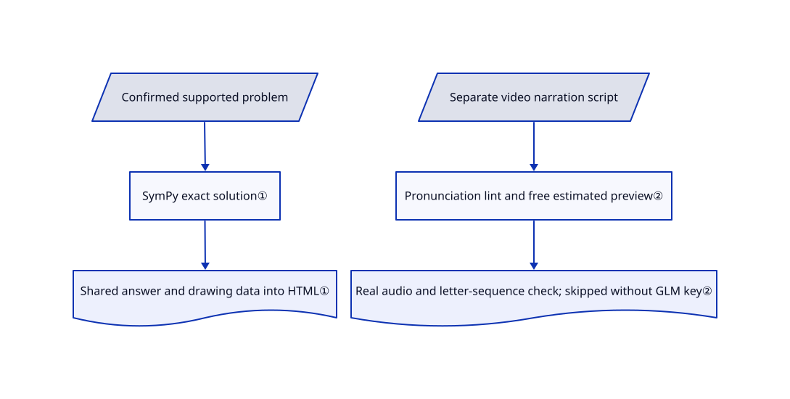

# edulab

A geometry answer shows a formula, but the student cannot see which line meets which plane. edulab gives an agent symbolic-computation kernels and lesson templates to make one problem into an interactive page, with separate skills for narrated teaching videos.

## When to use

You teach or explain a particular geometry, conic-section or chemistry problem, and want the diagram, worked values and answer to agree. Instead of asking a model to invent coordinates and a proof independently, you use edulab's supported kernels and templates, then inspect the lesson. Choose it over DeepTutor when the deliverable is one visual lesson rather than an ongoing textbook-grounded study workspace. For videos, its subject-specific narration and checks are more ready-made than starting directly from a general animation engine.

## When NOT to use

- **A complete tutoring product with course libraries and saved learning context:** choose [DeepTutor](deeptutor.md); this repository is a set of installed skills, kernels and per-problem artifacts.
- **An arbitrary theorem or a guaranteed correct proof:** use an instructor-reviewed solution and, for custom mathematical animation, [Manim](https://github.com/ManimCommunity/manim). Symbolic arithmetic cannot correct a wrongly extracted problem or unsupported modeling assumption.
- **General product films rather than teaching a problem:** choose [HyperFrames](../video-production/hyperframes.md) for a broader rendering foundation; edulab's templates encode classroom layouts and spoken Chinese conventions.
- **No network and no cloud credentials for video:** interactive page generation and the video path have different requirements. The video path may use GLM or networked edge-tts; macOS `say` is a fallback, and missing GLM credentials skip ASR instead of proving pronunciation correct.
- **Unreviewed student uploads as arbitrary code input:** the agent and scripts have local file authority. Use a separately sandboxed service rather than treating skill installation as multi-user security.

## Comparison

| Alternative | In index | Our verdict | Tradeoff |
|---|---|---|---|
| [DeepTutor](deeptutor.md) | ✅ | Choose DeepTutor for persistent study with uploaded textbooks and practice; choose edulab to publish one inspectable interactive lesson or problem video. | A full study app supplies course state and retrieval; edulab keeps the artifact workflow smaller but assumes an existing agent and instructor review. |
| [Manim](https://github.com/ManimCommunity/manim) | not indexed | Choose Manim for custom mathematical animation authored in Python; choose edulab when its supported problem kernels and narrated lesson workflow already fit. | Manim offers a general animation framework rather than this lesson method; not added in this tab batch because comparison intake is disabled. |
| [HyperFrames](../video-production/hyperframes.md) | ✅ | Choose HyperFrames for general deterministic HTML video compositions; choose edulab for subject-specific problem narration, pronunciation checks and worked diagrams. | HyperFrames is the engine layer; edulab adds teaching conventions but narrows the layout and requires its own Python/browser/audio dependencies. |

## Quick start

Install the skills using the documented `npx skills add wy51ai/edulab`, or its Claude Code marketplace. Give the agent one text problem or screenshot, confirm any uncertain statement and request an interactive lesson. For a directly runnable supported example, enter `skills/edu-solid-geometry`, ensure Python can import SymPy and run `python3 scripts/generate.py cube ./cube.html`. The kernel supplies exact values and diagram coordinates, and the generator injects them into the page; you check the statement, modeling and browser display. The separate video skills require Python packages, Node 18+, browser/FFmpeg and a chosen speech engine; they build narration and MP4 rather than extending this page-generation command.

<!-- flow-steps:begin (generated from flows/edulab.json by tools/flow_card.py — do not edit) -->

Text version of the flow

1. **You**: Install the skills and prepare Python with SymPy — `npx skills add wy51ai/edulab`
2. **You**: Provide one supported problem and confirm its statement
3. **edulab**: Computes exact values and drawing coordinates from one kernel
4. **edulab**: Injects the lesson data into an interactive HTML page

**Value**: A worked lesson whose diagram and answer use the same computed data

<!-- flow-steps:end -->

## Key techniques

<!-- mechanism:begin (generated from mechanisms/edulab.json by tools/mechanism_card.py; do not edit) -->

Text version of the mechanism

- Confirmed supported problem
- SymPy exact solution①
- Shared answer and drawing data into HTML①
- Separate video narration script
- Pronunciation lint and free estimated preview②
- Real audio and letter-sequence check; skipped without GLM key②

- Confirmed supported problem → SymPy exact solution①
- SymPy exact solution① → Shared answer and drawing data into HTML①
- Separate video narration script → Pronunciation lint and free estimated preview②
- Pronunciation lint and free estimated preview② → Real audio and letter-sequence check; skipped without GLM key②

<!-- mechanism:end -->

### 1. Derive the drawing and worked answer from one computation

- **Problem:** Independently generated diagrams and explanations can disagree about coordinates, angles or the final value.
- **How:** The geometry kernel uses SymPy vectors and exact expressions; one result contains LaTeX values and converted Three.js coordinates. The lesson generator reads that result for both the answer text and model data before injecting JSON into a template.
- **Limits:** This covers implemented solvers and correctly specified inputs, not all mathematics. Rendering coordinates become floats, and a consistent wrong model can still produce a consistent wrong lesson.
- **Source:** [Exact geometry and coordinate conversion](https://github.com/wy51ai/edulab/blob/6a9c8766061ca7101d10bab6fe3af716ec47bb07/skills/edu-solid-geometry/lib/geometry_kernel.py#L57-L264), [shared lesson data](https://github.com/wy51ai/edulab/blob/6a9c8766061ca7101d10bab6fe3af716ec47bb07/skills/edu-solid-geometry/scripts/generate.py#L32-L124).

### 2. Preview before speech billing, and expose skipped checks

- **Problem:** A mispronounced point name or bad layout can waste paid speech calls and invalidate a teaching video.
- **How:** The audio builder separately lints spoken text/pronunciation, creates an estimated preview timeline without API calls, and later uses actual clip durations. ASR compares the expected and recognized letter sequences; failures get a nonzero exit status.
- **Limits:** Without a GLM key, ASR prints `ASR SKIPPED` and exits zero; inspect the message, not only the exit code. Letter-sequence equality is not a full check of Chinese pronunciation or mathematical correctness.
- **Source:** [Lint, preview and ASR control flow](https://github.com/wy51ai/edulab/blob/6a9c8766061ca7101d10bab6fe3af716ec47bb07/skills/edu-math-video/template/build_audio.py#L566-L643), [required review steps](https://github.com/wy51ai/edulab/blob/6a9c8766061ca7101d10bab6fe3af716ec47bb07/skills/edu-math-video/SKILL.md#L93-L133).

## Health & viability

- **2026-10-18:** last push October 10, source package version 0.1.8 and no GitHub releases in the checked list. Recent open contributions propose new subject skills; they are not yet installed features.
- Created June 2026, roughly four months old, with all listed contributions attributed to `wy51ai`. This is a single-author teaching toolkit with little Lindy history.
- Apache-2.0 text names WY, matching the package author. Python kernels and runnable templates provide reusable substance beyond demo media.
- The skill method includes checks and visual review, but no source evidence establishes classroom learning gains or correctness across arbitrary uploaded questions.

## Caveats (unverified)

- [未验证：本批禁止运行上游程序，未提供语音凭据] Kernel self-checks, live HTML rendering and the narrated-video path were inspected but not executed.
- [推断：依据是有限求解器与需要确认题面的技能流程] General questions require new modeling/solver work and teacher verification; exact arithmetic is not an automatic proof guarantee.
