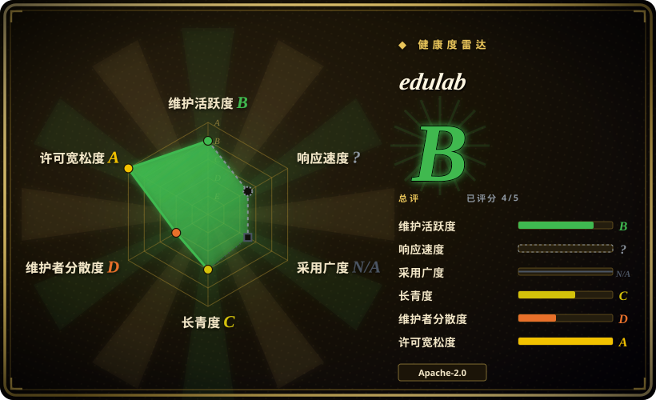
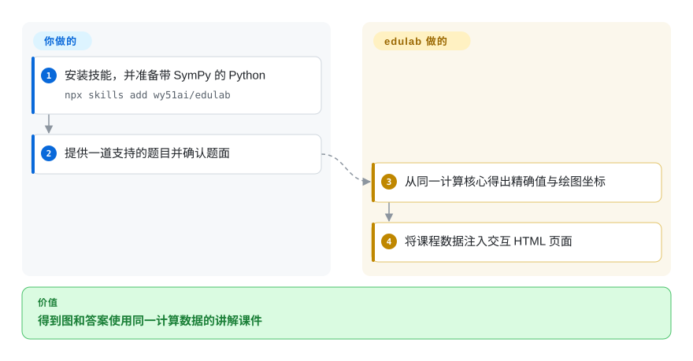
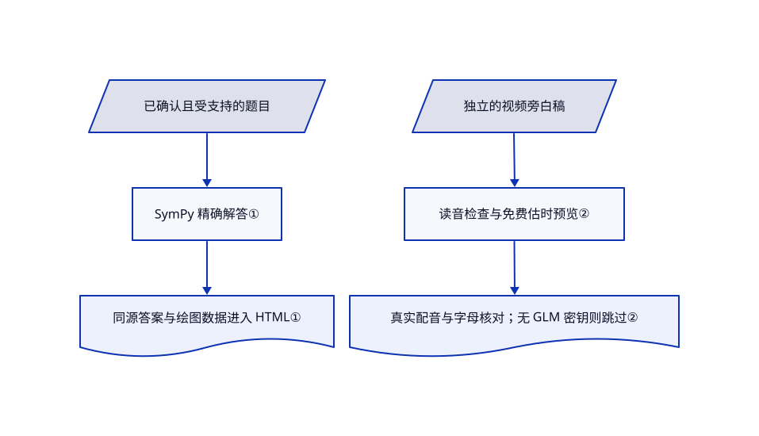

# edulab

几何题写出了公式，学生却看不清哪条线碰到哪个面。edulab 把符号计算核心与课程模板交给助手，将一道题做成交互页面，另有带旁白教学视频的技能。

## 何时使用

你在讲一道立体几何、圆锥曲线或化学题，希望图、推导数值和答案一致。相比让模型各自编坐标和证明，你可以使用 edulab 已支持的计算核心与模板，再检查课程。相比 DeepTutor，目标是一份视觉课件，而不是持续围绕课本学习的工作区。视频路线也已准备学科旁白和检查，比从通用动画引擎开始省去一层教学流程设计。

## 何时不用

- **需要课程库和持续学习上下文的完整产品：** 选 [DeepTutor](deeptutor.zh.md)；这里是一组技能、计算核心和逐题产物。
- **任意定理或必须保证证明正确：** 先由教师核对解答；要自定义数学动画可用 [Manim](https://github.com/ManimCommunity/manim)。精确运算不能纠正读错题面或错误建模。
- **普通产品影片，不是讲一道题：** 选 [HyperFrames](../video-production/hyperframes.zh.md) 的通用渲染基础；edulab 模板固定了课堂布局和中文口语规则。
- **视频不得联网，也不提供云端凭据：** 交互页面与视频依赖不同。视频可能用 GLM 或联网 edge-tts；macOS `say` 可兜底，但没 GLM 凭据会跳过语音识别核对，不代表读音正确。
- **把未经检查的学生输入直接交给代码：** 助手和脚本有本地文件权限。应另建沙箱服务，不能把安装技能当作多用户安全隔离。

## 横向对比

| 替代品 | 是否收录 | 我们的评价 | 取舍 |
|---|---|---|---|
| [DeepTutor](deeptutor.zh.md) | ✅ | 上传教材、持续学习和练习，选 DeepTutor；发布一份可检查的交互课件或解题视频，选 edulab。 | 完整学习应用提供课程状态与检索；edulab 的产物流程更小，但依赖已有助手和教师复核。 |
| [Manim](https://github.com/ManimCommunity/manim) | 未收录 | Python 自定义数学动画选 Manim；已支持的题型和带旁白课件流程吻合时选 edulab。 | Manim 提供通用动画框架，不提供本包的课件方法；本次关闭对比品扩录，因此未收录。 |
| [HyperFrames](../video-production/hyperframes.zh.md) | ✅ | 通用确定性 HTML 视频选 HyperFrames；需要学科解题旁白、读音检查和推导图，选 edulab。 | HyperFrames 是引擎层；edulab 加教学约定，但布局更窄，另需 Python、浏览器和音频依赖。 |

## 快速上手

按文档运行 `npx skills add wy51ai/edulab`，或安装 Claude Code 市场插件。提供一道文字题或截图，先确认读不清的题面，再请求交互课件。直接运行已支持样例时，进入 `skills/edu-solid-geometry`，确保 Python 可导入 SymPy，再执行 `python3 scripts/generate.py cube ./cube.html`。计算核心提供精确值和绘图坐标，生成器将它们注入页面；你核对题面、建模与浏览器显示。独立视频技能还需 Python 包、Node 18 及以上、浏览器、FFmpeg 与语音引擎，生成旁白和 MP4，不是给这个页面命令加个参数。

<!-- flow-steps:begin (generated from flows/edulab.json by tools/flow_card.py — do not edit) -->

流程文字版

1. **你**：安装技能，并准备带 SymPy 的 Python — `npx skills add wy51ai/edulab`
2. **你**：提供一道支持的题目并确认题面
3. **edulab**：从同一计算核心得出精确值与绘图坐标
4. **edulab**：将课程数据注入交互 HTML 页面

**价值**：得到图和答案使用同一计算数据的讲解课件

<!-- flow-steps:end -->

## 技术要点

<!-- mechanism:begin (generated from mechanisms/edulab.json by tools/mechanism_card.py; do not edit) -->

机制文字版

- 已确认且受支持的题目
- SymPy 精确解答①
- 同源答案与绘图数据进入 HTML①
- 独立的视频旁白稿
- 读音检查与免费估时预览②
- 真实配音与字母核对；无 GLM 密钥则跳过②

- 已确认且受支持的题目 → SymPy 精确解答①
- SymPy 精确解答① → 同源答案与绘图数据进入 HTML①
- 独立的视频旁白稿 → 读音检查与免费估时预览②
- 读音检查与免费估时预览② → 真实配音与字母核对；无 GLM 密钥则跳过②

<!-- mechanism:end -->

### 1. 让图和题解来自同一次计算

- **解决：** 分开生成图与讲解，容易出现坐标、角度和答案互相矛盾。
- **做法：** 几何核心用 SymPy 向量和精确表达式，同一结果同时包含 LaTeX 数值及转换后的 Three.js 坐标。生成器从这个结果组装答案和模型，再把 JSON 注入模板。
- **边界：** 只覆盖已实现求解器与正确输入，不代表通解所有数学题。渲染坐标会变成浮点；错误模型也能生成内部一致的错误课件。
- **源码：** [精确计算与坐标转换](https://github.com/wy51ai/edulab/blob/6a9c8766061ca7101d10bab6fe3af716ec47bb07/skills/edu-solid-geometry/lib/geometry_kernel.py#L57-L264)、[同源课程数据](https://github.com/wy51ai/edulab/blob/6a9c8766061ca7101d10bab6fe3af716ec47bb07/skills/edu-solid-geometry/scripts/generate.py#L32-L124)。

### 2. 花配音费用前先预览，跳过检查要明说

- **解决：** 点名读错或布局有误，会浪费付费语音调用，也会破坏教学视频。
- **做法：** 音频脚本分开做口语与读音检查、无 API 调用的估计时间轴预览，以及按真实音频长度制作。语音识别对比预期和听到的字母序列，不匹配就返回非零退出码。
- **边界：** 没 GLM 密钥时会打印 `ASR SKIPPED`，但退出码仍为零，必须看消息，不能只看状态。字母相同也不代表中文读音与数学推导全部正确。
- **源码：** [检查、预览和语音核对控制流](https://github.com/wy51ai/edulab/blob/6a9c8766061ca7101d10bab6fe3af716ec47bb07/skills/edu-math-video/template/build_audio.py#L566-L643)、[必需复核步骤](https://github.com/wy51ai/edulab/blob/6a9c8766061ca7101d10bab6fe3af716ec47bb07/skills/edu-math-video/SKILL.md#L93-L133)。

## 健康度与可持续性

- **2026-10-18：** 最近推送为 10 月 10 日，源码包版本 0.1.8，检查的 GitHub Releases 为空。近期开放贡献提议新增学科技能，但不能当成已安装功能。
- 创建于 2026 年 6 月，约四个月，可见贡献均归 `wy51ai`。这是单作者教学工具，林迪历史短。
- Apache-2.0 正文署名 WY，与清单作者一致。Python 计算核心和可运行模板，提供了演示媒体之外的复用价值。
- 技能流程包含检查与看图复核，但没有源码证据能证明课堂学习收益，或任意上传题目的正确率。

## 存疑（未验证）

- [未验证：本批禁止运行上游程序，未提供语音凭据] 阅读了核心自检、网页渲染和旁白视频路线，未执行。
- [推断：依据是有限求解器与需要确认题面的技能流程] 普通题目可能需要新增建模和求解器，必须教师复核；精确算术不是自动证明保证。
