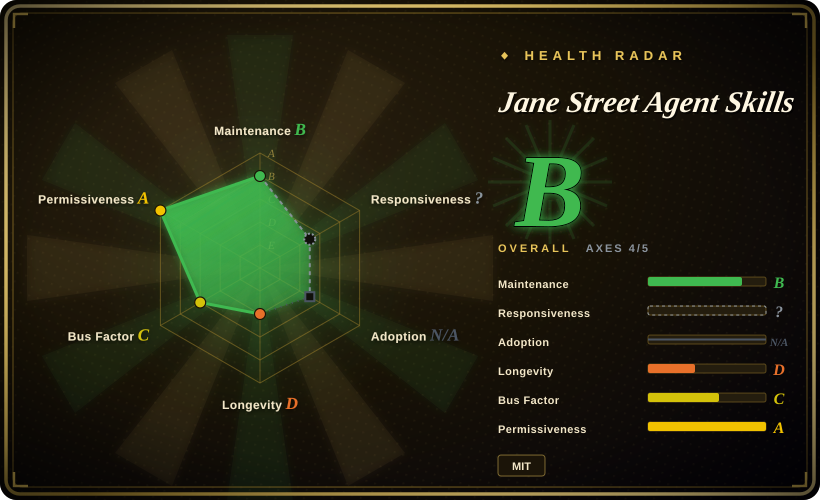
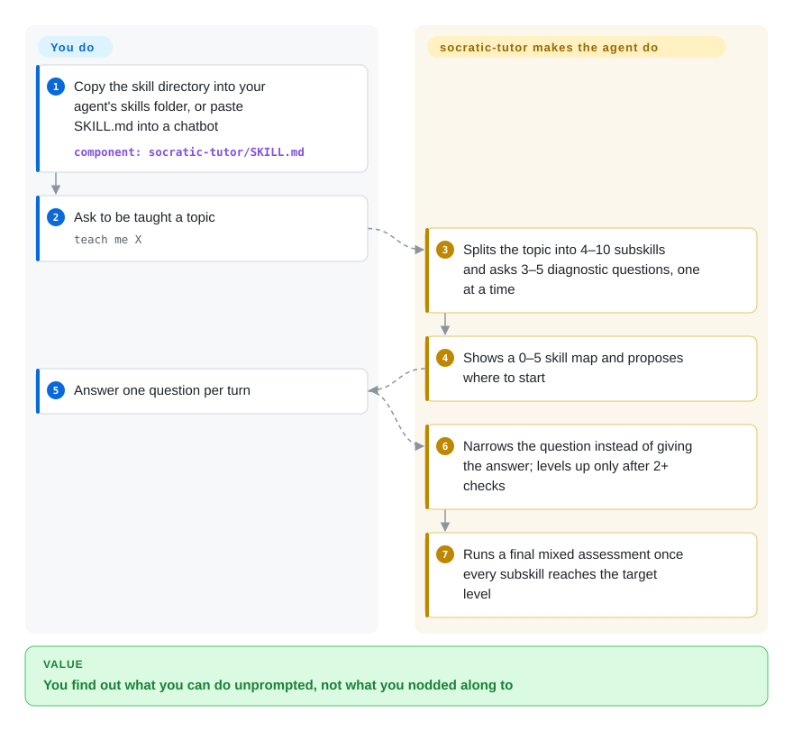
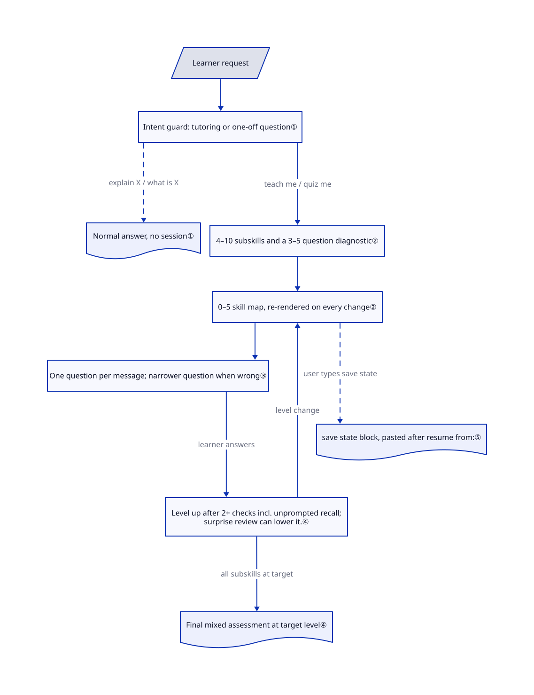

# Jane Street Agent Skills

You ask an AI to teach you something, it lectures for a screen, you reply "makes sense", and a week later you cannot do it unprompted. This repository's one skill, `socratic-tutor`, makes the agent test you first, ask one question at a time without giving the answer away, and raise a 0–5 level per subskill only after you have shown it twice.

## When to use

You are an engineer or analyst who has to actually get good at something — SQL joins, options pricing, a new type system — and you are already working in a coding agent or a chatbot. The explanations you get are fine; the problem is you. The session goes "So a LEFT JOIN keeps every row from the left table?" — "Exactly! Great question…", and nothing ever checks whether you could have produced that yourself. You drop `socratic-tutor` into the agent's skills folder and say "teach me X": it places you with a 3–5 question diagnostic, keeps a visible skill map, refuses to hand over answers until you have failed two or three narrower questions, and re-tests earlier topics without warning.

Pick it over an app such as DeepTutor when you do not want to install anything or index documents — the whole method is one 102-line Markdown file you can read in two minutes and paste into any chatbot. Pick it over older tutoring prompts such as Mr. Ranedeer when you want strict grading rules (a level needs two independent checks, one of them unprompted recall) rather than personalised lecture plans. The price is that nothing outside the conversation remembers, schedules or verifies anything: the model is both teacher and examiner.

## When NOT to use

- **You only want an explanation of X.** Ask normally. The skill itself declines to start a session for "explain X" / "what is X" and asks one confirming question when the intent is ambiguous; loading it for quick lookups only adds that friction.
- **You want to study from your own textbook or course files, with progress kept between sessions.** Choose [DeepTutor](deeptutor.md): it indexes your documents and stores study context. This skill has no retrieval and no storage; continuity is a "save state" text block you must paste back yourself.
- **You need spaced repetition across days and weeks.** Use [Anki](https://github.com/ankitects/anki) (not indexed). The skill's "spaced review" means surprise re-tests inside one conversation; there is no scheduler, reminder or card history.
- **You want a syllabus and lesson files you can annotate, or a web UI.** Choose [BloomTutor](https://github.com/Li-Evan/BloomTutor) (not indexed), which ships a Claude Code skill plus a self-hosted web app that saves courses. Jane Street's skill produces only chat turns and an ASCII map.
- **Grades must be trustworthy — certification, coursework, hiring.** Use instructor-reviewed assessment. The same model sets questions, judges answers and awards levels, and the repository ships no evals: an external contributor's transcript checker (PR #3) was closed without merging.
- **You expect a growing, community-maintained collection.** The README says the maintainers are not looking for new skills or text changes; every pull request so far was closed unmerged. Fork it and keep your own copy, or choose a collection that accepts contributions.

## Comparison

| Alternative | In index | Our verdict | Tradeoff |
|---|---|---|---|
| [DeepTutor](deeptutor.md) | ✅ | Choose DeepTutor when your course material and study history must persist in one self-hosted workspace; choose this skill when you want strict questioning inside the agent you already use, with nothing to install. | DeepTutor brings retrieval, saved context and a Web/CLI stack to run; this skill brings no infrastructure and no memory beyond the conversation. |
| [BloomTutor](https://github.com/Li-Evan/BloomTutor) | not indexed | Choose BloomTutor when you want generated syllabi and lessons you read and annotate, saved as files or in its web app; choose this skill when you want question-first drilling with explicit level rules. | BloomTutor (MIT, created 2026-03) is a fuller product with Python/Node web mode; Jane Street's is one prompt file with a stricter grading rubric. Real repository; not added in this tab batch. |
| [Mr. Ranedeer AI Tutor](https://github.com/JushBJJ/Mr.-Ranedeer-AI-Tutor) | not indexed | Choose Mr. Ranedeer only as a reference for configurable depth and learning-style knobs; choose this skill for reuse, because it carries a clear MIT license and current agent-skill packaging. | Ranedeer is much larger and more configurable but targets ChatGPT/GPT-4, has no LICENSE file in its root and was last pushed 2025-09-30. Real repository; not added in this tab batch. |
| [Anki](https://github.com/ankitects/anki) | not indexed | Choose Anki to retain facts over months with a real review scheduler; choose this skill to build understanding of a topic in a live dialogue. They combine well: drill with the tutor, then keep the facts in Anki. | Anki (AGPL-3.0-or-later, since 2012) schedules reviews but does not question your reasoning; the tutor questions reasoning but forgets everything when the chat ends. Real repository; not added in this tab batch. |

## Quick start

The README gives two paths. In a coding agent that reads `SKILL.md` skills (a skill is a folder whose `SKILL.md` the agent loads when the request matches its description), copy the `socratic-tutor` directory into the agent's skills folder and ask "teach me X". In a plain chatbot, paste the body of `SKILL.md` into the chat or a custom/system prompt, followed by the topic. The skill makes the agent confirm intent, run the diagnostic, show the skill map and drive the question loop; you answer one question per turn, use the commands it defines ("show progress", "harder", "just tell me", "save state"), and paste a saved state block after "resume from:" when you continue in a new session. You also pay for every model turn — a mastery session is many short round-trips. In Claude Code, one user reported that the client's own prompt suggestions pre-filled correct answers; turning off `Prompt suggestions` in `/config` fixed it (issue #16).

<!-- flow-steps:begin (generated from flows/janestreet-agent-skills.json by tools/flow_card.py — do not edit) -->

Text version of the flow

1. **You**: Copy the skill directory into your agent's skills folder, or paste SKILL.md into a chatbot — component: `socratic-tutor/SKILL.md`
2. **You**: Ask to be taught a topic — `teach me X`
3. **Jane Street Agent Skills**: Splits the topic into 4–10 subskills and asks 3–5 diagnostic questions, one at a time
4. **Jane Street Agent Skills**: Shows a 0–5 skill map and proposes where to start
5. **You**: Answer one question per turn
6. **Jane Street Agent Skills**: Narrows the question instead of giving the answer; levels up only after 2+ checks
7. **Jane Street Agent Skills**: Runs a final mixed assessment once every subskill reaches the target level

**Value**: You find out what you can do unprompted, not what you nodded along to

<!-- flow-steps:end -->

## Key techniques

<!-- mechanism:begin (generated from mechanisms/janestreet-agent-skills.json by tools/mechanism_card.py; do not edit) -->

Text version of the mechanism

- Learner request
- Intent guard: tutoring or one-off question①
- Normal answer, no session①
- 4–10 subskills and a 3–5 question diagnostic②
- 0–5 skill map, re-rendered on every change②
- One question per message; narrower question when wrong③
- Level up after 2+ checks incl. unprompted recall; surprise review can lower it.④
- Final mixed assessment at target level④
- save state block, pasted after resume from:⑤

- Learner request → Intent guard: tutoring or one-off question①
- Intent guard: tutoring or one-off question① → Normal answer, no session① (explain X / what is X) [optional/fallback]
- Intent guard: tutoring or one-off question① → 4–10 subskills and a 3–5 question diagnostic② (teach me / quiz me)
- 4–10 subskills and a 3–5 question diagnostic② → 0–5 skill map, re-rendered on every change②
- 0–5 skill map, re-rendered on every change② → One question per message; narrower question when wrong③
- One question per message; narrower question when wrong③ → Level up after 2+ checks incl. unprompted recall; surprise review can lower it.④ (learner answers)
- Level up after 2+ checks incl. unprompted recall; surprise review can lower it.④ → 0–5 skill map, re-rendered on every change② (level change)
- Level up after 2+ checks incl. unprompted recall; surprise review can lower it.④ → Final mixed assessment at target level④ (all subskills at target)
- 0–5 skill map, re-rendered on every change② → save state block, pasted after resume from:⑤ (user types save state) [optional/fallback]

<!-- mechanism:end -->

### 1. Guard the trigger so a quick question never becomes a quiz

- **Problem:** A tutoring skill that fires on every "what is X" turns a lookup into an unwanted diagnostic.
- **How:** The description lists positive triggers ("teach me", "quiz me", "drill me", "help me master") and an explicit exclusion for one-off "explain X" questions; the body repeats the rule and, when intent is ambiguous, spends exactly one short question on confirming before starting.
- **Limits:** Matching is the host agent's judgment over the description; there is no code-level router, so a different host may still load it too eagerly or not at all.
- **Source:** [description:1–4](https://github.com/janestreet/agent_skills/blob/469868f4489cbdbe178c775a0af05bb6bef63689/socratic-tutor/SKILL.md#L1-L4), [intent guard:12–19](https://github.com/janestreet/agent_skills/blob/469868f4489cbdbe178c775a0af05bb6bef63689/socratic-tutor/SKILL.md#L12-L19).

### 2. Place the learner before teaching, and keep the placement visible

- **Problem:** Starting from the beginning wastes time on what you know; starting in the middle loses you, and neither shows you where you stand.
- **How:** The agent splits the topic into 4–10 subskills (a two-level tree for broad topics), asks 3–5 diagnostic questions from easy to hard before teaching anything, then renders an ASCII skill map with levels 0 (unaware) to 5 (can teach it) and re-renders it after every level change.
- **Limits:** Five questions give a coarse placement across up to ten subskills, and the map is text in the transcript, not a stored record; it is lost when the context is truncated unless you saved it.
- **Source:** [session start:21–31](https://github.com/janestreet/agent_skills/blob/469868f4489cbdbe178c775a0af05bb6bef63689/socratic-tutor/SKILL.md#L21-L31), [skill map format:34–51](https://github.com/janestreet/agent_skills/blob/469868f4489cbdbe178c775a0af05bb6bef63689/socratic-tutor/SKILL.md#L34-L51).

### 3. One question per message, and no answer until you have tried

- **Problem:** Models append hints and the answer after their own question, so the learner reads instead of reasoning.
- **How:** Each message ends immediately after one question. A wrong answer gets a narrower question that exposes the contradiction; a direct explanation is allowed only after 2–3 failed attempts and must be followed by a re-test from another angle. Correct answers are sometimes challenged, and exercises check your actual output where tools exist.
- **Limits:** These are instructions, not enforcement; the host UI can still leak answers (issue #16), and "just tell me" deliberately overrides the mode for one question.
- **Source:** [teaching loop:53–68](https://github.com/janestreet/agent_skills/blob/469868f4489cbdbe178c775a0af05bb6bef63689/socratic-tutor/SKILL.md#L53-L68), [prompt-suggestion leak, issue #16](https://github.com/janestreet/agent_skills/issues/16).

### 4. Levels are earned twice and can be taken away

- **Problem:** A tutor that grades generously tells you that you have mastered something you only recognised a moment ago.
- **How:** A level rises only after two or more independent checks, at least one of them unprompted recall; vague or partly correct answers do not count; surprise reviews of earlier subskills lower a level on failure. Level 5 needs an edge case plus an explanation good enough to teach, and the course ends only with a final mixed assessment once every subskill reaches the target (4 by default).
- **Limits:** The examiner is the same model as the teacher, with the same knowledge gaps; no rubric or transcript checker ships with the repository, so strictness depends on the model following the text.
- **Source:** [evaluation rules:70–83](https://github.com/janestreet/agent_skills/blob/469868f4489cbdbe178c775a0af05bb6bef63689/socratic-tutor/SKILL.md#L70-L83), [mastery and completion:85–91](https://github.com/janestreet/agent_skills/blob/469868f4489cbdbe178c775a0af05bb6bef63689/socratic-tutor/SKILL.md#L85-L91), [transcript checker PR closed unmerged](https://github.com/janestreet/agent_skills/pull/3).

### 5. Carry the course across sessions as a pasted text block

- **Problem:** A long course outgrows one chat, and the skill has no storage of its own.
- **How:** "save state" makes the agent emit a compact block with the topic, levels and notes on misconceptions and coverage; pasting it after "resume from:" in a new session restores the map and continues.
- **Limits:** Fidelity depends on the model's summary; you hold the only copy, nothing validates it, and spaced review cannot happen between sessions you do not start.
- **Source:** [user commands:93–102](https://github.com/janestreet/agent_skills/blob/469868f4489cbdbe178c775a0af05bb6bef63689/socratic-tutor/SKILL.md#L93-L102).

## Health & viability

- **2026-11-18:** created 2026-11-03, three commits — two automated `public-release` exports from Jane Street's internal repository and one README update by maintainer `dra27-js` on 2026-11-17. No releases or tags. Too young for any Lindy credit.
- **Governance:** backed by Jane Street (GitHub organisation since 2013, a long-running OCaml open-source publisher), but this repo is a one-way export. The README rejects new skills and text changes; all pull requests so far, including new skills and a transcript checker, were closed unmerged. The template `CONTRIBUTING.md` still invites PRs with DCO sign-off, which the README overrides in practice.
- **Adoption signal:** about 9.9k stars and 673 forks in its first two weeks for a single 102-line file. That reflects the publisher's name more than tested quality [推断]; there is no published evaluation of learning outcomes.
- **Risk flags:** MIT, copyright Jane Street Group, LLC — clean for reuse and forking. No scripts, hooks or network calls in the tree, so installing it has no side effects beyond the prompt. The README's "Prior art" note says the skill was written internally and is not knowingly derived from other prompts.

## Caveats (unverified)

- [推断：依据是两周内的 star/fork 数与仓库内容体量对比，未做 star 来源分析] The star count mainly reflects the Jane Street brand and launch attention rather than measured tutoring quality.
- [未验证：未在任何 agent 中实际跑一轮辅导会话] Whether current models reliably keep to one question per message, withhold answers and grade strictly was not tested; the only field evidence is issue #16 and the closed PR #3 author's single test session.
- [未验证：README 只说技能导出自内部仓库，没有路线图] Whether Jane Street will add more skills to this repository, and how often the export runs, is unknown.
- [推断：依据是技能全部状态都在对话上下文里] Very long sessions may lose earlier map state or review history when the host truncates context, unless the learner uses "save state".
