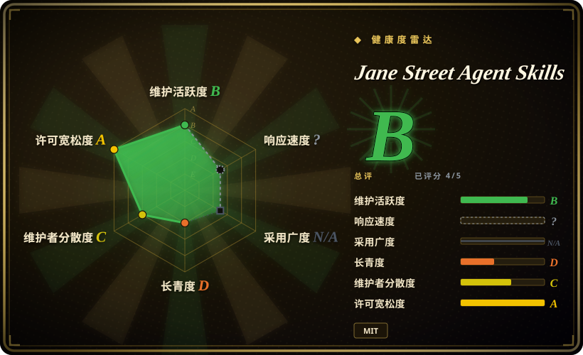
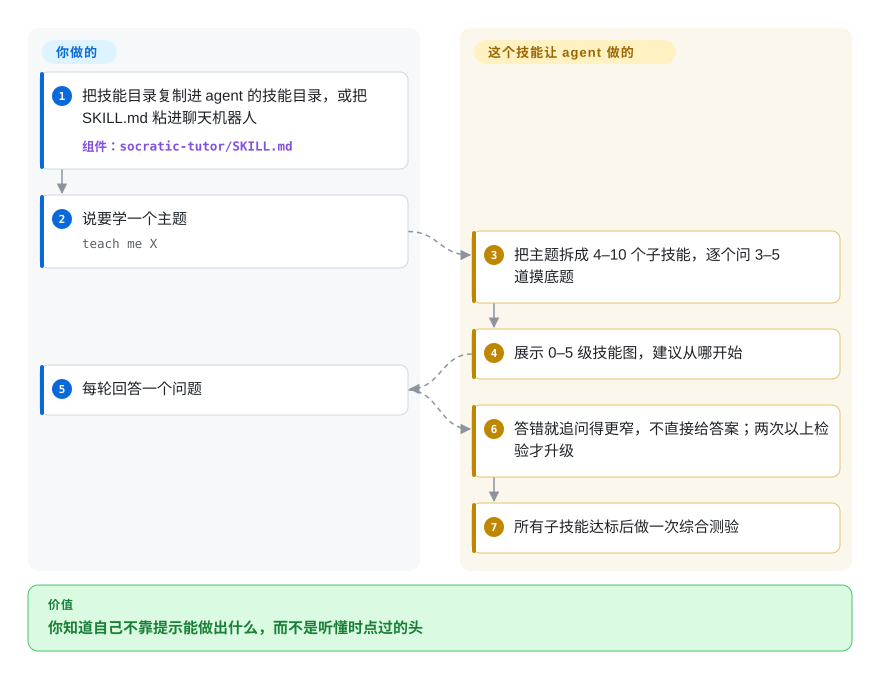
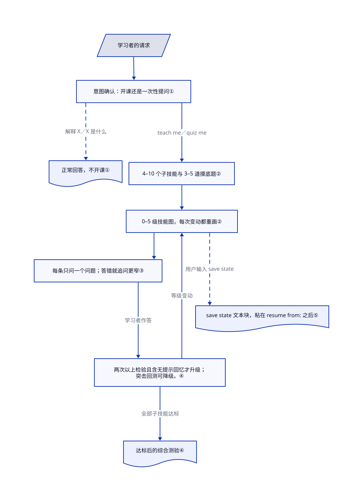

# Jane Street Agent Skills

让 AI 教你一样东西，它先讲满一屏，你回一句“懂了”，一周后自己还是做不出来。这个仓库唯一的技能 `socratic-tutor` 让 agent 先摸底，每次只问一个问题、不提前给答案，每个子技能的 0–5 级要你证明两次才往上加。

## 何时使用

你是工程师或分析师，得真正学会一样东西：SQL 连接、期权定价、一门新类型系统，而你本来就在用编程 agent 或聊天机器人。讲解本身没问题，问题在你：对话常常是“LEFT JOIN 就是保留左表所有行？”——“完全正确！好问题……”，从来没人检查你能不能自己说出来。把 `socratic-tutor` 放进 agent 的技能目录，说一句“teach me X”：它先用 3–5 道摸底题定位你，维护一张看得见的技能图，你在两三次更窄的追问上都失败之前不给答案，还会不打招呼地回测前面的内容。

和 DeepTutor 这类应用相比，选它是因为不想装任何东西、也不想索引文档——整套方法就是一个 102 行的 Markdown 文件，两分钟读完，也能整段粘进任何聊天机器人。和 Mr. Ranedeer 这类早期辅导提示词相比，选它是因为你要的是严格的评分规则（升一级要两次独立检验，其中一次是无提示回忆），而不是个性化的讲课计划。代价是对话之外什么都不记、不排程、不核验：出题、讲课、判分都是同一个模型。

## 何时不用

- **你只想听 X 的解释。** 直接问。技能本身对“explain X”“what is X”这类问题不会开课，意图不清时会先问一句确认；只为查个概念而加载它，只会多一道手续。
- **你要用自己的教材或课程文件学习，并且要跨会话保存进度。** 选 [DeepTutor](deeptutor.zh.md)：它会索引你的文档并保存学习上下文。这个技能没有检索、没有存储，跨会话靠你自己把“save state”文本块粘回去。
- **你需要跨天、跨周的间隔重复。** 用 [Anki](https://github.com/ankitects/anki)（未收录）。技能里的“间隔复习”只是同一场对话里的突击回测，没有排程器、提醒或卡片历史。
- **你要一份课程大纲和能批注的讲义文件，或一个网页界面。** 选 [BloomTutor](https://github.com/Li-Evan/BloomTutor)（未收录）：它同时提供 Claude Code 技能和能保存课程的自托管网页应用。Jane Street 这个技能只产出对话轮次和一张 ASCII 技能图。
- **评分必须可信，比如认证、课程考核、招聘。** 用有老师复核的测评。出题、判对错、定级别都是同一个模型，仓库也没有附带评测：外部贡献者提交的对话记录检查器（PR #3）未合并就被关闭。
- **你指望一个持续扩充、社区维护的合集。** README 写明维护者不收新技能、也不收文本修改，目前所有 PR 都未合并就关闭了。要改就 fork 一份自己维护，或换一个接受贡献的合集。

## 横向对比

| 替代品 | 是否收录 | 我们的评价 | 取舍 |
|---|---|---|---|
| [DeepTutor](deeptutor.zh.md) | ✅ | 课程资料和学习记录要长期留在一个自托管工作台里，选 DeepTutor；想在已经在用的 agent 里直接做严格追问、什么都不装，选本技能。 | DeepTutor 带来检索、持久上下文，也要跑一套 Web／CLI；本技能不需要任何基础设施，但对话结束就什么都不记得。 |
| [BloomTutor](https://github.com/Li-Evan/BloomTutor) | 未收录 | 想要生成好的大纲和讲义、能阅读批注并存成文件或存进网页应用，选 BloomTutor；想要先提问再讲、升级规则写死的刷题式辅导，选本技能。 | BloomTutor（MIT，2026-03 创建）是更完整的产品，网页模式要 Python／Node；Jane Street 的只是一个提示词文件，评级规则更严。真实仓库；not added in this tab batch。 |
| [Mr. Ranedeer AI Tutor](https://github.com/JushBJJ/Mr.-Ranedeer-AI-Tutor) | 未收录 | 只把 Mr. Ranedeer 当作“难度档位、学习风格可调”的设计参考；要拿来复用选本技能，因为它有明确的 MIT 许可和现行的技能目录格式。 | Ranedeer 体量大、可配置项多，但面向 ChatGPT／GPT-4，仓库根目录没有 LICENSE 文件，最近一次推送是 2025-09-30。真实仓库；not added in this tab batch。 |
| [Anki](https://github.com/ankitects/anki) | 未收录 | 要按月保持记忆、需要真正的复习排程，选 Anki；要在实时对话里把一个主题理解透，选本技能。两者可以配合：先用辅导技能吃透，再把要点放进 Anki。 | Anki（AGPL-3.0-or-later，2012 年起）会排程复习，但不追问你的推理；本技能追问推理，但对话一结束就全忘。真实仓库；not added in this tab batch。 |

## 快速上手

README 给了两条路。在支持 `SKILL.md` 技能的编程 agent 里（技能就是一个文件夹，请求和它的描述匹配时 agent 会读取其中的 `SKILL.md`），把 `socratic-tutor` 目录复制进 agent 的技能目录，然后说“teach me X”。在普通聊天机器人里，把 `SKILL.md` 正文粘进对话或自定义／系统提示词，后面接上你想学的主题。技能让 agent 负责确认意图、摸底、展示技能图、驱动提问循环；你负责每轮回答一个问题，使用它定义的命令（“show progress”“harder”“just tell me”“save state”），换新会话时在“resume from:”后面粘回保存的状态块。每一轮都要消耗模型调用，学到掌握是很多次短往返。在 Claude Code 里，有用户反馈客户端自带的提示建议把正确答案提前填好了；在 `/config` 里关掉 `Prompt suggestions` 后解决（issue #16）。

<!-- flow-steps:begin (generated from flows/janestreet-agent-skills.json by tools/flow_card.py — do not edit) -->

流程文字版

1. **你**：把技能目录复制进 agent 的技能目录，或把 SKILL.md 粘进聊天机器人 — 组件：`socratic-tutor/SKILL.md`
2. **你**：说要学一个主题 — `teach me X`
3. **Jane Street Agent Skills**：把主题拆成 4–10 个子技能，逐个问 3–5 道摸底题
4. **Jane Street Agent Skills**：展示 0–5 级技能图，建议从哪开始
5. **你**：每轮回答一个问题
6. **Jane Street Agent Skills**：答错就追问得更窄，不直接给答案；两次以上检验才升级
7. **Jane Street Agent Skills**：所有子技能达标后做一次综合测验

**价值**：你知道自己不靠提示能做出什么，而不是听懂时点过的头

<!-- flow-steps:end -->

## 技术要点

<!-- mechanism:begin (generated from mechanisms/janestreet-agent-skills.json by tools/mechanism_card.py; do not edit) -->

机制文字版

- 学习者的请求
- 意图确认：开课还是一次性提问①
- 正常回答，不开课①
- 4–10 个子技能与 3–5 道摸底题②
- 0–5 级技能图，每次变动都重画②
- 每条只问一个问题；答错就追问更窄③
- 两次以上检验且含无提示回忆才升级； 突击回测可降级。④
- 达标后的综合测验④
- save state 文本块，粘在 resume from: 之后⑤

- 学习者的请求 → 意图确认：开课还是一次性提问①
- 意图确认：开课还是一次性提问① → 正常回答，不开课①（解释 X／X 是什么）〔可选／兜底〕
- 意图确认：开课还是一次性提问① → 4–10 个子技能与 3–5 道摸底题②（teach me／quiz me）
- 4–10 个子技能与 3–5 道摸底题② → 0–5 级技能图，每次变动都重画②
- 0–5 级技能图，每次变动都重画② → 每条只问一个问题；答错就追问更窄③
- 每条只问一个问题；答错就追问更窄③ → 两次以上检验且含无提示回忆才升级； 突击回测可降级。④（学习者作答）
- 两次以上检验且含无提示回忆才升级； 突击回测可降级。④ → 0–5 级技能图，每次变动都重画②（等级变动）
- 两次以上检验且含无提示回忆才升级； 突击回测可降级。④ → 达标后的综合测验④（全部子技能达标）
- 0–5 级技能图，每次变动都重画② → save state 文本块，粘在 resume from: 之后⑤（用户输入 save state）〔可选／兜底〕

<!-- mechanism:end -->

### 1. 守住触发条件，别把随口一问变成考试

- **解决：** 辅导技能如果遇到“X 是什么”就启动，查个概念也会变成一场不想要的摸底测验。
- **做法：** 描述里列出正向触发词（“teach me”“quiz me”“drill me”“help me master”），并明确排除一次性的“explain X”问题；正文重复这条规则，意图不清时只花一句短问题确认再开课。
- **边界：** 是否匹配由宿主 agent 根据描述判断，没有代码层的路由，换一个宿主仍可能触发过度或根本不触发。
- **源码：** [描述第 1–4 行](https://github.com/janestreet/agent_skills/blob/469868f4489cbdbe178c775a0af05bb6bef63689/socratic-tutor/SKILL.md#L1-L4)、[意图确认第 12–19 行](https://github.com/janestreet/agent_skills/blob/469868f4489cbdbe178c775a0af05bb6bef63689/socratic-tutor/SKILL.md#L12-L19)。

### 2. 先定位再开讲，并让定位结果一直可见

- **解决：** 从头讲浪费你已经会的部分，从中间讲又会把你讲丢，两种做法都不告诉你自己在哪。
- **做法：** agent 把主题拆成 4–10 个子技能（主题太大就拆两层树），开讲前先问 3–5 道由易到难的摸底题，然后画出 ASCII 技能图，等级从 0（没听说过）到 5（能教别人），每次升降级都重画。
- **边界：** 五道题覆盖最多十个子技能，定位很粗；技能图只是对话里的文字，不是存下来的记录，宿主截断上下文后若没保存就会丢失。
- **源码：** [开场流程第 21–31 行](https://github.com/janestreet/agent_skills/blob/469868f4489cbdbe178c775a0af05bb6bef63689/socratic-tutor/SKILL.md#L21-L31)、[技能图格式第 34–51 行](https://github.com/janestreet/agent_skills/blob/469868f4489cbdbe178c775a0af05bb6bef63689/socratic-tutor/SKILL.md#L34-L51)。

### 3. 每条消息只问一个问题，你没试过就不给答案

- **解决：** 模型习惯在自己的问题后面接上提示甚至答案，学习者只是在读，没有在想。
- **做法：** 每条消息在一个问题之后立刻结束。答错时换一个更窄、能暴露推理矛盾的问题；连错两三次才允许直接讲解，讲完要马上换个角度重测。答对时偶尔唱反调，有工具时布置练习并检查你的实际输出。
- **边界：** 这些都是指令，不是强制；宿主界面仍可能漏答案（issue #16），而“just tell me”本来就允许对单个问题跳出提问模式。
- **源码：** [教学循环第 53–68 行](https://github.com/janestreet/agent_skills/blob/469868f4489cbdbe178c775a0af05bb6bef63689/socratic-tutor/SKILL.md#L53-L68)、[提示建议漏答案的 issue #16](https://github.com/janestreet/agent_skills/issues/16)。

### 4. 等级要证明两次才给，也会被收回

- **解决：** 给分宽松的辅导会告诉你已经掌握了一样你刚刚才认出来的东西。
- **做法：** 至少两次独立检验、其中一次是无提示回忆，才升一级；含糊或部分正确的回答不算对；对旧子技能的突击回测失败就降级。5 级要求能处理边界情况并讲到足以教别人；所有子技能达到目标（默认 4 级）后还要通过一次综合测验才结课。
- **边界：** 考官和老师是同一个模型，知识盲区也相同；仓库没有附带评分细则或对话记录检查器，严格程度全看模型是否照文本执行。
- **源码：** [评分规则第 70–83 行](https://github.com/janestreet/agent_skills/blob/469868f4489cbdbe178c775a0af05bb6bef63689/socratic-tutor/SKILL.md#L70-L83)、[掌握与结课第 85–91 行](https://github.com/janestreet/agent_skills/blob/469868f4489cbdbe178c775a0af05bb6bef63689/socratic-tutor/SKILL.md#L85-L91)、[对话记录检查器 PR 未合并即关闭](https://github.com/janestreet/agent_skills/pull/3)。

### 5. 用一段粘贴的文本把课程带到下一个会话

- **解决：** 一门课往往一场对话装不下，而技能自己没有存储。
- **做法：** 说“save state”，agent 输出一个紧凑的状态块，包含主题、各子技能等级、误解记录和已覆盖内容；在新会话里把它粘在“resume from:”后面即可恢复技能图并继续。
- **边界：** 状态是否准确取决于模型的总结；唯一的副本在你手里，没有任何校验，而你不开新会话，会话之间也就不会有间隔复习。
- **源码：** [用户命令第 93–102 行](https://github.com/janestreet/agent_skills/blob/469868f4489cbdbe178c775a0af05bb6bef63689/socratic-tutor/SKILL.md#L93-L102)。

## 健康度与可持续性

- **2026-11-18：** 2026-11-03 创建，共三次提交——两次是从 Jane Street 内部仓库自动导出的 `public-release`，一次是维护者 `dra27-js` 在 2026-11-17 更新 README。没有 release 或 tag。太年轻，谈不上林迪效应加分。
- **治理：** 背后是 Jane Street（2013 年起的 GitHub 组织，长期发布 OCaml 开源项目），但这个仓库是单向导出。README 拒收新技能和文本修改；目前所有 PR，包括新技能和对话记录检查器，都未合并就关闭。模板化的 `CONTRIBUTING.md` 仍写着欢迎带 DCO 签名的 PR，实际以 README 为准。
- **采用信号：** 一个 102 行的文件在头两周拿到约 9.9k star、673 个 fork。这更多反映发布方的名气，而不是经过检验的质量 [推断]；没有任何公开的学习效果评测。
- **风险信号：** MIT 许可，版权方 Jane Street Group, LLC，复用和 fork 都没有障碍。仓库里没有脚本、hook 或网络调用，安装后除了这段提示词没有其他副作用。README 的“Prior art”一节说明该技能为内部编写，并非有意衍生自其他提示词。

## 存疑（未验证）

- [推断：依据是两周内的 star／fork 数与仓库内容体量对比，未做 star 来源分析] star 数主要反映 Jane Street 的品牌和发布热度，而不是实测的辅导质量。
- [未验证：未在任何 agent 中实际跑一轮辅导会话] 当前模型能否稳定做到每条只问一个问题、不提前给答案、严格评分，没有测试；仅有的实地证据是 issue #16 和已关闭 PR #3 作者跑过的一次会话。
- [未验证：README 只说技能导出自内部仓库，没有路线图] Jane Street 是否会往这个仓库加更多技能、多久导出一次，都不清楚。
- [推断：依据是技能全部状态都在对话上下文里] 很长的会话在宿主截断上下文时可能丢掉早先的技能图或复习记录，除非学习者用了“save state”。
