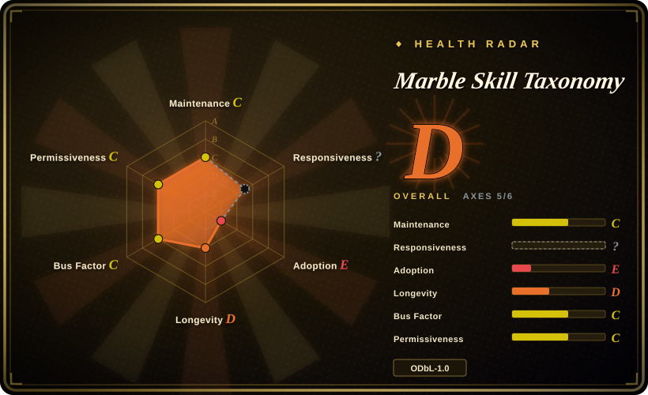
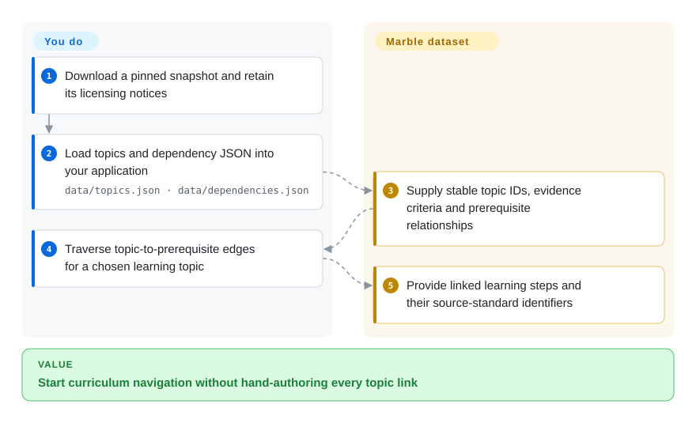
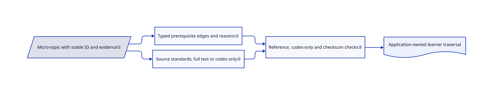

# Marble Skill Taxonomy

A flat curriculum list cannot tell your tutoring app what a child should learn first; this dataset connects elementary micro-topics to prerequisites, evidence criteria and curriculum identifiers.

## When to use

You build an elementary tutoring or curriculum-navigation app and need a starting graph rather than manually linking every concept. Load Marble's 1,590 topics and 3,221 dependency edges when fine-grained learning steps and source-standard mappings matter more than an official standards registry. This is reusable JSON data, not a tutor, assessment engine or validated model of an individual child.

## When NOT to use

- Need to author, govern and publish institutional competency frameworks? Choose OpenSALT rather than static export files.
- Need authoritative Common Core wording and permissions? Use the official Common Core standards source directly, not Marble's interpretation as an authority.
- Need only England's statutory curriculum? Use the Department for Education source directly and add your own graph if necessary.
- Cannot accept database and content share-alike obligations? Build an independently licensed taxonomy instead; the app consuming it and derivative data are different legal objects.

## Comparison

| Alternative | In index | Our verdict | Tradeoff |
| --- | --- | --- | --- |
| [OpenSALT](https://github.com/opensalt/opensalt) | not indexed | Choose OpenSALT for managing and publishing competency registries; choose Marble for immediately loadable elementary prerequisite data. | Registry software needs operation and authored content; not added in this tab batch. |
| Official Common Core State Standards | not a repo | Choose the official source when exact standards wording decides; choose Marble for an additional micro-topic and prerequisite layer. | Standards publication, not a repository; purpose-limited source terms still apply to included text. |
| England National Curriculum | not a repo | Choose the official curriculum for statutory scope; choose Marble to navigate teachable steps across several frameworks. | Government publication under OGL, not a repository; Marble's cross-framework interpretation needs educational review. |

## Quick start

Download a pinned checkout and load `data/topics.json` and `data/dependencies.json` in your application. Build an ID map and follow edges from `topicId` to `prerequisiteId`; reverse them to find what a topic unlocks. Marble supplies content and relationships, while you implement learner state, traversal, assessment and UI. Replace or strip `{{name}}` in assessment prompts, and retain attribution plus the applicable database, content and source-standard notices. The provided validator checks integrity, but the source database export tool is not included. See [data usage](https://github.com/withmarbleapp/os-taxonomy/blob/96a7933754af672e1bfdbf7ecb05c325860c6e0d/README.md#using-it).

<!-- flow-steps:begin (generated from flows/os-taxonomy.json by tools/flow_card.py — do not edit) -->

Text version of the flow

1. **You**: Download a pinned snapshot and retain its licensing notices
2. **You**: Load topics and dependency JSON into your application — `data/topics.json · data/dependencies.json`
3. **Marble Skill Taxonomy**: Supply stable topic IDs, evidence criteria and prerequisite relationships
4. **You**: Traverse topic-to-prerequisite edges for a chosen learning topic
5. **Marble Skill Taxonomy**: Provide linked learning steps and their source-standard identifiers

**Value**: Start curriculum navigation without hand-authoring every topic link

<!-- flow-steps:end -->

## Key techniques

<!-- mechanism:begin (generated from mechanisms/os-taxonomy.json by tools/mechanism_card.py; do not edit) -->

Text version of the mechanism

- Micro-topic with stable ID and evidence①
- Typed prerequisite edges and reasons①
- Source standards; full text or codes only②
- Reference, codes-only and checksum checks②
- Application-owned learner traversal

- Micro-topic with stable ID and evidence① → Typed prerequisite edges and reasons①
- Micro-topic with stable ID and evidence① → Source standards; full text or codes only②
- Typed prerequisite edges and reasons① → Reference, codes-only and checksum checks②
- Source standards; full text or codes only② → Reference, codes-only and checksum checks②
- Reference, codes-only and checksum checks② → Application-owned learner traversal

<!-- mechanism:end -->

### 1. Connect stable topics to prerequisites and evidence

- **Problem:** A standard's broad wording is too coarse to choose the next learning step.
- **How:** Topic records combine stable IDs, skill type, age range, evidence criteria and source-standard keys. Separate edges name a prerequisite, strength and reason.
- **Limits:** These are authored educational judgments, not experimentally established prerequisite effects or calibrated mastery probabilities.
- **Source:** [Topic schema](https://github.com/withmarbleapp/os-taxonomy/blob/96a7933754af672e1bfdbf7ecb05c325860c6e0d/schema/topics.schema.json), [edge schema](https://github.com/withmarbleapp/os-taxonomy/blob/96a7933754af672e1bfdbf7ecb05c325860c6e0d/schema/dependencies.schema.json), [actual records](https://github.com/withmarbleapp/os-taxonomy/blob/96a7933754af672e1bfdbf7ecb05c325860c6e0d/data/topics.json).

### 2. Preserve licensing boundaries in the exported data

- **Problem:** Source curricula cannot all be republished under Marble's database license.
- **How:** Provenance distinguishes full-text sources from codes-only sources. The validator rejects verbatim `data` fields in codes-only records, checks references and verifies manifest SHA-256 values.
- **Limits:** Checksums prove snapshot consistency, not educational validity or legal clearance; the validator checks self-edges but does not implement general cycle detection.
- **Source:** [Integrity checks](https://github.com/withmarbleapp/os-taxonomy/blob/96a7933754af672e1bfdbf7ecb05c325860c6e0d/scripts/validate.mjs#L32-L90), [source rights](https://github.com/withmarbleapp/os-taxonomy/blob/96a7933754af672e1bfdbf7ecb05c325860c6e0d/PROVENANCE.md).

## Tech stack

UTF-8 JSON data and JSON Schema documents. A dependency-free Node.js script performs export integrity checks; there is no serving runtime or database server in this repository.

## Dependencies

Any JSON reader is sufficient for consumption. Node is needed only for the supplied validator. Your application supplies storage and learner logic; no embeddings or child records are included.

## Ops difficulty

**Low for hosting, medium for governance.** Static files require no service, but updates need schema/reference checks, attribution and license review. ODbL covers the database, CC-BY-SA covers authored text, and source standards retain their own terms. The Common Core text is not simply relicensed under ODbL.

## Health & viability

- Verified 2026-10-18: published July 8, with no later commits or releases in the fetched snapshot; two contributors are visible. Treat it as a dated dataset, not a continuously updated curriculum service.
- Marble/Generative Spark is the named producer. [推断：依据是单次快照与创建日期] A three-month-old release has little Lindy evidence; pin the data and plan to maintain local corrections.
- Independent read-only checks found the declared topic/edge counts, no missing edge endpoints, matching hashes for four data files and no text fields in the four codes-only sources.

## Caveats (unverified)

- [未验证：未进行教学实验] Prerequisite accuracy, age ranges and assessment prompts have not been validated against learner outcomes here.
- [未验证：未取得各标准权利人的法律确认] Provenance documents upstream restrictions; this page is not legal clearance for your redistribution.
- [推断：依据是单次快照与创建日期] Future refresh cadence and vendor commitment remain uncertain.
