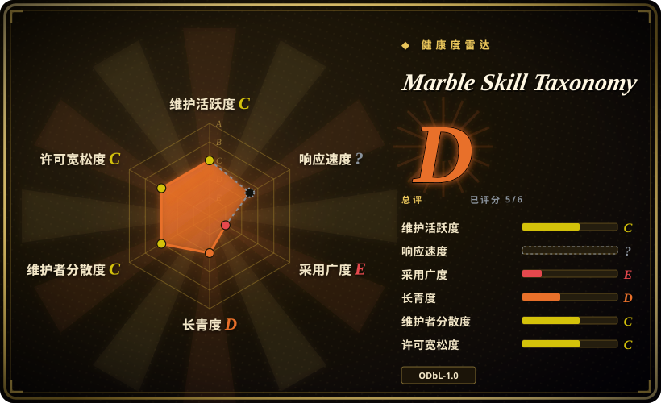
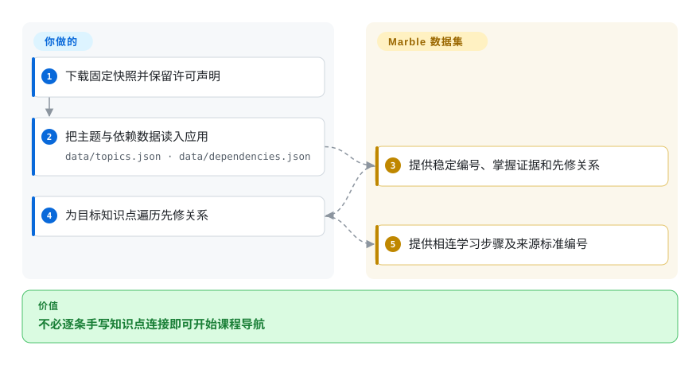

# Marble Skill Taxonomy

平铺的课程清单不能告诉辅导应用先教什么。这份数据把小学微知识点连成先修图，并附掌握证据与课程标准编号。

## 何时使用

你在开发小学辅导或课程导航应用，不想逐个手工连接概念。比起官方标准注册服务，若更需要细粒度学习步骤与来源映射，可以加载这份含 1,590 个主题和 3,221 条依赖的数据。它是可复用 JSON，不是教师、测评引擎，也不是经过验证的个人儿童模型。

## 何时不用

- 要编写、治理和发布机构能力框架，选 OpenSALT，而非静态导出文件。
- 要权威 Common Core 原文与权限，直接用官方标准，不能把 Marble 的解释当权威。
- 只要英格兰法定课程，直接用教育部来源，需要先修图时自己补建。
- 无法接受数据库与文本的相同方式共享义务，应独立构建许可合适的分类。消费数据的应用与衍生数据不是同一法律对象。

## 横向对比

| 替代品 | 是否收录 | 我们的评价 | 取舍 |
| --- | --- | --- | --- |
| [OpenSALT](https://github.com/opensalt/opensalt) | 未收录 | 要管理发布能力标准注册表选 OpenSALT；要即取即用的小学先修数据选 Marble。 | 注册软件还需运营与内容编写；本次标签批次不新增该仓库。 |
| 官方 Common Core State Standards | 非仓库 | 标准原文决定选型时用官方来源；要额外微知识点与先修关系时选 Marble。 | 标准出版物而非仓库；所含原文仍有目的限制条款。 |
| 英格兰国家课程 | 非仓库 | 法定范围优先时用官方课程；要跨框架导航细化学习步骤时用 Marble。 | OGL 政府出版物而非仓库；跨框架解释仍需教学审核。 |

## 快速上手

下载固定版本，读取 `data/topics.json` 和 `data/dependencies.json`。建立编号映射，从 `topicId` 沿边查找 `prerequisiteId`，反向则查学完后解锁什么。Marble 提供内容和关系，你实现学生状态、遍历、测评与界面。展示测评提示前替换或删掉 `{{name}}`，并保留署名、数据库、文本和来源标准声明。附带检查器能校验完整性，但生成数据的数据库导出工具未包含在仓库。来源为[数据用法](https://github.com/withmarbleapp/os-taxonomy/blob/96a7933754af672e1bfdbf7ecb05c325860c6e0d/README.md#using-it)。

<!-- flow-steps:begin (generated from flows/os-taxonomy.json by tools/flow_card.py — do not edit) -->

流程文字版

1. **你**：下载固定快照并保留许可声明
2. **你**：把主题与依赖数据读入应用 — `data/topics.json · data/dependencies.json`
3. **Marble Skill Taxonomy**：提供稳定编号、掌握证据和先修关系
4. **你**：为目标知识点遍历先修关系
5. **Marble Skill Taxonomy**：提供相连学习步骤及来源标准编号

**价值**：不必逐条手写知识点连接即可开始课程导航

<!-- flow-steps:end -->

## 技术要点

<!-- mechanism:begin (generated from mechanisms/os-taxonomy.json by tools/mechanism_card.py; do not edit) -->

机制文字版

- 有稳定编号和掌握证据的微知识点①
- 有强弱和原因的先修边①
- 来源标准：全文或仅编号②
- 引用、仅编号和摘要检查②
- 由应用实现学习路径遍历

- 有稳定编号和掌握证据的微知识点① → 有强弱和原因的先修边①
- 有稳定编号和掌握证据的微知识点① → 来源标准：全文或仅编号②
- 有强弱和原因的先修边① → 引用、仅编号和摘要检查②
- 来源标准：全文或仅编号② → 引用、仅编号和摘要检查②
- 引用、仅编号和摘要检查② → 由应用实现学习路径遍历

<!-- mechanism:end -->

### 1. 用稳定知识点连接先修与掌握证据

- **解决：** 宽泛课程条目不足以决定下一步教什么。
- **做法：** 主题记录组合稳定编号、能力类型、年龄范围、掌握证据与来源标准键；独立边记录先修点、强弱与原因。
- **边界：** 这些是作者的教学判断，不是经实验确认的先修效应或校准后的掌握概率。
- **源码：** [主题结构](https://github.com/withmarbleapp/os-taxonomy/blob/96a7933754af672e1bfdbf7ecb05c325860c6e0d/schema/topics.schema.json)、[边结构](https://github.com/withmarbleapp/os-taxonomy/blob/96a7933754af672e1bfdbf7ecb05c325860c6e0d/schema/dependencies.schema.json)、[真实记录](https://github.com/withmarbleapp/os-taxonomy/blob/96a7933754af672e1bfdbf7ecb05c325860c6e0d/data/topics.json)。

### 2. 在导出数据中保留许可边界

- **解决：** 不同课程来源不能统一改成 Marble 的数据库许可。
- **做法：** 来源账本区分全文和仅编号来源。检查器拒绝仅编号记录中的原文字段，核对引用，并检查清单 SHA-256。
- **边界：** 摘要只证明快照一致，不证明教学有效或法律放行；检查器只查自环，没有实现一般环路检测。
- **源码：** [完整性检查](https://github.com/withmarbleapp/os-taxonomy/blob/96a7933754af672e1bfdbf7ecb05c325860c6e0d/scripts/validate.mjs#L32-L90)、[来源权利](https://github.com/withmarbleapp/os-taxonomy/blob/96a7933754af672e1bfdbf7ecb05c325860c6e0d/PROVENANCE.md)。

## 技术栈

UTF-8 JSON 与 JSON Schema。无依赖 Node.js 脚本负责导出完整性检查；仓库没有服务运行时或数据库服务器。

## 依赖

消费数据只需 JSON 读取器，附带检查器才需要 Node。应用自己提供存储和学习逻辑，不附嵌入向量或儿童记录。

## 运维难度

**托管低，治理中等。** 静态文件无需服务，但更新要核对结构、引用、署名和许可。ODbL 覆盖数据库，CC-BY-SA 覆盖自编文字，来源标准另循原条款。Common Core 原文没有被简单改成 ODbL。

## 健康度与可持续性

- 2026-10-18 核验：数据于 7 月 8 日发布，获取的快照未见之后提交或标签版本，两名贡献者可见。应当作有日期的数据集，而非持续更新课程服务。
- Marble 和 Generative Spark 是署名生产方。[推断：依据是单次快照与创建日期] 三个月历史几乎没有 Lindy 证据，应固定数据并准备维护本地修正。
- 独立只读检查确认主题与边数量、所有边端点存在、四份数据摘要一致，四个仅编号来源没有原文字段。

## 存疑（未验证）

- [未验证：未进行教学实验] 未用学习结果验证先修关系、年龄区间与测评提示。
- [未验证：未取得各标准权利人的法律确认] 来源账本列出限制，本页不构成你再分发的法律放行。
- [推断：依据是单次快照与创建日期] 后续更新节奏与厂商承诺仍不确定。
