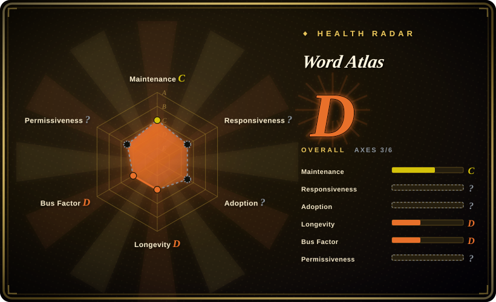
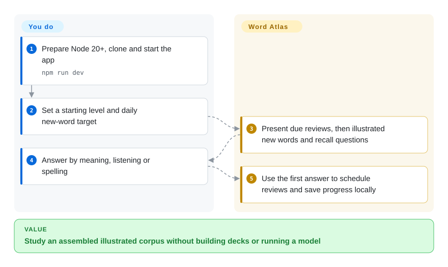
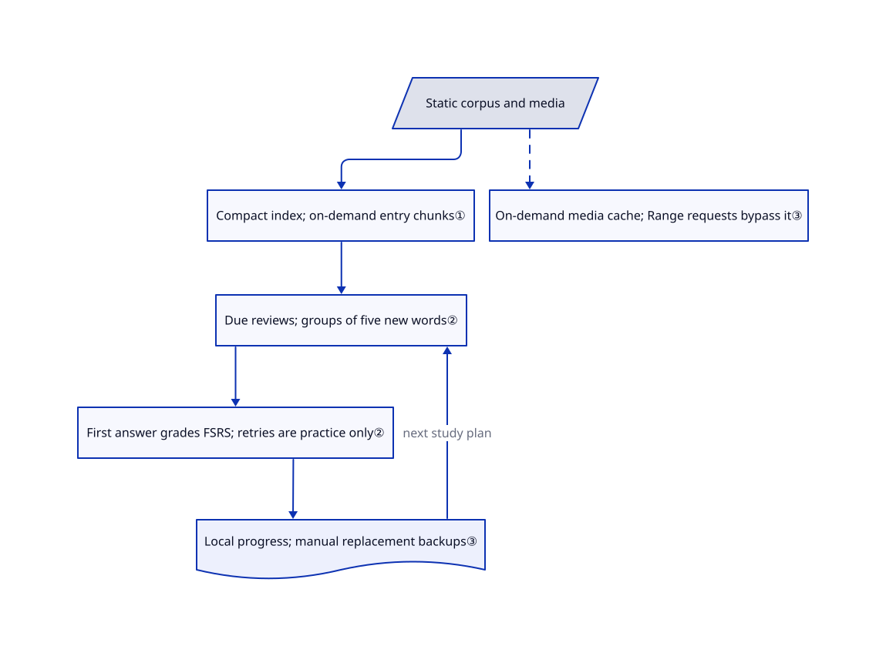

# Word Atlas

You remember a word's translation but cannot recall it in a sentence. Word Atlas couples illustrated English–Chinese vocabulary with listening, recall questions and scheduled review, without an account.

## When to use

You are preparing a Chinese-speaking learner's IELTS vocabulary practice, or building a small vocabulary site. A bare list such as `principle → 原则` leaves you assembling pictures, pronunciation and example sentences yourself. Word Atlas supplies a static web app plus reusable JSON/CSV and media for 7,298 entries. You can start with its existing learning route rather than authoring an Anki deck or connecting a model at study time.

Choose it when ready-made illustrations and a self-hosted, account-free study loop matter more than arbitrary deck editing or device synchronization. The content is AI-generated and not individually proofread; treat it as a reviewable starting corpus, not an authoritative dictionary. The README explicitly separates this open-source base edition from the independently evolving hosted website.

## When NOT to use

- **Your progress must survive device loss or synchronize automatically.** Prefer Anki or Mnemosyne with their synchronization workflow. This app stores progress in browser storage and requires manual backups. At the reviewed SHA, an unsupported inner backup version can become empty progress during import; the relevant code remains in place despite open [PR #15](https://github.com/designfuchen/word-atlas/pull/15). Preserve a known-good export before importing anything.
- **You need reliable whole-course offline audio or share an origin with another web app.** Prefer a desktop flashcard program such as Anki. This worker caches on demand, skips Range requests and deletes caches whose names do not start with its version prefix. Its code does not provide a complete offline media download, and cache names from unrelated same-origin apps are not protected.
- **You primarily want touch-typing with several exam or programming vocabularies.** Prefer Qwerty Learner. Word Atlas centers one illustrated IELTS corpus; its separate typing practice does not update the memory scheduler.
- **You need a teacher-approved lexical authority.** Use Anki with an instructor-reviewed deck or licensed reference material. Word Atlas explicitly disclaims per-entry proofreading, official IELTS affiliation and accuracy guarantees; the data maps recordings to a word ID rather than to each individual sense.
- **You only want to study or deploy the app.** Use the normal build path below, not `pack:public`. The optional export script clears its output directory and rejects only the project itself and descendants, not ancestors or unrelated nonempty folders. [PR #18](https://github.com/designfuchen/word-atlas/pull/18) proposes guards; it is not in the reviewed code. For reusable card content without this export tool, Anki is an alternative.

## Comparison

| Alternative | In index | Our verdict | Tradeoff |
|---|---|---|---|
| [Anki](https://github.com/ankitects/anki) | not indexed | Choose Anki for a general desktop flashcard workflow; choose Word Atlas when the supplied illustrated English–Chinese IELTS corpus removes most of your initial content assembly. | Word Atlas bundles a narrow corpus and web interface, while a general flashcard workflow leaves deck selection and content review to you. Not added in this tab batch. |
| [Qwerty Learner](https://github.com/RealKai42/qwerty-learner) | not indexed | Choose Qwerty Learner for keyboard practice across exam and programming dictionaries; choose Word Atlas for picture-led recall with scheduled reviews. | Qwerty Learner documents many dictionaries and typing feedback; Word Atlas supplies illustrations and its own first-attempt review grading. Not added in this tab batch. |
| [Mnemosyne](https://github.com/mnemosyne-proj/mnemosyne) | not indexed | Choose Mnemosyne for desktop multimedia cards, plugins and device synchronization; choose Word Atlas for a static browser app with the corpus already assembled. | Mnemosyne offers a broader card platform and synchronization, but you supply the learning material; Word Atlas avoids that setup at the cost of corpus and backup constraints. Not added in this tab batch. |

## Quick start

Prepare Node.js 20+ and npm, clone the repository, then use the README's `npm ci` and `npm run dev`; the local address is `http://localhost:5188`. Set the learner's starting level and daily new-word target, then begin today's study. The app presents illustrations, pronunciation and recall questions, and schedules future reviews from the first answer for each word in a session. You supply the hosting, content review and progress backups; study itself needs no model key or server database. To deploy, `npm run build` creates `dist/`; `ATLAS_BASE=/words/ npm run build` sets a subpath, but the deployment guide's claimed Pages workflow is absent from the reviewed tree.

<!-- flow-steps:begin (generated from flows/word-atlas.json by tools/flow_card.py — do not edit) -->

Text version of the flow

1. **You**: Prepare Node 20+, clone and start the app — `npm run dev`
2. **You**: Set a starting level and daily new-word target
3. **Word Atlas**: Present due reviews, then illustrated new words and recall questions
4. **You**: Answer by meaning, listening or spelling
5. **Word Atlas**: Use the first answer to schedule reviews and save progress locally

**Value**: Study an assembled illustrated corpus without building decks or running a model

<!-- flow-steps:end -->

## Key techniques

<!-- mechanism:begin (generated from mechanisms/word-atlas.json by tools/mechanism_card.py; do not edit) -->

Text version of the mechanism

- Static corpus and media
- Compact index; on-demand entry chunks①
- Due reviews; groups of five new words②
- First answer grades FSRS; retries are practice only②
- Local progress; manual replacement backups③
- On-demand media cache; Range requests bypass it③

- Static corpus and media → Compact index; on-demand entry chunks①
- Compact index; on-demand entry chunks① → Due reviews; groups of five new words②
- Due reviews; groups of five new words② → First answer grades FSRS; retries are practice only②
- First answer grades FSRS; retries are practice only② → Local progress; manual replacement backups③
- Local progress; manual replacement backups③ → Due reviews; groups of five new words② (next study plan)
- Static corpus and media → On-demand media cache; Range requests bypass it③ [optional/fallback]

<!-- mechanism:end -->

### 1. Load a compact index before full entries

- **Problem:** Loading every definition and media file before browsing would make a large illustrated corpus expensive to open.
- **How:** The app reads a compact index, maps rows to word references and fetches full entries in indexed chunks. A promise map shares concurrent chunk requests; media flags select image and audio paths.
- **Limits:** This is demand loading, not a complete offline download. Chunk URLs have no content version, while the service worker serves cached chunks first.
- **Source:** [Index, chunk cache and media paths](https://github.com/designfuchen/word-atlas/blob/99c007673d38f02c418d8e4cd2e9ec90b5d40be5/src/atlas/data.ts#L19-L86), [100-entry data chunks](https://github.com/designfuchen/word-atlas/blob/99c007673d38f02c418d8e4cd2e9ec90b5d40be5/docs/dataset.md#L26-L33).

### 2. Separate first-attempt memory updates from corrective practice

- **Problem:** Repeating a missed question immediately can inflate a learner's apparent retention.
- **How:** Sessions put due reviews before new words, then introduce new words in groups of five. Only a word's first graded answer updates ts-fsrs, a spaced-review scheduler; wrong answers can return twice in another format without being graded again.
- **Limits:** The grade still comes from answer correctness, time and hints, not a measured learning outcome. A normal session selects at most 120 due reviews; the scheduler does not certify the generated definitions or distractors.
- **Source:** [Session construction and first-answer gate](https://github.com/designfuchen/word-atlas/blob/99c007673d38f02c418d8e4cd2e9ec90b5d40be5/src/store/session.ts#L86-L149), [scheduler and serialized memory state](https://github.com/designfuchen/word-atlas/blob/99c007673d38f02c418d8e4cd2e9ec90b5d40be5/src/store/srs.ts#L22-L63).

### 3. Keep progress local, but distinguish storage from media caching

- **Problem:** An account-free study app still needs persistent progress and reusable media.
- **How:** The store writes per-dataset progress to localStorage after a 250 ms debounce, flushes on page hiding and supports JSON backups. A separate service worker caches same-origin GET responses and trims the media cache to 1,500 entries.
- **Limits:** Backups replace rather than merge progress. The inner-version import and failed-write dirty flag have open fixes; Range requests bypass caching, and activation deletes unrelated cache names on the same origin. These are code-inspected boundaries, not an offline reliability guarantee.
- **Source:** [Persistence and cross-tab state](https://github.com/designfuchen/word-atlas/blob/99c007673d38f02c418d8e4cd2e9ec90b5d40be5/src/store/store.ts#L203-L237), [backup validation and replacement](https://github.com/designfuchen/word-atlas/blob/99c007673d38f02c418d8e4cd2e9ec90b5d40be5/src/store/store.ts#L288-L315), [cache activation and request handling](https://github.com/designfuchen/word-atlas/blob/99c007673d38f02c418d8e4cd2e9ec90b5d40be5/public/sw.js#L1-L53).

## Tech stack

React 19.2, TypeScript 5.9, Vite 6 and ts-fsrs 5.4; custom WebGL2 vocabulary visualization. The manifest includes Node's test runner through tsx and Playwright for development tools, not a server-side application runtime.

## Dependencies

- **Build:** Node.js 20+ and npm, with dependencies installed from the lockfile. The development command binds to `0.0.0.0`; keep it on a trusted network rather than treating it as a secured shared service.
- **Study:** a browser and static hosting for the app and its media. No database, account service or model API key is required. Browser storage holds progress; the bundled media makes the repository large.
- **Optional content generation:** Python scripts, an OpenAI-compatible endpoint and ElevenLabs credentials. They read `.local/forge/headwords.json` and external credential files; that ignored intermediate input is not part of the public corpus. Existing data does not require regeneration.
- **Rights:** root code is MIT; the named text, illustrations and word recordings are offered under CC BY 4.0 to the extent the maintainers can grant rights. Preserve attribution and note modifications. Dependencies and the Fraunces font retain separate licenses; neither the voice models nor voice identities are licensed by the recording grant.

## Ops difficulty

**Low for an isolated static trial; medium for dependable daily use.** You host a large media tree, manage browser-cache freshness and arrange backups. Use a dedicated origin because of the service worker's broad cache deletion. Do not copy the guide's seven-day cache policy blindly for HTML, worker and index updates. The optional export tool is destructive and unnecessary for the ordinary build; inspect its destination handling before any use.

## Health & viability

- **2026-10-27:** created October 25 and pushed October 27, unarchived; the package says 1.0.0, but the releases API returns no GitHub releases. Two days of history supplies almost no Lindy evidence despite thousands of stars.
- The contributors endpoint lists only `designfuchen` with 12 contributions. Contribution and security policies exist, but the checked tree has no CI or Pages workflow. Treat the current maintenance arrangement as concentrated, not foundation-backed.
- Open issue/PR traffic includes downstream reuse and proposed backup, persistence, quiz and export fixes. Those are evidence of engagement, not evidence that fixes shipped; reviewed sources still contain the cited paths.
- The automatic radar leaves response speed, adoption and license permissiveness unscored: its sample has no qualifying response, no canonical install signal, and no registry corroboration for the modified MIT text. This does not erase the actual MIT code grant or the separate CC BY 4.0 content grant read above.
- **[Inference: based on the young history, concentrated contributions and code-confirmed state/export hazards]** Use the app as a reviewable starter and the dataset as reusable material, not yet as the sole record of a learner's progress. Popularity does not establish retention gains or content correctness.

## Caveats (unverified)

- [Unverified: this intake forbids running upstream code and installing dependencies] No upstream tests, app build, actual study session, backup restore or offline/browser playback was executed. Source inspection supports the described mechanisms, not runtime reliability on a particular device.
- [Unverified: no per-entry human audit or provider-rights documentation was supplied] AI-generated meanings, examples, illustrations and pronunciation can be wrong. The content license records the maintainer's grant, not an independent clearance of every generated asset or voice-provider contract.
- [Inference: based on two days of history, one listed contributor and still-present persistence/export paths] Long-term maintenance and safe daily progress retention remain unproven. Issue reports are cited as reports, not as independently reproduced tests.
