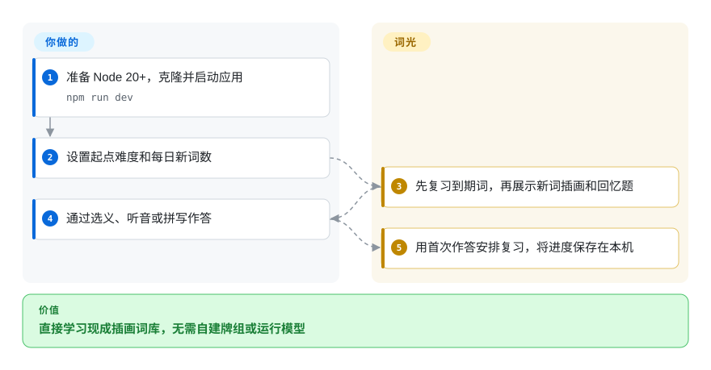
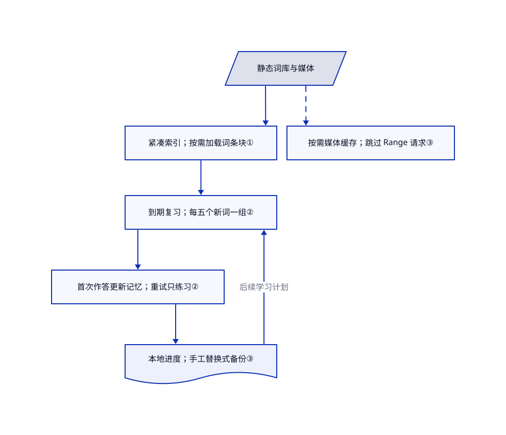

# Word Atlas

单词的中文意思背下来了，放进句子却想不起来。词光把插画、中英例句、听音与回忆题串成每日复习，无需注册账号。

## 何时使用

你在为中文学习者准备雅思词汇练习，或开发一个小型背词网站。面对 `principle → 原则` 这样的词表，你还得逐项补图、配音、写例句。词光提供静态网页应用，以及可复用的 7,298 条 JSON／CSV 词条和媒体。你能沿现成路线学习，不必先制作 Anki 牌组，也不必在学习时调用模型。

当你更看重现成插画、自托管和免账号学习，而不是任意牌组编辑或跨设备同步时，可考虑它。内容由 AI 生成，尚未逐条人工审校，应当作为待复核的起始词库，而不是权威词典。README 明确说明：仓库是开源基础版，在线网站独立迭代，两者功能可能不同。

## 何时不用

- **进度必须抗设备丢失或自动同步。** 优先用 Anki 或 Mnemosyne 的同步流程。词光把进度留在浏览器存储，备份要手工导出。所读版本导入不支持的内部进度版本时，会把它清洗为空进度；[PR #15](https://github.com/designfuchen/word-atlas/pull/15) 尚未进入所读源码。导入前保留一份已知有效的导出文件。
- **必须全课程音频可靠离线，或与其他网页应用共用域名。** 优先用 Anki 这类桌面闪卡程序。词光按访问缓存，跳过 Range 请求，还会删除名称不以自身版本前缀开头的缓存。源码没有完整媒体离线下载功能，也不保护同源其他应用的缓存名称。
- **主要目标是多考试词库或编程词汇的键盘练习。** 选 Qwerty Learner。词光围绕一套带插画的雅思词库组织学习，独立打字练习不会更新记忆调度。
- **需要教师审校过的词汇权威来源。** 用 Anki 配合教师审核的牌组或已获授权的参考资料。词光明确不保证逐条审校、官方雅思身份或准确性；录音按词条 ID 关联，不按每个义项分别关联。
- **只想学习或部署应用。** 用下方普通构建流程，不要运行 `pack:public`。可选导出脚本会清空输出目录，只拒绝项目自身和子目录，没有拒绝祖先或无关非空目录。[PR #18](https://github.com/designfuchen/word-atlas/pull/18) 提出了防护，但未进入所读源码。需要可复用卡片而不使用这个导出工具时，也可选 Anki。

## 横向对比

| 替代品 | 是否收录 | 我们的评价 | 取舍 |
|---|---|---|---|
| [Anki](https://github.com/ankitects/anki) | 未收录 | 通用桌面闪卡流程选 Anki；想直接拿到中英雅思插画词库，减少初期素材组装时选词光。 | 词光把窄范围词库和网页界面打包；通用闪卡流程仍需自己选牌组、审内容。本批不扩收替代仓库。 |
| [Qwerty Learner](https://github.com/RealKai42/qwerty-learner) | 未收录 | 多考试和编程词库的键盘训练选 Qwerty Learner；插画回忆加定时复习选词光。 | 前者文档列出多种词库与打字反馈；词光提供插画及首次作答的记忆评分。本批不扩收替代仓库。 |
| [Mnemosyne](https://github.com/mnemosyne-proj/mnemosyne) | 未收录 | 桌面多媒体卡片、插件与设备同步选 Mnemosyne；想要现成词库的静态网页应用选词光。 | 前者卡片平台更广并提供同步，但学习材料自备；词光省去素材准备，却受词库范围与备份方式限制。本批不扩收替代仓库。 |

## 快速上手

准备 Node.js 20+ 和 npm，克隆仓库后，按 README 执行 `npm ci`、`npm run dev`，本地地址为 `http://localhost:5188`。设置学习者的起点难度和每日新词数，再开始今日学习。应用展示插画、发音和回忆题，并用本轮每个词的首次作答安排后续复习。你负责托管、内容复核和进度备份；日常学习不需要模型密钥或服务器数据库。部署时，`npm run build` 生成 `dist/`，`ATLAS_BASE=/words/ npm run build` 设置子路径，但部署文档声称存在的 Pages 工作流不在所读文件树中。

<!-- flow-steps:begin (generated from flows/word-atlas.json by tools/flow_card.py — do not edit) -->

流程文字版

1. **你**：准备 Node 20+，克隆并启动应用 — `npm run dev`
2. **你**：设置起点难度和每日新词数
3. **Word Atlas**：先复习到期词，再展示新词插画和回忆题
4. **你**：通过选义、听音或拼写作答
5. **Word Atlas**：用首次作答安排复习，将进度保存在本机

**价值**：直接学习现成插画词库，无需自建牌组或运行模型

<!-- flow-steps:end -->

## 技术要点

<!-- mechanism:begin (generated from mechanisms/word-atlas.json by tools/mechanism_card.py; do not edit) -->

机制文字版

- 静态词库与媒体
- 紧凑索引；按需加载词条块①
- 到期复习；每五个新词一组②
- 首次作答更新记忆；重试只练习②
- 本地进度；手工替换式备份③
- 按需媒体缓存；跳过 Range 请求③

- 静态词库与媒体 → 紧凑索引；按需加载词条块①
- 紧凑索引；按需加载词条块① → 到期复习；每五个新词一组②
- 到期复习；每五个新词一组② → 首次作答更新记忆；重试只练习②
- 首次作答更新记忆；重试只练习② → 本地进度；手工替换式备份③
- 本地进度；手工替换式备份③ → 到期复习；每五个新词一组②（后续学习计划）
- 静态词库与媒体 → 按需媒体缓存；跳过 Range 请求③〔可选／兜底〕

<!-- mechanism:end -->

### 1. 先加载紧凑索引，再取完整词条

- **解决：** 如果浏览前就加载全部释义和媒体，插画词库的打开成本会很高。
- **做法：** 应用先读紧凑索引，转成词条引用，再按索引位置加载完整词条块。进行中的请求表复用同一块的并发请求，媒体位标记决定图片和音频路径。
- **边界：** 这是按需加载，不是完整离线下载。词条块 URL 不含内容版本，而后台缓存优先返回旧块。
- **源码：** [索引、分块缓存与媒体路径](https://github.com/designfuchen/word-atlas/blob/99c007673d38f02c418d8e4cd2e9ec90b5d40be5/src/atlas/data.ts#L19-L86)、[每块百条的数据格式](https://github.com/designfuchen/word-atlas/blob/99c007673d38f02c418d8e4cd2e9ec90b5d40be5/docs/dataset.md#L26-L33)。

### 2. 首次作答更新记忆，纠错练习不重复评分

- **解决：** 刚答错就重复同一道题，会抬高表面记忆率。
- **做法：** 会话先安排到期复习，再每五个新词一组介绍和回忆。每个词只有首次评分更新 ts-fsrs（间隔复习调度器）；错词能换题型再出现两次，但不再评分。
- **边界：** 评分依据仍是正误、耗时和提示，不是学习效果实测。普通会话最多选取 120 个到期词；调度器不会证明生成释义或干扰项正确。
- **源码：** [会话构建与首次评分闸门](https://github.com/designfuchen/word-atlas/blob/99c007673d38f02c418d8e4cd2e9ec90b5d40be5/src/store/session.ts#L86-L149)、[调度器与记忆状态序列化](https://github.com/designfuchen/word-atlas/blob/99c007673d38f02c418d8e4cd2e9ec90b5d40be5/src/store/srs.ts#L22-L63)。

### 3. 本地进度与媒体缓存分开管理

- **解决：** 免账号学习仍需保存进度，并复用下载过的媒体。
- **做法：** 状态库延迟 250 毫秒合并写入，按词库保存到 localStorage，页面隐藏时立即保存，支持 JSON 备份。独立的后台缓存脚本处理同源 GET 响应，媒体缓存最多保留 1,500 项。
- **边界：** 备份恢复是替换，不是合并。内部版本导入和写入失败标记已有待合并修复；Range 请求不缓存，激活时还会删除同源其他名称的缓存。这些是源码边界，不是离线可靠性保证。
- **源码：** [持久化与跨标签状态](https://github.com/designfuchen/word-atlas/blob/99c007673d38f02c418d8e4cd2e9ec90b5d40be5/src/store/store.ts#L203-L237)、[备份校验与替换](https://github.com/designfuchen/word-atlas/blob/99c007673d38f02c418d8e4cd2e9ec90b5d40be5/src/store/store.ts#L288-L315)、[缓存激活和请求处理](https://github.com/designfuchen/word-atlas/blob/99c007673d38f02c418d8e4cd2e9ec90b5d40be5/public/sw.js#L1-L53)。

## 技术栈

React 19.2、TypeScript 5.9、Vite 6、ts-fsrs 5.4，以及自定义 WebGL2 词汇星图。清单通过 tsx 使用 Node 测试运行器，并包含开发工具所用的 Playwright，不是服务器端应用运行时。

## 依赖

- **构建：** Node.js 20+、npm，依赖按锁文件安装。开发命令绑定 `0.0.0.0`，应留在可信网络，不应当作已加固的共享服务。
- **学习：** 浏览器，以及应用和媒体的静态托管。不需要数据库、账号服务或模型密钥。进度留在浏览器存储；完整媒体使仓库体积较大。
- **可选内容生成：** Python 脚本、兼容 OpenAI 的接口和 ElevenLabs 凭据。脚本读取 `.local/forge/headwords.json` 及外部凭据文件；该中间输入被忽略，不在公开词库中。使用现有数据不必重新生成。
- **授权：** 根代码采用 MIT；指定文本、插画和词条录音按维护者可授予的权利范围提供 CC BY 4.0。保留署名并说明修改。依赖与 Fraunces 字体另有许可；录音授权不包含声音模型或声音身份。

## 运维难度

**隔离试用低，可靠日用中。** 你要托管大量媒体、处理浏览器缓存更新，并安排备份。后台脚本会广泛删除缓存，因此用独立源部署。不要把文档对所有文件缓存七天的示例直接用于 HTML、后台脚本和索引更新。普通构建不需要可选导出工具；该工具具有破坏性，使用前必须检查输出目录处理。

## 健康度与可持续性

- **2026-10-27：** 仓库创建于 10 月 25 日，10 月 27 日仍有推送，未归档；包版本为 1.0.0，但 releases API 没有 GitHub 正式发布。两天历史几乎不能提供林迪证据，数千星标也不能替代它。
- contributors 接口仅列出 `designfuchen`，贡献数为 12。仓库有贡献和安全政策，但所读文件树没有 CI 或 Pages 工作流。当前维护集中，不能当作基金会保障。
- 开放问题和 PR 包含下游复用，以及备份、持久化、出题和导出修复提案。这证明有人参与，不证明修复已发布；所读源码仍含相关路径。
- 自动雷达没有评出响应、采用和许可宽松度：样本缺少合格首次响应，没有规范安装量信号，附加范围说明的 MIT 正文也缺少注册表佐证。这不抹去上文已读到的 MIT 代码授权和单独的 CC BY 4.0 内容授权。
- **[推断：依据是极短历史、集中贡献和源码确认的状态及导出风险]** 可作为待复核的应用起点和可复用词库，暂不宜成为学习进度的唯一记录。热度不能证明记忆收益或词条准确性。

## 存疑（未验证）

- [未验证：本批禁止运行上游和安装依赖] 未运行上游测试、应用构建、真实学习流程、备份恢复或离线音频播放。源码支持机制描述，不证明特定设备上的运行可靠性。
- [未验证：没有逐条人工审校或服务商权利证明] 生成释义、例句、插画和读音可能错误。内容许可记录维护者的授权声明，不等于独立完成每项素材及语音服务合同的权利核验。
- [推断：依据是两天历史、单一列出贡献者和仍存在的持久化及导出路径] 长期维护及日常进度安全尚无充分证明。问题报告按报告引用，不当作本轮独立复现。
