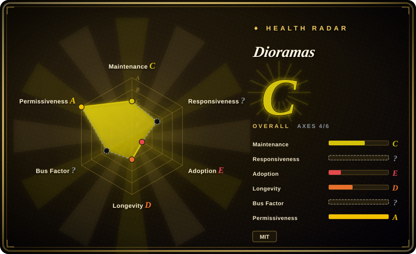
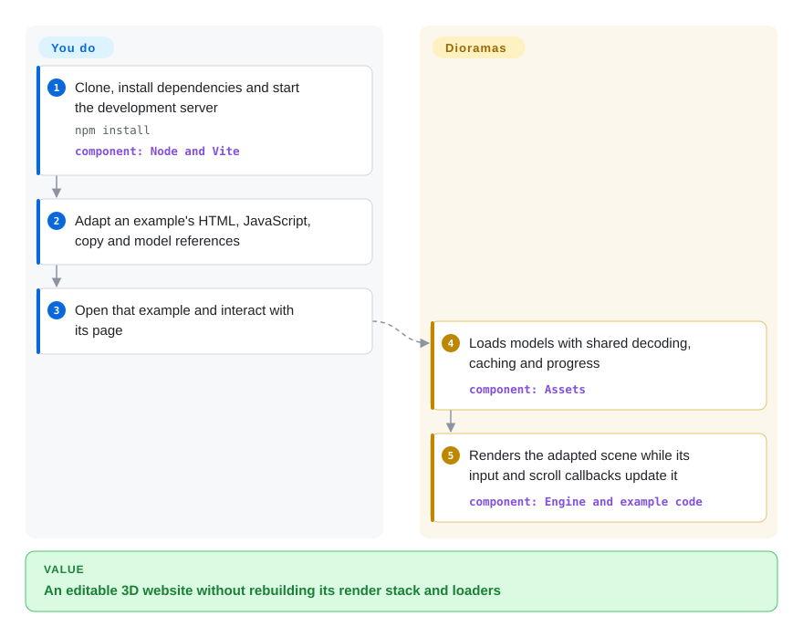
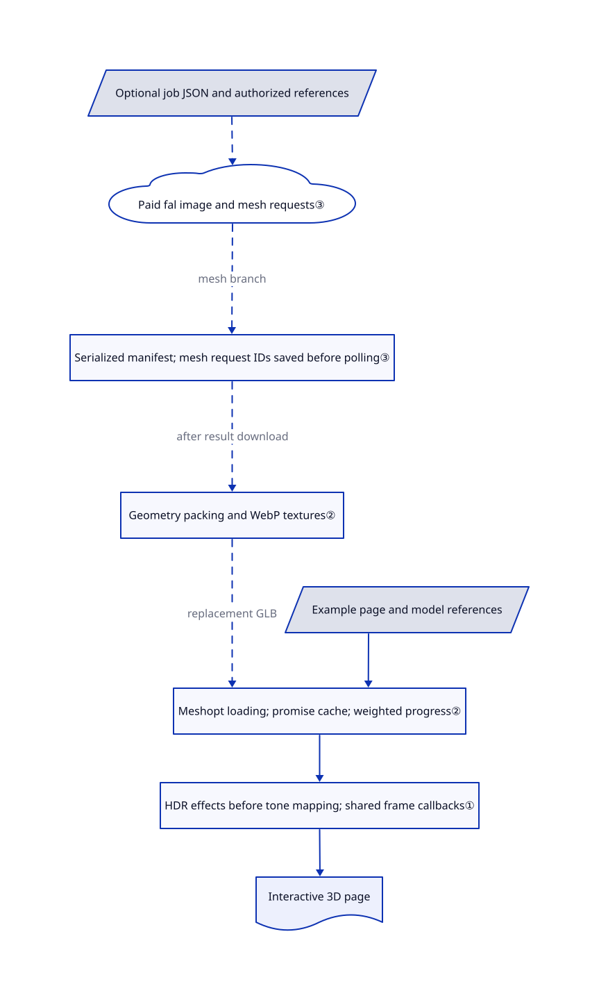

# Dioramas

Your product page needs a camera that moves through a lit 3D scene, not another image beside a heading. Dioramas gives you twenty editable websites plus their shared rendering layer, so you can adapt a working scene rather than assemble its loaders, lighting effects and scroll plumbing from scratch.

## When to use

You build a campaign or portfolio site where the product itself should fill the screen: scroll past a museum object, steer a lighthouse beam, or move around a shoe. You can edit plain HTML, CSS and JavaScript, and you want a complete scene to re-theme rather than a blank 3D renderer. Dioramas bundles twenty separately authored example sites with a shared Three.js layer for loading models, processing lighting and connecting scroll to motion.

Choose it over starting directly with Three.js when inheriting an example's composition and code is useful. Choose it over a React renderer when you do not need a component-based application. You still design the camera path, interactions, copy and fallback experience; this is source to adapt, not an editor, an agent skill or an automatic website generator.

## When NOT to use

- **You only need headlines, buttons or SVGs to move.** Use [Anime.js](anime.md); shipping models and a GPU render loop adds a different class of cost to ordinary interface animation.
- **Your existing application is built from React components.** Prefer React Three Fiber for a React-owned scene lifecycle; copying these standalone imperative example pages does not give you that integration.
- **You need a general-purpose game or 3D application engine.** Prefer Babylon.js for that broader application surface. Dioramas is an opinionated set of landing-page scenes, not a general scene editor or game framework.
- **You must control every renderer feature or keep the dependency surface small.** Start with Three.js directly; this layer brings a particular post-processing stack, GSAP and Lenis, and substantial example-specific code.
- **You cannot afford large downloads or require a lightweight non-WebGL experience.** Prefer an ordinary HTML/CSS page, with Anime.js only where motion helps. The repository includes large models in normal Git; the guide budgets up to 45 MB per page and recommends a desktop GPU. Its frame-rate target is not a measured cross-device guarantee.
- **You need zero external processing or a single MIT grant for everything.** Supply your own cleared assets in a direct Three.js build. Generating replacements here uploads references to fal and uses paid APIs; included models/images have a separate CC BY 4.0 declaration, and GSAP retains its own terms.

## Comparison

| Alternative | In index | Our verdict | Tradeoff |
|---|---|---|---|
| Three.js | not indexed | Start with Three.js when you need a clean renderer foundation and will design the experience yourself; choose Dioramas when adapting one of its complete scenes saves more work than shedding its opinions. | Three.js supplies the underlying scene and rendering APIs, not these twenty composed sites or their generation scripts. Not added in this tab batch. |
| React Three Fiber | not indexed | Choose React Three Fiber when your 3D scene must participate in a React application's component model; choose Dioramas for a standalone, directly editable HTML/JS site. | React composition instead of the examples' imperative startup and frame callbacks; you still supply the art direction and asset pipeline. Not added in this tab batch. |
| Babylon.js | not indexed | Choose Babylon.js for a broader interactive 3D application; choose Dioramas when a cinematic landing page and an existing composition are the actual deliverable. | A general 3D engine rather than this smaller, opinionated layer over Three.js; migration is not a drop-in example swap. Not added in this tab batch. |
| [Anime.js](anime.md) | ✅ | Choose Anime.js when the page needs DOM/SVG motion rather than a rendered 3D world; choose Dioramas when lighting, models and camera movement carry the page. | A dependency-free animation library instead of a scene renderer, model downloads and the full effect stack. |

## Quick start

Clone the repository, run the README's `npm install`, then `npm run dev`; the gallery is at `http://127.0.0.1:5190`, with sites under `/examples/<name>/`. Select an example and edit its HTML, CSS and JavaScript, supplying your copy, model references and camera/interaction choices; the existing assets let you start without a fal account or key. The shared layer loads models and renders the scene while the example connects input and scroll to its behavior; `npm run build` produces the multi-page static build for you to host. You remain responsible for asset credits, third-party terms, deployment paths, accessible alternatives and performance testing; development live reload is disabled, so refresh after edits. Generating new assets is a separate, optional path: put `FAL_KEY` in the project `.env`, supply a job JSON, then use the documented generation and optimization scripts, with uploads and service charges under your control. The engine guide still contains old `pages/` paths and internal build-team instructions; follow the current `examples/` tree and Vite config instead of assuming its server is already running ([README:77–98](https://github.com/blendi-remade/dioramas/blob/868539fb5b64a843071a2247d5d8bacb706a07b1/README.md#L77-L98), [build routes:4–19](https://github.com/blendi-remade/dioramas/blob/868539fb5b64a843071a2247d5d8bacb706a07b1/vite.config.js#L4-L19)).

<!-- flow-steps:begin (generated from flows/dioramas.json by tools/flow_card.py — do not edit) -->

Text version of the flow

1. **You**: Clone, install dependencies and start the development server — `npm install` — component: `Node and Vite`
2. **You**: Adapt an example's HTML, JavaScript, copy and model references
3. **You**: Open that example and interact with its page
4. **Dioramas**: Loads models with shared decoding, caching and progress — component: `Assets`
5. **Dioramas**: Renders the adapted scene while its input and scroll callbacks update it — component: `Engine and example code`

**Value**: An editable 3D website without rebuilding its render stack and loaders

<!-- flow-steps:end -->

## Key techniques

<!-- mechanism:begin (generated from mechanisms/dioramas.json by tools/mechanism_card.py; do not edit) -->

Text version of the mechanism

- Example page and model references
- Meshopt loading; promise cache; weighted progress②
- HDR effects before tone mapping; shared frame callbacks①
- Interactive 3D page
- Optional job JSON and authorized references
- Paid fal image and mesh requests③
- Serialized manifest; mesh request IDs saved before polling③
- Geometry packing and WebP textures②

- Example page and model references → Meshopt loading; promise cache; weighted progress②
- Meshopt loading; promise cache; weighted progress② → HDR effects before tone mapping; shared frame callbacks①
- HDR effects before tone mapping; shared frame callbacks① → Interactive 3D page
- Optional job JSON and authorized references → Paid fal image and mesh requests③ [optional/fallback]
- Paid fal image and mesh requests③ → Serialized manifest; mesh request IDs saved before polling③ (mesh branch) [optional/fallback]
- Serialized manifest; mesh request IDs saved before polling③ → Geometry packing and WebP textures② (after result download) [optional/fallback]
- Geometry packing and WebP textures② → Meshopt loading; promise cache; weighted progress② (replacement GLB) [optional/fallback]

<!-- mechanism:end -->

### 1. A shared HDR frame pipeline, not twenty independent renderers

- **Problem:** Independently assembled example pages can apply lighting and display conversion inconsistently.
- **How:** `Engine` creates a Three.js renderer with tone mapping disabled there, then builds a half-float high-dynamic-range buffer: ambient occlusion, bloom and optional pre-effects precede display tone mapping. Chromatic aberration gets its own later pass; scene-specific callbacks run in the shared animation loop.
- **Limits:** This is a chosen visual stack, not automatic art direction or a performance budget. Resolution caps and pause controls reduce some work but do not prove mobile frame rates.
- **Source:** [Renderer and effect ordering:17–92](https://github.com/blendi-remade/dioramas/blob/868539fb5b64a843071a2247d5d8bacb706a07b1/src/core/engine.js#L17-L92), [resolution and frame loop:97–139](https://github.com/blendi-remade/dioramas/blob/868539fb5b64a843071a2247d5d8bacb706a07b1/src/core/engine.js#L97-L139).

### 2. Load compressed assets through one cache and progress channel

- **Problem:** A scene with several large model downloads needs a loader that tracks them without repeatedly requesting the same model.
- **How:** `Assets.gltf()` attaches the Meshopt decoder, caches each URL's loading promise and combines byte progress with completed-item counts. The optional optimizer welds and deduplicates geometry, packs it with Meshopt and converts textures to WebP before the browser loads the resulting GLB files.
- **Limits:** This is neither a streaming level-of-detail system nor a download cap. Missing content lengths weaken byte estimates, rejected promises remain cached, and the optimizer only simplifies geometry when a ratio below one is requested.
- **Source:** [Decoder, cache and progress:9–46](https://github.com/blendi-remade/dioramas/blob/868539fb5b64a843071a2247d5d8bacb706a07b1/src/core/assets.js#L9-L46), [offline optimization:11–32](https://github.com/blendi-remade/dioramas/blob/868539fb5b64a843071a2247d5d8bacb706a07b1/scripts/optimize.mjs#L11-L32).

### 3. Save mesh request IDs so interrupted generation can resume

- **Problem:** Repeating an interrupted paid image-to-3D request can submit the same work twice.
- **How:** The mesh branch submits to fal, writes the request ID and input into a serialized JSON manifest, then polls that request and downloads its result. The image branch instead uses a direct subscription; successful image URLs are recorded for later mesh inputs.
- **Limits:** Request-ID recovery applies to meshes, not an in-flight image subscription. Submission and the subsequent manifest write are not atomic; `--force`, lost state or failed results can cause another paid request. Per-job failures are logged and swallowed by the worker pool, so a final `done` line is not proof every output exists.
- **Source:** [Pool failure handling:26–35](https://github.com/blendi-remade/dioramas/blob/868539fb5b64a843071a2247d5d8bacb706a07b1/scripts/gen.mjs#L26-L35), [image subscription:42–65](https://github.com/blendi-remade/dioramas/blob/868539fb5b64a843071a2247d5d8bacb706a07b1/scripts/gen.mjs#L42-L65), [mesh submission and recovery:69–129](https://github.com/blendi-remade/dioramas/blob/868539fb5b64a843071a2247d5d8bacb706a07b1/scripts/gen.mjs#L69-L129), [manifest write serialization:16–27](https://github.com/blendi-remade/dioramas/blob/868539fb5b64a843071a2247d5d8bacb706a07b1/scripts/fal.mjs#L16-L27).

## Tech stack

- JavaScript ES modules, HTML/CSS and GLSL shaders; Three.js, pmndrs postprocessing and N8AO render the scenes.
- GSAP/ScrollTrigger and Lenis connect motion and scrolling; Rapier is included for physics-oriented examples.
- Vite builds a static multi-page site targeting ES2022. The package is marked private, not a published installable framework package.
- Optional Node scripts use fal, glTF Transform, Meshoptimizer, sharp and Playwright ([manifest:1–32](https://github.com/blendi-remade/dioramas/blob/868539fb5b64a843071a2247d5d8bacb706a07b1/package.json#L1-L32)).

## Dependencies

- Node/npm for development and builds; a modern WebGL-capable browser and sufficient GPU memory for the chosen scene. The lockfile's Vite 8.3.1 requires Node `^20.19.0 || >=22.12.0`; the root package does not declare a broader tested runtime range ([locked requirement:3425–3442](https://github.com/blendi-remade/dioramas/blob/868539fb5b64a843071a2247d5d8bacb706a07b1/package-lock.json#L3425-L3442)).
- No application backend or database is required by the supplied static-site setup. The example HTML loads Google Fonts, so a default deployment is not fully offline; bundle fonts yourself when that matters.
- A fal account, credits and `FAL_KEY` are needed only for new generated assets. References may be uploaded to fal storage; do not submit confidential or uncleared images without authorization ([client:7–9,45–49](https://github.com/blendi-remade/dioramas/blob/868539fb5b64a843071a2247d5d8bacb706a07b1/scripts/fal.mjs#L7-L49)).
- Screenshot QA additionally expects Playwright and installed Chrome; its launch arguments select a D3D11 graphics backend, so the checked-in recipe is not a demonstrated portable Linux/macOS test ([review script:7–18](https://github.com/blendi-remade/dioramas/blob/868539fb5b64a843071a2247d5d8bacb706a07b1/scripts/review.mjs#L7-L18)).

## Ops difficulty

**Medium for a public site; low for a source experiment.** There is no persistent service to administer, but you own model transfer size, GPU behavior, build output and CDN paths. Vite includes all example entry points and copies public assets; a small single-page deployment needs a deliberate pruning/build plan rather than assuming the gallery build is small. Test keyboard/touch access and a non-3D alternative yourself. The screenshot battery captures selected states and prints frame rates/errors; it has no visual acceptance score or enforced pass threshold. For removal, stop the development process and remove the project/build outputs you no longer need; separately handle `.env`, raw/generated assets, manifest records, screenshots and deployed copies. Deleting local files does not undo fal uploads or charges, and the project documents no remote-data deletion workflow.

## Health & viability

- **Verdict as of 2026-10-27:** useful as an editable reference framework, not yet a low-risk long-term platform dependency. The public history is one initial source commit on 2026-09-30, with no GitHub releases or issue-response sample.
- **Backing and governance:** the repository sits under an individual account, with one listed contributor and no governance/security policy in the pinned tree. There is no evidence here of a foundation, support commitment or multi-maintainer succession plan.
- **Age and Lindy:** about 27 days old and not updated after publication in this snapshot. Twenty complete sites demonstrate breadth of examples, not survival across dependency generations.
- **Adoption:** 637 stars show attention, not production deployments. The package is private; the site examples and the machine radar do not establish a published package ecosystem or a support SLA.
- **Radar coverage:** the automated result is C with four of six axes scored. Responsiveness is unknown because the project is too young with thin traffic; governance is unknown because GitHub's contributor-statistics endpoint returned an empty/gated response. One listed contributor is a separate observation, not a substitute governance score.
- **License scope:** code is MIT; generated models and images are declared CC BY 4.0 with project credit. Libraries retain their own terms, including GSAP's Standard no-charge license. The radar's code-license axis is not an audit of generated-content rights or all dependency terms ([code grant](https://github.com/blendi-remade/dioramas/blob/868539fb5b64a843071a2247d5d8bacb706a07b1/LICENSE#L1-L21), [asset declaration](https://github.com/blendi-remade/dioramas/blob/868539fb5b64a843071a2247d5d8bacb706a07b1/ASSET-LICENSES.md#L1-L7), [third-party notices](https://github.com/blendi-remade/dioramas/blob/868539fb5b64a843071a2247d5d8bacb706a07b1/THIRD_PARTY_NOTICES.md#L1-L10)).

## Caveats (unverified)

- [未验证：no upstream execution permitted in this intake] No dependency install, build, browser session, screenshot run, asset generation or deployment was performed. Visual quality, compatibility, mobile accessibility and frame rates were not measured; the guide's 60-fps/4090 targets and the README's cost/size claims are author reports.
- [未验证：no independent rights chain or service-account review] CC BY 4.0 is the publisher's asset declaration, not proof of every generated output's copyright, trademark clearance or fal/model-provider terms. Source/blob comparison against the named Three.js tree is not an all-web originality audit.
- [推断：based on static build configuration and source layout] A production single-world bundle requires pruning/testing beyond the supplied all-world build; exact transfer sizes and subpath deployment behavior were not measured.
