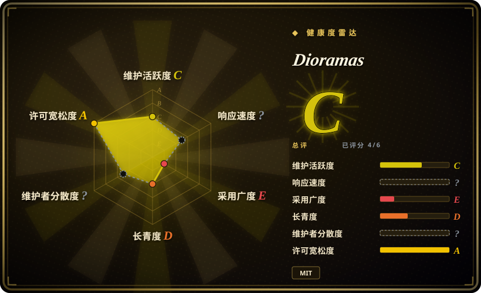
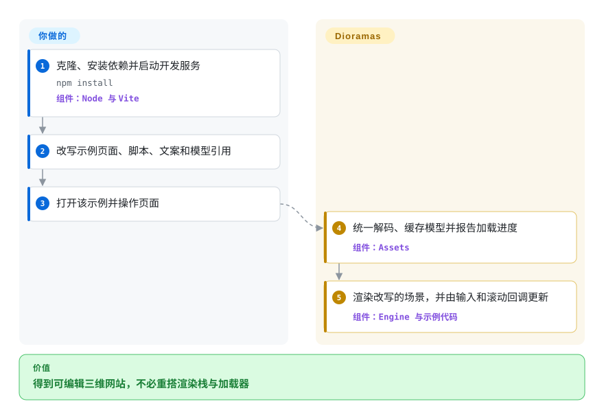
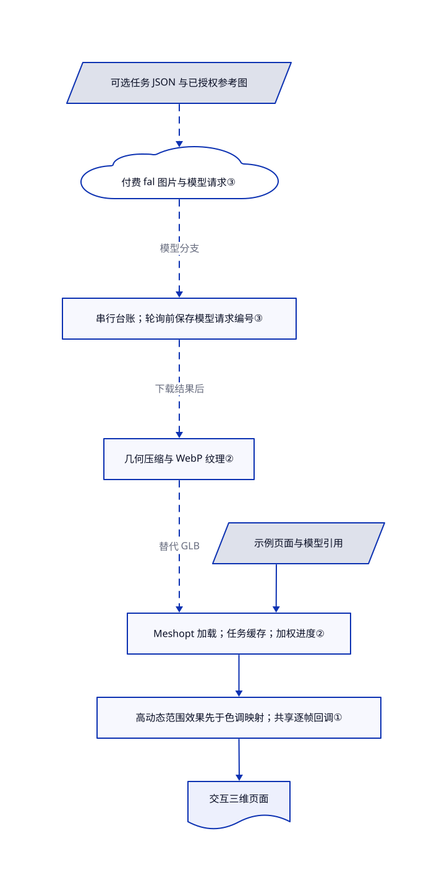

# Dioramas

你想让访客随滚动走进有灯光的三维产品场景，而不是再放一张标题配图。Dioramas 提供二十个可改写的网站和共享渲染层，让你从完整场景出发，不必从零拼接模型加载、光效和滚动联动。

## 何时使用

你在做活动页或作品集，希望产品本身占据屏幕：滚动经过博物馆藏品、转动灯塔光束，或围绕一只鞋移动视角。你能修改普通 HTML、CSS 和 JavaScript，想直接换主题，而不是先搭一个空的三维渲染器。Dioramas 带有二十个分别编写的示例网站，共用一层负责加载模型、处理光效和连接滚动动画的 Three.js 代码。

当现成场景的构图与代码值得继承时，选它而不是直接从 Three.js 起步。若不需要组件化应用，它也比接入 React 渲染器更直接。镜头路径、交互、文案和降级体验仍由你设计；这是可改写的源码，不是编辑器、agent 技能或自动建站器。

## 何时不用

- **只想让标题、按钮或 SVG 动起来。** 用 [Anime.js](anime.zh.md)；普通界面动画不值得额外承担模型下载和 GPU 渲染循环。
- **已有应用按 React 组件组织。** 优先用 React Three Fiber 管理场景生命周期；复制这些独立的命令式页面，不会自动得到 React 集成。
- **需要通用游戏或三维应用引擎。** 优先看 Babylon.js 的更广应用能力。Dioramas 面向落地页场景，不是通用场景编辑器或游戏框架。
- **需要完全掌控渲染特性或缩小依赖面。** 直接从 Three.js 开始；本项目带着特定的后处理栈、GSAP、Lenis 和大量示例专用代码。
- **不能承担大文件下载，或必须提供轻量的非 WebGL 体验。** 用普通 HTML/CSS 页面，只在确有必要时加 Anime.js。仓库用普通 Git 存放大模型；指南给出的单页预算最高为 45 MB，并推荐桌面 GPU。帧率目标不是跨设备实测保证。
- **要求输入不出本机，或想用一份 MIT 覆盖全部内容。** 在直接使用 Three.js 的工程中放入自行清权的素材。这里生成替代素材会上传参考图并调用付费 fal API；内附模型与图片另按 CC BY 4.0 声明，GSAP 也保留自己的条款。

## 横向对比

| 替代品 | 是否收录 | 我们的评价 | 取舍 |
|---|---|---|---|
| Three.js | 未收录 | 需要干净的渲染基础、愿意自己设计体验时选 Three.js；继承某个完整场景比去除既有设计更省事时选 Dioramas。 | Three.js 提供底层场景与渲染 API，不带这里的二十个完整网站和生成脚本。本轮标签批次不扩收。 |
| React Three Fiber | 未收录 | 三维场景要参与 React 组件模型时选 React Three Fiber；做可直接修改的独立 HTML/JS 网站时选 Dioramas。 | 获得 React 组合方式，不沿用示例的命令式启动和逐帧回调；美术设计和素材流程仍由自己负责。本轮标签批次不扩收。 |
| Babylon.js | 未收录 | 构建更广的交互式三维应用时选 Babylon.js；交付目标是带现成构图的电影式落地页时选 Dioramas。 | 通用三维引擎，与这个较小而有明确设计取向的 Three.js 上层不同；不能直接替换示例代码。本轮标签批次不扩收。 |
| [Anime.js](anime.zh.md) | 已收录 | 页面需要 DOM/SVG 动画而不是三维世界时选 Anime.js；模型、灯光和镜头运动才是页面主体时选 Dioramas。 | 零运行时依赖的动画库，不承担场景渲染、模型下载和整套光效。 |

## 快速上手

克隆仓库，按 README 执行 `npm install`，再运行 `npm run dev`；画廊位于 `http://127.0.0.1:5190`，各站点位于 `/examples/<name>/`。选一个示例，修改其 HTML、CSS 和 JavaScript，提供自己的文案、模型引用、镜头和交互选择；内附素材足够起步，不需要 fal 账号或 key。共享层负责加载模型和渲染场景，示例负责把输入与滚动接到具体行为上；`npm run build` 生成由你托管的多页面静态构建。素材署名、第三方条款、部署路径、无障碍替代方案和性能测试仍由你负责；开发时关闭了自动重载，修改后需手动刷新。生成新素材是独立可选路径：在项目 `.env` 填入 `FAL_KEY`，提供任务 JSON，再按文档运行生成与优化脚本，上传和服务费用由你控制。引擎指南仍残留旧 `pages/` 路径及内部协作指令，应以当前 `examples/` 树和 Vite 配置为准，不能照抄“服务已运行”的前提（[README 第 77–98 行](https://github.com/blendi-remade/dioramas/blob/868539fb5b64a843071a2247d5d8bacb706a07b1/README.md#L77-L98)、[构建路由第 4–19 行](https://github.com/blendi-remade/dioramas/blob/868539fb5b64a843071a2247d5d8bacb706a07b1/vite.config.js#L4-L19)）。

<!-- flow-steps:begin (generated from flows/dioramas.json by tools/flow_card.py — do not edit) -->

流程文字版

1. **你**：克隆、安装依赖并启动开发服务 — `npm install` — 组件：`Node 与 Vite`
2. **你**：改写示例页面、脚本、文案和模型引用
3. **你**：打开该示例并操作页面
4. **Dioramas**：统一解码、缓存模型并报告加载进度 — 组件：`Assets`
5. **Dioramas**：渲染改写的场景，并由输入和滚动回调更新 — 组件：`Engine 与示例代码`

**价值**：得到可编辑三维网站，不必重搭渲染栈与加载器

<!-- flow-steps:end -->

## 技术要点

<!-- mechanism:begin (generated from mechanisms/dioramas.json by tools/mechanism_card.py; do not edit) -->

机制文字版

- 示例页面与模型引用
- Meshopt 加载；任务缓存；加权进度②
- 高动态范围效果先于色调映射；共享逐帧回调①
- 交互三维页面
- 可选任务 JSON 与已授权参考图
- 付费 fal 图片与模型请求③
- 串行台账；轮询前保存模型请求编号③
- 几何压缩与 WebP 纹理②

- 示例页面与模型引用 → Meshopt 加载；任务缓存；加权进度②
- Meshopt 加载；任务缓存；加权进度② → 高动态范围效果先于色调映射；共享逐帧回调①
- 高动态范围效果先于色调映射；共享逐帧回调① → 交互三维页面
- 可选任务 JSON 与已授权参考图 → 付费 fal 图片与模型请求③〔可选／兜底〕
- 付费 fal 图片与模型请求③ → 串行台账；轮询前保存模型请求编号③（模型分支）〔可选／兜底〕
- 串行台账；轮询前保存模型请求编号③ → 几何压缩与 WebP 纹理②（下载结果后）〔可选／兜底〕
- 几何压缩与 WebP 纹理② → Meshopt 加载；任务缓存；加权进度②（替代 GLB）〔可选／兜底〕

<!-- mechanism:end -->

### 1. 共用高动态范围帧管线，不各搭一套渲染器

- **解决：** 示例各自拼装光效时，照明与最终显示转换容易不一致。
- **做法：** `Engine` 创建 Three.js 渲染器，并关闭其自身的色调映射，改用半浮点高动态范围缓冲：环境遮蔽、泛光和可选前置效果先运行，再转换到屏幕显示范围。色差效果单独放在后续通道；场景专用回调接入共享动画循环。
- **边界：** 这是选定的视觉栈，不是自动美术指导或性能预算。分辨率上限和暂停控制能减少部分工作，不证明手机帧率。
- **源码：** [渲染器与效果顺序第 17–92 行](https://github.com/blendi-remade/dioramas/blob/868539fb5b64a843071a2247d5d8bacb706a07b1/src/core/engine.js#L17-L92)、[分辨率与帧循环第 97–139 行](https://github.com/blendi-remade/dioramas/blob/868539fb5b64a843071a2247d5d8bacb706a07b1/src/core/engine.js#L97-L139)。

### 2. 用同一缓存与进度通道加载压缩素材

- **解决：** 多个大模型下载需要统一进度，且不应重复请求同一模型。
- **做法：** `Assets.gltf()` 接入 Meshopt 解码器，缓存每个地址的加载任务，并结合字节进度与完成项目数。可选优化器先焊接、去重几何，再用 Meshopt 压缩，并把纹理转成 WebP，浏览器随后加载生成的 GLB 文件。
- **边界：** 这不是流式细节层级系统，也不限制下载总量。服务端缺少内容长度时字节估计会减弱；失败的任务仍留在缓存；只有指定小于一的比例才会简化几何。
- **源码：** [解码器、缓存与进度第 9–46 行](https://github.com/blendi-remade/dioramas/blob/868539fb5b64a843071a2247d5d8bacb706a07b1/src/core/assets.js#L9-L46)、[离线优化第 11–32 行](https://github.com/blendi-remade/dioramas/blob/868539fb5b64a843071a2247d5d8bacb706a07b1/scripts/optimize.mjs#L11-L32)。

### 3. 保存模型请求编号，让中断的生成能够续接

- **解决：** 付费的图生三维任务中断后，重复提交可能让同一工作付费两次。
- **做法：** 模型分支向 fal 提交请求，把编号和输入串行写入 JSON 台账，再轮询同一请求并下载结果。图片分支则直接订阅生成，成功后记录图片地址，供后续模型输入使用。
- **边界：** 请求编号恢复适用于模型，不适用于尚未完成的图片订阅。提交与后续台账写入不是原子操作；`--force`、状态丢失或失败结果都可能触发新的付费请求。任务池只记录并吞掉逐项错误，因此最后一行 `done` 不证明所有产物都存在。
- **源码：** [任务池错误处理第 26–35 行](https://github.com/blendi-remade/dioramas/blob/868539fb5b64a843071a2247d5d8bacb706a07b1/scripts/gen.mjs#L26-L35)、[图片订阅第 42–65 行](https://github.com/blendi-remade/dioramas/blob/868539fb5b64a843071a2247d5d8bacb706a07b1/scripts/gen.mjs#L42-L65)、[模型提交与续接第 69–129 行](https://github.com/blendi-remade/dioramas/blob/868539fb5b64a843071a2247d5d8bacb706a07b1/scripts/gen.mjs#L69-L129)、[台账串行写入第 16–27 行](https://github.com/blendi-remade/dioramas/blob/868539fb5b64a843071a2247d5d8bacb706a07b1/scripts/fal.mjs#L16-L27)。

## 技术栈

- JavaScript ES 模块、HTML/CSS 与 GLSL 着色器；场景使用 Three.js、pmndrs postprocessing 和 N8AO。
- GSAP/ScrollTrigger 与 Lenis 连接运动和滚动；需要物理效果的示例可使用内附 Rapier。
- Vite 生成面向 ES2022 的多页面静态站点。包标记为 private，不是已发布、直接安装的框架包。
- 可选 Node 脚本使用 fal、glTF Transform、Meshoptimizer、sharp 和 Playwright（[依赖清单第 1–32 行](https://github.com/blendi-remade/dioramas/blob/868539fb5b64a843071a2247d5d8bacb706a07b1/package.json#L1-L32)）。

## 依赖

- 开发与构建需要 Node/npm；访问需要支持现代 WebGL 的浏览器，以及能承担所选场景的 GPU 显存。锁文件中的 Vite 8.3.1 要求 Node `^20.19.0 || >=22.12.0`，根包没有声明更广的已测试运行时范围（[锁定要求第 3425–3442 行](https://github.com/blendi-remade/dioramas/blob/868539fb5b64a843071a2247d5d8bacb706a07b1/package-lock.json#L3425-L3442)）。
- 随附静态站点方案不要求应用后端或数据库。示例 HTML 从 Google Fonts 加载字体，因此默认部署并非完全离线；有此要求时应自行打包字体。
- 只有生成新素材才需要 fal 账号、余额和 `FAL_KEY`。参考图可能上传至 fal 存储，未经授权不能提交保密或未清权图片（[客户端第 7–9、45–49 行](https://github.com/blendi-remade/dioramas/blob/868539fb5b64a843071a2247d5d8bacb706a07b1/scripts/fal.mjs#L7-L49)）。
- 截图检查还要求 Playwright 和已安装 Chrome；启动参数选择 D3D11 图形后端，因此仓库配方不是已经验证的 Linux/macOS 通用测试（[审查脚本第 7–18 行](https://github.com/blendi-remade/dioramas/blob/868539fb5b64a843071a2247d5d8bacb706a07b1/scripts/review.mjs#L7-L18)）。

## 运维难度

**公开站点中等，源码试验较低。** 无需管理持久服务，但模型传输体积、GPU 表现、构建产物和 CDN 路径都由你负责。Vite 纳入所有示例入口并复制 public 素材；只发布一个小站点时，需要明确裁剪与构建方案，不能默认画廊构建很小。键盘、触控和非三维替代方案需自行测试。截图脚本采集选定状态并打印帧率及错误，没有视觉验收分数或强制通过阈值。卸载时停止开发进程，移除不再需要的项目与构建产物；另行处理 `.env`、原始与生成素材、台账、截图及已部署副本。删除本地文件不能撤回 fal 上传或费用，项目也未提供远端数据删除流程。

## 健康度与可持续性

- **截至 2026-10-27 的判断：** 可作可编辑参考框架，尚不适合作为低风险的长期平台依赖。公开历史只有 2026-09-30 的一次初始源码提交，没有 GitHub 发布或 issue 响应样本。
- **支持与治理：** 仓库属于个人账号，贡献者列表只有一人；固定树没有治理或安全政策。当前证据不支持基金会背景、支持承诺或多人接续维护计划。
- **年龄与林迪效应：** 约 27 天，快照中发布后未再更新。二十个完整站点证明示例广度，不证明已经跨越多代依赖变化。
- **采用信号：** 637 星只表示关注，不表示生产部署。包为 private；示例与机器雷达都不证明已形成发布包生态或支持服务等级承诺。
- **雷达覆盖：** 自动结果为 C，六轴中四轴有分数。响应轴因项目过年轻、讨论量不足而未知；治理轴因 GitHub 贡献统计接口返回空白或受限响应而未知。贡献者列表只有一人是另一项观察，不能代替治理评分。
- **许可范围：** 代码 MIT；生成模型和图片声明为 CC BY 4.0，需署名项目。依赖保留自身条款，包括 GSAP Standard 免费使用许可。雷达中的代码许可轴不是生成素材权利或全部依赖条款审计（[代码授权](https://github.com/blendi-remade/dioramas/blob/868539fb5b64a843071a2247d5d8bacb706a07b1/LICENSE#L1-L21)、[素材声明](https://github.com/blendi-remade/dioramas/blob/868539fb5b64a843071a2247d5d8bacb706a07b1/ASSET-LICENSES.md#L1-L7)、[第三方声明](https://github.com/blendi-remade/dioramas/blob/868539fb5b64a843071a2247d5d8bacb706a07b1/THIRD_PARTY_NOTICES.md#L1-L10)）。

## 存疑（未验证）

- [未验证：本轮禁止执行上游] 未安装依赖、构建、启动浏览器、运行截图、生成素材或部署。未测视觉质量、兼容性、手机无障碍和帧率；指南的 60 帧／4090 目标，以及 README 的费用和体积说法均为作者报告。
- [未验证：未独立核验权利链和服务账号条款] CC BY 4.0 是发布者的素材声明，不证明每个生成结果的版权、商标清权或 fal／模型提供者条款。与指定 Three.js 树比对源码和 blob，不等于全网原创审计。
- [推断：依据静态构建配置与源码结构] 生产环境只发布一个场景，需要在默认全场景构建之外裁剪与测试；未测实际传输体积和子路径部署行为。
