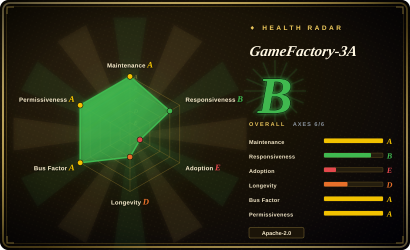
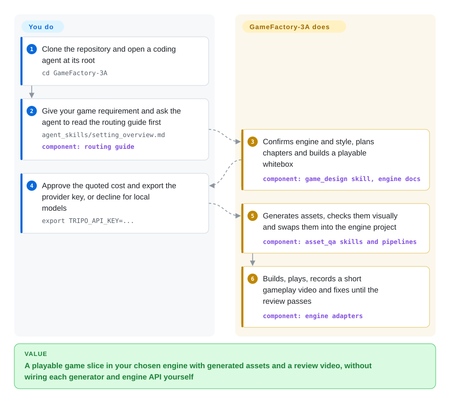
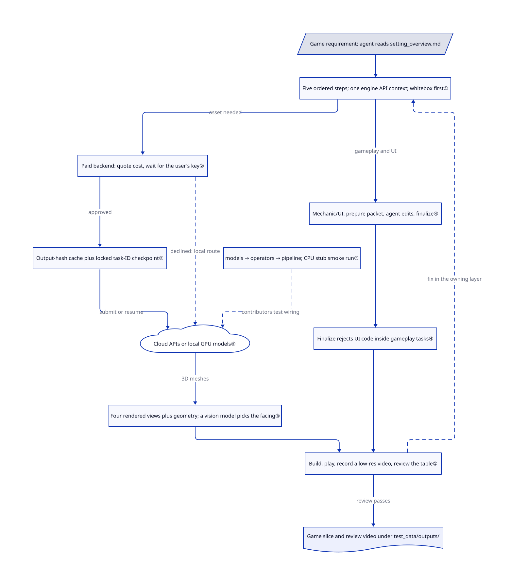

# GameFactory-3A

You ask a coding agent for a 3D game and get a grey scene with cubes for characters, or a character that runs backwards while every log line says the import passed. GameFactory-3A hands the agent a written route from requirement to playable whitebox to generated assets in one of five engines, with wrappers for paid and local asset generators and a rule that it must play and record the game before calling it done.

## When to use

You are an indie developer or a researcher with a coding agent (Codex, Claude Code, Gemini CLI), a game idea such as "a tactical FPS with a custom rifle and a voiced briefing", and a chosen engine among UE5, Unity, Godot 4, Blender or three.js. A bare agent can write gameplay code, but it has no route for producing the rifle mesh, the walk cycle, the voice line or the intro cutscene, and it will happily import a character facing +Z into a runtime that treats -Z as forward. Reach for GameFactory-3A when you want one repository that tells the agent the order of work (plan chapters, build a whitebox, then replace placeholders with generated or licensed assets), wraps the asset generators (Tripo, Meshy and local TRELLIS.2 for 3D objects; Seedream for images; Seed Audio and local TTS for audio; Seedance and local MiniMax H3 for cutscenes; Puppeteer, MoMask and Mixamo retargeting for motion), and ships per-engine API notes and reference projects.

It beats a game-dev prompt pack or a Claude Code template when the bottleneck is *assets inside a 3D engine*, not process: those give the agent instructions, while this gives it callable pipelines, a cache for paid generation calls, a vision-based orientation check and engine adapters. The price is a large research codebase with no releases, several conda environments, paid API keys or an NVIDIA GPU, and an upstream that has announced a major restructure.

## When NOT to use

- **You want a stable dependency to build a product on.** There are no releases or tags, and the README and issue #84 (2026-11-11) announce a major restructure: the current code is to be frozen as an old version, engine code reduced to a list of per-engine MCP servers, and assets moved to Hugging Face. Pin a commit and treat it as a pattern source, or wait for the new layout; for an engine bridge with versioned releases today, use [Unity-MCP](unity-mcp.md).
- **You have neither paid API budget nor an NVIDIA GPU.** The skills recommend closed cloud APIs first for 3D objects, images, audio and cutscenes, and the local fallbacks (TRELLIS.2 on CUDA 12.4, MoMask/Puppeteer on CUDA 11.8 conda environments, MiniMax H3) need a GPU. Only describable props (crates, signs, rifles) have a free procedural "spec" route. For a no-cost playable prototype without asset generation, use [Claude Code Game Studios](../agent-dev-methodology/coding-agent-harnesses/claude-code-game-studios.md), which builds browser games from code.
- **You only need a 3D mesh from an image.** The 3D-object pipeline is one slice of this repository and needs its environment, task JSONL and output layout. For a desktop app that runs local image-to-3D models, use [Modly](../3d-generation/modly.md), or call TRELLIS.2 directly.
- **You want the agent to work inside an existing engine project.** The engine adapters target the repository's own reference projects and launch paths, and its skills say to treat those as read-only. For live inspection and edits of your own Unity scene, use [Unity-MCP](unity-mcp.md); for Blender, `ahujasid/blender-mcp` (not indexed).
- **You are making a 2D game.** The pipelines and demos are all 3D, and a maintainer answered on issue #83 (2026-11) that 2D game generation has barely been tested. For a jam-scale 2D web game, use [kaplay](kaplay.md); for engine- and version-aware recipes across agents, use [awesome-gamedev-agent-skills](../agent-skills/engineering/awesome-gamedev-agent-skills.md).
- **You need generated characters to pass animation review on their own.** Issue #76 (open) reports an A-pose character whose arms fold into the torso after a T-pose walk retarget while the structural import check returned `ok=true`, plus foot sliding and cloth stretching. The skills themselves prefer licensed library motion (Mixamo, engine asset stores) where available; plan on that, or on hand review of every clip.
- **You ship in the EU, UK or South Korea and use the 3D-scene reconstruction route.** `models/gen_3d_scene/world_mirror_utils/` is vendored HunyuanWorld-Mirror code under Tencent's community license, which excludes those territories and requires a separate license above one million monthly active users. Use the engine asset-library route for scenes instead.

## Comparison

| Alternative | In index | Our verdict | Tradeoff |
|---|---|---|---|
| [Claude Code Game Studios](../agent-dev-methodology/coding-agent-harnesses/claude-code-game-studios.md) | ✅ | Choose Claude Code Game Studios for an idea-to-playable browser prototype with a brief, headless self-check and director gates in Claude Code; choose GameFactory-3A when the game needs generated 3D meshes, motion, audio or cutscenes inside UE5, Unity, Godot, Blender or three.js. | The template is light and agent-specific, with no asset generation; GameFactory-3A is agent-agnostic and carries asset pipelines and engine adapters, at the cost of GPU or paid-API setup and an unreleased, restructuring codebase. |
| [awesome-gamedev-agent-skills](../agent-skills/engineering/awesome-gamedev-agent-skills.md) | ✅ | Choose the skill pack when you want engine- and version-aware recipes the agent can follow in an existing project; choose GameFactory-3A when you want runnable generation pipelines and reference engine projects behind those instructions. | The skill pack installs into many agents and runs nothing; GameFactory-3A runs real generators and checks, but you clone a 1,390-file repository and work inside its layout. |
| [Unity-MCP](unity-mcp.md) | ✅ | For an existing Unity project where the agent must read and change the live editor, pick Unity-MCP; pick GameFactory-3A when you start from a requirement and need assets generated for a reference project. | Unity-MCP gives versioned, live editor control but no asset generation; GameFactory-3A gives asset generation and a play-and-record acceptance rule but no bridge into your own editor session. |
| [Modly](../3d-generation/modly.md) | ✅ | If the job is image-to-3D meshes on your own machine, pick Modly; pick GameFactory-3A when meshes are one step in a whole game build with motion, audio and engine import. | Modly is a focused desktop app with reviewed model extensions; GameFactory-3A wraps several cloud and local 3D backends plus orientation QA, but needs its own Python environments and output layout. |
| [ahujasid/blender-mcp](https://github.com/ahujasid/blender-mcp) | not indexed | For letting an agent model and arrange scenes directly in your open Blender, use blender-mcp; use GameFactory-3A when Blender is the target engine for a generated game with pipelines around it. | blender-mcp is a small MIT bridge into a running Blender; GameFactory-3A drives Blender through its own adapter and scripts and adds asset generation. Not added in this tab batch. |

## Quick start

The README's path is to clone the repository, open a coding agent at its root (`cd GameFactory-3A`), give it your game requirement, and ask it to read `agent_skills/setting_overview.md` first — the routing file that tells the agent which skills and engine notes to load. The agent then asks for the engine and visual style if missing, writes a chapter plan, builds a whitebox (a playable version with simple shapes as placeholders), and replaces placeholders through the asset skills. Before any paid generation call the skills tell it to stop, estimate the cost and ask you for a provider key (for example `export TRIPO_API_KEY=...` for Tripo 3D models); you buy access or decline, in which case it falls back to local models on your GPU or licensed library assets. You supply the agent and its model usage, the engine installs (setup scripts live in `scripts/engine_install/`), one conda environment per asset type, and API spending; the repository supplies the routing, generator wrappers, output layout under `test_data/outputs/` and engine reference code. Contributors adding a model wrapper follow a separate path in `agent_skills/develop_harness/README.md`.

<!-- flow-steps:begin (generated from flows/gamefactory-3a.json by tools/flow_card.py — do not edit) -->

Text version of the flow

1. **You**: Clone the repository and open a coding agent at its root — `cd GameFactory-3A`
2. **You**: Give your game requirement and ask the agent to read the routing guide first — `agent_skills/setting_overview.md` — component: `routing guide`
3. **GameFactory-3A**: Confirms engine and style, plans chapters and builds a playable whitebox — component: `game_design skill, engine docs`
4. **You**: Approve the quoted cost and export the provider key, or decline for local models — `export TRIPO_API_KEY=...`
5. **GameFactory-3A**: Generates assets, checks them visually and swaps them into the engine project — component: `asset_qa skills and pipelines`
6. **GameFactory-3A**: Builds, plays, records a short gameplay video and fixes until the review passes — component: `engine adapters`

**Value**: A playable game slice in your chosen engine with generated assets and a review video, without wiring each generator and engine API yourself

<!-- flow-steps:end -->

## Key techniques

<!-- mechanism:begin (generated from mechanisms/gamefactory-3a.json by tools/mechanism_card.py; do not edit) -->

Text version of the mechanism

- Game requirement; agent reads setting_overview.md
- Five ordered steps; one engine API context; whitebox first①
- Paid backend: quote cost, wait for the user's key②
- Output-hash cache plus locked task-ID checkpoint②
- Cloud APIs or local GPU models⑤
- Four rendered views plus geometry; a vision model picks the facing③
- Mechanic/UI: prepare packet, agent edits, finalize④
- Finalize rejects UI code inside gameplay tasks④
- models → operators → pipeline; CPU stub smoke run⑤
- Build, play, record a low-res video, review the table①
- Game slice and review video under test_data/outputs/

- Game requirement; agent reads setting_overview.md → Five ordered steps; one engine API context; whitebox first①
- Five ordered steps; one engine API context; whitebox first① → Paid backend: quote cost, wait for the user's key② (asset needed)
- Paid backend: quote cost, wait for the user's key② → Output-hash cache plus locked task-ID checkpoint② (approved)
- Output-hash cache plus locked task-ID checkpoint② → Cloud APIs or local GPU models⑤ (submit or resume)
- Paid backend: quote cost, wait for the user's key② → Cloud APIs or local GPU models⑤ (declined: local route) [optional/fallback]
- models → operators → pipeline; CPU stub smoke run⑤ → Cloud APIs or local GPU models⑤ (contributors test wiring) [optional/fallback]
- Cloud APIs or local GPU models⑤ → Four rendered views plus geometry; a vision model picks the facing③ (3D meshes)
- Five ordered steps; one engine API context; whitebox first① → Mechanic/UI: prepare packet, agent edits, finalize④ (gameplay and UI)
- Mechanic/UI: prepare packet, agent edits, finalize④ → Finalize rejects UI code inside gameplay tasks④
- Four rendered views plus geometry; a vision model picks the facing③ → Build, play, record a low-res video, review the table①
- Finalize rejects UI code inside gameplay tasks④ → Build, play, record a low-res video, review the table①
- Build, play, record a low-res video, review the table① → Game slice and review video under test_data/outputs/ (review passes)
- Build, play, record a low-res video, review the table① → Five ordered steps; one engine API context; whitebox first① (fix in the owning layer) [optional/fallback]

<!-- mechanism:end -->

### 1. A Markdown router that orders the work and defines "done" as played and recorded

- **Problem:** An agent asked for a game jumps to writing code or generating assets, mixes engine APIs, and reports success when the project compiles.
- **How:** `setting_overview.md` fixes five steps (clarify brief, plan chapters, build a playable whitebox, refine assets, validate) and a table of which skill and which single engine API document to read per task. Its acceptance section requires building, playing most player operations, recording a short low-resolution gameplay video and reviewing it against a seven-row table (lighting, facing while moving, weapon and wheel placement, collision, UI) before declaring the game ready.
- **Limits:** These are instructions to the model, not an executed gate; nothing in code blocks a completion claim without a video. The review itself is the model watching its own recording.
- **Source:** [Workflow:22–60](https://github.com/OpenDCAI/GameFactory-3A/blob/f9e927c04ed6abd1dd6f805d52638f1ffe884798/agent_skills/setting_overview.md#L22-L60), [asset decision policy:113–135](https://github.com/OpenDCAI/GameFactory-3A/blob/f9e927c04ed6abd1dd6f805d52638f1ffe884798/agent_skills/setting_overview.md#L113-L135), [validate, play and iterate:139–195](https://github.com/OpenDCAI/GameFactory-3A/blob/f9e927c04ed6abd1dd6f805d52638f1ffe884798/agent_skills/setting_overview.md#L139-L195).

### 2. Paid generation calls that are asked for, cached and resumable

- **Problem:** Cloud 3D generation costs money per task; a crash or timeout after submission, or two agents retrying at once, would pay twice for the same mesh.
- **How:** The asset skill tells the agent to pause, quote the provider, URL and estimated batch cost, and wait for a key. In code, the Tripo wrapper hashes everything that changes the output (payload, image hash, format, never the key) into a cache key; under a per-request file lock it checks the cache, then a checkpoint file holding the accepted remote task ID, and resumes polling that task instead of submitting a new one. The checkpoint is cleared only after the result is cached.
- **Limits:** The spending pause is a prompt rule, not enforced in code. Checkpointing is implemented for Tripo and Meshy (merged 2026-10); other cloud wrappers rely on the result cache only, and deleting the checkpoint file deliberately allows a new paid task.
- **Source:** [Paid backend rule:68–100](https://github.com/OpenDCAI/GameFactory-3A/blob/f9e927c04ed6abd1dd6f805d52638f1ffe884798/agent_skills/asset_qa/README.md#L68-L100), [cache key and lock:404–451](https://github.com/OpenDCAI/GameFactory-3A/blob/f9e927c04ed6abd1dd6f805d52638f1ffe884798/models/gen_3d_object/tripo_model.py#L404-L451), [resume or submit:460–528](https://github.com/OpenDCAI/GameFactory-3A/blob/f9e927c04ed6abd1dd6f805d52638f1ffe884798/models/gen_3d_object/tripo_model.py#L460-L528), [checkpoint store:14–100](https://github.com/OpenDCAI/GameFactory-3A/blob/f9e927c04ed6abd1dd6f805d52638f1ffe884798/models/common/task_recovery.py#L14-L100).

### 3. Facing decided from rendered views, not file metadata

- **Problem:** A glTF file fixes the up axis but not which way the model faces, so a character modelled facing +Z and one facing -Z have identical bounding boxes and node trees; in game the character runs backwards and nothing errors.
- **How:** For directional asset types the three.js adapter marks `needs_vision_check`, records candidate forward axes `-z`/`+z` and states the sign is undecidable from geometry. `orientation_report` renders four horizontal views at the model's composed size and returns them with the geometric evidence; the orientation skill tells a vision-capable model to decide and record the axis through `assets.set_orientation`, with the images outranking the geometry.
- **Limits:** This report is implemented in the three.js adapter; other engines follow the review instructions without this exact call. The decision is a model's visual judgment and can be wrong on symmetric or ambiguous meshes.
- **Source:** [Orientation skill:1–60](https://github.com/OpenDCAI/GameFactory-3A/blob/f9e927c04ed6abd1dd6f805d52638f1ffe884798/agent_skills/asset_qa/3d_object/orientation_review.md#L1-L60), [geometry evidence:240–270](https://github.com/OpenDCAI/GameFactory-3A/blob/f9e927c04ed6abd1dd6f805d52638f1ffe884798/engine_adapters/three_js/assets/_internal/orientation.py#L240-L270), [render plus evidence:201–260](https://github.com/OpenDCAI/GameFactory-3A/blob/f9e927c04ed6abd1dd6f805d52638f1ffe884798/engine_adapters/three_js/preview/client.py#L201-L260).

### 4. Prepare and finalize packets around the agent's own code edits

- **Problem:** When the outer agent writes gameplay code freely, it pulls in unrelated engine examples, mixes UI widgets into gameplay scripts, and leaves no record of what context it used.
- **How:** `gen_mechanic/run.py prepare` writes a task packet and workspace naming the skill, the one engine context root, the allowed example paths and their content digests; the agent edits the workspace; `finalize` validates the packet, checks required artifacts and runs per-engine scans that reject UI implementation in a Mechanic task (for Unity, `Canvas`, `Button`, `RectTransform`, `TMP_Text` and UI-named folders outside tests).
- **Limits:** The scans are regular-expression and path checks; they catch obvious contamination, not wrong game logic. Running and playing the result is still separate evidence.
- **Source:** [prepare and finalize commands:81–230](https://github.com/OpenDCAI/GameFactory-3A/blob/f9e927c04ed6abd1dd6f805d52638f1ffe884798/pipeline/code_gen/gen_mechanic/run.py#L81-L230), [Unity UI scan:124–170](https://github.com/OpenDCAI/GameFactory-3A/blob/f9e927c04ed6abd1dd6f805d52638f1ffe884798/pipeline/code_gen/gen_mechanic/artifacts.py#L124-L170), [finalize checks:403–499](https://github.com/OpenDCAI/GameFactory-3A/blob/f9e927c04ed6abd1dd6f805d52638f1ffe884798/pipeline/code_gen/gen_mechanic/artifacts.py#L403-L499).

### 5. A three-layer asset chain that can be smoke-tested without a GPU

- **Problem:** Each new generator brings its own weights, CUDA build and output conventions; testing a pipeline change by downloading weights is slow and often impossible on a laptop.
- **How:** Model wrappers only talk to one model, operators turn one task dictionary into artifacts, and `run.py`/`eval.py` handle batches; dependencies point downward and are wired once in `make_operator()`. Every output path comes from `pipeline/common/paths.py`. `test/harness/stubs.py` supplies fake models so `smoke.py --kind <kind>` checks a chain's output layout on CPU with only Pillow, NumPy and SciPy.
- **Limits:** The stub run proves wiring and paths, not generation quality; real tests still need GPUs or paid keys. The announced restructure may change this layout.
- **Source:** [Layers and rules:33–51](https://github.com/OpenDCAI/GameFactory-3A/blob/f9e927c04ed6abd1dd6f805d52638f1ffe884798/agent_skills/develop_harness/README.md#L33-L51), [stub verification:92–133](https://github.com/OpenDCAI/GameFactory-3A/blob/f9e927c04ed6abd1dd6f805d52638f1ffe884798/agent_skills/develop_harness/README.md#L92-L133), [cloud installer and smoke commands](https://github.com/OpenDCAI/GameFactory-3A/blob/f9e927c04ed6abd1dd6f805d52638f1ffe884798/scripts/asset_env_setup/cloud_api_install.sh).

## Tech stack

- **Orchestration:** Markdown skills under `agent_skills/` (routing, asset QA, code generation, engine API notes of 15–89 KB each, game design, game feel) read by an external coding agent.
- **Pipelines:** Python (about 6.1 MB of the 8.3 MB of code by GitHub's language count) in a models → operators → pipeline layout; cloud wrappers use `requests` only.
- **Local models:** TRELLIS.2 (vendored, with CUDA/C++ extensions) for image-to-3D, HunyuanWorld-Mirror and WorldPlay for scenes, Puppeteer and MoMask for rigging and motion, Qwen3-TTS and Woosh for audio, MiniMax H3 for video, SDXL-Turbo and Qwen-Edit for images.
- **Engine adapters:** UE5 (C++ example projects), Unity (C# runtime package and examples), Godot 4 (GDScript), Blender (Python), three.js (JavaScript plugin and eight example projects), plus a browser-serving gateway for playing and recording in a browser.

## Dependencies

- **Always:** a coding agent and its model usage; Python 3.10 environments created per asset type with conda; Git.
- **Cloud route:** keys for Tripo or Meshy (3D), Volcengine Ark (Seedream images, Seedance video), Volcengine speech (Seed Audio) and MiniMax, each billed by the provider.
- **Local route:** an NVIDIA GPU with CUDA 12.4 for TRELLIS.2 (PyTorch 2.6, flash-attention, Eigen build) and CUDA 11.8 environments with PyTorch 2.1.1 for the motion chain; model weights downloaded from Hugging Face.
- **Engines:** whichever of UE5, Unity, Godot 4, Blender or Node.js/three.js you target, installed through `scripts/engine_install/`; third-party asset packs cloned into `third_party/` (git-ignored) keep their own licenses.

## Ops difficulty

**High.** There is no service to run, but there is no single install either: each asset type has its own setup script and conda environment, local generators need specific CUDA and PyTorch versions that differ between the 3D-object and motion chains, and every target engine is a separate multi-gigabyte install. Paid routes shift the burden to key management and spend tracking. Generated output accumulates under `test_data/outputs/` in the repository checkout, and with no releases, updating means pulling `main` across an announced restructure.

## Health & viability

- **Maintenance (2026-11-18):** active but slowing toward a rewrite. 293 commits since 2026-07-06 and about 65 merged pull requests; 10 commits in the last month. No releases or tags. The README banner and issue #84 announce a major update that freezes the current code as an old version.
- **Governance / bus factor:** an organization repository (`OpenDCAI`, which also runs DataFlow with about 8.6k stars) with 14 contributors; one maintainer authored 132 of about 276 counted contributions, and three people account for most of the rest. Pull requests from outside contributors (checkpoint recovery, camera strategies) are reviewed and merged.
- **Age / Lindy:** created 2026-07-06, about four and a half months old; no Lindy support yet, and the pending restructure resets much of the surface.
- **Adoption:** 1,325 stars and 143 forks. Issue #76 is a detailed field report from a team building a multiplayer web game with it, which shows real use as well as quality gaps. [推断：no dependents list or shipped titles published]
- **Risk flags:** Apache-2.0 at the root, but `trellis_utils/` is 114 of 117 files blob-identical to `microsoft/TRELLIS.2` (MIT) without its license file, and `world_mirror_utils/` carries Tencent's territory-limited license. Demo games mix generated assets with Mixamo, Unity asset-store and other third-party content, so a shipped game needs per-asset license review.

## Caveats (unverified)

- [未验证：no GPU, paid keys or engines were run for this entry] Whether the end-to-end route produces a playable game for a given requirement, and its time and API cost, were not reproduced; the demo videos are the maintainers' own.
- [未验证：harness not executed, to avoid running untrusted code] The CPU stub harness (`test/harness/smoke.py`) is described as running without GPU or network; this entry did not run it.
- [推断：from issue #84 and the README banner, 2026-11] The announced restructure may remove the engine adapters and pipelines described here in favour of MCP lists and Hugging Face asset downloads.
- [推断：blob SHA comparison against microsoft/TRELLIS.2 main on 2026-11-18] The vendored TRELLIS.2 code lacks the upstream MIT notice inside this repository; whether that matters for your redistribution is a legal question not settled here.
- [未验证：model-written review, not measured] How reliably the vision-model orientation decision and the self-recorded gameplay review catch real defects is not measured anywhere in the repository.
- [推断：no dependents or shipped-title list] Stars and forks reflect attention to the demos rather than verified production use.
