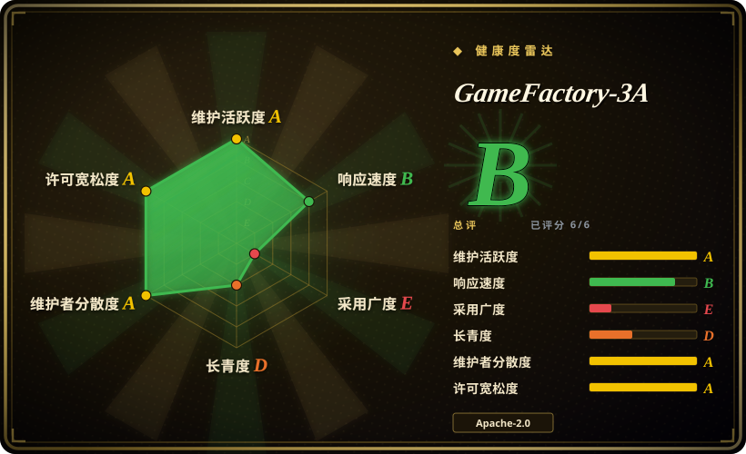
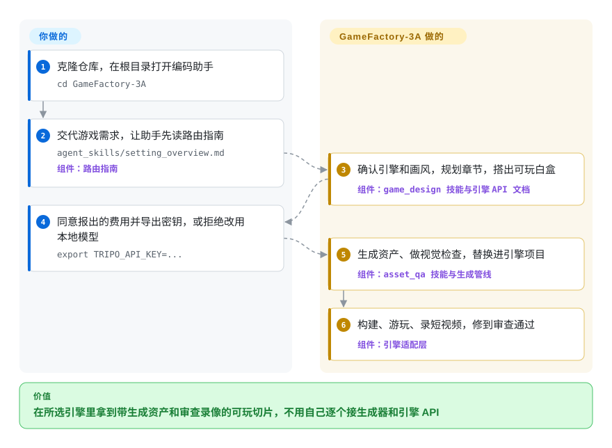
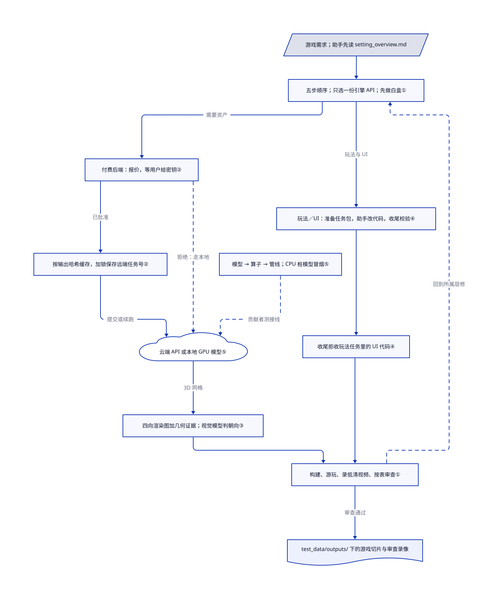

# GameFactory-3A

让编码助手做一个 3D 游戏，常见结果是角色全是方块的灰色场景，或者角色倒着跑、导入日志却每行都显示通过。GameFactory-3A 给助手一条写好的路线：从需求到可玩白盒，再到五种引擎之一里的生成资产，附带付费与本地资产生成器的封装，并规定必须实际游玩、录屏之后才能说做完。

## 何时使用

你是独立开发者或研究者，手上有编码助手（Codex、Claude Code、Gemini CLI），有一个游戏想法，比如“带一把定制步枪和语音简报的战术射击游戏”，引擎已在 UE5、Unity、Godot 4、Blender、three.js 里选定。裸用助手能写玩法代码，但它没有办法产出步枪网格、走路动作、配音和开场过场动画，还会把朝 +Z 建模的角色导进以 -Z 为前方的运行时。这时想到 GameFactory-3A：一个仓库里既告诉助手干活顺序（先规划章节，再搭白盒，最后用生成或有授权的资产替换占位），又封装了资产生成器（3D 物体用 Tripo、Meshy 和本地 TRELLIS.2；图片用 Seedream；音频用 Seed Audio 和本地 TTS；过场用 Seedance 和本地 MiniMax H3；动作用 Puppeteer、MoMask 和 Mixamo 重定向），还附上各引擎的 API 说明和参考工程。

当卡点是“3D 引擎里的资产”而不是流程时，它比游戏开发提示词包或 Claude Code 模板更合适：那些只给助手指令，这里给的是能调用的管线、付费生成调用的缓存、基于视觉的朝向检查和引擎适配层。代价是：一个没有发版的大型研究代码库，好几个 conda 环境，要么付费 API 密钥、要么 NVIDIA GPU，而且上游已宣布要大改结构。

## 何时不用

- **你要一个稳定依赖来做产品。** 仓库没有任何发版或标签，README 和 issue #84（2026-11-11）宣布要大改：现有代码冻结为旧版本，引擎代码缩成各引擎的 MCP 清单，资产搬到 Hugging Face。要么锁定某个提交、只当设计参考，要么等新结构；现在就要有版本号的引擎桥接，用 [Unity-MCP](unity-mcp.zh.md)。
- **你既没有付费 API 预算，也没有 NVIDIA GPU。** 技能文档对 3D 物体、图片、音频和过场都建议先用闭源云 API，本地兜底（CUDA 12.4 上的 TRELLIS.2、CUDA 11.8 conda 环境里的 MoMask／Puppeteer、MiniMax H3）都要 GPU。只有能精确描述的道具（箱子、路牌、步枪）有免费的程序化“spec”路线。想零成本做可玩原型、不需要资产生成，用 [Claude Code Game Studios](../agent-dev-methodology/coding-agent-harnesses/claude-code-game-studios.zh.md)，它直接用代码写浏览器游戏。
- **你只需要从一张图生成一个 3D 网格。** 3D 物体管线只是这个仓库的一小块，还要配它的环境、任务 JSONL 和输出目录结构。想在本机跑图生 3D 模型的桌面应用，用 [Modly](../3d-generation/modly.zh.md)，或直接调用 TRELLIS.2。
- **你要助手在已有的引擎项目里干活。** 引擎适配层面向的是仓库自带的参考工程和启动路径，技能文档还要求把它们当只读参考。要实时查看、修改你自己的 Unity 场景，用 [Unity-MCP](unity-mcp.zh.md)；Blender 用 `ahujasid/blender-mcp`（未收录）。
- **你在做 2D 游戏。** 管线和演示全是 3D，维护者在 issue #83（2026-11）回复说 2D 游戏生成基本没测过。做 Jam 规模的 2D 网页游戏用 [kaplay](kaplay.zh.md)；要跨多个助手、懂引擎版本的做法手册，用 [awesome-gamedev-agent-skills](../agent-skills/engineering/awesome-gamedev-agent-skills.zh.md)。
- **你需要生成的角色自己就能通过动画验收。** issue #76（未关闭）报告：接近 A-pose 的角色套用 T-pose 走路动作重定向后，双臂折进躯干，结构化导入检查却返回 `ok=true`；另有滑步和衣服拉伸。技能文档本身也建议有现成授权动作时（Mixamo、引擎资源商店）优先用它们；按这个规划，或者每段动作都人工过目。
- **你在欧盟、英国或韩国发行，并且要用 3D 场景重建路线。** `models/gen_3d_scene/world_mirror_utils/` 是内嵌的 HunyuanWorld-Mirror 代码，适用腾讯社区许可，许可排除了这些地区，月活过百万还要另行申请。场景改走引擎资源库路线。

## 横向对比

| 替代品 | 是否收录 | 我们的评价 | 取舍 |
|---|---|---|---|
| [Claude Code Game Studios](../agent-dev-methodology/coding-agent-harnesses/claude-code-game-studios.zh.md) | ✅ | 想在 Claude Code 里从想法直接做出带简报、无头自检和总监门禁的浏览器原型，选 Claude Code Game Studios；游戏需要在 UE5、Unity、Godot、Blender 或 three.js 里放生成的 3D 网格、动作、音频或过场时，选 GameFactory-3A。 | 模板轻、绑定单一助手、不生成资产；GameFactory-3A 不绑定助手，带资产管线和引擎适配层，代价是要配 GPU 或付费 API，代码也没发版、正在重构。 |
| [awesome-gamedev-agent-skills](../agent-skills/engineering/awesome-gamedev-agent-skills.zh.md) | ✅ | 想让助手在现有项目里照着懂引擎版本的做法手册干活，选这个技能包；想要指令背后有能跑的生成管线和参考引擎工程，选 GameFactory-3A。 | 技能包能装进多种助手但什么都不运行；GameFactory-3A 真的跑生成器和检查，但你要克隆一个约 1,390 个文件的仓库，在它的目录结构里工作。 |
| [Unity-MCP](unity-mcp.zh.md) | ✅ | 已有 Unity 项目、要助手读写运行中的编辑器，选 Unity-MCP；从需求出发、要为参考工程生成资产，选 GameFactory-3A。 | Unity-MCP 有版本号、能实时控制编辑器，但不生成资产；GameFactory-3A 有资产生成和“游玩加录屏”的验收规则，但接不进你自己的编辑器会话。 |
| [Modly](../3d-generation/modly.zh.md) | ✅ | 任务只是在本机把图片变成 3D 网格，选 Modly；网格只是整个游戏构建里的一步，还要动作、音频和引擎导入时，选 GameFactory-3A。 | Modly 是专注的桌面应用，模型扩展经过审核；GameFactory-3A 封装了多个云端和本地 3D 后端，外加朝向检查，但要配它自己的 Python 环境和输出目录。 |
| [ahujasid/blender-mcp](https://github.com/ahujasid/blender-mcp) | 未收录 | 想让助手直接在你打开的 Blender 里建模、摆场景，用 blender-mcp；Blender 是生成游戏的目标引擎、周围还要管线时，用 GameFactory-3A。 | blender-mcp 是接入运行中 Blender 的小型 MIT 桥接；GameFactory-3A 通过自己的适配层和脚本驱动 Blender，并加上资产生成。本批标签未收录。 |

## 快速上手

README 给的路径是：克隆仓库，在根目录打开编码助手（`cd GameFactory-3A`），交代游戏需求，并让它先读 `agent_skills/setting_overview.md`——这份路由文件告诉助手该加载哪些技能和哪份引擎说明。之后助手会在缺信息时追问引擎和画风，写章节计划，搭白盒（用简单几何体占位、但已经能玩的版本），再通过资产技能逐个替换占位。每次付费生成调用之前，技能要求它停下来、估算费用并向你要服务商密钥（比如 Tripo 3D 模型用 `export TRIPO_API_KEY=...`）；你可以购买，也可以拒绝，拒绝时它改用你 GPU 上的本地模型或有授权的资源库资产。你负责提供助手和模型用量、各引擎的安装（安装脚本在 `scripts/engine_install/`）、每种资产各一个 conda 环境，以及 API 花费；仓库负责路由、生成器封装、`test_data/outputs/` 下的输出目录和引擎参考代码。要新增模型封装的贡献者走另一条路径，见 `agent_skills/develop_harness/README.md`。

<!-- flow-steps:begin (generated from flows/gamefactory-3a.json by tools/flow_card.py — do not edit) -->

流程文字版

1. **你**：克隆仓库，在根目录打开编码助手 — `cd GameFactory-3A`
2. **你**：交代游戏需求，让助手先读路由指南 — `agent_skills/setting_overview.md` — 组件：`路由指南`
3. **GameFactory-3A**：确认引擎和画风，规划章节，搭出可玩白盒 — 组件：`game_design 技能与引擎 API 文档`
4. **你**：同意报出的费用并导出密钥，或拒绝改用本地模型 — `export TRIPO_API_KEY=...`
5. **GameFactory-3A**：生成资产、做视觉检查，替换进引擎项目 — 组件：`asset_qa 技能与生成管线`
6. **GameFactory-3A**：构建、游玩、录短视频，修到审查通过 — 组件：`引擎适配层`

**价值**：在所选引擎里拿到带生成资产和审查录像的可玩切片，不用自己逐个接生成器和引擎 API

<!-- flow-steps:end -->

## 技术要点

<!-- mechanism:begin (generated from mechanisms/gamefactory-3a.json by tools/mechanism_card.py; do not edit) -->

机制文字版

- 游戏需求；助手先读 setting_overview.md
- 五步顺序；只选一份引擎 API；先做白盒①
- 付费后端：报价，等用户给密钥②
- 按输出哈希缓存，加锁保存远端任务号②
- 云端 API 或本地 GPU 模型⑤
- 四向渲染图加几何证据；视觉模型判朝向③
- 玩法／UI：准备任务包，助手改代码，收尾校验④
- 收尾拒收玩法任务里的 UI 代码④
- 模型 → 算子 → 管线；CPU 桩模型冒烟⑤
- 构建、游玩、录低清视频、按表审查①
- test_data/outputs/ 下的游戏切片与审查录像

- 游戏需求；助手先读 setting_overview.md → 五步顺序；只选一份引擎 API；先做白盒①
- 五步顺序；只选一份引擎 API；先做白盒① → 付费后端：报价，等用户给密钥②（需要资产）
- 付费后端：报价，等用户给密钥② → 按输出哈希缓存，加锁保存远端任务号②（已批准）
- 按输出哈希缓存，加锁保存远端任务号② → 云端 API 或本地 GPU 模型⑤（提交或续跑）
- 付费后端：报价，等用户给密钥② → 云端 API 或本地 GPU 模型⑤（拒绝：走本地）〔可选／兜底〕
- 模型 → 算子 → 管线；CPU 桩模型冒烟⑤ → 云端 API 或本地 GPU 模型⑤（贡献者测接线）〔可选／兜底〕
- 云端 API 或本地 GPU 模型⑤ → 四向渲染图加几何证据；视觉模型判朝向③（3D 网格）
- 五步顺序；只选一份引擎 API；先做白盒① → 玩法／UI：准备任务包，助手改代码，收尾校验④（玩法与 UI）
- 玩法／UI：准备任务包，助手改代码，收尾校验④ → 收尾拒收玩法任务里的 UI 代码④
- 四向渲染图加几何证据；视觉模型判朝向③ → 构建、游玩、录低清视频、按表审查①
- 收尾拒收玩法任务里的 UI 代码④ → 构建、游玩、录低清视频、按表审查①
- 构建、游玩、录低清视频、按表审查① → test_data/outputs/ 下的游戏切片与审查录像（审查通过）
- 构建、游玩、录低清视频、按表审查① → 五步顺序；只选一份引擎 API；先做白盒①（回到所属层修）〔可选／兜底〕

<!-- mechanism:end -->

### 1. 用 Markdown 路由排好工序，把“做完”定义为玩过并录过

- **解决：** 助手接到做游戏的需求，常常直接写代码或生成资产，混用引擎 API，编译通过就报成功。
- **做法：** `setting_overview.md` 定下五步（澄清需求、规划章节、搭可玩白盒、细化资产、验收），并用表格规定每类任务读哪个技能、只读哪一份引擎 API 文档。验收一节要求构建、实际操作大部分玩家动作、录一段低清短视频，并按七行检查表（光照、移动时朝向、武器和车轮位置、碰撞、UI 等）审查后才能宣布可玩。
- **边界：** 这些是给模型的指令，不是执行层的门禁；代码里没有任何东西阻止没录像就宣称完成。审查本身也是模型看自己的录像。
- **源码：** [工序第 22–60 行](https://github.com/OpenDCAI/GameFactory-3A/blob/f9e927c04ed6abd1dd6f805d52638f1ffe884798/agent_skills/setting_overview.md#L22-L60)、[资产决策规则第 113–135 行](https://github.com/OpenDCAI/GameFactory-3A/blob/f9e927c04ed6abd1dd6f805d52638f1ffe884798/agent_skills/setting_overview.md#L113-L135)、[游玩验收第 139–195 行](https://github.com/OpenDCAI/GameFactory-3A/blob/f9e927c04ed6abd1dd6f805d52638f1ffe884798/agent_skills/setting_overview.md#L139-L195)。

### 2. 付费生成先问、可缓存、可续跑

- **解决：** 云端 3D 生成按任务计费；提交后进程崩溃或超时，或两个助手同时重试，都会为同一个网格付两次钱。
- **做法：** 资产技能要求助手先停下，报出服务商、购买地址和本批预估费用，等用户给密钥。代码层面，Tripo 封装把所有影响输出的参数（请求体、图片哈希、格式，从不含密钥）哈希成缓存键；在按请求加的文件锁里，先查缓存，再查保存已受理远端任务号的检查点文件，有就续轮询那个任务，不再新提交。结果写入缓存后才清掉检查点。
- **边界：** “先问再花钱”是提示词规则，代码不强制。检查点只在 Tripo 和 Meshy 上实现（2026-10 合入），其他云端封装只有结果缓存；手动删掉检查点文件就是有意允许再付费提交一次。
- **源码：** [付费后端规则第 68–100 行](https://github.com/OpenDCAI/GameFactory-3A/blob/f9e927c04ed6abd1dd6f805d52638f1ffe884798/agent_skills/asset_qa/README.md#L68-L100)、[缓存键与加锁第 404–451 行](https://github.com/OpenDCAI/GameFactory-3A/blob/f9e927c04ed6abd1dd6f805d52638f1ffe884798/models/gen_3d_object/tripo_model.py#L404-L451)、[续跑或提交第 460–528 行](https://github.com/OpenDCAI/GameFactory-3A/blob/f9e927c04ed6abd1dd6f805d52638f1ffe884798/models/gen_3d_object/tripo_model.py#L460-L528)、[检查点存储第 14–100 行](https://github.com/OpenDCAI/GameFactory-3A/blob/f9e927c04ed6abd1dd6f805d52638f1ffe884798/models/common/task_recovery.py#L14-L100)。

### 3. 朝向看渲染图定，不看文件元数据

- **解决：** glTF 文件规定了向上轴，却不规定模型面朝哪边；朝 +Z 和朝 -Z 建模的同一个角色，包围盒和节点树完全一样，进了游戏角色倒着跑，却没有任何报错。
- **做法：** 对有方向的资产类型，three.js 适配层标记 `needs_vision_check`，记录候选前向轴 `-z`／`+z`，并注明仅凭几何无法判定正负。`orientation_report` 按模型组装后的真实尺寸渲染四个水平视角，连同几何证据一起返回；朝向技能要求有视觉能力的模型做判断，再通过 `assets.set_orientation` 记下结果，图片与几何证据冲突时以图片为准。
- **边界：** 这个报告只在 three.js 适配层实现，其他引擎按审查说明手动做，没有同样的调用。判断靠模型目测，对称或模糊的网格可能判错。
- **源码：** [朝向技能第 1–60 行](https://github.com/OpenDCAI/GameFactory-3A/blob/f9e927c04ed6abd1dd6f805d52638f1ffe884798/agent_skills/asset_qa/3d_object/orientation_review.md#L1-L60)、[几何证据第 240–270 行](https://github.com/OpenDCAI/GameFactory-3A/blob/f9e927c04ed6abd1dd6f805d52638f1ffe884798/engine_adapters/three_js/assets/_internal/orientation.py#L240-L270)、[渲染加证据第 201–260 行](https://github.com/OpenDCAI/GameFactory-3A/blob/f9e927c04ed6abd1dd6f805d52638f1ffe884798/engine_adapters/three_js/preview/client.py#L201-L260)。

### 4. 用准备／收尾任务包包住助手自己的代码改动

- **解决：** 外层助手自由写玩法代码时，会拉进无关的引擎示例，把 UI 控件混进玩法脚本，也不留下用过哪些上下文的记录。
- **做法：** `gen_mechanic/run.py prepare` 生成任务包和工作区，写明技能、唯一的引擎上下文根目录、允许参考的示例路径及其内容摘要；助手在工作区里改代码；`finalize` 校验任务包、检查必需产物，并按引擎扫描，拒收玩法任务里的 UI 实现（Unity 下是 `Canvas`、`Button`、`RectTransform`、`TMP_Text`，以及测试目录之外以 UI 命名的文件夹）。
- **边界：** 扫描靠正则和路径判断，只能抓明显的串层，抓不到错误的游戏逻辑。运行并游玩结果仍是另一份证据。
- **源码：** [prepare 与 finalize 命令第 81–230 行](https://github.com/OpenDCAI/GameFactory-3A/blob/f9e927c04ed6abd1dd6f805d52638f1ffe884798/pipeline/code_gen/gen_mechanic/run.py#L81-L230)、[Unity UI 扫描第 124–170 行](https://github.com/OpenDCAI/GameFactory-3A/blob/f9e927c04ed6abd1dd6f805d52638f1ffe884798/pipeline/code_gen/gen_mechanic/artifacts.py#L124-L170)、[收尾检查第 403–499 行](https://github.com/OpenDCAI/GameFactory-3A/blob/f9e927c04ed6abd1dd6f805d52638f1ffe884798/pipeline/code_gen/gen_mechanic/artifacts.py#L403-L499)。

### 5. 三层资产链，没有 GPU 也能冒烟测试

- **解决：** 每接一个生成器就多一套权重、CUDA 编译和输出约定；为了测一次管线改动去下载权重，又慢、在笔记本上又常常做不到。
- **做法：** 模型封装只管和一个模型对话，算子把一个任务字典变成产物，`run.py`／`eval.py` 负责批量；依赖只能向下，跨层装配只在 `make_operator()` 里做一次。所有输出路径都来自 `pipeline/common/paths.py`。`test/harness/stubs.py` 提供假模型，`smoke.py --kind <kind>` 只需 Pillow、NumPy、SciPy 就能在 CPU 上检查一条链的输出目录。
- **边界：** 桩模型只证明接线和路径对，不证明生成质量；真测试仍要 GPU 或付费密钥。宣布中的重构可能改掉这套结构。
- **源码：** [三层与规则第 33–51 行](https://github.com/OpenDCAI/GameFactory-3A/blob/f9e927c04ed6abd1dd6f805d52638f1ffe884798/agent_skills/develop_harness/README.md#L33-L51)、[桩模型验证第 92–133 行](https://github.com/OpenDCAI/GameFactory-3A/blob/f9e927c04ed6abd1dd6f805d52638f1ffe884798/agent_skills/develop_harness/README.md#L92-L133)、[云端安装脚本与冒烟命令](https://github.com/OpenDCAI/GameFactory-3A/blob/f9e927c04ed6abd1dd6f805d52638f1ffe884798/scripts/asset_env_setup/cloud_api_install.sh)。

## 技术栈

- **编排：** `agent_skills/` 下的 Markdown 技能（路由、资产检查、代码生成、每份 15–89 KB 的引擎 API 说明、游戏设计、手感），由外部编码助手读取。
- **管线：** Python（按 GitHub 语言统计，8.3 MB 代码里约 6.1 MB），按模型 → 算子 → 管线分层；云端封装只依赖 `requests`。
- **本地模型：** 图生 3D 用内嵌的 TRELLIS.2（含 CUDA／C++ 扩展），场景用 HunyuanWorld-Mirror 和 WorldPlay，绑骨和动作用 Puppeteer、MoMask，音频用 Qwen3-TTS 和 Woosh，视频用 MiniMax H3，图片用 SDXL-Turbo 和 Qwen-Edit。
- **引擎适配：** UE5（C++ 示例工程）、Unity（C# 运行时包与示例）、Godot 4（GDScript）、Blender（Python）、three.js（JavaScript 插件和八个示例工程），外加一个在浏览器里游玩和录屏的 browser-serving 网关。

## 依赖

- **必需：** 编码助手及其模型用量；按资产类型分别用 conda 建的 Python 3.10 环境；Git。
- **云端路线：** Tripo 或 Meshy（3D）、火山方舟（Seedream 图片、Seedance 视频）、火山语音（Seed Audio）和 MiniMax 的密钥，各自按服务商计费。
- **本地路线：** 支持 CUDA 12.4 的 NVIDIA GPU 跑 TRELLIS.2（PyTorch 2.6、flash-attention、需编译 Eigen），动作链另需 CUDA 11.8 加 PyTorch 2.1.1 的环境；模型权重从 Hugging Face 下载。
- **引擎：** 你要用的 UE5、Unity、Godot 4、Blender 或 Node.js／three.js，通过 `scripts/engine_install/` 安装；克隆到 `third_party/`（已被 git 忽略）的第三方资源包各自保留许可。

## 运维难度

**高。** 不用跑服务，但也没有一键安装：每种资产各有安装脚本和 conda 环境，本地生成器要的 CUDA 和 PyTorch 版本在 3D 物体链和动作链之间互不相同，每个目标引擎又是一份数 GB 的独立安装。走付费路线则把负担换成密钥管理和花费跟踪。生成结果堆在仓库目录的 `test_data/outputs/` 下；没有发版，升级就意味着跨过已宣布的重构去拉 `main`。

## 健康度与可持续性

- **维护（2026-11-18）：** 活跃，但正转向重写。自 2026-07-06 起 293 个提交、约 65 个已合并的 PR；最近一个月 10 个提交。没有发版或标签。README 横幅和 issue #84 宣布大更新，现有代码将冻结为旧版本。
- **治理／巴士系数：** 组织仓库（`OpenDCAI`，同时维护约 8.6k 星的 DataFlow），14 位贡献者；一位维护者在约 276 次计入的贡献里占 132 次，其余主要来自另外三人。外部贡献者的 PR（检查点续跑、相机策略）会被审查并合入。
- **年龄／Lindy：** 创建于 2026-07-06，约四个半月；还谈不上 Lindy 支撑，待定的重构还会重置大部分接口。
- **采用度：** 1,325 星、143 个 fork。issue #76 是一个用它做多人网页游戏的团队写的详细实测报告，既说明有人真在用，也暴露了质量缺口。[推断：没有公布依赖方列表或已发行作品]
- **风险信号：** 根目录是 Apache-2.0，但 `trellis_utils/` 的 117 个文件里有 114 个与 `microsoft/TRELLIS.2`（MIT）逐字节相同，却没有带上它的许可文件；`world_mirror_utils/` 适用腾讯限定地区的许可。演示游戏混用了生成资产和 Mixamo、Unity 资源商店等第三方内容，真要发行，每个资产都得单独核许可。

## 存疑（未验证）

- [未验证：本条目没有运行 GPU、付费密钥或引擎] 端到端路线能否针对给定需求做出可玩游戏、耗时和 API 花费多少，均未复现；演示视频是维护者自己录的。
- [未验证：为避免执行不可信代码，未运行] CPU 桩模型冒烟（`test/harness/smoke.py`）号称不需要 GPU 和网络，本条目没有实际运行。
- [推断：依据 issue #84 和 README 横幅，2026-11] 宣布中的重构可能删掉本页描述的引擎适配层和管线，改成 MCP 清单加 Hugging Face 资产下载。
- [推断：2026-11-18 与 microsoft/TRELLIS.2 main 比对 blob SHA] 内嵌的 TRELLIS.2 代码在本仓库里缺少上游 MIT 声明；这对你的再分发是否有影响属于法律问题，本页不下结论。
- [未验证：模型自评，没有量化] 视觉模型判朝向、自录游玩视频审查，到底能抓住多少真实缺陷，仓库里没有任何测量。
- [推断：没有依赖方或已发行作品列表] 星数和 fork 数反映的是对演示的关注，不是已验证的生产使用。
