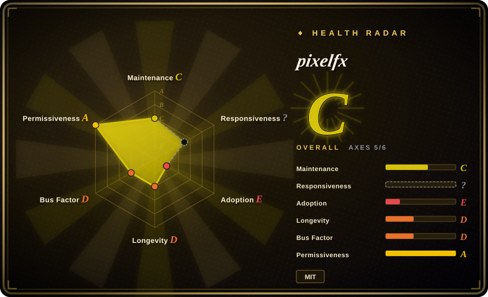
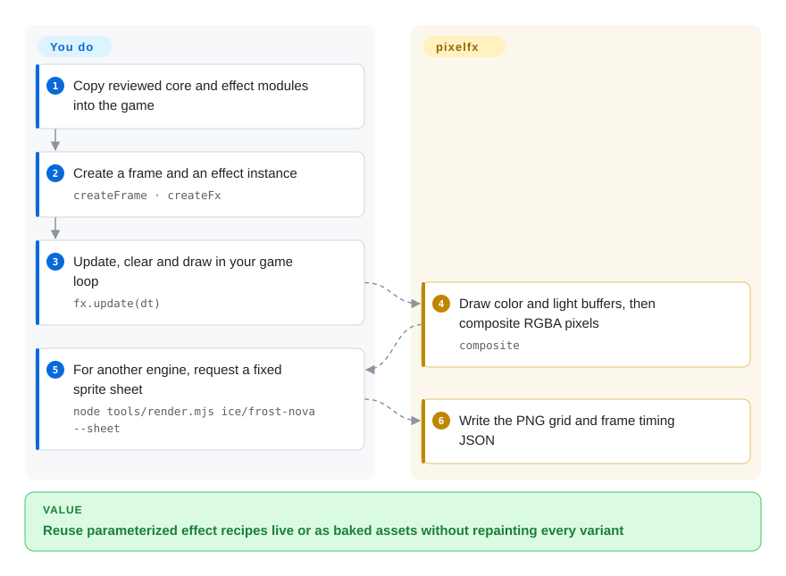
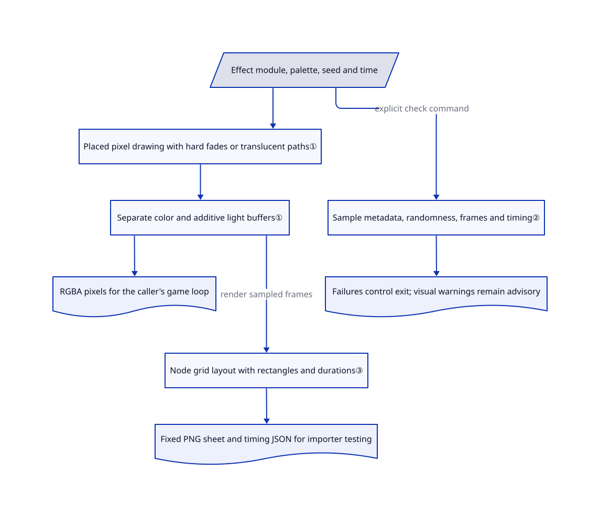

# pixelfx

Your pixel-art game needs several readable fire, impact and healing effects, but repainting every frame also means repainting every color variant. pixelfx packages effects as JavaScript drawing programs that accept palettes and seeds, with a path to baked sprite sheets for other engines.

## When to use

You have a small 2D game with a pixel-grid aesthetic, not a blank engine project. You need a family of consistent effects and want to change their palette, placement or seed without redrawing a sheet. The reviewed catalog lists 244 effects across 21 categories, including whole attacks with character wind-up and recovery. Choose pixelfx over hand-painting when reusable parameterized recipes fit the art direction; choose it over an engine-specific emitter when sharing effects across browser games and baked asset pipelines matters.

Its useful contribution is the integration layer around attributed effect recipes: a shared frame format, color and light compositing, reusable placement, an acting-character layer, sheet exporters and source checks. You still supply the game loop, input, collision, gameplay and acceptance of how the effects look. It is a new effects library, not evidence that every animation is production-ready or frame-rate-invariant.

## When NOT to use

- **You need a stable long-term dependency.** The repository is two days old, has no sampled tags or releases and has one visible committer. Vendor only reviewed files at a fixed commit, or stay with your engine's established asset pipeline.
- **An artist must directly paint the final frames.** Use [Aseprite](https://github.com/aseprite/aseprite), which is not indexed, or your existing sprite editor. pixelfx changes pictures through code rather than a drawing timeline.
- **You need an entire game engine.** Use [KAPLAY](kaplay.md) for a code-first web game or [Pyxel](pyxel.md) for a constrained Python retro game with editors. pixelfx only draws effects into buffers you own.
- **You need reactive effects inside a non-JavaScript engine.** Exported sheets freeze a particular animation, palette and seed. Tracking moving targets or adding runtime variation requires more baked variants or a code port; native emitters may be simpler.
- **You cannot separate gallery assets from reusable code.** The root MIT grant covers code and effects, but [NOTICE.md](https://github.com/patch-gg/pixelfx/blob/a84159688af3ca37a4be05a0d422b94451b2e24e/NOTICE.md#L3-L11) explicitly excludes the gallery font and identifies adapted sources. Do not redistribute the gallery as though everything has one license.

## Comparison

| Alternative | In index | Our verdict | Tradeoff |
|---|---|---|---|
| [KAPLAY](kaplay.md) | Indexed | Pick KAPLAY for scenes, input, game objects and collision; add pixelfx only when ready-made effects fill a gap inside that game. | An engine owns the frame loop; pixelfx supplies effect pixels and timing. |
| [Pyxel](pyxel.md) | Indexed | Pick Pyxel for a Python retro game with sprite and sound editors; pick pixelfx for live JavaScript effects or generated sheet assets. | Pyxel supplies a complete constrained environment; pixelfx leaves game structure and audio to you. |
| [Aseprite](https://github.com/aseprite/aseprite) | Not indexed | Pick Aseprite when frame-by-frame art direction is the main work; pick pixelfx when parameterizing a fitting recipe avoids repetitive drawing. | An editor gives direct artistic control; a code library gives programmable variants but no painting surface. |
| [Sprite Fusion VFX](https://www.spritefusion.com/pixel-art-vfx/fire) | Not a repo | Use its original downloadable effect when that recipe is enough; pick pixelfx for the larger catalog and common acting/export/checking workflow. | The sampled original is a website-distributed MIT source ZIP, not an indexed repository; pixelfx explicitly adapts those recipes rather than originating all of them. |

## Quick start

The [documented installation](https://github.com/patch-gg/pixelfx/blob/a84159688af3ca37a4be05a0d422b94451b2e24e/README.md#L54-L87) is `npm i github:patch-gg/pixelfx`, or copying `src/core` plus the desired effects. Pin the reviewed commit before adopting a moving GitHub dependency. In a browser game, import `createFrame`, `clearFrame`, `createFx` and `composite`, import an effect such as `pixelfx/fx/ice/frost-nova`, then create a frame and instance. Your tick calls `fx.update(dt)`, clears the buffers, draws the effect's back/front layers around your characters and composites into `ImageData`. For another engine, the documented `node tools/render.mjs ice/frost-nova --sheet` emits a PNG grid and Aseprite-style JSON; engine-import compatibility still needs your acceptance test. The optional Claude Code skill teaches contact-sheet iteration, but is not required to use the library. No upstream installation, renderer, checker or skill was executed for this page.

<!-- flow-steps:begin (generated from flows/pixelfx.json by tools/flow_card.py — do not edit) -->

Text version of the flow

1. **You**: Copy reviewed core and effect modules into the game
2. **You**: Create a frame and an effect instance — `createFrame · createFx`
3. **You**: Update, clear and draw in your game loop — `fx.update(dt)`
4. **pixelfx**: Draw color and light buffers, then composite RGBA pixels — `composite`
5. **You**: For another engine, request a fixed sprite sheet — `node tools/render.mjs ice/frost-nova --sheet`
6. **pixelfx**: Write the PNG grid and frame timing JSON

**Value**: Reuse parameterized effect recipes live or as baked assets without repainting every variant

<!-- flow-steps:end -->

## Key techniques

<!-- mechanism:begin (generated from mechanisms/pixelfx.json by tools/mechanism_card.py; do not edit) -->

Text version of the mechanism

- Effect module, palette, seed and time
- Placed pixel drawing with hard fades or translucent paths①
- Separate color and additive light buffers①
- RGBA pixels for the caller's game loop
- Sample metadata, randomness, frames and timing②
- Failures control exit; visual warnings remain advisory
- Node grid layout with rectangles and durations③
- Fixed PNG sheet and timing JSON for importer testing

- Effect module, palette, seed and time → Placed pixel drawing with hard fades or translucent paths①
- Placed pixel drawing with hard fades or translucent paths① → Separate color and additive light buffers①
- Separate color and additive light buffers① → RGBA pixels for the caller's game loop
- Effect module, palette, seed and time → Sample metadata, randomness, frames and timing② (explicit check command)
- Sample metadata, randomness, frames and timing② → Failures control exit; visual warnings remain advisory
- Separate color and additive light buffers① → Node grid layout with rectangles and durations③ (render sampled frames)
- Node grid layout with rectangles and durations③ → Fixed PNG sheet and timing JSON for importer testing

<!-- mechanism:end -->

### 1. Separate pigment from additive light

- **Problem:** Ordinary alpha blending can flatten fire and magic, while soft fades can blur an intended pixel-grid silhouette.
- **How:** `createFrame` allocates separate color and light arrays. The painter places local coordinates on whole pixel cells and uses ordered Bayer thresholds for hard fades; `composite` combines color with a background, then adds light. A separate blending path supports translucent smoke.
- **Limits:** This is not a rule that all pixels are opaque. Over transparency, light becomes color and alpha; baked glow therefore reads differently over a bright background than a dark one.
- **Source:** [frame and composite](https://github.com/patch-gg/pixelfx/blob/a84159688af3ca37a4be05a0d422b94451b2e24e/src/core/fx.js#L8-L19), [light composition](https://github.com/patch-gg/pixelfx/blob/a84159688af3ca37a4be05a0d422b94451b2e24e/src/core/fx.js#L95-L131), [dither and translucent paths](https://github.com/patch-gg/pixelfx/blob/a84159688af3ca37a4be05a0d422b94451b2e24e/src/core/painter.js#L9-L79).

### 2. Distinguish check failures from visual warnings

- **Problem:** An effect can render successfully while spilling outside its frame, leaving a seam or consuming too much time.
- **How:** The checker rejects malformed metadata, direct `Math.random` calls and sampled nondeterministic results. It also records pixel spill, nonempty endings, loop seams and slow frames as warnings, then prints separate pass/fail/warning counts. Live simulations use substeps no larger than about 1/120 second.
- **Limits:** Warnings do not make the process fail; exit status depends only on failures. A sampled check and bounded variable substeps do not prove identical output for every seed, time partition or effect implementation.
- **Source:** [metadata and randomness checks](https://github.com/patch-gg/pixelfx/blob/a84159688af3ca37a4be05a0d422b94451b2e24e/tools/check.mjs#L77-L95), [warnings and sampled determinism](https://github.com/patch-gg/pixelfx/blob/a84159688af3ca37a4be05a0d422b94451b2e24e/tools/check.mjs#L131-L174), [exit policy](https://github.com/patch-gg/pixelfx/blob/a84159688af3ca37a4be05a0d422b94451b2e24e/tools/check.mjs#L195-L216), [substeps](https://github.com/patch-gg/pixelfx/blob/a84159688af3ca37a4be05a0d422b94451b2e24e/src/core/fx.js#L63-L68).

### 3. Export a fixed effect without a browser renderer

- **Problem:** A Unity or Godot project cannot directly consume a JavaScript drawing function as an animated texture.
- **How:** The Node renderer loads an effect, produces frames, arranges transparent pixels in a PNG grid and writes frame rectangles and durations in Aseprite-style JSON. Extra metadata retains loop, pivot, fps and optional acting timings. GIF/MP4 preview generation delegates to ffmpeg separately.
- **Limits:** The sheet fixes one parameter set and loses live code behavior. The export format does not itself certify every engine importer; ffmpeg is optional for sheets but required for those video previews.
- **Source:** [render entry and flags](https://github.com/patch-gg/pixelfx/blob/a84159688af3ca37a4be05a0d422b94451b2e24e/tools/render.mjs#L19-L59), [sheet metadata](https://github.com/patch-gg/pixelfx/blob/a84159688af3ca37a4be05a0d422b94451b2e24e/tools/lib/fxlib.mjs#L220-L242), [ffmpeg boundary](https://github.com/patch-gg/pixelfx/blob/a84159688af3ca37a4be05a0d422b94451b2e24e/tools/lib/fxlib.mjs#L244-L261).

## Tech stack

JavaScript ES modules and typed-array pixel buffers. Node scripts provide rendering, validation and a gallery; [package.json](https://github.com/patch-gg/pixelfx/blob/a84159688af3ca37a4be05a0d422b94451b2e24e/package.json#L1-L23) lists esbuild as a development dependency and no runtime dependency packages. A Claude Code plugin exposes the optional effect-authoring skill. The acting layer adapts attributed MIT Hollow Crown work; effect and simulation sources also acknowledge Sprite Fusion.

## Dependencies

- A browser canvas or texture-upload path for live use, plus your game loop and scene composition.
- Node.js 18+ for tools. PNG sheet export uses the repository's tooling; ffmpeg is only needed for GIF/MP4 previews.
- An image-capable coding agent if you choose the optional render-and-review skill. It is not a dependency of runtime effects.

## Ops difficulty

**Low.** There is no server, database or model account required for the library. The ongoing work is choosing art, reviewing warning output and updating vendored source deliberately. Preserve root and per-file notices for adapted code, exclude the gallery font unless separately authorized, and test exported assets against your actual importer. Removing the copied modules and derived assets removes the library; optional global skill installation has its own separate cleanup.

## Health & viability

- **Maintenance, 2026-11-01:** metadata shows creation on 2026-10-30 and the reviewed commit on 2026-10-31. The manifest says 0.3.0; sampled releases and tags are empty. A version string is not a released stability contract.
- **Governance:** the public owner is the Patch organization, with one visible committer in the sampled history. This is not evidence of a broad maintenance team or support commitment.
- **Age and adoption:** two days of public history cannot establish durability. About 2.3k stars and 300 forks show attention, not shipped-game adoption. [推断: based on age and metadata] Long-lived game code should isolate the dependency behind its own asset or rendering boundary.
- **Provenance:** README and NOTICE name the adapted MIT sources and retain attribution. The sampled original Sprite Fusion Fire ZIP is not byte-identical to any of the 302 verified saved repository blobs; that single sample does not establish originality across the catalog. Reusable renderer, checker, sheet exporter and acting integration provide substance beyond a link collection.
- **License scope:** code and effects have an actual MIT text; the gallery font is explicitly excluded. Treat it as a separate asset, not a reason to pretend the code has no public license.

## Caveats (unverified)

- [未验证: upstream execution prohibited] Rendering quality, performance, check results and engine importer compatibility were not reproduced.
- [未验证: provenance comparison sampled one original archive] Attribution is visible, but the full degree of adaptation across all effects was not measured; the Fire comparison does not establish independent authorship of the whole repository.
- [未验证: no adoption interviews or deployed-game inventory] Stars and forks do not establish production use or future maintenance.
- [推断: based on creation and release evidence] Vendoring selected files reduces upgrade exposure, but does not remove review, license or correctness obligations.
