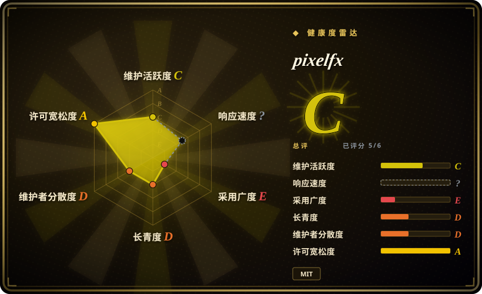
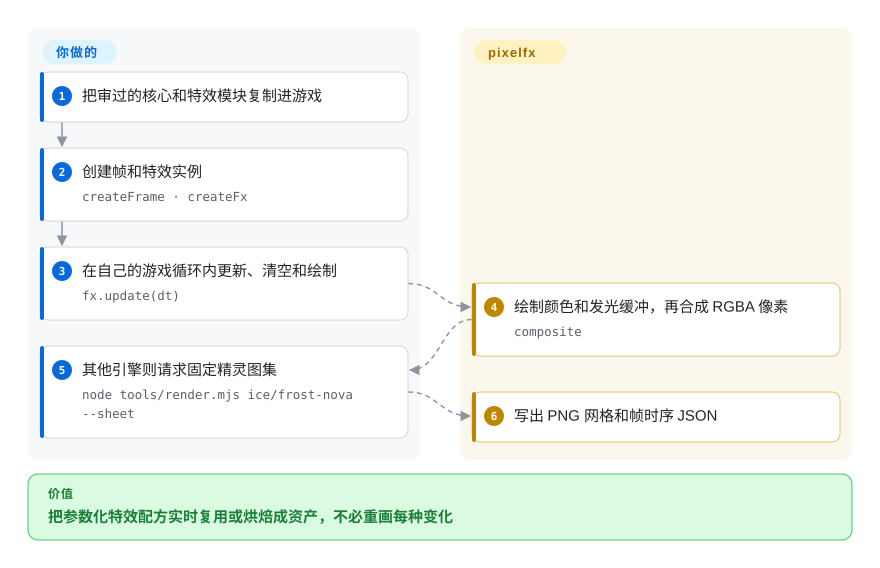
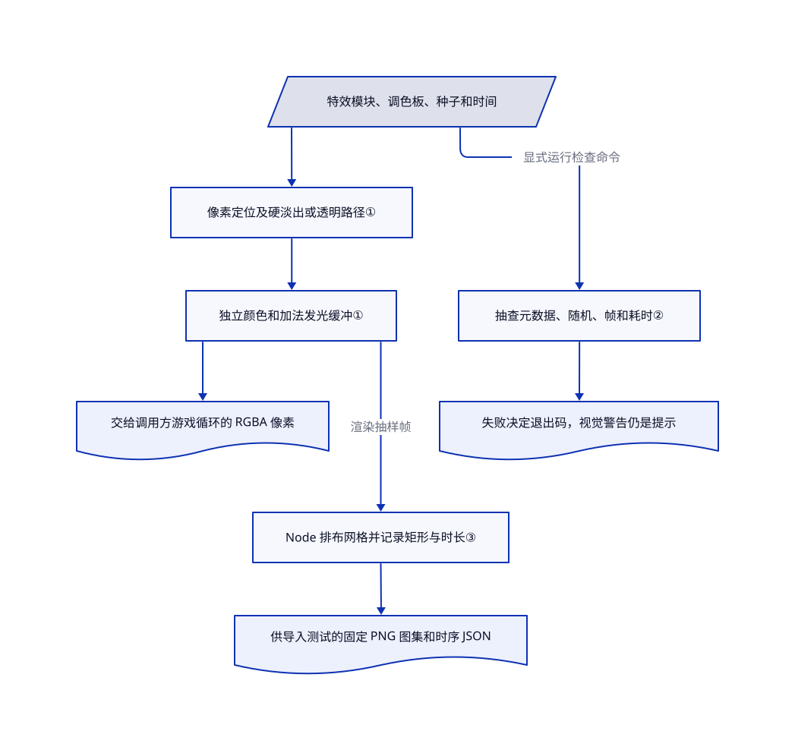

# pixelfx

像素游戏需要几组清楚的火焰、命中和治疗特效，但每换一种颜色就重画整套帧很费力。pixelfx 把特效写成接受调色板和随机种子的 JavaScript 绘图程序，也能烘焙成其他引擎使用的精灵图集。

## 何时使用

你已有一个小型二维像素游戏，不是在找从零建项目的引擎。你需要风格一致的一组特效，希望不重画图集就能改变颜色、位置或种子。已审目录列出 21 类、244 个特效，其中有带角色蓄力和收招的完整攻击。现成配方符合美术方向、参数变化能替代重复绘制时，选它而非逐帧手绘；需要在浏览器游戏和烘焙资产流程间复用时，选它而非只适配单个引擎的发射器。

它的可复用贡献是署名配方周围的集成层：统一帧格式、颜色与发光合成、位置变换、角色动作、图集导出和源码检查。游戏循环、输入、碰撞、玩法和画面验收仍由你负责。它是很新的特效库，不证明每段动画都达到生产标准，也不证明输出完全不受帧率影响。

## 何时不用

- **需要长期稳定的依赖。** 仓库才两天，抽样没有标签或发行版，可见提交者只有一位。只随项目保存固定提交中审过的文件，或者继续用已有引擎的资产流程。
- **美术师必须直接绘制最终帧。** 用未收录的 [Aseprite](https://github.com/aseprite/aseprite) 或已有精灵编辑器。pixelfx 通过代码改图，不提供绘画时间线。
- **需要完整游戏引擎。** 代码驱动的网页游戏看 [KAPLAY](kaplay.zh.md)，带编辑器的受限 Python 复古游戏看 [Pyxel](pyxel.zh.md)。pixelfx 只把特效画进你管理的缓冲区。
- **要在非 JavaScript 引擎内实时响应目标。** 导出图集固定一套动画、调色板和种子。跟踪移动目标或增加运行时变化，需要更多烘焙版本或移植代码；原生发射器可能更简单。
- **无法把画廊资源和可复用代码分开。** 根 MIT 授权覆盖代码与特效，但 [NOTICE.md](https://github.com/patch-gg/pixelfx/blob/a84159688af3ca37a4be05a0d422b94451b2e24e/NOTICE.md#L3-L11) 明确排除画廊字体，并列出改编来源。不要把整个画廊当成统一许可的资源包分发。

## 横向对比

| 替代品 | 是否收录 | 我们的评价 | 取舍 |
|---|---|---|---|
| [KAPLAY](kaplay.zh.md) | 已收录 | 要场景、输入、游戏对象和碰撞，选 KAPLAY；只在游戏缺现成特效时补 pixelfx。 | 引擎拥有帧循环；pixelfx 提供特效像素和时序。 |
| [Pyxel](pyxel.zh.md) | 已收录 | 要带精灵及声音编辑器的 Python 复古游戏，选 Pyxel；要实时 JavaScript 特效或生成图集，选 pixelfx。 | Pyxel 给出完整受限环境；pixelfx 把游戏结构和音频留给你。 |
| [Aseprite](https://github.com/aseprite/aseprite) | 未收录 | 逐帧美术控制是主要工作时选 Aseprite；参数化现成配方能省掉重复绘制时选 pixelfx。 | 编辑器直接控制画面；代码库给出可编程变化，但没有绘画界面。 |
| [Sprite Fusion VFX](https://www.spritefusion.com/pixel-art-vfx/fire) | 非仓库 | 原始可下载特效已够用时直接用它；需要更大目录和统一动作、导出、检查流程时看 pixelfx。 | 抽样原版是网站分发的 MIT 源码 ZIP，不是已收录仓库；pixelfx 明确改编这些配方，而非独创全部内容。 |

## 快速上手

[文档安装路径](https://github.com/patch-gg/pixelfx/blob/a84159688af3ca37a4be05a0d422b94451b2e24e/README.md#L54-L87) 是 `npm i github:patch-gg/pixelfx`，或复制 `src/core` 和所需特效。采用持续变化的 GitHub 依赖前应锁定已审提交。浏览器游戏中导入 `createFrame`、`clearFrame`、`createFx`、`composite`，再导入例如 `pixelfx/fx/ice/frost-nova` 的特效，创建帧和实例。你在每个 tick 调用 `fx.update(dt)`，清空缓冲，把前后层画在角色两侧，再合成到 `ImageData`。其他引擎可按文档运行 `node tools/render.mjs ice/frost-nova --sheet`，生成 PNG 网格和 Aseprite 风格 JSON；实际导入器仍需自己验收。可选 Claude Code 技能负责指导截图拼图迭代，不是使用库的前提。本页没有执行上游安装、渲染器、检查器或技能。

<!-- flow-steps:begin (generated from flows/pixelfx.json by tools/flow_card.py — do not edit) -->

流程文字版

1. **你**：把审过的核心和特效模块复制进游戏
2. **你**：创建帧和特效实例 — `createFrame · createFx`
3. **你**：在自己的游戏循环内更新、清空和绘制 — `fx.update(dt)`
4. **pixelfx**：绘制颜色和发光缓冲，再合成 RGBA 像素 — `composite`
5. **你**：其他引擎则请求固定精灵图集 — `node tools/render.mjs ice/frost-nova --sheet`
6. **pixelfx**：写出 PNG 网格和帧时序 JSON

**价值**：把参数化特效配方实时复用或烘焙成资产，不必重画每种变化

<!-- flow-steps:end -->

## 技术要点

<!-- mechanism:begin (generated from mechanisms/pixelfx.json by tools/mechanism_card.py; do not edit) -->

机制文字版

- 特效模块、调色板、种子和时间
- 像素定位及硬淡出或透明路径①
- 独立颜色和加法发光缓冲①
- 交给调用方游戏循环的 RGBA 像素
- 抽查元数据、随机、帧和耗时②
- 失败决定退出码，视觉警告仍是提示
- Node 排布网格并记录矩形与时长③
- 供导入测试的固定 PNG 图集和时序 JSON

- 特效模块、调色板、种子和时间 → 像素定位及硬淡出或透明路径①
- 像素定位及硬淡出或透明路径① → 独立颜色和加法发光缓冲①
- 独立颜色和加法发光缓冲① → 交给调用方游戏循环的 RGBA 像素
- 特效模块、调色板、种子和时间 → 抽查元数据、随机、帧和耗时②（显式运行检查命令）
- 抽查元数据、随机、帧和耗时② → 失败决定退出码，视觉警告仍是提示
- 独立颜色和加法发光缓冲① → Node 排布网格并记录矩形与时长③（渲染抽样帧）
- Node 排布网格并记录矩形与时长③ → 供导入测试的固定 PNG 图集和时序 JSON

<!-- mechanism:end -->

### 1. 把颜料与加法发光分开

- **解决：** 普通透明混合容易让火焰、魔法显得平，而柔和淡出又会模糊像素轮廓。
- **做法：** `createFrame` 分配独立颜色和发光数组。绘图器把局部坐标落到整像素格，硬淡出使用有序 Bayer 阈值；`composite` 先合成颜色与背景，再加入发光。另有混合路径处理半透明烟雾。
- **边界：** 这不意味着全部像素都不透明。透明底上的发光会转成颜色和透明度，因此烘焙后在亮背景与暗背景上的观感不同。
- **源码：** [帧与合成](https://github.com/patch-gg/pixelfx/blob/a84159688af3ca37a4be05a0d422b94451b2e24e/src/core/fx.js#L8-L19)、[发光合成](https://github.com/patch-gg/pixelfx/blob/a84159688af3ca37a4be05a0d422b94451b2e24e/src/core/fx.js#L95-L131)、[抖色和透明路径](https://github.com/patch-gg/pixelfx/blob/a84159688af3ca37a4be05a0d422b94451b2e24e/src/core/painter.js#L9-L79)。

### 2. 区分检查失败与视觉警告

- **解决：** 特效能渲染，不代表它没有越界、接缝或耗时过长。
- **做法：** 检查器拒绝不合格元数据、直接调用 `Math.random` 和抽样非确定性结果；把像素溢出、结尾不空、循环接缝和慢帧记为警告，分别打印通过、失败和警告数量。实时模拟把步长拆到约 1/120 秒以内。
- **边界：** 警告不会让进程失败，退出码只看失败数量。抽样检查和有界可变子步长，不证明每个种子、时间切分或特效实现都会完全一致。
- **源码：** [元数据与随机检查](https://github.com/patch-gg/pixelfx/blob/a84159688af3ca37a4be05a0d422b94451b2e24e/tools/check.mjs#L77-L95)、[警告与抽样确定性](https://github.com/patch-gg/pixelfx/blob/a84159688af3ca37a4be05a0d422b94451b2e24e/tools/check.mjs#L131-L174)、[退出规则](https://github.com/patch-gg/pixelfx/blob/a84159688af3ca37a4be05a0d422b94451b2e24e/tools/check.mjs#L195-L216)、[子步长](https://github.com/patch-gg/pixelfx/blob/a84159688af3ca37a4be05a0d422b94451b2e24e/src/core/fx.js#L63-L68)。

### 3. 不启动浏览器也能导出固定特效

- **解决：** Unity 或 Godot 项目不能直接把 JavaScript 绘图函数当动画纹理。
- **做法：** Node 渲染器加载特效并生成各帧，把透明像素排成 PNG 网格，再写出 Aseprite 风格的帧矩形和时长。附加元数据保留循环、轴心、帧率和可选动作时序。GIF／MP4 预览另交给 ffmpeg。
- **边界：** 图集固定一套参数，不能保留实时代码行为。导出格式本身不认证所有引擎导入器；导出图集不必装 ffmpeg，但生成这些视频预览需要它。
- **源码：** [渲染入口和参数](https://github.com/patch-gg/pixelfx/blob/a84159688af3ca37a4be05a0d422b94451b2e24e/tools/render.mjs#L19-L59)、[图集元数据](https://github.com/patch-gg/pixelfx/blob/a84159688af3ca37a4be05a0d422b94451b2e24e/tools/lib/fxlib.mjs#L220-L242)、[ffmpeg 边界](https://github.com/patch-gg/pixelfx/blob/a84159688af3ca37a4be05a0d422b94451b2e24e/tools/lib/fxlib.mjs#L244-L261)。

## 技术栈

JavaScript ES 模块和类型化数组像素缓冲。Node 脚本提供渲染、校验和画廊；[package.json](https://github.com/patch-gg/pixelfx/blob/a84159688af3ca37a4be05a0d422b94451b2e24e/package.json#L1-L23) 只列出开发依赖 esbuild，没有运行时依赖包。Claude Code 插件提供可选的特效编写技能。动作层改编自署名的 MIT Hollow Crown 代码，特效与模拟源码也注明 Sprite Fusion 来源。

## 依赖

- 实时使用需要浏览器画布或纹理上传路径，以及你自己的游戏循环和场景合成。
- 工具要求 Node.js 18+。PNG 图集使用仓库工具导出；GIF／MP4 预览才需要 ffmpeg。
- 选择可选的渲染自查技能时，需要能读图的编码 agent；它不是运行时特效的依赖。

## 运维难度

**低。** 库本身不要求服务器、数据库或模型账号。持续成本在美术选择、警告审阅和审慎更新随项目保存的源码。保留改编代码的根许可及逐文件声明，没有单独授权就排除画廊字体，并用实际导入器测试导出资产。删除复制的模块和派生资产即可移除库；可选的全局技能安装有独立清理步骤。

## 健康度与可持续性

- **维护情况，2026-11-01：** 元数据显示 2026-10-30 建仓，已审提交日期为 2026-10-31。清单版本为 0.3.0，抽样发行版和标签为空。版本字符串不是已发布的稳定性承诺。
- **治理：** 公开所有者是 Patch 组织，抽样历史只有一位可见提交者。这不证明有广泛维护团队或支持承诺。
- **年龄与采用：** 两天公开历史无法证明耐久性。约 2300 星、300 个 fork 说明受到关注，不证明已经用于已发布游戏。[推断：依据是年龄与元数据] 长期游戏代码应通过自己的资产或渲染边界隔离它。
- **来源：** README 和 NOTICE 列出 MIT 改编来源并保留署名。抽样 Sprite Fusion 原版 Fire ZIP 与 302 个已校验仓库文件均非逐字节相同；一个样本不能证明整个目录的原创性。可复用渲染器、检查器、图集导出和动作集成，提供了链接合集之外的实质内容。
- **许可范围：** 代码和特效有真实 MIT 文本，画廊字体明确排除。应把它视为独立资源，不能因此误称代码没有公开许可。

## 存疑（未验证）

- [未验证：禁止执行上游] 渲染质量、性能、检查结果和引擎导入兼容性没有实测。
- [未验证：来源比较只抽样一份原始压缩包] 可见署名不等于已衡量全部特效的改编程度；Fire 比较不证明整个仓库独立创作。
- [未验证：没有采用访谈或已发布游戏清单] 星标和 fork 不证明生产采用或未来维护。
- [推断：依据是创建及发行证据] 随项目保存选定源码能减少升级暴露，但不免除审查、许可和正确性义务。
