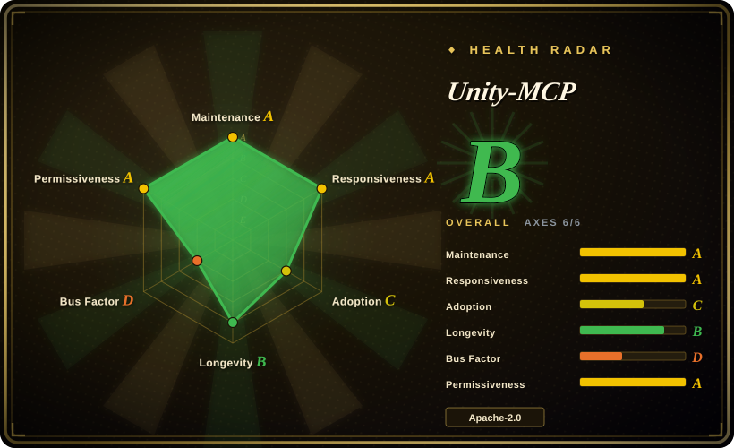
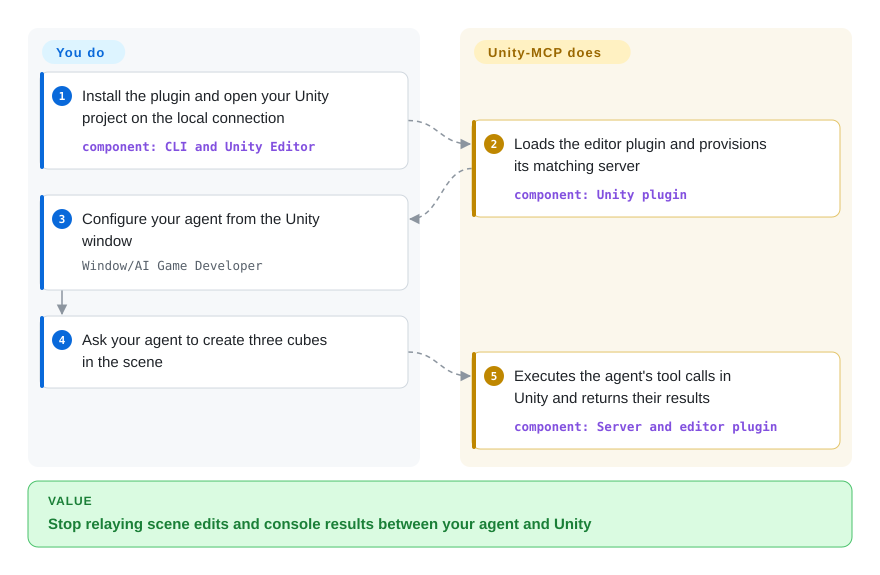
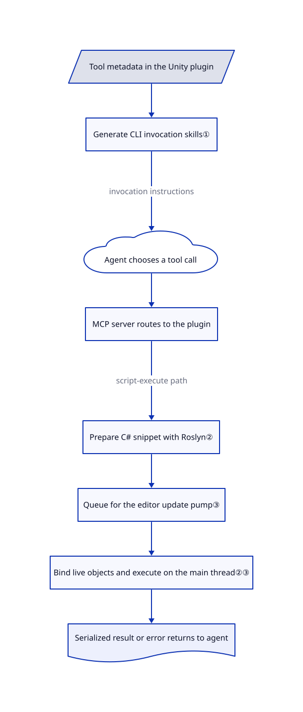

# Unity-MCP

Your coding agent edits C# but still asks you to place objects and read Unity's console. Unity-MCP lets it call the running editor directly, with generated tool instructions and an in-editor C# executor.

## When to use

You're building a Unity prototype with a coding agent. It writes a movement script, then asks you to attach it to the Player, inspect a missing component, and paste console errors back into chat. You want that agent to inspect scenes, change objects, capture images, and run editor tests without you relaying each operation. Choose Unity-MCP when project-specific C# tools, generated agent skills, and optional compiled-game integration matter more than keeping the bridge editor-only.

You can expose your own methods through attributes instead of writing another protocol server. Unlike merely adding game-development advice to an agent, this requires a live Unity plugin and gives the agent real access to project state. Runtime integration is a separate engineering path: the compiled game starts with no built-in tools, so you implement the allowed game actions yourself. See the [installation and runtime examples](https://github.com/IvanMurzak/Unity-MCP/blob/c89aec4da7bc1d328f9d6813077598d30dceddbc/README.md#runtime-usage-in-game).

## When NOT to use

- **You need a permissive-only component for a competing developer product.** Choose [CoplayDev/unity-mcp](https://github.com/CoplayDev/unity-mcp), whose root license is MIT, rather than treating this whole package as Apache-2.0. The vendored Code-Exec sources use PolyForm Shield, including a noncompete clause; the exception is explicit in [VENDORED.md](https://github.com/IvanMurzak/Unity-MCP/blob/c89aec4da7bc1d328f9d6813077598d30dceddbc/Unity-MCP-Plugin/Packages/com.ivanmurzak.unity.mcp/Editor/Scripts/CodeExec/VENDORED.md). Review the full dependency set before redistribution.
- **You only need a Node.js-based editor bridge.** Consider [CoderGamester/mcp-unity](https://github.com/CoderGamester/mcp-unity): it exposes scene, component, console and test operations through a Node server. Unity-MCP adds a shared .NET server, dependency restoration and runtime integration that may be unnecessary for that scope.
- **You cannot grant an agent broad editor/process access.** Use the Unity Editor manually, or reviewed editor scripts. This tool exposes asset deletion, reflection calls and C# execution; authentication is not a code sandbox. Restrict enabled tools and inspect generated agent configuration before trusting it.
- **You need deterministic release-test execution, not an interactive agent.** Use Unity Editor's Test Runner or its direct batch test workflow. Do not treat an agent-selected sequence as a release gate; the open [test-lock report #1049](https://github.com/IvanMurzak/Unity-MCP/issues/1049) also warrants checking before consecutive automated runs.

## Comparison

| Alternative | In index | Our verdict | Tradeoff |
|---|---|---|---|
| [CoplayDev/unity-mcp](https://github.com/CoplayDev/unity-mcp) | not indexed | Choose CoplayDev for a Python-backed editor integration or Unity 2021.3 support; choose this page's project for its generated CLI skills and explicit compiled-game integration path. | CoplayDev documents Python 3.10+ through uv and Unity 2021.3–6.x; this package declares Unity 2022.3 minimum and adds its own .NET bridge. CoplayDev is not added in this tab batch. |
| [CoderGamester/mcp-unity](https://github.com/CoderGamester/mcp-unity) | not indexed | Choose CoderGamester when a Node.js server with editor operations and a VS Code dashboard fits your team; choose Unity-MCP when C# method exposure and generated per-tool skills decide the integration. | CoderGamester's current README requires Unity 6 and Node 18+, while Unity-MCP supports an older declared editor baseline but restores additional .NET libraries. CoderGamester is not added in this tab batch. |
| [Unity Editor](https://docs.unity3d.com/Manual/index.html) | not a repo | Keep manual editor work and reviewed scripts for sensitive assets or reproducible release checks; choose Unity-MCP when eliminating repeated human handoffs justifies agent write access. | Unity Editor is a proprietary application, not a repository. Manual operation avoids another agent endpoint but retains the clicking and copy-paste work. |

Comparison basis: [CoplayDev README](https://github.com/CoplayDev/unity-mcp#quickstart), [CoplayDev license](https://github.com/CoplayDev/unity-mcp/blob/main/LICENSE), and [CoderGamester README](https://github.com/CoderGamester/mcp-unity#requirements), read on 2026-10-21.

## Quick start

Install `unity-mcp-cli` with npm, then run `unity-mcp-cli install-plugin ./MyUnityProject` against an existing Unity project; the CLI adds the plugin and package registries. For the documented local path, open the project with the `open` command's `--url http://localhost:8080 --keep-connected` options, then use `Window/AI Game Developer` to configure your agent's MCP connection—the interface through which it calls Unity tools. Ask the agent to create three cubes or inspect your scene; the plugin executes its calls in Unity and returns results. You supply the Unity installation and license, agent/model access, permissions, and review of changed assets; the bridge does not supply an LLM or make model usage free. The README's default cloud walkthrough instead signs in to ai-game.dev and uses project-pinned endpoints; local operation does not require that cloud route. Sources: [quick start](https://github.com/IvanMurzak/Unity-MCP/blob/c89aec4da7bc1d328f9d6813077598d30dceddbc/README.md#quick-start), [local open example](https://github.com/IvanMurzak/Unity-MCP/blob/c89aec4da7bc1d328f9d6813077598d30dceddbc/cli/README.md#open).

<!-- flow-steps:begin (generated from flows/unity-mcp.json by tools/flow_card.py — do not edit) -->

Text version of the flow

1. **You**: Install the plugin and open your Unity project on the local connection — component: `CLI and Unity Editor`
2. **Unity-MCP**: Loads the editor plugin and provisions its matching server — component: `Unity plugin`
3. **You**: Configure your agent from the Unity window — `Window/AI Game Developer`
4. **You**: Ask your agent to create three cubes in the scene
5. **Unity-MCP**: Executes the agent's tool calls in Unity and returns their results — component: `Server and editor plugin`

**Value**: Stop relaying scene edits and console results between your agent and Unity

<!-- flow-steps:end -->

## Key techniques

<!-- mechanism:begin (generated from mechanisms/unity-mcp.json by tools/mechanism_card.py; do not edit) -->

Text version of the mechanism

- Tool metadata in the Unity plugin
- Generate CLI invocation skills①
- Agent chooses a tool call
- MCP server routes to the plugin
- Prepare C# snippet with Roslyn②
- Queue for the editor update pump③
- Bind live objects and execute on the main thread②③
- Serialized result or error returns to agent

- Tool metadata in the Unity plugin → Generate CLI invocation skills①
- Generate CLI invocation skills① → Agent chooses a tool call (invocation instructions)
- Agent chooses a tool call → MCP server routes to the plugin
- MCP server routes to the plugin → Prepare C# snippet with Roslyn② (script-execute path)
- Prepare C# snippet with Roslyn② → Queue for the editor update pump③
- Queue for the editor update pump③ → Bind live objects and execute on the main thread②③
- Bind live objects and execute on the main thread②③ → Serialized result or error returns to agent

<!-- mechanism:end -->

### 1. Generate callable skills from tool metadata

- **Problem:** An agent needs accurate argument shapes and invocation instructions for the tools installed in this particular project.
- **How:** The editor installs a Unity-specific skill generator. It emits `run-tool` or `run-system-tool` CLI examples from tool metadata and offers JSON-file/stdin input for complex arguments; repeated descriptions are omitted from the generated body and schema.
- **Limits:** These are invocation instructions, not an agent planner or a permission system. The CLI resolves authorization; generated instructions do not themselves isolate a tool.
- **Source:** [Generator:20–100](https://github.com/IvanMurzak/Unity-MCP/blob/c89aec4da7bc1d328f9d6813077598d30dceddbc/Unity-MCP-Plugin/Packages/com.ivanmurzak.unity.mcp/Editor/Scripts/Utils/UnitySkillFileGenerator.cs#L20-L100), [editor wiring:29–59](https://github.com/IvanMurzak/Unity-MCP/blob/c89aec4da7bc1d328f9d6813077598d30dceddbc/Unity-MCP-Plugin/Packages/com.ivanmurzak.unity.mcp/Editor/Scripts/UnityMcpPluginEditor.Build.cs#L29-L59).

### 2. Compile snippets before binding live Unity objects

- **Problem:** Writing a new script asset and waiting for a project reload is unnecessary for a small inspection or change.
- **How:** `script-execute` prepares C# through Roslyn, the C# compiler, on the calling thread. It then resolves live object parameters and runs the prepared snippet on Unity's main thread, serializing the returned value. Identical loaded snippets are reused on Mono, where individual assemblies cannot unload.
- **Limits:** Execution occurs in the editor process, not a sandbox. The asynchronous timeout stops waiting, not necessarily the code; a synchronous loop can block the editor. Unique loaded snippets remain until the domain goes away on Mono.
- **Source:** [Prepare, execute and serialize:35–153](https://github.com/IvanMurzak/Unity-MCP/blob/c89aec4da7bc1d328f9d6813077598d30dceddbc/Unity-MCP-Plugin/Packages/com.ivanmurzak.unity.mcp/Editor/Scripts/API/Tool/Script.Execute.cs#L35-L153), [timeout and assembly reuse:256–345](https://github.com/IvanMurzak/Unity-MCP/blob/c89aec4da7bc1d328f9d6813077598d30dceddbc/Unity-MCP-Plugin/Packages/com.ivanmurzak.unity.mcp/Editor/Scripts/CodeExec/Core/CodeRunner.cs#L256-L345).

### 3. Queue work onto one editor-owned update pump

- **Problem:** Network tool calls arrive on background threads, but Unity operations need its main thread; concurrent edits to the update delegate can lose callbacks.
- **How:** Background callers enqueue actions in a concurrent queue. One pump, installed on the main thread, drains the actions present at the start of each editor tick. Each action completes a task with either its result or exception.
- **Limits:** This prevents that callback-registration race, not unsafe application logic. A long synchronous action still occupies the main thread, and work added during a tick waits for a later tick.
- **Source:** [Main-thread dispatcher:20–89](https://github.com/IvanMurzak/Unity-MCP/blob/c89aec4da7bc1d328f9d6813077598d30dceddbc/Unity-MCP-Plugin/Packages/com.ivanmurzak.unity.mcp/Runtime/Utils/MainThread.Editor.cs#L20-L89).

## Tech stack

- C# Unity editor/runtime plugin; attribute-based tools and reflection through McpPlugin and ReflectorNet.
- TypeScript/Node CLI using `@baizor/gamedev-cli-core`; Roslyn for editor code execution.
- A separately versioned GameDev-MCP-Server bridges MCP clients to the plugin over SignalR. The reviewed plugin pins server **9.2.13**; it is not the same version as plugin **1.3.0**. See [server manager](https://github.com/IvanMurzak/Unity-MCP/blob/c89aec4da7bc1d328f9d6813077598d30dceddbc/Unity-MCP-Plugin/Packages/com.ivanmurzak.unity.mcp/Editor/Scripts/McpServerManager.cs#L156-L166).

## Dependencies

- Unity **2022.3+** is the package's declared baseline, not a promise that every future editor works. The CLI requires Node **^20.19.0 or >=22.12.0**. Sources: [Unity manifest](https://github.com/IvanMurzak/Unity-MCP/blob/c89aec4da7bc1d328f9d6813077598d30dceddbc/Unity-MCP-Plugin/Packages/com.ivanmurzak.unity.mcp/package.json), [CLI manifest](https://github.com/IvanMurzak/Unity-MCP/blob/c89aec4da7bc1d328f9d6813077598d30dceddbc/cli/package.json).
- The plugin downloads a platform-specific server and restores NuGet libraries into `Assets/Plugins/NuGet`; initial provisioning therefore needs network access. UPM dependencies include Unity Test Framework, UIElements and PlayerPrefsEx. There is no database to operate.
- Supply an agent supporting skills or dynamic MCP tool updates and your chosen model access. Cloud mode adds ai-game.dev credentials; Custom mode can use a local server. The README explicitly warns against spaces in project paths.
- Compiled-game integration requires custom tools and an explicit runtime connection; editor-only tools do not automatically become game actions.

## Ops difficulty

**Medium.** Local setup avoids a database, but couples an editor plugin, downloaded server, NuGet DLL set, CLI and agent configuration. Pin these together and test upgrades on a disposable project. The [dependency resolver](https://github.com/IvanMurzak/Unity-MCP/blob/c89aec4da7bc1d328f9d6813077598d30dceddbc/Unity-MCP-Plugin/Packages/com.ivanmurzak.unity.mcp/Editor/DependencyResolver/NuGetConfig.cs#L39-L86) documents why stale DLLs can block editor reloads.

Do not expose an unauthenticated HTTP endpoint beyond a trusted local environment. Review generated configuration for credentials and enabled tools. The CLI's `open` command can auto-dismiss Unity's compile-error dialog; opt out with `--no-auto-dismiss-launch-errors` when that behavior is inappropriate. Root `.claude/settings.json` also grants broad Bash permissions and enables project MCP servers: inspect it before opening the upstream clone in a trusted agent workspace, rather than copying those allowances into your harness.

## Health & viability

- **Maintenance, 2026-10-21:** release 1.3.0 shipped on October 20, following 1.1.0 on October 17 and 1.2.0 on October 18. The repository is not archived. Rapid releases support active experimentation but justify version pinning. Sources: [releases](https://github.com/IvanMurzak/Unity-MCP/releases).
- **Governance:** personal-account ownership; [CODEOWNERS](https://github.com/IvanMurzak/Unity-MCP/blob/c89aec4da7bc1d328f9d6813077598d30dceddbc/.github/CODEOWNERS) assigns all paths to IvanMurzak. The contributors API shows 2,967 contributions for Ivan and 32 for the next listed contributor: contribution history is concentrated, not foundation governance.
- **Age and durability:** created April 2, 2025, approximately 18 months before this review. [推断：based on repository age, current releases and concentrated ownership] Active but still young; its short operating history is weaker durability evidence than a long-maintained engine tool.
- **Adoption:** 4,512 stars and 401 forks on 2026-10-21 show interest, not verified production use. The repository includes editor tests, CLI tests and several Unity-version fixture projects; this intake inspected tests but did not run Unity.
- **License and trust:** root and plugin licenses name Ivan Murzak under Apache-2.0, while the explicitly vendored Code-Exec component uses PolyForm Shield. The automatic radar's GitHub-license axis does not audit that mixed-license distribution. Broad execution access and cloud routing deserve more attention than the star count.

## Caveats (unverified)

- [未验证：upstream execution was outside this intake's authorization] Installation, editor connectivity, images, compiled-game integration and end-to-end tool behavior were checked against docs/source only, not reproduced in Unity.
- [未验证：no matching Unity/import environment was run] Open issue [#1050](https://github.com/IvanMurzak/Unity-MCP/issues/1050) reports asset-import workers replacing the main editor connection in local no-auth mode on Unity 2022.3; this is a reporter's observation, not a reproduced universal defect.
- [未验证：the reported test lifecycle was not reproduced] Open issue [#1049](https://github.com/IvanMurzak/Unity-MCP/issues/1049) reports premature test-lock release and missing release on run errors. Validate consecutive EditMode/PlayMode runs before using them unattended.
- [推断：based on age, release dates and CODEOWNERS] The project is active but its long-term durability and maintainer continuity remain unproven; repository popularity is not production validation.
