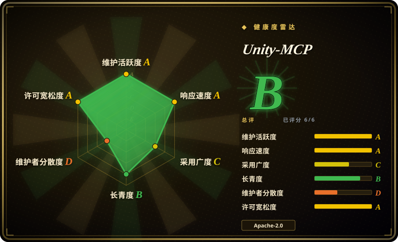
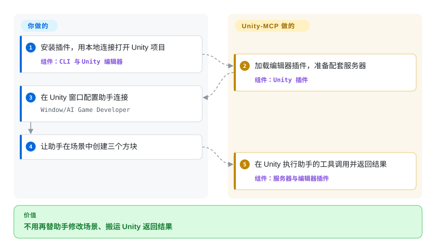
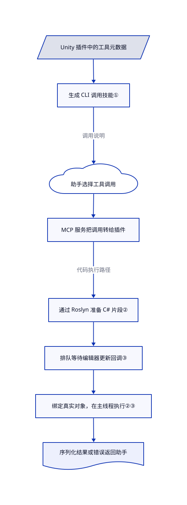

# Unity-MCP

编程助手写完 C#，还要你手动摆物体、抄 Unity 报错。Unity-MCP 让它直接调用运行中的编辑器，并生成工具说明、在编辑器内执行 C#。

## 何时使用

你正和编程助手一起做 Unity 原型。它写好了移动脚本，却让你把脚本挂到 Player、检查缺失组件，再把控制台错误贴回聊天。你想让它直接读取场景、修改物体、截图和运行编辑器测试，不再由你逐项传话。当项目专属 C# 工具、自动生成的助手技能，以及接入打包后游戏的能力更重要时，选 Unity-MCP，而非只面向编辑器的桥接方案。

你可以给自己的方法加特性声明，把它们暴露成工具，不必另写协议服务器。它不是给助手补一份游戏开发建议，而是通过运行中的 Unity 插件访问真实项目状态。接入打包后游戏是另一项工程：运行时没有默认工具，你必须自己实现允许调用的游戏动作。参见[安装与运行时示例](https://github.com/IvanMurzak/Unity-MCP/blob/c89aec4da7bc1d328f9d6813077598d30dceddbc/README.md#runtime-usage-in-game)。

## 何时不用

- **你要给竞品开发工具使用纯宽松许可组件。** 优先考虑根许可证为 MIT 的 [CoplayDev/unity-mcp](https://github.com/CoplayDev/unity-mcp)，不要把本项目整个发行包都视为 Apache-2.0。内嵌 Code-Exec 源码采用 PolyForm Shield，含竞业限制；[内嵌声明](https://github.com/IvanMurzak/Unity-MCP/blob/c89aec4da7bc1d328f9d6813077598d30dceddbc/Unity-MCP-Plugin/Packages/com.ivanmurzak.unity.mcp/Editor/Scripts/CodeExec/VENDORED.md)明确保留了这一例外。再分发前仍需检查完整依赖。
- **你只想用 Node.js 桥接编辑器。** 可以考虑 [CoderGamester/mcp-unity](https://github.com/CoderGamester/mcp-unity)，它通过 Node 服务暴露场景、组件、日志和测试操作。Unity-MCP 增加的共享 .NET 服务、依赖恢复与运行时接入，对这个范围未必必要。
- **你不能授予助手广泛的编辑器与进程权限。** 改用 Unity Editor 手动操作，或经过评审的编辑器脚本。本项目提供资源删除、反射调用与 C# 执行；认证不是代码沙箱。应限制启用的工具，并检查生成的助手配置。
- **你需要确定性的发版测试，而非交互式助手。** 使用 Unity Editor 自带 Test Runner 或直接批处理测试流程。不要把助手临时选择的操作序列当成发版门禁；连续自动跑测前，还应核验未关闭的[测试锁报告 #1049](https://github.com/IvanMurzak/Unity-MCP/issues/1049)。

## 横向对比

| 替代品 | 是否收录 | 我们的评价 | 取舍 |
|---|---|---|---|
| [CoplayDev/unity-mcp](https://github.com/CoplayDev/unity-mcp) | 未收录 | 要用 Python 服务桥接编辑器，或需支持 Unity 2021.3，选 CoplayDev；自动生成 CLI 技能和接入打包后游戏才是关键时，选本项目。 | CoplayDev 文档要求通过 uv 使用 Python 3.10+，支持 Unity 2021.3–6.x；本包声明的编辑器下限是 2022.3，并另带 .NET 桥接服务。not added in this tab batch。 |
| [CoderGamester/mcp-unity](https://github.com/CoderGamester/mcp-unity) | 未收录 | 团队偏好 Node.js 服务和 VS Code 仪表盘时，选 CoderGamester；需要暴露 C# 方法、生成逐工具技能时，选 Unity-MCP。 | CoderGamester 当前文档要求 Unity 6 与 Node 18+；Unity-MCP 声明支持更早的编辑器，但还要恢复额外的 .NET 库。not added in this tab batch。 |
| [Unity Editor](https://docs.unity3d.com/Manual/index.html) | 非仓库 | 敏感资源和可复现发版检查，保留手动编辑器操作与评审过的脚本；省去反复人工传话值得开放助手写权限时，再选 Unity-MCP。 | Unity Editor 是专有应用，不是代码仓库。手动操作少一个助手端点，但仍需点击界面和复制报错。 |

比较依据：[CoplayDev 文档](https://github.com/CoplayDev/unity-mcp#quickstart)、[CoplayDev 许可证](https://github.com/CoplayDev/unity-mcp/blob/main/LICENSE)与 [CoderGamester 文档](https://github.com/CoderGamester/mcp-unity#requirements)，读取于 2026-10-21。

## 快速上手

通过 npm 安装 `unity-mcp-cli`，再对已有 Unity 项目运行 `unity-mcp-cli install-plugin ./MyUnityProject`；CLI 会加入插件与包注册源。走文档中的本地路径时，使用 `open` 命令的 `--url http://localhost:8080 --keep-connected` 选项打开项目，再到 `Window/AI Game Developer` 配置助手的 MCP 连接，也就是助手调用 Unity 工具的接口。让助手创建三个方块或检查场景，插件会在 Unity 中执行调用并返回结果。你负责 Unity 安装与许可、助手及模型访问、授权和资源改动验收；桥接工具不提供大模型，也不免除模型费用。README 默认的云端流程则会登录 ai-game.dev，并使用固定到项目的端点；本地运行不必走这条云端路径。来源：[快速开始](https://github.com/IvanMurzak/Unity-MCP/blob/c89aec4da7bc1d328f9d6813077598d30dceddbc/README.md#quick-start)、[本地打开示例](https://github.com/IvanMurzak/Unity-MCP/blob/c89aec4da7bc1d328f9d6813077598d30dceddbc/cli/README.md#open)。

<!-- flow-steps:begin (generated from flows/unity-mcp.json by tools/flow_card.py — do not edit) -->

流程文字版

1. **你**：安装插件，用本地连接打开 Unity 项目 — 组件：`CLI 与 Unity 编辑器`
2. **Unity-MCP**：加载编辑器插件，准备配套服务器 — 组件：`Unity 插件`
3. **你**：在 Unity 窗口配置助手连接 — `Window/AI Game Developer`
4. **你**：让助手在场景中创建三个方块
5. **Unity-MCP**：在 Unity 执行助手的工具调用并返回结果 — 组件：`服务器与编辑器插件`

**价值**：不用再替助手修改场景、搬运 Unity 返回结果

<!-- flow-steps:end -->

## 技术要点

<!-- mechanism:begin (generated from mechanisms/unity-mcp.json by tools/mechanism_card.py; do not edit) -->

机制文字版

- Unity 插件中的工具元数据
- 生成 CLI 调用技能①
- 助手选择工具调用
- MCP 服务把调用转给插件
- 通过 Roslyn 准备 C# 片段②
- 排队等待编辑器更新回调③
- 绑定真实对象，在主线程执行②③
- 序列化结果或错误返回助手

- Unity 插件中的工具元数据 → 生成 CLI 调用技能①
- 生成 CLI 调用技能① → 助手选择工具调用（调用说明）
- 助手选择工具调用 → MCP 服务把调用转给插件
- MCP 服务把调用转给插件 → 通过 Roslyn 准备 C# 片段②（代码执行路径）
- 通过 Roslyn 准备 C# 片段② → 排队等待编辑器更新回调③
- 排队等待编辑器更新回调③ → 绑定真实对象，在主线程执行②③
- 绑定真实对象，在主线程执行②③ → 序列化结果或错误返回助手

<!-- mechanism:end -->

### 1. 从工具元数据生成可调用的技能

- **解决：** 助手需要知道当前项目已装工具的参数结构，以及真实调用方式。
- **做法：** 编辑器装入 Unity 专用技能生成器。它从工具元数据生成 `run-tool` 或 `run-system-tool` 示例，复杂参数可通过 JSON 文件或标准输入传入；生成正文与参数模式时省去重复描述。
- **边界：** 这是调用说明，不是助手规划器或权限系统。认证由 CLI 解析，生成说明本身不隔离工具。
- **源码：** [生成器第 20–100 行](https://github.com/IvanMurzak/Unity-MCP/blob/c89aec4da7bc1d328f9d6813077598d30dceddbc/Unity-MCP-Plugin/Packages/com.ivanmurzak.unity.mcp/Editor/Scripts/Utils/UnitySkillFileGenerator.cs#L20-L100)、[编辑器接线第 29–59 行](https://github.com/IvanMurzak/Unity-MCP/blob/c89aec4da7bc1d328f9d6813077598d30dceddbc/Unity-MCP-Plugin/Packages/com.ivanmurzak.unity.mcp/Editor/Scripts/UnityMcpPluginEditor.Build.cs#L29-L59)。

### 2. 先编译代码片段，再绑定真实 Unity 对象

- **解决：** 小范围检查或修改，不必每次都新写脚本资源、等待整个项目重载。
- **做法：** `script-execute` 在调用线程上通过 C# 编译器 Roslyn 准备代码，再到 Unity 主线程解析真实对象参数、运行代码并序列化返回值。Mono 无法单独卸载程序集，因此会复用已加载的相同代码片段。
- **边界：** 代码在编辑器进程执行，不是沙箱。异步超时只结束等待，不一定终止代码；同步死循环会卡住编辑器。Mono 下不同片段加载的程序集会保留到域销毁。
- **源码：** [准备、执行与序列化第 35–153 行](https://github.com/IvanMurzak/Unity-MCP/blob/c89aec4da7bc1d328f9d6813077598d30dceddbc/Unity-MCP-Plugin/Packages/com.ivanmurzak.unity.mcp/Editor/Scripts/API/Tool/Script.Execute.cs#L35-L153)、[超时与程序集复用第 256–345 行](https://github.com/IvanMurzak/Unity-MCP/blob/c89aec4da7bc1d328f9d6813077598d30dceddbc/Unity-MCP-Plugin/Packages/com.ivanmurzak.unity.mcp/Editor/Scripts/CodeExec/Core/CodeRunner.cs#L256-L345)。

### 3. 用编辑器独占的更新回调排队执行

- **解决：** 网络工具调用来自后台线程，Unity 操作却要求主线程；并发修改更新委托可能丢失回调。
- **做法：** 后台调用把动作放进并发队列，主线程安装的唯一更新回调按每帧开始时的队列长度取出动作。每个动作把结果或异常写回等待任务。
- **边界：** 它防止的是回调注册竞争，不会让业务代码自动安全。长时间同步动作仍占用主线程，本帧执行期间加入的工作要等后续帧。
- **源码：** [主线程调度第 20–89 行](https://github.com/IvanMurzak/Unity-MCP/blob/c89aec4da7bc1d328f9d6813077598d30dceddbc/Unity-MCP-Plugin/Packages/com.ivanmurzak.unity.mcp/Runtime/Utils/MainThread.Editor.cs#L20-L89)。

## 技术栈

- C# 编写的 Unity 编辑器与运行时插件，通过 McpPlugin 和 ReflectorNet 实现工具特性声明与反射。
- TypeScript／Node CLI，依赖 `@baizor/gamedev-cli-core`；编辑器代码执行使用 Roslyn。
- 独立版本的 GameDev-MCP-Server 通过 SignalR 桥接 MCP 客户端与插件。核验版本固定服务器为 **9.2.13**，与插件 **1.3.0** 不是同一版本号。参见[服务器管理器](https://github.com/IvanMurzak/Unity-MCP/blob/c89aec4da7bc1d328f9d6813077598d30dceddbc/Unity-MCP-Plugin/Packages/com.ivanmurzak.unity.mcp/Editor/Scripts/McpServerManager.cs#L156-L166)。

## 依赖

- 包声明的编辑器下限为 Unity **2022.3+**，不代表保证未来每个版本都兼容。CLI 要求 Node **^20.19.0 或 >=22.12.0**。来源：[Unity 清单](https://github.com/IvanMurzak/Unity-MCP/blob/c89aec4da7bc1d328f9d6813077598d30dceddbc/Unity-MCP-Plugin/Packages/com.ivanmurzak.unity.mcp/package.json)、[CLI 清单](https://github.com/IvanMurzak/Unity-MCP/blob/c89aec4da7bc1d328f9d6813077598d30dceddbc/cli/package.json)。
- 插件下载平台对应的服务器，并把 NuGet 库恢复到 `Assets/Plugins/NuGet`，所以首次准备需要网络。Unity 包依赖包含 Test Framework、UIElements 和 PlayerPrefsEx，无需运维数据库。
- 自备支持技能或动态 MCP 工具更新的助手，以及模型访问能力。云端模式增加 ai-game.dev 凭据；Custom 模式可连接本地服务器。README 明确提醒项目路径不能含空格。
- 接入打包后游戏时，需要自定义工具并显式连接；编辑器工具不会自动成为游戏动作。

## 运维难度

**中等。** 本地运行不需要数据库，但编辑器插件、下载的服务器、NuGet 库、CLI 与助手配置相互耦合。应一起固定版本，并先在可丢弃项目中测试升级。[依赖恢复器](https://github.com/IvanMurzak/Unity-MCP/blob/c89aec4da7bc1d328f9d6813077598d30dceddbc/Unity-MCP-Plugin/Packages/com.ivanmurzak.unity.mcp/Editor/DependencyResolver/NuGetConfig.cs#L39-L86)解释了旧 DLL 为什么可能阻断编辑器重载。

不要把无认证 HTTP 端点暴露到可信本地环境之外。检查生成配置中的凭据与启用工具。CLI 的 `open` 命令可能自动跳过 Unity 编译错误弹窗，不适合时使用 `--no-auto-dismiss-launch-errors` 关闭。根目录 `.claude/settings.json` 还放行了广泛 Bash 权限并启用项目 MCP 服务器；在可信助手工作区打开上游克隆前应先检查，不要把这些授权照搬进个人配置。

## 健康度与可持续性

- **维护，2026-10-21：** 1.3.0 于 10 月 20 日发布，之前的 1.1.0 和 1.2.0 分别在 10 月 17、18 日发布，仓库未归档。更新密集适合试验，也说明应固定版本。来源：[发布记录](https://github.com/IvanMurzak/Unity-MCP/releases)。
- **治理：** 仓库由个人账户持有，[CODEOWNERS](https://github.com/IvanMurzak/Unity-MCP/blob/c89aec4da7bc1d328f9d6813077598d30dceddbc/.github/CODEOWNERS)把全部路径交给 IvanMurzak。贡献者 API 中，Ivan 记录为 2967 次，下一位列出者为 32 次；历史贡献集中，不是基金会治理。
- **年龄与耐久性：** 仓库创建于 2025-04-02，距核验约 18 个月。[推断：依据仓库年龄、近期发布与所有权集中程度] 项目活跃但仍年轻，短运行历史不如长期维护的引擎工具能证明可持续性。
- **采用信号：** 2026-10-21 有 4512 星、401 个分支，只能证明关注度，不代表已验证的生产采用。仓库包含编辑器测试、CLI 测试与多版本 Unity 测试项目；本次阅读了测试，未运行 Unity。
- **许可与信任：** 根目录和插件许可证以 Ivan Murzak 名义采用 Apache-2.0，但明确内嵌的 Code-Exec 采用 PolyForm Shield。自动雷达读取的 GitHub 许可证轴，不等于审计了混合许可发行包。相比星数，更应关注广泛执行权限与云端路由。

## 存疑（未验证）

- [未验证：本次授权不包含执行上游] 安装、编辑器连接、截图、打包后游戏接入和端到端工具行为，仅依据文档与源码核验，未在 Unity 中复现。
- [未验证：未运行匹配的 Unity 与资源导入环境] 未关闭的问题 [#1050](https://github.com/IvanMurzak/Unity-MCP/issues/1050)报告，在 Unity 2022.3 的本地无认证模式下，资源导入工作进程会替换主编辑器连接。这是报告者的观察，不是已复现的普遍缺陷。
- [未验证：未复现报告中的测试生命周期] 未关闭的问题 [#1049](https://github.com/IvanMurzak/Unity-MCP/issues/1049)报告，测试锁过早释放，且运行错误时未释放。无人值守使用前应验证连续的编辑与播放模式测试。
- [推断：依据年龄、发布日期与 CODEOWNERS] 项目活跃，但长期耐久性和维护者持续投入仍未证明；仓库热度不能替代生产验证。
