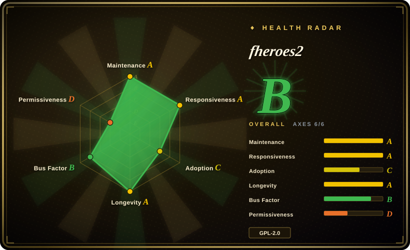
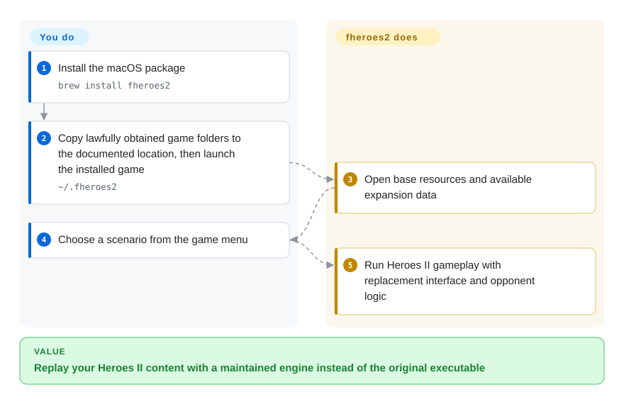
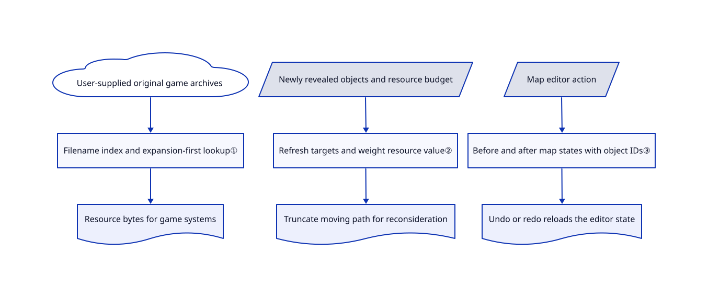

# fheroes2

You still have Heroes II maps and artwork, but want higher resolutions and a maintained engine instead of the original executable. fheroes2 reads those game resources and supplies replacement gameplay, AI and interface code.

## When to use

You own Heroes of Might and Magic II and want to replay its campaigns on a current computer, or maintain a native port. Your map and resource folders are available, but replacing the entire game with another fantasy strategy title would lose the particular creatures, castles and scenarios you want. Choose fheroes2 for Heroes II specifically; VCMI recreates Heroes III, while Wesnoth supplies a different game and its own content.

You can also contribute to a concrete C++ strategy engine rather than start with a blank game library. The repository includes adventure-map and battle logic, an opponent planner, a map editor and asset-conversion tools. Choose it when Heroes II compatibility is the constraint, not when you want an unrestricted foundation for a new game. The [FAQ](https://github.com/ihhub/fheroes2/blob/4ec9886825b198b6d0ec7ffc15c6b11ee76e9165/docs/FAQ.md#q-are-there-any-rebalancing-in-fheroes2) explicitly rejects redesigning the original balance.

## When NOT to use

- **You need a complete game with freely licensed content and no commercial-game resource dependency.** Choose The Battle for Wesnoth. fheroes2 needs original or demo Heroes II data; its GPL code license does not license that external artwork, music or campaign content.
- **You want Heroes III mechanics and its modding surface.** Choose VCMI, not fheroes2. They recreate different games, not interchangeable versions of one engine.
- **You must continue an original Heroes II save or reproduce the original executable's behavior.** Keep the original commercial game. The [FAQ](https://github.com/ihhub/fheroes2/blob/4ec9886825b198b6d0ec7ffc15c6b11ee76e9165/docs/FAQ.md#q-i-have-save-files-from-the-original-heroes-of-might-and-magic-ii-does-fheroes2-support-them) says original saves are unsupported, and fheroes2 intentionally changes AI and fixes bugs.
- **You are building a small original Python game and want to own its rules.** Start with [pygame](../game-dev/pygame.md), checking that page's maintenance caveat first. fheroes2 brings a complete, Heroes-II-specific ruleset rather than a general-purpose Python library.

## Comparison

| Alternative | In index | Our verdict | Tradeoff |
|---|---|---|---|
| [VCMI](https://github.com/vcmi/vcmi) | not indexed | For Heroes III maps and mod development, choose VCMI; for Heroes II campaigns and rules, choose fheroes2 because the target game decides compatibility. | VCMI documents mod formats and an editor, but does not replace Heroes II. [Reviewed documentation](https://github.com/vcmi/vcmi/blob/46f2e15ec69e0507e6d0195d6357df5a2813dde1/docs/Readme.md); not added in this tab batch. |
| [The Battle for Wesnoth](https://github.com/wesnoth/wesnoth) | not indexed | Choose Wesnoth for a self-contained fantasy tactics game with online multiplayer; choose fheroes2 when retaining Heroes II content matters more than changing games. | Wesnoth supplies campaigns and licensed art, but not the Heroes II experience. [Reviewed README](https://github.com/wesnoth/wesnoth/blob/514fbeb797fb887ac6de9f14ded81aaf0bedb8f2/README.md); not added in this tab batch. |
| Original Heroes of Might and Magic II | not a repo | Keep the original commercial game for existing original saves and original behavior; choose fheroes2 for a modifiable engine with interface and AI changes. | Closed commercial game, not an OSS repository. Buying it can supply resources, but does not grant their redistribution rights; neither engine choice removes that distinction. |

## Quick start

On macOS, the [installation guide](https://github.com/ihhub/fheroes2/blob/4ec9886825b198b6d0ec7ffc15c6b11ee76e9165/docs/INSTALL.md#homebrew-on-macos) gives `brew install fheroes2`. For this package-manager path, manually copy the available `ANIM`, `DATA`, `MAPS` and `MUSIC` directories from your lawfully obtained game into `~/.fheroes2`, as documented under gathering resources. Start the installed game and select a scenario; fheroes2 reads the assets and runs the game, while you supply the resource rights and files. For engine development, the [CMake guide](https://github.com/ihhub/fheroes2/blob/4ec9886825b198b6d0ec7ffc15c6b11ee76e9165/docs/README_cmake.md) gives `cmake -B build` then `cmake --build build` after dependencies are present. These are documented paths, not commands executed for this entry; the flow below keeps only the packaged-player path.

<!-- flow-steps:begin (generated from flows/fheroes2.json by tools/flow_card.py — do not edit) -->

Text version of the flow

1. **You**: Install the macOS package — `brew install fheroes2`
2. **You**: Copy lawfully obtained game folders to the documented location, then launch the installed game — `~/.fheroes2`
3. **fheroes2**: Open base resources and available expansion data
4. **You**: Choose a scenario from the game menu
5. **fheroes2**: Run Heroes II gameplay with replacement interface and opponent logic

**Value**: Replay your Heroes II content with a maintained engine instead of the original executable

<!-- flow-steps:end -->

## Key techniques

<!-- mechanism:begin (generated from mechanisms/fheroes2.json by tools/mechanism_card.py; do not edit) -->

Text version of the mechanism

- User-supplied original game archives
- Filename index and expansion-first lookup①
- Resource bytes for game systems
- Newly revealed objects and resource budget
- Refresh targets and weight resource value②
- Truncate moving path for reconsideration
- Map editor action
- Before and after map states with object IDs③
- Undo or redo reloads the editor state

- User-supplied original game archives → Filename index and expansion-first lookup①
- Filename index and expansion-first lookup① → Resource bytes for game systems
- Newly revealed objects and resource budget → Refresh targets and weight resource value②
- Refresh targets and weight resource value② → Truncate moving path for reconsideration
- Map editor action → Before and after map states with object IDs③
- Before and after map states with object IDs③ → Undo or redo reloads the editor state

<!-- mechanism:end -->

### 1. Read original resource archives with expansion fallback

- **Problem:** Original artwork and sound live inside game-specific archives, not loose files a new renderer can consume directly.
- **How:** The AGG reader indexes filenames, offsets and sizes, checks filename hashes, then retrieves requested bytes. The game tries the expansion archive first and falls back to the base archive when an entry is absent.
- **Limits:** The base archive must still exist; missing data stops initialization. Filename-hash checks detect a particular corruption condition, not authenticity or permission to reuse the assets.
- **Source:** [Archive reader, lines 30–85](https://github.com/ihhub/fheroes2/blob/4ec9886825b198b6d0ec7ffc15c6b11ee76e9165/src/engine/agg_file.cpp#L30-L85), [fallback and initialization, lines 40–115](https://github.com/ihhub/fheroes2/blob/4ec9886825b198b6d0ec7ffc15c6b11ee76e9165/src/fheroes2/agg/agg.cpp#L40-L115).

### 2. Reconsider exploration and price scarce resources

- **Problem:** A hero can discover a better target while moving, and equal resource counts do not imply equal strategic value.
- **How:** Revealing an actionable object refreshes target caches and truncates a moving hero's path for reconsideration. Resource scores normalize mine income and resource piles, then increase weights for recurring costs and priority budget entries.
- **Limits:** These are game-specific rules and fixed multipliers, not a learned policy or proof that the opponent wins more often. They depend on Heroes II's economy and other planner modules.
- **Source:** [Discovery and resource valuation, lines 47–172](https://github.com/ihhub/fheroes2/blob/4ec9886825b198b6d0ec7ffc15c6b11ee76e9165/src/fheroes2/ai/ai_planner.cpp#L47-L172).

### 3. Undo map edits from before-and-after snapshots

- **Problem:** An editor operation can change many map objects, making inverse edits difficult to implement reliably.
- **How:** Generic actions retain compressed map states before and after the operation, plus the object-ID counters. Undo or redo reloads the appropriate state; metadata-only actions copy the relevant metadata map instead.
- **Limits:** Generic actions retain two map states and reload the editor world; this is not a compact operation log or a cross-session recovery guarantee. No memory or latency benchmark was run.
- **Source:** [Generic and metadata actions, lines 48–159](https://github.com/ihhub/fheroes2/blob/4ec9886825b198b6d0ec7ffc15c6b11ee76e9165/src/fheroes2/editor/history_manager.cpp#L48-L159), [commit preparation, lines 205–216](https://github.com/ihhub/fheroes2/blob/4ec9886825b198b6d0ec7ffc15c6b11ee76e9165/src/fheroes2/editor/history_manager.cpp#L205-L216).

## Tech stack

- C++17 game and engine code; C support for bundled decoder code. CMake requires version 3.24 or later; Make and Visual Studio build paths also exist.
- SDL2 handles platform multimedia; SDL2_mixer and zlib are required by [CMake](https://github.com/ihhub/fheroes2/blob/4ec9886825b198b6d0ec7ffc15c6b11ee76e9165/CMakeLists.txt#L21-L65). SDL2_image and PNG support are optional under `ENABLE_IMAGE`.
- The repository contains native platform projects, translation files, maps, asset tools and a bundled libsmacker video decoder.

## Dependencies

- **Content:** original or demo Heroes II resource data. Expansion support checks for `heroes2x.agg`. A downloadable demo is an upstream installation option, not evidence of a general redistribution license.
- **Build/runtime:** a C++17 toolchain for source builds, SDL2, SDL2_mixer and zlib. Packaged builds and dependency bundling vary by platform; no database or service deployment is part of the documented desktop path.
- **Rights:** reviewed project source headers grant GPL-2.0-or-later; preserve third-party notices, including libsmacker's LGPL text. The bundled [GeneralUser GS license](https://github.com/ihhub/fheroes2/blob/4ec9886825b198b6d0ec7ffc15c6b11ee76e9165/files/soundfonts/GeneralUser-GS-LICENSE.txt) separately acknowledges incomplete sample provenance. Do not infer a blanket asset license from the frontmatter's code-license field.

## Ops difficulty

**Low for a packaged desktop client; medium for a maintained port.** Players must put the right resource folders in platform-specific locations and keep engine saves separate from original saves. Port maintainers own native dependencies, packaging and game regressions. Review helper scripts before use: the demo script downloads and unpacks an external archive, while the Linux dependency script invokes `sudo apt-get`; neither was executed here.

## Health & viability

- **Maintenance, 2026-10-26:** the reviewed default-branch commit is dated 2026-10-23. The latest five releases returned by GitHub run from 1.1.13 in December 2025 to 1.1.17 on 2026-06-30; ongoing branch activity does not mean a newer stable release exists.
- **Governance and backing:** this is a user-owned repository, not foundation ownership. Contributor history includes ihhub, oleg-derevenetz and Districh-ru; the README solicits donations, and the FAQ describes team review and player testing. Those sources do not establish a funded support commitment.
- **Longevity judgment:** [推断：based on the 2019-08-30 repository creation date and the 2026-10-23 commit] seven years of visible repository life plus current work is a favorable continuity signal, not a promise of future support. The README also credits an earlier SourceForge project; no earlier founding date is assumed here.
- **Adoption:** 3,669 GitHub stars were observed on 2026-10-26. Installation documentation covers several desktop and handheld platforms; stars and port availability do not measure active players.
- **Primary risk:** code availability does not solve original-game resource rights, original-save compatibility, or provenance questions in separately licensed audio content. Decide those before redistributing a complete bundle.

## Caveats (unverified)

- [未验证：source-only review; no upstream installation, game, scripts or tests were run] platform compatibility, performance and gameplay fidelity were not reproduced. The documented startup path is not a runtime acceptance result.
- [未验证：no original-game asset license or user purchase entitlement was available] no rights to redistribute original or demo resources are established here. GeneralUser GS also records sample-origin uncertainty in its own license; this entry is not a complete asset-rights audit.
- [推断：repository age and recent commits are the evidence, not a support contract] the continuity judgment cannot establish future maintainer capacity.
