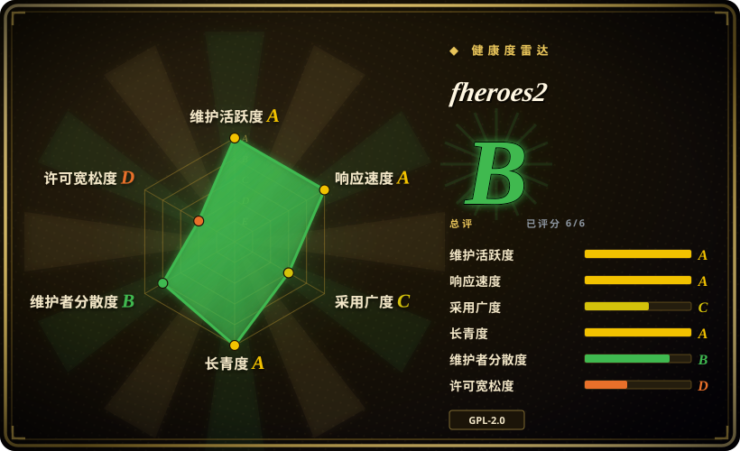
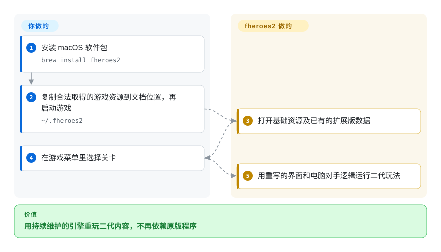
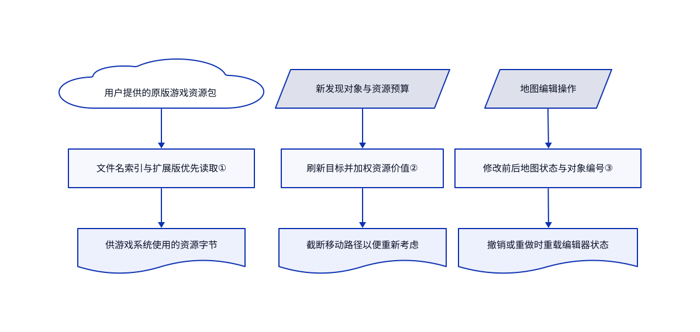

# fheroes2

你还留着《英雄无敌 II》的地图和素材，却想换掉原版程序，用更高分辨率继续玩。fheroes2 读取这些游戏资源，提供重新实现的玩法、电脑对手和界面。

## 何时使用

你买过《英雄无敌 II》，想在现在的电脑上重玩战役，或维护一个原生移植版本。地图和资源目录还在，但你要的是熟悉的兵种、城堡和关卡，不是另一款奇幻策略游戏。这时选 fheroes2，因为它专门重现二代；VCMI 面向三代，韦诺之战则提供另一套游戏和内容。

你也可以在一个具体的 C++ 策略引擎里贡献代码，不必从空白游戏库起步。仓库包含冒险地图、战斗逻辑、电脑对手规划器、地图编辑器和素材转换工具。前提是你要兼容二代，而不是随意设计新游戏。[常见问题](https://github.com/ihhub/fheroes2/blob/4ec9886825b198b6d0ec7ffc15c6b11ee76e9165/docs/FAQ.md#q-are-there-any-rebalancing-in-fheroes2)明确说，项目不以重做原版平衡为目标。

## 何时不用

- **你要内容也能自由授权、不依赖商业游戏资源的完整游戏。** 选韦诺之战。fheroes2 仍需二代原版或演示版数据；代码的 GPL 许可不等于外部美术、音乐和战役内容的授权。
- **你要三代的机制和模组开发接口。** 选 VCMI。两者重现不同游戏，不是同一个引擎的可互换版本。
- **你必须接着玩原版二代存档，或保持原版程序行为。** 保留原版商业游戏。[常见问题](https://github.com/ihhub/fheroes2/blob/4ec9886825b198b6d0ec7ffc15c6b11ee76e9165/docs/FAQ.md#q-i-have-save-files-from-the-original-heroes-of-might-and-magic-ii-does-fheroes2-support-them)明确不支持原版存档；fheroes2 还会改进电脑对手并修复原版缺陷。
- **你想用 Python 做小型原创游戏，自己定规则。** 从 [pygame](../game-dev/pygame.zh.md) 起步，先看该页的维护风险。fheroes2 带着完整且绑定二代的规则，不是通用 Python 游戏库。

## 横向对比

| 替代品 | 是否收录 | 我们的评价 | 取舍 |
|---|---|---|---|
| [VCMI](https://github.com/vcmi/vcmi) | 未收录 | 要三代地图和模组开发就选 VCMI；要二代战役和规则就选 fheroes2，因为目标游戏决定兼容范围。 | VCMI 有模组格式文档和编辑器，但不能替换二代。[已读固定版本文档](https://github.com/vcmi/vcmi/blob/46f2e15ec69e0507e6d0195d6357df5a2813dde1/docs/Readme.md)；本批次不扩收。 |
| [韦诺之战](https://github.com/wesnoth/wesnoth) | 未收录 | 想直接玩完整奇幻战棋并联网对战，选韦诺之战；保留二代内容比换游戏重要时，选 fheroes2。 | 韦诺之战自带战役和有许可的美术，但不是二代体验。[已读固定版本说明](https://github.com/wesnoth/wesnoth/blob/514fbeb797fb887ac6de9f14ded81aaf0bedb8f2/README.md)；本批次不扩收。 |
| 原版《英雄无敌 II》 | 非仓库 | 要沿用原版存档和原版行为，保留商业原版；要可修改的引擎及界面、电脑对手改进，选 fheroes2。 | 它是闭源商业游戏，不是开源仓库。购买能提供资源，不等于取得资源再分发权；换引擎也不会消除这个区别。 |

## 快速上手

在 macOS 上，[安装指南](https://github.com/ihhub/fheroes2/blob/4ec9886825b198b6d0ec7ffc15c6b11ee76e9165/docs/INSTALL.md#homebrew-on-macos)给出的命令是 `brew install fheroes2`。按包管理器这条路径，手动将合法取得的游戏中现有的 `ANIM`、`DATA`、`MAPS`、`MUSIC` 目录复制到 `~/.fheroes2`，具体位置见资源收集说明。启动已安装的游戏并选关卡；你负责资源权利和文件，fheroes2 负责读取资源及运行玩法。要开发引擎，先备好依赖，再按 [CMake 指南](https://github.com/ihhub/fheroes2/blob/4ec9886825b198b6d0ec7ffc15c6b11ee76e9165/docs/README_cmake.md)执行 `cmake -B build` 和 `cmake --build build`。这里只核对了文档，没有执行这些命令；下图只保留安装包玩家这条主线。

<!-- flow-steps:begin (generated from flows/fheroes2.json by tools/flow_card.py — do not edit) -->

流程文字版

1. **你**：安装 macOS 软件包 — `brew install fheroes2`
2. **你**：复制合法取得的游戏资源到文档位置，再启动游戏 — `~/.fheroes2`
3. **fheroes2**：打开基础资源及已有的扩展版数据
4. **你**：在游戏菜单里选择关卡
5. **fheroes2**：用重写的界面和电脑对手逻辑运行二代玩法

**价值**：用持续维护的引擎重玩二代内容，不再依赖原版程序

<!-- flow-steps:end -->

## 技术要点

<!-- mechanism:begin (generated from mechanisms/fheroes2.json by tools/mechanism_card.py; do not edit) -->

机制文字版

- 用户提供的原版游戏资源包
- 文件名索引与扩展版优先读取①
- 供游戏系统使用的资源字节
- 新发现对象与资源预算
- 刷新目标并加权资源价值②
- 截断移动路径以便重新考虑
- 地图编辑操作
- 修改前后地图状态与对象编号③
- 撤销或重做时重载编辑器状态

- 用户提供的原版游戏资源包 → 文件名索引与扩展版优先读取①
- 文件名索引与扩展版优先读取① → 供游戏系统使用的资源字节
- 新发现对象与资源预算 → 刷新目标并加权资源价值②
- 刷新目标并加权资源价值② → 截断移动路径以便重新考虑
- 地图编辑操作 → 修改前后地图状态与对象编号③
- 修改前后地图状态与对象编号③ → 撤销或重做时重载编辑器状态

<!-- mechanism:end -->

### 1. 读取原版资源包，优先扩展版再回退

- **解决：** 原版图像和声音封装在专用资源包里，不能像普通散装文件那样直接交给新渲染器。
- **做法：** AGG 读取器建立文件名、偏移和长度索引，校验文件名哈希，再按需取出字节。游戏先查扩展版资源包，找不到对应条目才读取基础包。
- **边界：** 基础资源包仍不可缺；缺数据会停止初始化。文件名哈希只能识别特定损坏，不证明资源来源可靠，也不授予使用权。
- **源码：** [资源包读取第 30–85 行](https://github.com/ihhub/fheroes2/blob/4ec9886825b198b6d0ec7ffc15c6b11ee76e9165/src/engine/agg_file.cpp#L30-L85)、[回退与初始化第 40–115 行](https://github.com/ihhub/fheroes2/blob/4ec9886825b198b6d0ec7ffc15c6b11ee76e9165/src/fheroes2/agg/agg.cpp#L40-L115)。

### 2. 探索后重估目标，按稀缺程度给资源计分

- **解决：** 英雄移动时会发现更好的目标，不同资源的相同数量也不代表相同战略价值。
- **做法：** 新发现可交互对象后，规划器更新目标缓存，并截断正在移动的英雄路径以便重新考虑。资源评分先统一矿产和资源堆的价值尺度，再为持续支出和优先预算项提高权重。
- **边界：** 这是绑定游戏规则的固定权重计算，不是学习策略，也不证明对手胜率更高。它依赖二代经济规则和其他规划模块。
- **源码：** [探索响应与资源估值第 47–172 行](https://github.com/ihhub/fheroes2/blob/4ec9886825b198b6d0ec7ffc15c6b11ee76e9165/src/fheroes2/ai/ai_planner.cpp#L47-L172)。

### 3. 用修改前后快照撤销地图编辑

- **解决：** 一次编辑可能改变多个地图对象，很难逐一编写可靠的反向操作。
- **做法：** 通用操作保留修改前后的压缩地图状态及对象编号计数器。撤销和重做分别加载对应状态；仅改元数据的操作则复制相应元数据表。
- **边界：** 通用操作保存两份地图状态，并重新加载编辑器世界；它不是紧凑的操作日志，也不保证跨会话恢复。本轮没有测内存或延迟。
- **源码：** [通用与元数据操作第 48–159 行](https://github.com/ihhub/fheroes2/blob/4ec9886825b198b6d0ec7ffc15c6b11ee76e9165/src/fheroes2/editor/history_manager.cpp#L48-L159)、[提交前准备第 205–216 行](https://github.com/ihhub/fheroes2/blob/4ec9886825b198b6d0ec7ffc15c6b11ee76e9165/src/fheroes2/editor/history_manager.cpp#L205-L216)。

## 技术栈

- 游戏和引擎用 C++17，内置解码器代码还用到 C。CMake 最低版本为 3.24，另有 Make 和 Visual Studio 构建路径。
- SDL2 负责跨平台多媒体；[构建声明](https://github.com/ihhub/fheroes2/blob/4ec9886825b198b6d0ec7ffc15c6b11ee76e9165/CMakeLists.txt#L21-L65)要求 SDL2_mixer 和 zlib。开启 `ENABLE_IMAGE` 才需要 SDL2_image 和 PNG 支持。
- 仓库包含原生平台工程、翻译文件、地图、素材工具，以及内置的 libsmacker 视频解码器。

## 依赖

- **游戏内容：** 二代原版或演示版资源。扩展版支持会检查 `heroes2x.agg`。上游提供演示版下载路径，不代表演示版可以任意再分发。
- **构建与运行：** 从源码构建要有 C++17 工具链、SDL2、SDL2_mixer 和 zlib。各平台的安装包和依赖打包方式不同；文档里的桌面使用路径没有数据库或服务部署步骤。
- **权利边界：** 已读项目源码头使用 GPL-2.0-or-later；第三方声明要保留，包括 libsmacker 的 LGPL 文本。内置 [GeneralUser GS 许可](https://github.com/ihhub/fheroes2/blob/4ec9886825b198b6d0ec7ffc15c6b11ee76e9165/files/soundfonts/GeneralUser-GS-LICENSE.txt)还单独说明部分采样来源不完整。不能把页头的代码许可当成全部素材许可。

## 运维难度

**安装包桌面客户端低，长期维护移植版中。** 玩家要把资源目录放到对应平台位置，并区分引擎存档与原版存档。移植维护者还要承担原生依赖、打包和游戏回归。使用辅助脚本前要先审阅：演示版脚本下载并解压外部压缩包，Linux 依赖脚本调用 `sudo apt-get`；本轮都没有执行。

## 健康度与可持续性

- **维护状态，2026-10-26：** 已读默认分支提交日期为 2026-10-23。GitHub 返回的最近五个版本，从 2025 年 12 月的 1.1.13 到 2026-06-30 的 1.1.17；分支持续更新不代表已有更新稳定版。
- **治理和支持：** 仓库属于个人账号，不是基金会。贡献记录包含 ihhub、oleg-derevenetz 和 Districh-ru；说明页接受捐助，常见问题描述了团队评审和玩家测试。这些材料不能证明存在付费支持承诺。
- **持续性判断：** [推断：依据为 2019-08-30 建仓日期和 2026-10-23 提交] 七年可见仓库历史加上近期工作，是积极的延续信号，不是未来支持保证。说明页还致谢更早的 SourceForge 项目，本页不据此虚构更早创立日期。
- **采用情况：** 2026-10-26 观察到 3,669 个 GitHub 星标。安装文档覆盖多个桌面和掌机平台；星标和移植数量不能当成活跃玩家数。
- **主要风险：** 源码开放不能解决原版资源权利、原版存档兼容，以及单独授权音频中的来源问题。再分发完整游戏包前必须先处理这些边界。

## 存疑（未验证）

- [未验证：本轮只读源码，没有安装或运行上游游戏、脚本和测试] 没有复现平台兼容、性能和玩法还原程度。文档启动路径不等于运行验收结果。
- [未验证：没有原版资源许可文本及用户购买凭据] 本页不确认原版或演示版资源的再分发权。GeneralUser GS 自身许可也记录了采样来源疑问；本页不是完整素材权利审计。
- [推断：依据为仓库年龄和近期提交，而非支持合同] 持续性判断不能证明未来维护者投入。
