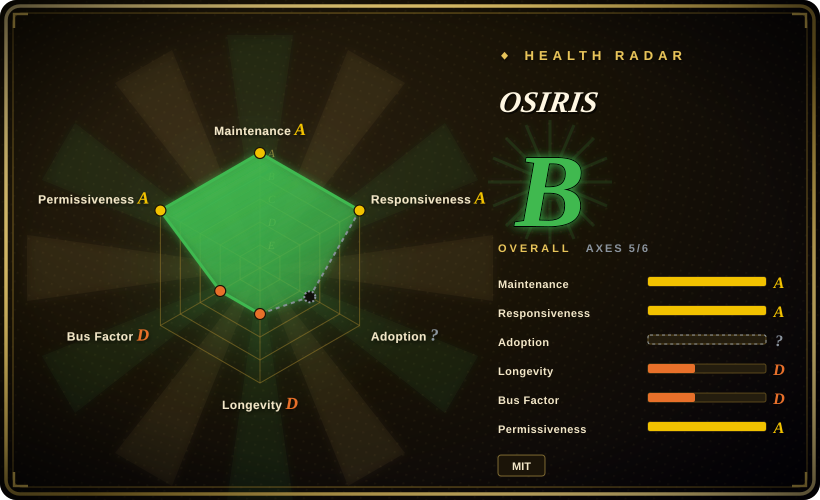
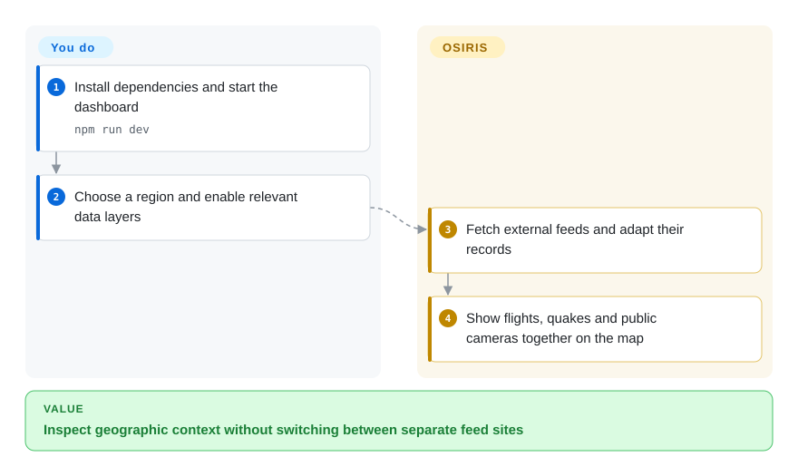
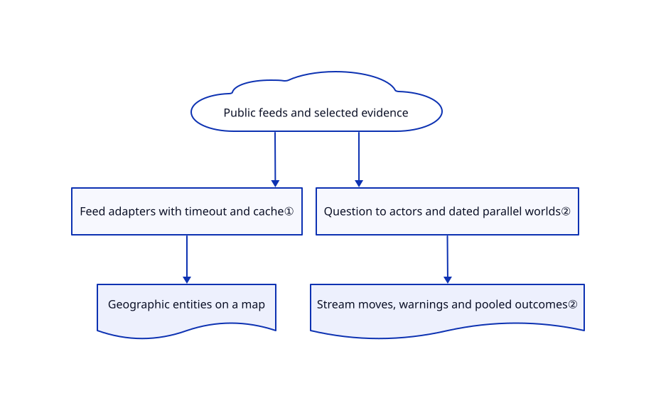

# OSIRIS

Checking flights, earthquakes and public cameras across separate sites hides their geographic overlap. OSIRIS puts these feeds on one map and can run model-generated scenarios over selected evidence.

## When to use

You monitor a region during a disruption and keep switching between a seismic feed, flight map and traffic cameras. Choose OSIRIS when a ready-made map with switchable public-data layers and optional question-driven scenarios matters more than desktop GIS analysis. It is a situational-awareness application, not an agent self-improvement system.

## When NOT to use

- For reproducible spatial analysis and editing your own layers, use [QGIS](qgis.md); OSIRIS emphasizes live feeds and a fixed dashboard.
- For document-seeded social-world rehearsal without the surveillance-map focus, examine [MiroFish](../social-simulation/mirofish.md). Neither tool's generated probabilities should be treated as validated forecasts.
- For a news-centered global monitoring alternative, compare World Monitor before committing to OSIRIS's camera-heavy workflow.
- For an authorized security assessment, use a dedicated scoped security tool rather than assuming the included scanner is a complete pentest platform. Its proxy needs a separately configured backend and credential.

## Comparison

| Alternative | In index | Our verdict | Tradeoff |
|---|---|---|---|
| [QGIS](qgis.md) | ✅ | Choose QGIS for spatial processing and reproducible data work; choose OSIRIS for a browser view of pre-integrated live feeds. | Desktop analysis depth versus a turnkey monitoring map. |
| [MiroFish](../social-simulation/mirofish.md) | ✅ | Choose MiroFish for document-to-society rehearsal; choose OSIRIS when the scenario must sit beside current map evidence. | Different simulation stack and data dependencies; neither establishes real-world predictive validity. |
| [World Monitor](https://github.com/koala73/worldmonitor) | not indexed | Compare World Monitor for news-first situational awareness; choose OSIRIS when public cameras and map-linked scenario exploration lead the task. | A real alternative, not added in this tab batch; no head-to-head feed coverage test. |

## Quick start

Clone the repository, run `npm install`, then `npm run dev`, and open port 3000. Enable only the map layers relevant to your region; the app fetches public feeds and plots their returned entities. To use OI, the optional scenario engine, provide your own model key and question through its interface. You remain responsible for external data terms, model charges and verifying sources; camera availability is not guaranteed. Scanner integration additionally needs `SCANNER_URL` and `SCANNER_KEY` and explicit authorization for every target.

<!-- flow-steps:begin (generated from flows/osiris.json by tools/flow_card.py — do not edit) -->

Text version of the flow

1. **You**: Install dependencies and start the dashboard — `npm run dev`
2. **You**: Choose a region and enable relevant data layers
3. **OSIRIS**: Fetch external feeds and adapt their records
4. **OSIRIS**: Show flights, quakes and public cameras together on the map

**Value**: Inspect geographic context without switching between separate feed sites

<!-- flow-steps:end -->

## Key techniques

<!-- mechanism:begin (generated from mechanisms/osiris.json by tools/mechanism_card.py; do not edit) -->

Text version of the mechanism

- Public feeds and selected evidence
- Feed adapters with timeout and cache①
- Geographic entities on a map
- Question to actors and dated parallel worlds②
- Stream moves, warnings and pooled outcomes②

- Public feeds and selected evidence → Feed adapters with timeout and cache①
- Feed adapters with timeout and cache① → Geographic entities on a map
- Public feeds and selected evidence → Question to actors and dated parallel worlds②
- Question to actors and dated parallel worlds② → Stream moves, warnings and pooled outcomes②

<!-- mechanism:end -->

### 1. Adapt external feeds into map entities

- **Problem:** Different data providers expose incompatible records and failure behavior.
- **How:** The earthquake API fetches USGS GeoJSON with a timeout, maps coordinates and properties into dashboard records and attaches short cache headers.
- **Limits:** An upstream non-success can return an empty array with an error string; an empty map is not proof that no event occurred. This adapter proves earthquake handling, not uniform behavior across all layers.
- **Source:** [Earthquake adapter](https://github.com/simplifaisoul/osiris/blob/07a24fc9b7504e021965bcaa57f7d04d51d0a7ed/src/app/api/earthquakes/route.ts).

### 2. Simulate actors in parallel worlds

- **Problem:** A single model-written narrative hides alternative assumptions and its relation to evidence.
- **How:** OI gathers context, constructs actors and relations, then advances multiple worlds through dated periods. Actor moves, source links, warnings and pooled outcomes stream as events; price questions can use a historical statistical baseline.
- **Limits:** Research failures can yield partial context, and failed actors can be omitted with warnings. Parallel narratives and normalized probabilities do not establish predictive calibration.
- **Source:** [Engine](https://github.com/simplifaisoul/osiris/blob/07a24fc9b7504e021965bcaa57f7d04d51d0a7ed/src/lib/oi/engine.ts#L163-L434), [answer representation](https://github.com/simplifaisoul/osiris/blob/07a24fc9b7504e021965bcaa57f7d04d51d0a7ed/src/lib/oi/forecast.ts).

## Tech stack

Next.js 16.3.4, React 19, TypeScript, MapLibre GL 6.7.0 and HLS playback. The manifest also includes ONNX Runtime Web and model-provider libraries.

## Dependencies

Node/npm or the provided Node 22-based container, a WebGL-capable browser and network access to feed, map and media providers. OI needs a model provider key. The scanner backend is separate; the dashboard's keyless layers do not imply an offline application.

## Ops difficulty

**Medium.** A local dashboard is easy; long-lived monitoring requires checking provider outages, stale feeds, credentials and scanner exposure. Keep scanning behind your own access controls and authorized scope. Review data licenses separately from the app's MIT license.

## Health & viability

- On 2026-10-18, the default branch had a 2026-10-16 commit; release v5.0.0 dates to 2026-09-28, while package metadata still says 0.1.0.
- Created 2026-05-12 and led by `simplifaisoul`, it has only five months of history. The 11,106 stars do not establish durable operation or forecast quality.
- MIT text credits the author. The tree includes committed dependencies with their licenses; substantial original app sources remain outside those directories.
- [推断：依据是单作者主导、短历史及外部源依赖] Suitable for exploratory monitoring, with weaker durability evidence than established GIS tools.

## Caveats (unverified)

- [未验证：本任务禁止执行上游或扫描外部目标] Feed availability, scanner defenses and deployment were source-inspected only.
- [未验证：未见本次读取材料中的独立实测] Real-world forecast calibration and the README's performance claims are not established.
- [推断：依据是单作者主导、短历史及外部源依赖] Maintenance and data-source continuity remain operational risks.
