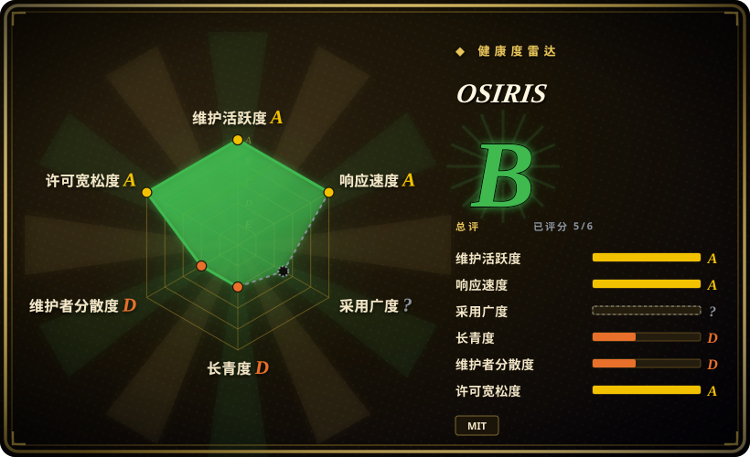
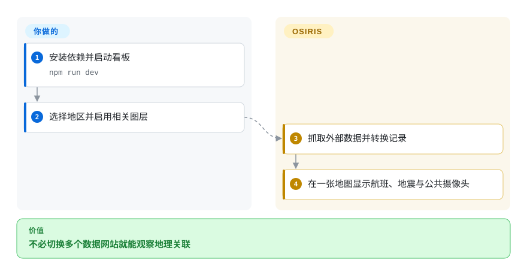
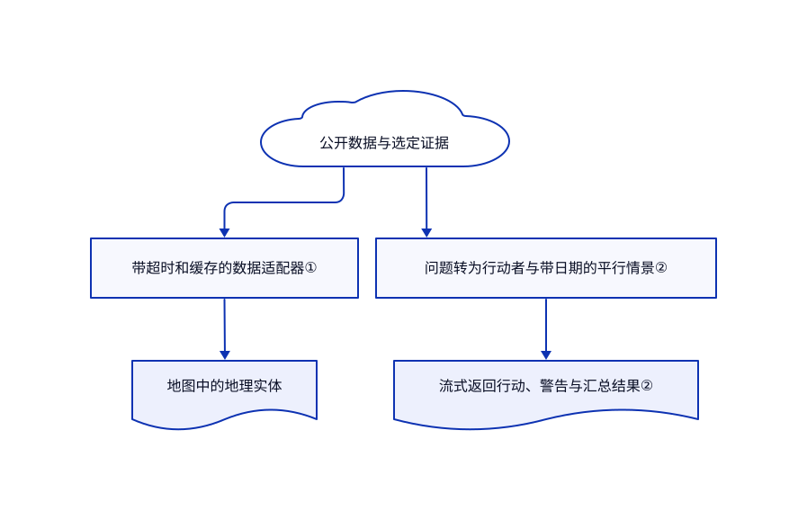

# OSIRIS

航班、地震和公共摄像头分散在不同网站，很难看出地理关联。OSIRIS 把这些数据放到一张地图，还能围绕证据生成情景推演。

## 何时使用

你要观察某地区的突发事件，却不停切换地震网站、航班地图和交通摄像头。若你需要现成地图、可切换的公开数据层，以及可选的问答式情景推演，而非桌面空间分析，选 OSIRIS。它是态势感知应用，不是代理自进化系统。

## 何时不用

- 要处理、编辑自有空间图层并复现实验，选 [QGIS](qgis.zh.md)。OSIRIS 重在实时数据和固定看板。
- 要从文档出发排演社会情景，不需要监控地图，先看 [MiroFish](../social-simulation/mirofish.zh.md)。两者给出的概率都不应当作已验证预测。
- 重点是全球新闻监测，先比较 World Monitor，再决定是否需要 OSIRIS 偏重摄像头的工作流。
- 要开展授权安全评估，选有明确范围的专用安全工具。内置扫描代理不是完整渗透平台，还需要独立后端和凭据。

## 横向对比

| 替代品 | 是否收录 | 我们的评价 | 取舍 |
|---|---|---|---|
| [QGIS](qgis.zh.md) | ✅ | 空间处理与可复现数据工作选 QGIS；浏览已集成的实时数据选 OSIRIS。 | 桌面分析深度，换成开箱即用的监测地图。 |
| [MiroFish](../social-simulation/mirofish.zh.md) | ✅ | 文档驱动的社会排演选 MiroFish；推演要紧邻当前地图证据时选 OSIRIS。 | 模拟栈和数据依赖不同；两者都不证明真实预测能力。 |
| [World Monitor](https://github.com/koala73/worldmonitor) | 未收录 | 新闻优先的态势感知先比较 World Monitor；公共摄像头和地图推演优先时选 OSIRIS。 | 真实替代仓库，本批未收录；未做数据覆盖面对测。 |

## 快速上手

克隆仓库，运行 `npm install` 和 `npm run dev`，打开本机 3000 端口。只启用目标地区所需的图层，应用会抓取公开数据并显示地图实体。若要使用可选情景引擎 OI，在界面提供自己的模型密钥和问题。你仍负责数据使用条款、模型费用和来源核查；摄像头不保证持续在线。接入扫描后端还需要 `SCANNER_URL`、`SCANNER_KEY`，以及每个目标的明确授权。

<!-- flow-steps:begin (generated from flows/osiris.json by tools/flow_card.py — do not edit) -->

流程文字版

1. **你**：安装依赖并启动看板 — `npm run dev`
2. **你**：选择地区并启用相关图层
3. **OSIRIS**：抓取外部数据并转换记录
4. **OSIRIS**：在一张地图显示航班、地震与公共摄像头

**价值**：不必切换多个数据网站就能观察地理关联

<!-- flow-steps:end -->

## 技术要点

<!-- mechanism:begin (generated from mechanisms/osiris.json by tools/mechanism_card.py; do not edit) -->

机制文字版

- 公开数据与选定证据
- 带超时和缓存的数据适配器①
- 地图中的地理实体
- 问题转为行动者与带日期的平行情景②
- 流式返回行动、警告与汇总结果②

- 公开数据与选定证据 → 带超时和缓存的数据适配器①
- 带超时和缓存的数据适配器① → 地图中的地理实体
- 公开数据与选定证据 → 问题转为行动者与带日期的平行情景②
- 问题转为行动者与带日期的平行情景② → 流式返回行动、警告与汇总结果②

<!-- mechanism:end -->

### 1. 把外部数据转换为地图实体

- **解决：** 不同数据提供商的记录结构和失败方式不同。
- **做法：** 地震接口带超时抓取 USGS GeoJSON，把坐标与属性转换成看板记录，并附短时缓存头。
- **边界：** 上游失败可能返回空数组和错误文字；空地图不证明没有事件。此适配器只证明地震层行为，不代表所有图层一致。
- **源码：** [地震适配器](https://github.com/simplifaisoul/osiris/blob/07a24fc9b7504e021965bcaa57f7d04d51d0a7ed/src/app/api/earthquakes/route.ts)。

### 2. 在平行情景里模拟行动者

- **解决：** 单篇模型叙事隐藏了替代假设，也难以追查证据。
- **做法：** OI 收集上下文，建立行动者和关系，再按日期推进多个平行情景。行动、引用、警告和汇总结果以事件流返回；价格问题还可结合历史统计基线。
- **边界：** 检索失败时上下文可能不全；失败的行动者可带警告被略去。多篇叙事与归一化概率不证明预测已经校准。
- **源码：** [引擎](https://github.com/simplifaisoul/osiris/blob/07a24fc9b7504e021965bcaa57f7d04d51d0a7ed/src/lib/oi/engine.ts#L163-L434)、[答案表示](https://github.com/simplifaisoul/osiris/blob/07a24fc9b7504e021965bcaa57f7d04d51d0a7ed/src/lib/oi/forecast.ts)。

## 技术栈

Next.js 16.3.4、React 19、TypeScript、MapLibre GL 6.7.0 和 HLS 播放。依赖清单还包含 ONNX Runtime Web 和模型服务库。

## 依赖

需要 Node／npm，或提供的 Node 22 容器，以及支持 WebGL 的浏览器。数据、地图和媒体供应方需要联网访问。OI 需要模型密钥，扫描后端独立配置。部分图层免密钥不等于应用可以离线工作。

## 运维难度

**中等。** 本地看板容易启动，持续监测仍需检查源站故障、过期数据、凭据和扫描接口暴露。扫描应置于自己的访问控制和授权范围内。数据许可应与应用的 MIT 许可分开核查。

## 健康度与可持续性

- 截至 2026-10-18，默认分支最近提交为 2026-10-16。v5.0.0 发布于 2026-09-28，但包元数据仍写 0.1.0。
- 仓库创建于 2026-05-12，由 `simplifaisoul` 主导，仅有五个月历史。11,106 颗星不证明长期运行或预测质量。
- MIT 实文署名作者。仓库提交了依赖及其许可，但依赖目录外仍有大量原创应用代码。
- [推断：依据是单作者主导、短历史及外部源依赖] 适合探索性监测，持久性证据弱于成熟 GIS 工具。

## 存疑（未验证）

- [未验证：本任务禁止执行上游或扫描外部目标] 仅从源码核查数据可用性、扫描防线和部署路径。
- [未验证：本次读取材料无独立实测] 真实预测校准和 README 性能宣传均未确立。
- [推断：依据是单作者主导、短历史及外部源依赖] 维护与数据源持续性仍是运维风险。
