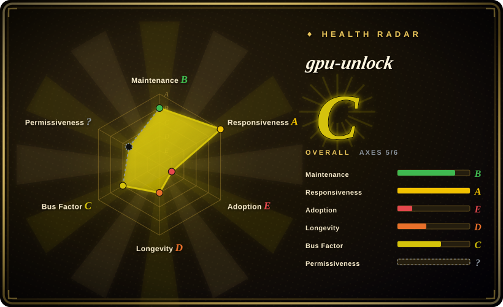
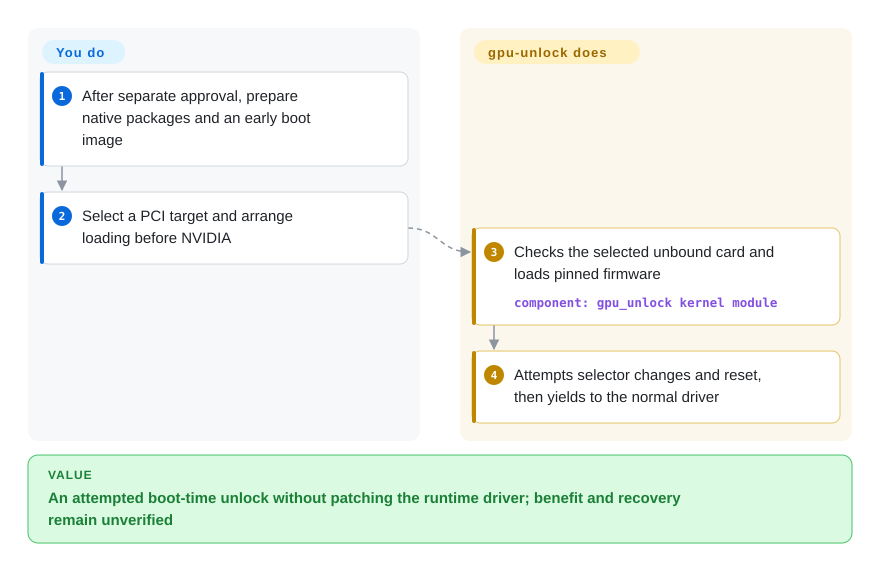
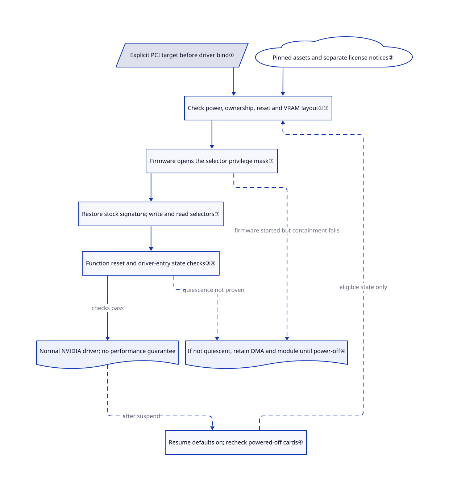

# gpu-unlock

Your RTX 30-series card spends its time multiplying matrices, yet its half-precision instruction rate is restricted. gpu-unlock changes hardware speed selectors before NVIDIA's normal driver starts, rather than replacing application kernels.

> [!WARNING]
> **Information-only inclusion, not approval to install or unlock a GPU.** This runs privileged kernel code, loads GPU firmware, writes registers and resets the PCIe function; boot display and driver availability can be affected. Module and local packaging explicitly declare **GPL-2.0-only**. Preserved MIT notices cover particular references, not the whole delivery, and NVIDIA firmware has separate terms. `NOASSERTION` records that no single license for the complete source-plus-firmware distribution was verified; it does **not** mean the module has no license. Do not call the complete delivery MIT or uniformly open source. No upstream code was built, installed or run for this page.

## When to use

You investigate compute throughput on a Linux workstation with a specifically listed GA102, GA103, GA104 or GA106 device. Dense BF16 matrix multiplication — multiplying matrices with 16-bit inputs — is the bottleneck, not model loading or token-by-token memory traffic. This repository merits **source review** when you want to understand an early-boot unlock that leaves the runtime NVIDIA driver unpatched, rather than the CMP reference's patched-driver path. Application independence comes at the cost of kernel, firmware and boot-order risk.

The [fixed README](https://github.com/Zagitta/gpu-unlock/blob/af28cbbfd3d922a659227ecfb7369adfd924cf03/README.md#L20-L55) reports gains on several 3090/3090 Ti, 3080, 3070 and 3060 cards, but also an RTX 3080 Ti 20 GB OEM counterexample with no BF16 uplift. GA103 has no reports, and the cited 3070 Ti run used a **different UEFI implementation**, not this module. A listed ID or `unlocked` log is not evidence of increased throughput.

## When NOT to use

- **Production boot or local display recovery cannot be put at risk.** Prefer CUTLASS software tuning below. The module removes the firmware framebuffer before reset and can retain resources until power-off rather than guarantee driver handoff.
- **Your bottleneck is memory-bound LLM decode or INT8.** Prefer [llama.cpp](../llm-inference/local-runtimes/llama-cpp.md) quantization, model sizing and backend controls. Upstream reports little change in these workloads; this does not add VRAM or memory bandwidth.
- **You need unlisted hardware, Windows, GA107, Ada or Blackwell.** Choose CUTLASS for its documented CUDA targets, or llama.cpp for broader backends. The [accepted-ID list](https://github.com/Zagitta/gpu-unlock/blob/af28cbbfd3d922a659227ecfb7369adfd924cf03/kernel/gpu_unlock/main.c#L21-L39) is narrower than “all NVIDIA 3000 cards”; acceptance is not validation.
- **You maintain a CMP 90HX patched-driver experiment.** Read WildFlash1st/cmp90hx-unlock instead: its rejoin15 route targets that card and patches 610.43.03. It is not a safer general unlocker, and its results do not establish RTX compatibility.
- **You need fully reviewed distribution rights or lossless rollback.** Keep the stock driver with CUTLASS or llama.cpp while those questions remain open. GPL source notices do not authorize every firmware component; unloading does not restore original selectors, and warm reboot is not a universal reset guarantee.

## Comparison

These are different optimization or research routes, not interchangeable unlockers.

| Alternative | In index | Our verdict | Tradeoff |
|---|---|---|---|
| [CUTLASS](https://github.com/NVIDIA/cutlass) | not indexed | For application-owned matrix bottlenecks, start with CUTLASS kernel selection instead of changing boot state. Study gpu-unlock only for a separately authorized instruction-rate experiment. | CUDA C++ integration costs development time, but needs no pre-driver unlock; tuning cannot remove a hardware rate restriction. [Source](https://github.com/NVIDIA/cutlass/blob/91843b71d90737e0a9b86f7d9df213cff5a3526f/README.md#L8-L26). Not added in this batch. |
| [llama.cpp](../llm-inference/local-runtimes/llama-cpp.md) | ✅ | For local LLM serving, especially memory-bound decode, choose llama.cpp's quantization and backend controls before kernel-unlock risk. gpu-unlock addresses a narrower matrix-rate limit, not serving. | GGUF conversion, model compatibility and precision remain yours; this changes the software workload rather than boot-time GPU selectors. |
| [WildFlash1st/cmp90hx-unlock](https://github.com/WildFlash1st/cmp90hx-unlock) | not indexed | For CMP 90HX driver research choose the pinned CMP reference; for an RTX-oriented pre-driver module read this repository. Do not transfer successful-card claims between them. | The [reference](https://github.com/WildFlash1st/cmp90hx-unlock/blob/76940ae583281daa2b883518a2e89b56c11d3a46/README.md#L55-L108) uses a patched 610.43.03 driver or legacy bootstrap service; gpu-unlock separates early module and runtime driver, but retains firmware/reset risks. Not added in this batch. |

## Quick start

**Read-only review is approved here; this describes upstream usage, not instructions to execute it.** The [README](https://github.com/Zagitta/gpu-unlock/blob/af28cbbfd3d922a659227ecfb7369adfd924cf03/README.md#L60-L155) begins with a source checkout and `make install`, which selects Arch, Debian/Ubuntu or RPM packaging, downloads pinned inputs and can request administrator privileges. Packages install DKMS — rebuilding the module for each kernel — firmware and initramfs configuration inside the early boot image. A separately authorized operator supplies a PCI address through `gpu_unlock.targets`; missing targets means no unlock, while `all` covers every accepted unbound card. At a correctly ordered boot, the module attempts the transaction and yields to the normal NVIDIA driver; you still own license review, signing policy, boot-image validation, matched before/after correctness and performance tests, and physical recovery. This page establishes neither compatibility nor authorization for those changes.

<!-- flow-steps:begin (generated from flows/gpu-unlock.json by tools/flow_card.py — do not edit) -->

Text version of the flow

1. **You**: After separate approval, prepare native packages and an early boot image
2. **You**: Select a PCI target and arrange loading before NVIDIA
3. **gpu-unlock**: Checks the selected unbound card and loads pinned firmware — component: `gpu_unlock kernel module`
4. **gpu-unlock**: Attempts selector changes and reset, then yields to the normal driver

**Value**: An attempted boot-time unlock without patching the runtime driver; benefit and recovery remain unverified

<!-- flow-steps:end -->

## Key techniques

<!-- mechanism:begin (generated from mechanisms/gpu-unlock.json by tools/mechanism_card.py; do not edit) -->

Text version of the mechanism

- Explicit PCI target before driver bind①
- Pinned assets and separate license notices②
- Check power, ownership, reset and VRAM layout①③
- Firmware opens the selector privilege mask③
- Restore stock signature; write and read selectors③
- Function reset and driver-entry state checks③④
- Normal NVIDIA driver; no performance guarantee
- If not quiescent, retain DMA and module until power-off④
- Resume defaults on; recheck powered-off cards④

- Explicit PCI target before driver bind① → Check power, ownership, reset and VRAM layout①③
- Pinned assets and separate license notices② → Check power, ownership, reset and VRAM layout①③
- Check power, ownership, reset and VRAM layout①③ → Firmware opens the selector privilege mask③
- Firmware opens the selector privilege mask③ → Restore stock signature; write and read selectors③
- Restore stock signature; write and read selectors③ → Function reset and driver-entry state checks③④
- Function reset and driver-entry state checks③④ → Normal NVIDIA driver; no performance guarantee (checks pass)
- Firmware opens the selector privilege mask③ → If not quiescent, retain DMA and module until power-off④ (firmware started but containment fails) [optional/fallback]
- Function reset and driver-entry state checks③④ → If not quiescent, retain DMA and module until power-off④ (quiescence not proven) [optional/fallback]
- Normal NVIDIA driver; no performance guarantee → Resume defaults on; recheck powered-off cards④ (after suspend) [optional/fallback]
- Resume defaults on; recheck powered-off cards④ → Check power, ownership, reset and VRAM layout①③ (eligible state only) [optional/fallback]

<!-- mechanism:end -->

### 1. Make the pre-driver handoff explicitly opt-in

- **Problem:** Writing a card already owned by a driver would collide with live GPU state.
- **How:** A read-only `targets` parameter selects accepted PCI devices; missing targets returns immediately. Per-device locks and asynchronous tasks process selected unbound cards concurrently, sharing one GSP firmware load before normal driver probing.
- **Limits:** Selection is not compatibility detection. Per-card failures are logged, but initialization still returns zero: module-load success is not unlock success.
- **Source:** [Parameters and IDs](https://github.com/Zagitta/gpu-unlock/blob/af28cbbfd3d922a659227ecfb7369adfd924cf03/kernel/gpu_unlock/main.c#L13-L39), [locking and shared assets](https://github.com/Zagitta/gpu-unlock/blob/af28cbbfd3d922a659227ecfb7369adfd924cf03/kernel/gpu_unlock/main.c#L66-L125), [initialization](https://github.com/Zagitta/gpu-unlock/blob/af28cbbfd3d922a659227ecfb7369adfd924cf03/kernel/gpu_unlock/main.c#L181-L211).

### 2. Pin firmware identity without flattening licensing

- **Problem:** A layout-specific firmware sequence cannot accept arbitrary newer assets.
- **How:** Python tools verify input/output SHA-256, extract NVIDIA 610.43.03 assets and generate a separate V67 payload from a pinned CMP reference. The NVIDIA license notice is extracted and checked separately; GPL and reference MIT texts are preserved.
- **Limits:** Hashes establish identity, not safety, permission or runtime-driver compatibility. The complete NVIDIA agreement inside the binary package was not retrieved; an attempted version-specific public agreement URL returned 404, and no binary package was downloaded.
- **Source:** [Input verification](https://github.com/Zagitta/gpu-unlock/blob/af28cbbfd3d922a659227ecfb7369adfd924cf03/firmware/fetch_artifacts.py#L28-L62), [generation and notice preservation](https://github.com/Zagitta/gpu-unlock/blob/af28cbbfd3d922a659227ecfb7369adfd924cf03/firmware/generate_v67.py#L96-L128), [terms and provenance](https://github.com/Zagitta/gpu-unlock/blob/af28cbbfd3d922a659227ecfb7369adfd924cf03/firmware/NOTICE.md#L1-L30).

### 3. Change protected selectors, then reset for driver entry

- **Problem:** The host normally cannot write the protected instruction-rate selectors.
- **How:** The transaction checks board state, reads security firmware from board ROM, prepares protected VRAM and DMA — memory the GPU can access directly — and uses V67 to open the register privilege mask. It restores the stock signature pointer, writes and reads both selectors, then resets the PCIe function and checks driver-entry state.
- **Limits:** This changes firmware/register privilege state and can blank the boot display. It rejects insufficient reservation space, missing reset capability and previously initialized cards; selector readback does not prove throughput gain.
- **Source:** [Transaction order](https://github.com/Zagitta/gpu-unlock/blob/af28cbbfd3d922a659227ecfb7369adfd924cf03/kernel/gpu_unlock/unlock_610.c#L1443-L1485), [layout constraints](https://github.com/Zagitta/gpu-unlock/blob/af28cbbfd3d922a659227ecfb7369adfd924cf03/kernel/gpu_unlock/unlock_610.c#L657-L745), [selectors and reset](https://github.com/Zagitta/gpu-unlock/blob/af28cbbfd3d922a659227ecfb7369adfd924cf03/kernel/gpu_unlock/unlock_610.c#L1169-L1429), [no-gain report](https://github.com/Zagitta/gpu-unlock/issues/28).

### 4. Retain unsafe-to-free resources and recheck resume state

- **Problem:** Freeing GPU-accessible memory before firmware stops risks host-memory corruption; suspend can clear selectors.
- **How:** Cleanup restores DMA masks and selected PCI command bits after proving quiescence. Otherwise it retains DMA buffers, work state, device and module references until power-off. A notifier defaults to re-unlocking boot-successful cards before NVIDIA resumes them, skipping already-running or still-unlocked state.
- **Limits:** This is partial containment, not rollback: unload does not restore original selectors. `resume` defaults to true and can be disabled with `gpu_unlock.resume=0`; hibernation is not covered. Mocked fault tests exist but were not executed here.
- **Source:** [Cleanup](https://github.com/Zagitta/gpu-unlock/blob/af28cbbfd3d922a659227ecfb7369adfd924cf03/kernel/gpu_unlock/unlock_610.c#L526-L607), [retention](https://github.com/Zagitta/gpu-unlock/blob/af28cbbfd3d922a659227ecfb7369adfd924cf03/kernel/gpu_unlock/unlock_610.c#L1480-L1495), [resume](https://github.com/Zagitta/gpu-unlock/blob/af28cbbfd3d922a659227ecfb7369adfd924cf03/kernel/gpu_unlock/main.c#L83-L146), [mock scenarios](https://github.com/Zagitta/gpu-unlock/blob/af28cbbfd3d922a659227ecfb7369adfd924cf03/tests/test_unlock_adapter.c#L540-L716).

## Tech stack

- Six kernel C implementation files, 2440 physical lines at the reviewed SHA, plus headers and Kbuild. This is not a CUDA library, UEFI app or replacement NVIDIA driver.
- Three Python firmware scripts, Make, DKMS and native Arch/Debian/RPM packaging. Mock C and Python packaging tests exist; existence is not a successful run.
- GPL-2.0-only module/packaging, GPL CMP payload lineage, separate NVIDIA firmware terms and reference MIT notices. The fixed tree contains no models, weights or training datasets.

## Dependencies

- Listed-ID Ampere hardware, Linux PCI/firmware loading and PCIe function-level reset. Boot processing needs an unbound, powered card not already initialized this power cycle; resume has separate checks.
- Kernel headers/toolchain, DKMS, Python 3, zstd and native packaging/initramfs tools. Installation and boot-image changes need administrator authority; host module-signing/security policy still applies and was not tested.
- Pinned NVIDIA 610.43.03 source and CachyOS `nvidia-utils` inputs; upstream CI describes about 340 MB. Firmware identity remains fixed even when the subsequent runtime driver differs.
- CI declares builds for Debian 12/13, Ubuntu 24.04, Fedora and Arch: **build coverage, not hardware validation**. [Issue #33](https://github.com/Zagitta/gpu-unlock/issues/33) reports stock 610.57.04-open on one 3090; [issue #1](https://github.com/Zagitta/gpu-unlock/issues/1) used a modified 610.43.02 driver and custom boot integration for its 3090 Ti figures. Neither is a universal support matrix.

## Ops difficulty

**High.** The critical integration is early-boot load order. Native installation can rebuild images for multiple kernels; verify module build, firmware inclusion and actual order, not just package success. [Issue #28](https://github.com/Zagitta/gpu-unlock/issues/28) reports a mkinitcpio integration adjustment.

Upstream says removing the target option disables future attempts, and package removal removes module/drop-ins with image-rebuild hooks. It does not restore this boot's selectors or prove no residue: input caches and manual bootloader edits are separate, and some RPM cleanup commands tolerate errors. Unstopped firmware deliberately pins resources until power-off. See [recovery notes](https://github.com/Zagitta/gpu-unlock/blob/af28cbbfd3d922a659227ecfb7369adfd924cf03/README.md#L163-L195), [unload](https://github.com/Zagitta/gpu-unlock/blob/af28cbbfd3d922a659227ecfb7369adfd924cf03/kernel/gpu_unlock/main.c#L214-L222) and [RPM hooks](https://github.com/Zagitta/gpu-unlock/blob/af28cbbfd3d922a659227ecfb7369adfd924cf03/packaging/rpm/gpu-unlock.spec#L70-L130).

## Health & viability

- **2026-10-25 maintenance:** public non-fork, created 2026-10-18, pushed 2026-10-24. Source says 1.0.0; releases API returns none. Pin `af28cbbfd3d922a659227ecfb7369adfd924cf03`, not a stable-release promise.
- **Governance/backing:** User-owned by Zagitta; contributors API lists Zagitta, claude, jesvs and foureight84, not four verified human maintainers. Funding links exist; governance/security-policy files do not appear in the fixed tree. Foundation backing is not established.
- **Age/adoption:** roughly one week old, 3340 stars and 369 forks at this check. Judgment: an experiment without a long-lived-and-active Lindy prior; attention and community reports do not establish long-term correctness.
- **License/risk:** source GPL declarations are real despite GitHub's `license: null`. The complete delivery includes separately licensed firmware and a derived payload; keep `NOASSERTION` for the whole-package field. The automated radar is not legal or operational clearance.
- **Selection judgment:** a substantive hardware experiment and risk-information entry, not routine production tuning. Privileged boot-time writes, device-specific benefit, partial recovery and unresolved complete-distribution rights decide this recommendation.

## Caveats (unverified)

- [未验证：no GPU execution authorized] Author/community speed and correctness reports were read, not reproduced. The 3090 Ti table reports BF16 87.50 → 157.41 TFLOPS at 450 W; reported LLM prefill gains of 14–36% do not imply universal twofold application gains.
- [未验证：static sources and public reports only] No exact board/kernel/runtime-driver/signing-policy, multi-GPU or suspend/resume combination was established here. GA103 has no fixed-README report; the cited 3070 Ti run was UEFI, not this module.
- [未验证：embedded agreement not obtained; public version URL returned 404] Complete NVIDIA firmware redistribution rights, notice obligations and derived-payload distribution rights were not legally reviewed. GPL declarations and reference MIT notices do not close that gap.
- [未验证：hardware writes and recovery trials prohibited] Driver handoff, power-off recovery, long-term numerical/memory integrity and residue-free uninstall were not tested. Retention and package hooks describe intended containment, not guaranteed lossless recovery.
