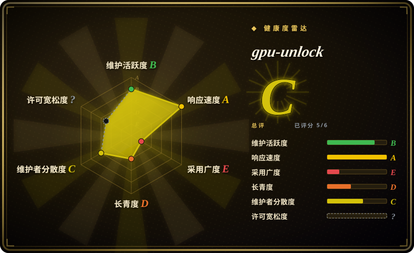
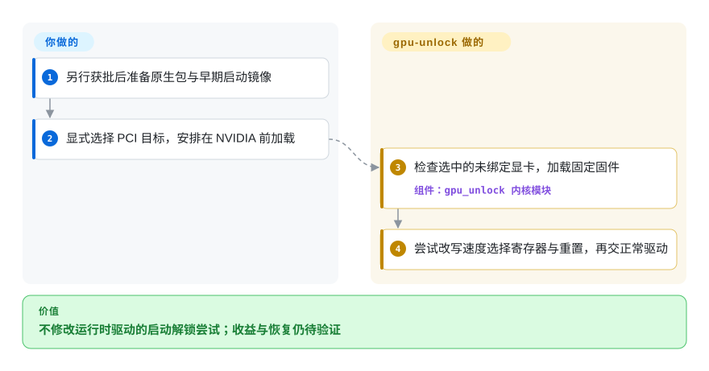
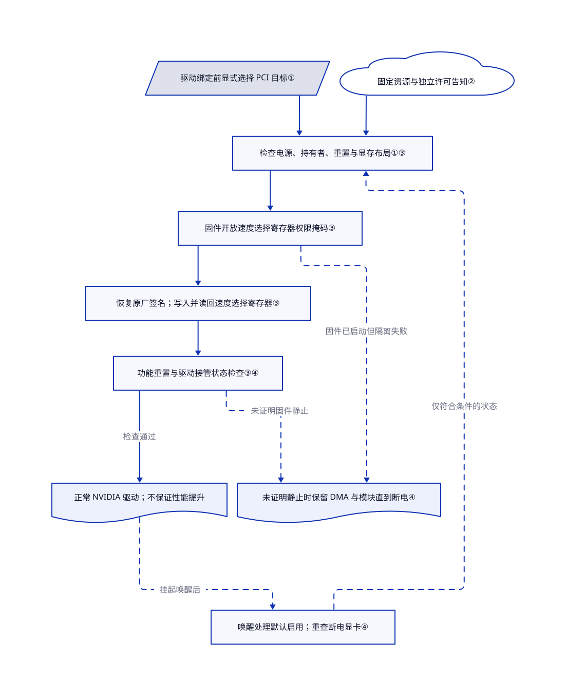

# gpu-unlock

你的 RTX 30 系显卡忙着乘矩阵，半精度指令吞吐却受限制。gpu-unlock 在正常 NVIDIA 驱动启动前改写速度选择寄存器，不替换应用计算内核。

> [!WARNING]
> **仅作为风险信息页收录，不代表批准安装或解锁显卡。** 它运行特权内核代码、加载显卡固件、写寄存器并重置 PCIe 功能，可能影响开机显示与驱动可用性。模块和本地打包明确声明 **GPL-2.0-only**，保留的 MIT 文本只覆盖特定参考来源，不覆盖完整交付；NVIDIA 固件另有条款。`NOASSERTION` 表示尚未核定源码加固件交付物的统一许可，**不是**说模块没有许可。不要把完整交付称为 MIT 或统一开源软件。本页没有编译、安装或执行上游。

## 何时使用

你在 Linux 工作站上研究计算吞吐，显卡属于明确列出的 GA102、GA103、GA104 或 GA106 设备。瓶颈是 BF16 稠密矩阵乘法，也就是用两组 16 位输入相乘，不是加载模型或逐字生成时搬运内存。你想了解正常驱动绑定前的解锁方式，不走 CMP 参考项目的驱动补丁路线，此时值得**只读研究**本仓库。不修改应用，代价是内核、固件与启动顺序风险。

[固定版本 README](https://github.com/Zagitta/gpu-unlock/blob/af28cbbfd3d922a659227ecfb7369adfd924cf03/README.md#L20-L55)汇总了部分 3090／3090 Ti、3080、3070 和 3060 的正面报告，也记录了 RTX 3080 Ti 20 GB OEM 没有 BF16 增益的反例。GA103 尚无报告；3070 Ti 的引用来自**另一份 UEFI 实现**，不是本模块。设备 ID 被接受或日志显示 `unlocked`，都不等于吞吐提高。

## 何时不用

- **生产启动或现场黑屏恢复不能冒险。** 优先选下文 CUTLASS 软件调优。模块在重置前移除固件帧缓冲，失败时可能保留资源直到断电，不保证驱动接管。
- **瓶颈是带宽受限的逐字生成，或 INT8。** 优先选 [llama.cpp](../llm-inference/local-runtimes/llama-cpp.zh.md) 的量化、模型容量与后端控制。上游报告这两类负载变化很小；它不会增加显存或内存带宽。
- **需要未列硬件、Windows、GA107、Ada 或 Blackwell。** 选 CUTLASS 明确覆盖的 CUDA 设备，或 llama.cpp 的多后端路线。[接受列表](https://github.com/Zagitta/gpu-unlock/blob/af28cbbfd3d922a659227ecfb7369adfd924cf03/kernel/gpu_unlock/main.c#L21-L39)比“所有 NVIDIA 3000 显卡”更窄，被接受也不代表已验证。
- **你维护的是 CMP 90HX 驱动补丁实验。** 应读 WildFlash1st/cmp90hx-unlock；其 rejoin15 路线针对该卡并修改 610.43.03 驱动。它不是更安全的通用解锁器，其结果不证明 RTX 兼容。
- **必须有完整分发授权，或必须无损回滚。** 问题明确前，保留原厂驱动，选 CUTLASS 或 llama.cpp。源码 GPL 声明不授权所有固件；卸载不恢复原选择寄存器，热重启也不保证全面复位。

## 横向对比

下面比较不同优化或研究路线，不是可互换的解锁器。

| 替代品 | 是否收录 | 我们的评价 | 取舍 |
|---|---|---|---|
| [CUTLASS](https://github.com/NVIDIA/cutlass) | 未收录 | 能修改应用矩阵计算时，先选 CUTLASS 调整计算内核，不先改启动状态。只有取得独立授权、研究指令速率限制时，才考虑 gpu-unlock。 | CUDA C++ 集成需要开发，但不需要驱动前解锁；软件调优无法移除硬件速率限制。见[源码说明](https://github.com/NVIDIA/cutlass/blob/91843b71d90737e0a9b86f7d9df213cff5a3526f/README.md#L8-L26)。本批不扩收。 |
| [llama.cpp](../llm-inference/local-runtimes/llama-cpp.zh.md) | 已收录 | 本地运行大模型，尤其逐字生成受带宽限制时，先选 llama.cpp 的量化与后端控制，不先承担内核解锁风险。gpu-unlock 只处理更窄的矩阵速率限制，不提供推理服务。 | GGUF 转换、模型兼容与精度由你负责；这条路线改变软件负载，不改变显卡启动时的选择寄存器。 |
| [WildFlash1st/cmp90hx-unlock](https://github.com/WildFlash1st/cmp90hx-unlock) | 未收录 | 研究 CMP 90HX 驱动时选固定 CMP 参考项目；研究面向 RTX 的驱动前模块时读本仓库。不能在两者之间移植成功显卡结论。 | [参考项目](https://github.com/WildFlash1st/cmp90hx-unlock/blob/76940ae583281daa2b883518a2e89b56c11d3a46/README.md#L55-L108)用打补丁的 610.43.03 驱动或旧式引导服务；gpu-unlock 分离早期模块与运行时驱动，但保留固件和重置风险。本批不扩收。 |

## 快速上手

**本页批准的是只读研究；以下说明上游用法，不是执行指令。** [README](https://github.com/Zagitta/gpu-unlock/blob/af28cbbfd3d922a659227ecfb7369adfd924cf03/README.md#L60-L155)从源码目录与 `make install` 开始，它会选择 Arch、Debian／Ubuntu 或 RPM 打包、下载固定输入，并可能请求管理员权限。包会安装 DKMS（随内核重新构建模块的系统）、固件，以及写进早期启动镜像的 initramfs 配置。另行获批的操作者通过 `gpu_unlock.targets` 指定 PCI 地址；不填目标就不解锁，`all` 则覆盖所有被接受且未绑定的设备。启动顺序正确时，模块尝试完成处理，再交给正常 NVIDIA 驱动；你仍负责许可审查、签名策略、启动镜像核验、同条件正确性与性能对照，以及现场恢复。本页不证明兼容，也不授权这些修改。

<!-- flow-steps:begin (generated from flows/gpu-unlock.json by tools/flow_card.py — do not edit) -->

流程文字版

1. **你**：另行获批后准备原生包与早期启动镜像
2. **你**：显式选择 PCI 目标，安排在 NVIDIA 前加载
3. **gpu-unlock**：检查选中的未绑定显卡，加载固定固件 — 组件：`gpu_unlock 内核模块`
4. **gpu-unlock**：尝试改写速度选择寄存器与重置，再交正常驱动

**价值**：不修改运行时驱动的启动解锁尝试；收益与恢复仍待验证

<!-- flow-steps:end -->

## 技术要点

<!-- mechanism:begin (generated from mechanisms/gpu-unlock.json by tools/mechanism_card.py; do not edit) -->

机制文字版

- 驱动绑定前显式选择 PCI 目标①
- 固定资源与独立许可告知②
- 检查电源、持有者、重置与显存布局①③
- 固件开放速度选择寄存器权限掩码③
- 恢复原厂签名；写入并读回速度选择寄存器③
- 功能重置与驱动接管状态检查③④
- 正常 NVIDIA 驱动；不保证性能提升
- 未证明静止时保留 DMA 与模块直到断电④
- 唤醒处理默认启用；重查断电显卡④

- 驱动绑定前显式选择 PCI 目标① → 检查电源、持有者、重置与显存布局①③
- 固定资源与独立许可告知② → 检查电源、持有者、重置与显存布局①③
- 检查电源、持有者、重置与显存布局①③ → 固件开放速度选择寄存器权限掩码③
- 固件开放速度选择寄存器权限掩码③ → 恢复原厂签名；写入并读回速度选择寄存器③
- 恢复原厂签名；写入并读回速度选择寄存器③ → 功能重置与驱动接管状态检查③④
- 功能重置与驱动接管状态检查③④ → 正常 NVIDIA 驱动；不保证性能提升（检查通过）
- 固件开放速度选择寄存器权限掩码③ → 未证明静止时保留 DMA 与模块直到断电④（固件已启动但隔离失败）〔可选／兜底〕
- 功能重置与驱动接管状态检查③④ → 未证明静止时保留 DMA 与模块直到断电④（未证明固件静止）〔可选／兜底〕
- 正常 NVIDIA 驱动；不保证性能提升 → 唤醒处理默认启用；重查断电显卡④（挂起唤醒后）〔可选／兜底〕
- 唤醒处理默认启用；重查断电显卡④ → 检查电源、持有者、重置与显存布局①③（仅符合条件的状态）〔可选／兜底〕

<!-- mechanism:end -->

### 1. 用显式选择控制驱动前交接

- **解决：** 已有驱动持有设备时写显卡，会与活动硬件状态冲突。
- **做法：** 只读参数 `targets` 选择被接受的 PCI 设备，不填立即返回。逐设备锁与异步任务并行处理选中的未绑定显卡，并在正常驱动探测前共用一次 GSP 固件加载。
- **边界：** 选择不是兼容性检测。单卡错误写日志，但初始化仍返回零；模块加载成功不等于解锁成功。
- **源码：** [参数与设备 ID](https://github.com/Zagitta/gpu-unlock/blob/af28cbbfd3d922a659227ecfb7369adfd924cf03/kernel/gpu_unlock/main.c#L13-L39)、[锁与共享资源](https://github.com/Zagitta/gpu-unlock/blob/af28cbbfd3d922a659227ecfb7369adfd924cf03/kernel/gpu_unlock/main.c#L66-L125)、[初始化](https://github.com/Zagitta/gpu-unlock/blob/af28cbbfd3d922a659227ecfb7369adfd924cf03/kernel/gpu_unlock/main.c#L181-L211)。

### 2. 固定固件身份，但不抹平不同许可

- **解决：** 依赖特定布局的固件流程不能随意接受更新资源。
- **做法：** Python 工具核对输入输出 SHA-256，提取 NVIDIA 610.43.03 资源，并按固定 CMP 参考生成独立 V67 载荷。NVIDIA 许可告知单独提取校验，另保留 GPL 和参考 MIT 文本。
- **边界：** 哈希证明身份，不证明安全、授权或运行时驱动兼容。本次未取得二进制包内完整 NVIDIA 协议；尝试的公开版本协议 URL 返回 404，没有下载二进制包。
- **源码：** [输入验证](https://github.com/Zagitta/gpu-unlock/blob/af28cbbfd3d922a659227ecfb7369adfd924cf03/firmware/fetch_artifacts.py#L28-L62)、[生成与保留告知](https://github.com/Zagitta/gpu-unlock/blob/af28cbbfd3d922a659227ecfb7369adfd924cf03/firmware/generate_v67.py#L96-L128)、[条款和来源](https://github.com/Zagitta/gpu-unlock/blob/af28cbbfd3d922a659227ecfb7369adfd924cf03/firmware/NOTICE.md#L1-L30)。

### 3. 改受保护的选择寄存器，再重置交给驱动

- **解决：** 主机通常不能写受保护的指令速率选择寄存器。
- **做法：** 流程检查设备状态，从板载 ROM 读取安全固件，准备受保护显存与 DMA（显卡可直接访问的内存），再用 V67 开放寄存器权限掩码。随后恢复原厂签名指针，写入并读回两个选择寄存器，重置 PCIe 功能并检查驱动接管状态。
- **边界：** 它改变固件和寄存器权限状态，可能使开机显示变黑。代码拒绝预留空间不足、缺少重置能力或本轮通电已初始化的设备；读回正确不证明吞吐提升。
- **源码：** [执行顺序](https://github.com/Zagitta/gpu-unlock/blob/af28cbbfd3d922a659227ecfb7369adfd924cf03/kernel/gpu_unlock/unlock_610.c#L1443-L1485)、[布局约束](https://github.com/Zagitta/gpu-unlock/blob/af28cbbfd3d922a659227ecfb7369adfd924cf03/kernel/gpu_unlock/unlock_610.c#L657-L745)、[选择寄存器与重置](https://github.com/Zagitta/gpu-unlock/blob/af28cbbfd3d922a659227ecfb7369adfd924cf03/kernel/gpu_unlock/unlock_610.c#L1169-L1429)、[无增益报告](https://github.com/Zagitta/gpu-unlock/issues/28)。

### 4. 保留不能安全释放的资源，并重查唤醒状态

- **解决：** 固件停止前释放显卡可访问内存，会威胁主机内存；挂起断电也会清除选择寄存器。
- **做法：** 只有证明固件静止后，清理才恢复 DMA 掩码与部分 PCI 命令位。否则保留 DMA 缓冲、工作结构、设备与模块引用直到断电。通知器默认在 NVIDIA 恢复设备前，重新处理启动时成功的卡；设备已运行或仍保持解锁时跳过。
- **边界：** 这是部分隔离，不是回滚；卸载不恢复原选择寄存器。`resume` 默认为真，可用 `gpu_unlock.resume=0` 禁用；文档不覆盖休眠到磁盘。仓库有模拟故障测试，但本页没有执行。
- **源码：** [清理](https://github.com/Zagitta/gpu-unlock/blob/af28cbbfd3d922a659227ecfb7369adfd924cf03/kernel/gpu_unlock/unlock_610.c#L526-L607)、[资源保留](https://github.com/Zagitta/gpu-unlock/blob/af28cbbfd3d922a659227ecfb7369adfd924cf03/kernel/gpu_unlock/unlock_610.c#L1480-L1495)、[唤醒](https://github.com/Zagitta/gpu-unlock/blob/af28cbbfd3d922a659227ecfb7369adfd924cf03/kernel/gpu_unlock/main.c#L83-L146)、[模拟场景](https://github.com/Zagitta/gpu-unlock/blob/af28cbbfd3d922a659227ecfb7369adfd924cf03/tests/test_unlock_adapter.c#L540-L716)。

## 技术栈

- 六个内核 C 实现文件，固定版本共 2440 个物理行，另有头文件与 Kbuild。不是 CUDA 库、UEFI 应用，也不替换 NVIDIA 驱动。
- 三个 Python 固件脚本、Make、DKMS，以及 Arch／Debian／RPM 原生打包。树中有模拟 C 测试与 Python 打包测试，存在不代表运行成功。
- 模块与打包声明 GPL-2.0-only，另有 GPL CMP 载荷来源、独立 NVIDIA 固件条款和参考 MIT 告知。固定树没有模型、权重或训练数据集。

## 依赖

- 列表接受的 Ampere 设备、Linux PCI 与固件加载，以及 PCIe 功能级重置。启动处理要求设备未绑定、已上电，且本轮通电未被初始化；唤醒另有检查。
- 内核头文件与工具链、DKMS、Python 3、zstd、原生打包与 initramfs 工具。安装和修改启动镜像需要管理员权限；主机签名与安全策略仍适用，本页未测试。
- 固定 NVIDIA 610.43.03 源码与 CachyOS `nvidia-utils` 输入，上游 CI 称约 340 MB。即使后续运行时驱动不同，固件身份仍固定。
- CI 声明为 Debian 12／13、Ubuntu 24.04、Fedora、Arch 构建模块，这是**构建覆盖，不是硬件验证**。[问题 #33](https://github.com/Zagitta/gpu-unlock/issues/33)报告一张 3090 使用原厂 610.57.04-open；[问题 #1](https://github.com/Zagitta/gpu-unlock/issues/1)的 3090 Ti 数字则使用修改过的 610.43.02 驱动和自定义启动集成。两者都不是普遍兼容矩阵。

## 运维难度

**高。** 关键是早期启动顺序。原生安装可能重建多个内核镜像，必须核对模块构建、固件包含与实际顺序，不能只看包安装成功。[问题 #28](https://github.com/Zagitta/gpu-unlock/issues/28)报告需要调整 mkinitcpio 集成。

上游说明移除目标参数会停用以后启动的尝试，卸包会移除模块与配置，并通过钩子重建镜像。但这不恢复本次启动的选择寄存器，也不证明没有残留：输入缓存、手工引导配置是独立项，部分 RPM 清理命令容忍错误。固件不停机时会主动保留资源直到断电。见[恢复说明](https://github.com/Zagitta/gpu-unlock/blob/af28cbbfd3d922a659227ecfb7369adfd924cf03/README.md#L163-L195)、[卸载代码](https://github.com/Zagitta/gpu-unlock/blob/af28cbbfd3d922a659227ecfb7369adfd924cf03/kernel/gpu_unlock/main.c#L214-L222)和 [RPM 钩子](https://github.com/Zagitta/gpu-unlock/blob/af28cbbfd3d922a659227ecfb7369adfd924cf03/packaging/rpm/gpu-unlock.spec#L70-L130)。

## 健康度与可持续性

- **2026-10-25 维护状态：** 公开非 fork，2026-10-18 建立，2026-10-24 推送。源码为 1.0.0，发行 API 无发布。应固定 `af28cbbfd3d922a659227ecfb7369adfd924cf03`，不把它当稳定版本承诺。
- **治理与支持：** 个人账号 Zagitta 持有；贡献者 API 列出 Zagitta、claude、jesvs 和 foureight84，不等于四名已核实的人类维护者。有赞助链接，固定树无治理或安全策略文件，未建立基金会支持证据。
- **年龄与采用：** 本次核查时约一周，3340 星、369 fork。选型判断：这是实验项目，没有长期活跃的林迪先验；关注度和社区报告不能证明长期正确性。
- **许可与风险：** 虽然 GitHub 返回 `license: null`，源码 GPL 声明确实存在。完整交付还包含独立条款固件与派生载荷，整包字段保留 `NOASSERTION`。自动雷达不代表法律或运行安全放行。
- **选型判断：** 这是有实质实现的硬件实验与风险信息页，不是常规生产调优。特权启动写入、设备相关收益、部分恢复和未闭合的整包权利决定本页建议。

## 存疑（未验证）

- [未验证：无显卡执行授权] 已读作者与社区性能、正确性报告，未复现。3090 Ti 表格在 450 W 条件下报告 BF16 从 87.50 升至 157.41 TFLOPS；大模型预填充提升 14–36% 不代表应用普遍翻倍。
- [未验证：仅静态源码与公开报告] 未建立任何具体显卡、内核、运行时驱动、签名策略、多卡或挂起唤醒组合的兼容性。固定 README 中 GA103 无报告；3070 Ti 引用来自 UEFI，不是本模块。
- [未验证：包内协议未取得，公开版本 URL 返回 404] 未对 NVIDIA 固件完整分发权、告知义务和派生载荷权利作法律审查。GPL 声明和参考 MIT 文本不能补足这一缺口。
- [未验证：禁止硬件写入与恢复实验] 未测试驱动接管、断电恢复、长期数值与内存正确性，也未测试无残留卸载。资源保留与包钩子说明预期隔离，不保证无损恢复。
