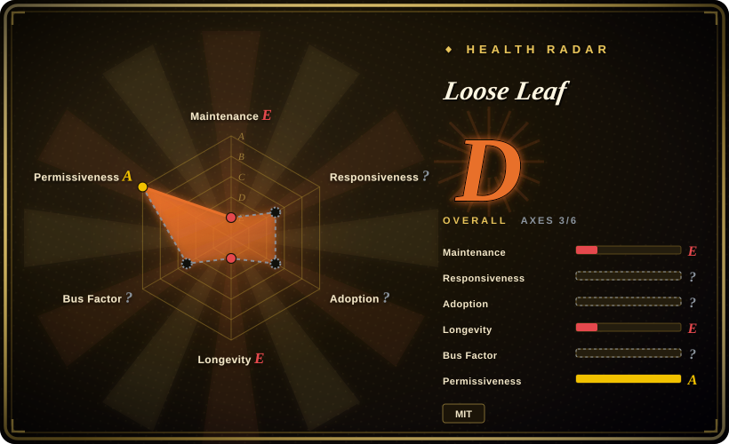
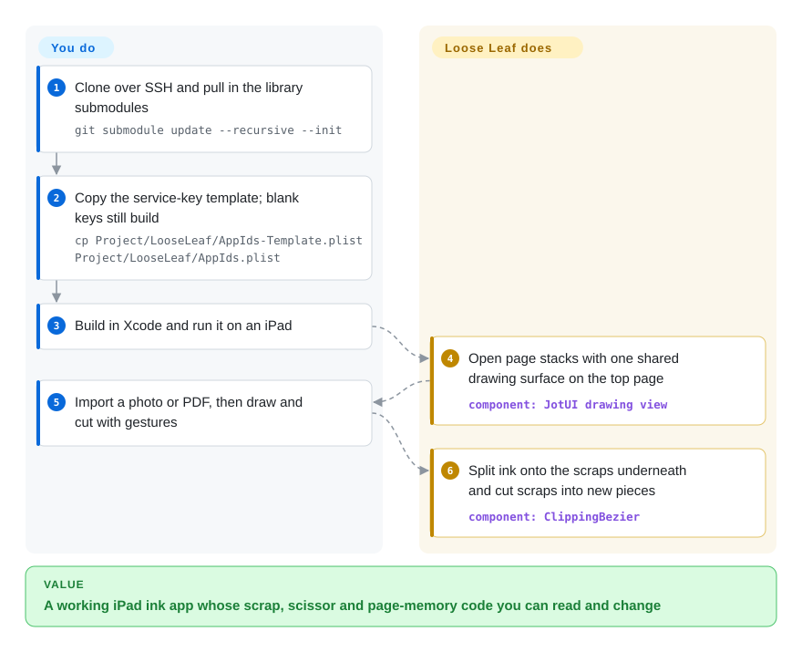
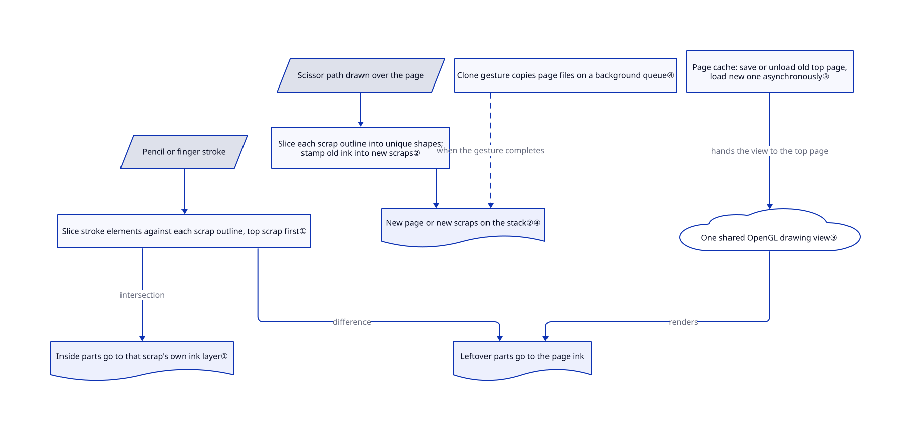

# Loose Leaf

Commercial iPad note apps let you paste a photo and scribble on it, but you cannot see how they keep ink attached to a photo you later move, cut or duplicate — and you cannot fork them. Loose Leaf is the complete MIT source of a note app that once shipped on the App Store: ink splits onto the photos under the pen, scissors cut photos into new pieces, and pages are stacked and cloned with gestures.

## When to use

You are an iOS developer about to build a pen feature — marking up photos in a field-inspection app, say — and you have hit the questions the tutorials skip: a user draws a line that crosses half onto a pasted photo and then drags the photo away; does the ink go with it? How do you cut that photo into two pieces and keep the ink on both? How many pages of full-resolution ink can stay in memory before the app is killed? Loose Leaf answers these with shipped Objective-C code: each stroke is sliced against every photo outline beneath it, scissor paths cut outlines into new shapes, and only the top page holds a live drawing surface.

Pick it over the maintained open handwriting apps (Saber, Xournal++, Rnote) when the point is native UIKit iPad source to read or fork — those are Flutter, GTK and Rust apps with different object models. Pick it over Apple's PencilKit when you need the scrap-and-scissor behaviour, which PencilKit does not offer. You pay with a code base frozen since 2023 on OpenGL ES, which Apple deprecated in iOS 12.

## When NOT to use

- **You want a handwriting app for your own daily notes.** Use Saber (iPad, Android and desktop, active, GPL-3.0) or the App Store build of a commercial app. Loose Leaf's App Store version is 3.3.4 from 2020-07-19, and nobody answers its issue tracker.
- **You are adding ink to a new iOS app.** Use Apple's PencilKit. Loose Leaf draws through its author's JotUI view on OpenGL ES, deprecated by Apple since iOS 12; porting that renderer to Metal would be your job.
- **You only need one algorithm, not an app.** Take the libraries the author split out — ClippingBezier (path intersection and slicing, MIT, pushed 2026-10-13) or JotUI (the drawing view, last pushed 2021-07) — instead of forking a 2,400-file app tree.
- **You annotate very large PDFs.** Open issue [#1889](https://github.com/adamwulf/loose-leaf/issues/1889) (2025-11) reports crashes when flipping pages of 500–1,000-page PDFs, and the README's own [#1723](https://github.com/adamwulf/loose-leaf/issues/1723) (export crash with more than ten imported documents, suspected heap corruption) has been open since 2016. Use Xournal++ on a desktop, or Saber.
- **You need iPhone, Android or desktop.** The Xcode project targets iPad only (`TARGETED_DEVICE_FAMILY = 2`). Use Saber for phones and tablets, Rnote or Xournal++ for desktop.
- **You need a fork that builds cleanly with no third-party services.** About 1,070 of the 2,423 files are vendored binary SDKs (Facebook, Pinterest, App Center, Twitter's discontinued Digits), plus Mixpanel analytics, and every submodule URL is `git@github.com:` SSH. Expect to strip SDKs and rewrite submodule URLs before CI can build it; if you cannot, start from PencilKit.

## Comparison

| Alternative | In index | Our verdict | Tradeoff |
|---|---|---|---|
| [Saber](https://github.com/saber-notes/saber) | not indexed | Choose Saber for handwriting notes you will actually live in across iPad, Android and desktop; choose Loose Leaf only to read or fork native iPad ink code. | Saber is active (pushed 2026-11-17) and cross-platform but GPL-3.0 and built in Flutter; Loose Leaf is MIT and UIKit-native but frozen. Not added in this tab batch. |
| [Xournal++](https://github.com/xournalpp/xournalpp) | not indexed | Choose Xournal++ to hand-annotate PDFs on a desktop with a Wacom tablet; choose Loose Leaf when the target is the iPad. | Xournal++ is long-lived, active and handles PDF annotation as its core job, under GPL-2.0; it has no iPad build. Not added in this tab batch. |
| [Rnote](https://github.com/flxzt/rnote) | not indexed | Choose Rnote for desktop sketching and handwritten notes on Linux, macOS or Windows; choose Loose Leaf for an iPad gesture model to study. | Rnote is a maintained Rust/GTK4 app with PDF import and export, GPL-3.0; no iPad target. Not added in this tab batch. |
| Apple PencilKit | not a repo | Choose PencilKit to add Pencil ink to a new iOS app with Apple maintaining the renderer; choose Loose Leaf when you need ink that follows movable, cuttable image scraps. | PencilKit is a closed system framework (no source), current with iPadOS, but has no scrap, scissor or page-stack model; Loose Leaf has those on a deprecated GPU API. |
| [JotUI](https://github.com/adamwulf/JotUI) | not indexed | Choose JotUI when you only want Loose Leaf's drawing view in your own app; choose the full app when you also need scraps, scissors and the page cache. | Same author and renderer, far smaller surface, but also OpenGL ES and unpushed since 2021-07. Not added in this tab batch. |

## Quick start

Clone the repository over SSH and pull its library submodules, then copy `AppIds-Template.plist` to `AppIds.plist` — the file holding client keys for App Center, Twitter, Facebook, Pinterest, Imgur and Mixpanel; the README says blank keys still build and run, with some sharing features off ([README:32–51](https://github.com/adamwulf/loose-leaf/blob/86c33a5ecfbf8d1dc5bfc9fa92667a6171ed7b0b/README.md#L32-L51)). Build in Xcode and install on an iPad; the last commit says it builds with Xcode 14.3, and the deployment target is iOS 10. The app then does the ink work — splitting strokes onto photos, cutting scraps, loading and unloading pages — while you own the signing, the dead SDKs you keep or remove, and any App Store or privacy obligations for your fork. Users who only want the app can install the free App Store build instead. Nothing was built or run for this page.

<!-- flow-steps:begin (generated from flows/loose-leaf.json by tools/flow_card.py — do not edit) -->

Text version of the flow

1. **You**: Clone over SSH and pull in the library submodules — `git submodule update --recursive --init`
2. **You**: Copy the service-key template; blank keys still build — `cp Project/LooseLeaf/AppIds-Template.plist Project/LooseLeaf/AppIds.plist`
3. **You**: Build in Xcode and run it on an iPad
4. **Loose Leaf**: Open page stacks with one shared drawing surface on the top page — component: `JotUI drawing view`
5. **You**: Import a photo or PDF, then draw and cut with gestures
6. **Loose Leaf**: Split ink onto the scraps underneath and cut scraps into new pieces — component: `ClippingBezier`

**Value**: A working iPad ink app whose scrap, scissor and page-memory code you can read and change

<!-- flow-steps:end -->

## Key techniques

<!-- mechanism:begin (generated from mechanisms/loose-leaf.json by tools/mechanism_card.py; do not edit) -->

Text version of the mechanism

- Pencil or finger stroke
- Slice stroke elements against each scrap outline, top scrap first①
- Inside parts go to that scrap's own ink layer①
- Leftover parts go to the page ink
- Scissor path drawn over the page
- Slice each scrap outline into unique shapes; stamp old ink into new scraps②
- Page cache: save or unload old top page, load new one asynchronously③
- One shared OpenGL drawing view③
- Clone gesture copies page files on a background queue④
- New page or new scraps on the stack②④

- Pencil or finger stroke → Slice stroke elements against each scrap outline, top scrap first①
- Slice stroke elements against each scrap outline, top scrap first① → Inside parts go to that scrap's own ink layer① (intersection)
- Slice stroke elements against each scrap outline, top scrap first① → Leftover parts go to the page ink (difference)
- Scissor path drawn over the page → Slice each scrap outline into unique shapes; stamp old ink into new scraps②
- Slice each scrap outline into unique shapes; stamp old ink into new scraps② → New page or new scraps on the stack②④
- Page cache: save or unload old top page, load new one asynchronously③ → One shared OpenGL drawing view③ (hands the view to the top page)
- One shared OpenGL drawing view③ → Leftover parts go to the page ink (renders)
- Clone gesture copies page files on a background queue④ → New page or new scraps on the stack②④ (when the gesture completes) [optional/fallback]

<!-- mechanism:end -->

### 1. Split every stroke across the scraps beneath it

- **Problem:** Ink drawn across a pasted photo must move with the photo later, but the part that misses the photo must stay on the page.
- **How:** Before new stroke elements reach the page, the page walks its scraps (imported photos or cut pieces) from the top down. A bounding-box test skips scraps that cannot touch the element; otherwise ClippingBezier slices the element against the scrap outline into an intersection and a difference. The intersection is written into that scrap's own ink layer, the difference is passed to the next scrap down, and whatever is left goes on the page.
- **Limits:** Cost grows with the number of overlapping scraps and outline segments — the code counts segment tests per stroke for its analytics; undo levels are forced mid-stroke across all scraps when any layer exceeds the byte limit.
- **Source:** [stroke splitting:431–604](https://github.com/adamwulf/loose-leaf/blob/86c33a5ecfbf8d1dc5bfc9fa92667a6171ed7b0b/Project/LooseLeaf/MMScrappedPaperView.m#L431-L604).

### 2. Cut scraps with an open scissor path

- **Problem:** Users want to cut a shape out of a photo and keep the ink that was already on it.
- **How:** The scissor path is scaled into page coordinates, then each scrap outline, top first, is sliced by the open path into unique shapes. Each new shape becomes a new scrap that inherits the old scrap's background image and ink by stamping; the pieces are nudged apart, the original is removed, and the part of the scissor path already used is subtracted before the next scrap. A closed path drawn on bare page lifts that area of page ink into a new scrap and erases it from the page.
- **Limits:** Shape slicing throws on duplicate reversed subpaths and the whole cut runs inside a try block; it is geometry on Bézier outlines, so very complex outlines get slower, and the old ink is copied as a GPU texture stamp, not as editable strokes.
- **Source:** [scissor cut:666–890](https://github.com/adamwulf/loose-leaf/blob/86c33a5ecfbf8d1dc5bfc9fa92667a6171ed7b0b/Project/LooseLeaf/MMScrappedPaperView.m#L666-L890), [texture stamp:582–620](https://github.com/adamwulf/loose-leaf/blob/86c33a5ecfbf8d1dc5bfc9fa92667a6171ed7b0b/Project/LooseLeaf/MMScrapView.m#L582-L620), [ClippingBezier](https://github.com/adamwulf/ClippingBezier).

### 3. One drawing surface, handed to the top page

- **Problem:** A notebook with hundreds of pages cannot keep a GPU-backed ink layer alive for each one on an iPad's memory budget.
- **How:** A single page-cache manager owns one shared JotUI drawing view. When the top page changes, it first saves the old editable page if it has edits, then unloads its state, then loads the new page's state asynchronously, and only then moves the drawing view over; other pages show cached thumbnail images. A short fade hides the frame where the view still shows old content.
- **Limits:** Switching quickly between pages queues saves and loads; the open large-PDF crash report and closed 2026-10 reports about lost reloads during unloads point at this state machine as fragile.
- **Source:** [top-page handoff:203–250](https://github.com/adamwulf/loose-leaf/blob/86c33a5ecfbf8d1dc5bfc9fa92667a6171ed7b0b/Project/LooseLeaf/MMPageCacheManager.m#L203-L250), [view attach and fade:180–230](https://github.com/adamwulf/loose-leaf/blob/86c33a5ecfbf8d1dc5bfc9fa92667a6171ed7b0b/Project/LooseLeaf/MMEditablePaperView.m#L180-L230).

### 4. Clone pages by copying files while the gesture runs

- **Problem:** Duplicating a page with all its ink and scraps should feel instant even though the data lives on disk.
- **How:** When a clone gesture begins, a cloner copies the page's directory on a background queue, overlaying files from the bundled starter content that the user has not modified. The gesture completes against a completion block that fires immediately if copying already finished, or waits; an aborted gesture deletes the copy afterwards.
- **Limits:** The copy is a plain file copy, so cloning a page with large imported images costs disk space and time proportional to its files.
- **Source:** [cloner:30–105](https://github.com/adamwulf/loose-leaf/blob/86c33a5ecfbf8d1dc5bfc9fa92667a6171ed7b0b/Project/LooseLeaf/MMPageCloner.m#L30-L105).

## Tech stack

- Objective-C and some Objective-C++ (333 `.m`/`.mm` files under `Project/LooseLeaf`), UIKit, Core Graphics `CGPDF` for PDF import including password unlocking.
- Drawing through the author's JotUI (OpenGL ES) with ClippingBezier, vectorboolean, touch-chart and MMStretchGestureRecognizers as git submodules.
- Vendored binary frameworks: Facebook SDK, App Center, Pinterest, DigitsKit; Mixpanel, AFNetworking, ZipArchive and MMMarkdown as submodules.
- Code style via Square's spacecommander (`format-all.sh`, `format-staged.sh`). No automated test target was found in the tree.

## Dependencies

- **To build:** macOS with Xcode (the last commit targets Xcode 14.3), an Apple developer account to sign for a device, and GitHub SSH access because all 16 submodules use `git@github.com:` URLs.
- **To run:** an iPad on iOS 10 or later (iPad-only device family).
- **Optional services:** keys for App Center, Mixpanel, Facebook, Twitter, Pinterest, Imgur and Mashape in `AppIds.plist`; blank keys disable the related features. No server of its own.

## Ops difficulty

**Medium for a fork, nothing for a user.** There is no backend. The work is keeping a 2012-era Objective-C app compiling on current Xcode and iPadOS: OpenGL ES is deprecated, several vendored SDKs are discontinued or years out of date, and submodules must resolve over SSH. Removing analytics and sharing SDKs is a manual project-file job. Users who install the App Store build have no ops at all, but get no fixes either.

## Health & viability

- **Maintenance, as of 2026-11-18:** dormant. The last commit is 2023-08-12 (an Xcode 14.3 build fix and version bump to 3.3.5), the one before it 2021-04; the App Store build is still 3.3.4 from 2020-07-19. No GitHub releases, only tags.
- **Governance and bus factor:** a single author; `adamwulf` has 3,423 of the contributor-counted commits and no other contributor appears in the top list. The copyright holder is his company, Milestone Made, LLC.
- **Responsiveness:** 171 open issues and one open pull request; the maintainer has not commented on any issue updated since 2022. A burst of 2026-10 bug reports and PRs from one outside account was closed by that account without maintainer response.
- **Age and Lindy:** 14 years old but not still active, so age gives no Lindy credit; treat it as a finished artifact, not a living product.
- **Adoption:** 676 stars and 100 forks — attention as a reference code base rather than as a dependency.
- **Risk flags:** MIT (the README adds "attribution is required", which MIT's notice clause already covers); deprecated OpenGL ES; closed vendor SDKs and analytics in the tree.

## Caveats (unverified)

- [未验证: nothing built or run] Whether the 2023-08 tree still builds on current Xcode and iPadOS releases newer than Xcode 14.3 was not tested.
- [未验证: no device test] The large-PDF crash in #1889 and the export crash in #1723 were not reproduced; they are user and author reports.
- [推断: from code reading plus closed 2026-10 issue titles, not from profiling] The page-cache state machine being the fragile part is an inference.
- [未验证: App Store lookup only] The App Store listing was read through Apple's lookup API (version 3.3.4, free); whether the app still installs and runs on the newest iPadOS was not checked.
- [未验证: licenses of vendored binaries not reviewed] The license terms of the bundled Facebook, Pinterest, App Center and DigitsKit binaries, and whether they may be redistributed in a fork, were not checked.
- [推断: from the contributors endpoint, which lists only the top accounts] Outside contribution may exist in commits not attributed to GitHub accounts.
