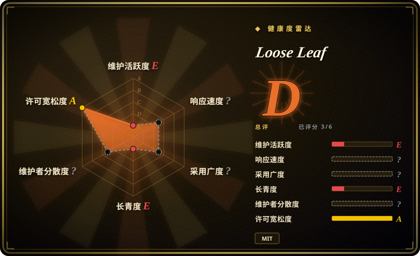
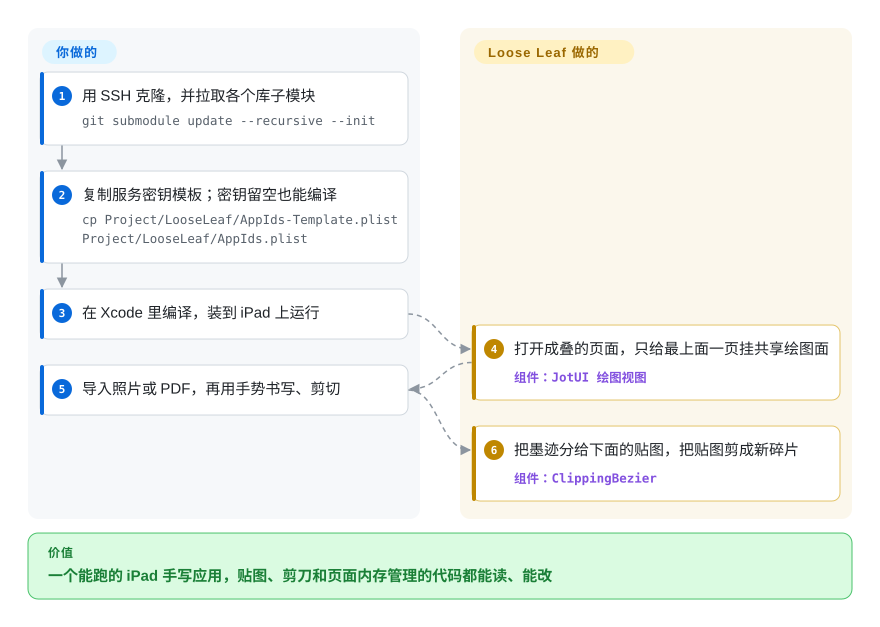
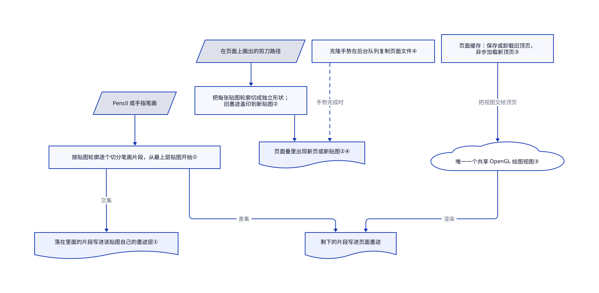

# Loose Leaf

商业 iPad 笔记应用都能贴一张照片再往上写字，可你看不到它们是怎么让墨迹在照片被拖走、剪开、复制之后还跟着照片走的，也没法拿来改。Loose Leaf 是一个真正在 App Store 上架过的笔记应用的完整 MIT 源码：笔画落到照片上就分给照片，剪刀能把照片剪成新碎片，页面靠手势成叠整理和复制。

## 何时使用

你是 iOS 开发者，准备给自己的应用加手写功能——比如巡检应用里在现场照片上圈画——然后撞上了教程不讲的问题：用户画的一条线一半落在贴进来的照片上，接着把照片拖走，墨迹要不要跟着走？把这张照片剪成两块，两块上的墨迹怎么保住？满分辨率的墨迹页在内存里能放几页，应用才不会被系统杀掉？Loose Leaf 用上架过的 Objective-C 代码回答了这些：每一笔都按下面每张照片的轮廓切开，剪刀路径把轮廓切成新形状，只有最上面一页挂着真正的绘图面。

当你要的是能读、能 fork 的原生 UIKit iPad 源码时，选它而不是仍在维护的开源手写应用（Saber、Xournal++、Rnote）——它们分别是 Flutter、GTK、Rust 应用，对象模型完全不同。当你需要“贴图加剪刀”这套行为时，选它而不是苹果的 PencilKit，因为 PencilKit 不提供这些。代价是代码 2023 年起就冻结了，绘图建立在苹果自 iOS 12 起弃用的 OpenGL ES 上。

## 何时不用

- **你想找一个自己天天记笔记的手写应用。** 用 Saber（iPad、Android、桌面都有，活跃，GPL-3.0）或商业应用。Loose Leaf 在 App Store 上的版本是 2020-07-19 的 3.3.4，issue 区没有人回复。
- **你在给一个新 iOS 应用加墨迹。** 用苹果的 PencilKit。Loose Leaf 通过作者自己的 JotUI 视图在 OpenGL ES 上绘图，苹果从 iOS 12 起就弃用了 OpenGL ES；把渲染器移植到 Metal 是你的活。
- **你只需要其中一个算法，不需要整个应用。** 直接用作者拆出来的库——ClippingBezier（路径求交与切分，MIT，2026-10-13 仍有推送）或 JotUI（绘图视图，最后推送于 2021-07）——不要 fork 一棵 2,400 个文件的应用树。
- **你要批注特别大的 PDF。** 未关闭的 [#1889](https://github.com/adamwulf/loose-leaf/issues/1889)（2025-11）报告翻 500～1,000 页的 PDF 时崩溃；README 自己点名的 [#1723](https://github.com/adamwulf/loose-leaf/issues/1723)（导入超过十个文档后导出崩溃，疑似堆内存损坏）从 2016 年开到现在。桌面上用 Xournal++，或者用 Saber。
- **你需要 iPhone、Android 或桌面版。** Xcode 工程只面向 iPad（`TARGETED_DEVICE_FAMILY = 2`）。手机平板用 Saber，桌面用 Rnote 或 Xournal++。
- **你需要一个不依赖任何第三方服务、能干净编译的 fork。** 2,423 个文件里约 1,070 个是内置的二进制 SDK（Facebook、Pinterest、App Center，以及 Twitter 已停服的 Digits），还有 Mixpanel 统计，而且所有子模块地址都是 `git@github.com:` 形式的 SSH。CI 能编译之前，预计要先剥掉这些 SDK、改写子模块地址；做不到的话，从 PencilKit 起步。

## 横向对比

| 替代品 | 是否收录 | 我们的评价 | 取舍 |
|---|---|---|---|
| [Saber](https://github.com/saber-notes/saber) | 未收录 | 要一个在 iPad、Android、桌面上都真正天天用的手写笔记应用，选 Saber；只有想读或 fork 原生 iPad 墨迹代码时才选 Loose Leaf。 | Saber 活跃（2026-11-17 仍有推送）且跨平台，但是 GPL-3.0、用 Flutter 写；Loose Leaf 是 MIT、原生 UIKit，但已冻结。本批未收录。 |
| [Xournal++](https://github.com/xournalpp/xournalpp) | 未收录 | 在桌面上配 Wacom 数位板手写批注 PDF，选 Xournal++；目标设备是 iPad 时才轮到 Loose Leaf。 | Xournal++ 历史长、仍活跃，PDF 批注是它的主业，GPL-2.0；没有 iPad 版。本批未收录。 |
| [Rnote](https://github.com/flxzt/rnote) | 未收录 | 在 Linux、macOS、Windows 上画草图、写手写笔记，选 Rnote；想研究 iPad 手势模型时选 Loose Leaf。 | Rnote 是仍在维护的 Rust／GTK4 应用，能导入导出 PDF，GPL-3.0；没有 iPad 目标。本批未收录。 |
| Apple PencilKit | 非仓库 | 给新的 iOS 应用加 Pencil 墨迹、让苹果替你维护渲染器，选 PencilKit；需要墨迹跟着可移动、可剪开的贴图走时，选 Loose Leaf。 | PencilKit 是闭源系统框架（无源码），跟随 iPadOS 更新，但没有贴图、剪刀、页面叠模型；Loose Leaf 有这些，代价是建在已弃用的 GPU 接口上。 |
| [JotUI](https://github.com/adamwulf/JotUI) | 未收录 | 只想把 Loose Leaf 的绘图视图搬进自己的应用，选 JotUI；还需要贴图、剪刀和页面缓存时，选整个应用。 | 同一作者、同一渲染器，面小得多，但同样是 OpenGL ES，2021-07 之后没有推送。本批未收录。 |

## 快速上手

用 SSH 克隆仓库并拉取各个库子模块，再把 `AppIds-Template.plist` 复制成 `AppIds.plist`——这个文件存放 App Center、Twitter、Facebook、Pinterest、Imgur、Mixpanel 的客户端密钥；README 说留空也能编译运行，只是部分分享功能不可用（[README 第 32–51 行](https://github.com/adamwulf/loose-leaf/blob/86c33a5ecfbf8d1dc5bfc9fa92667a6171ed7b0b/README.md#L32-L51)）。在 Xcode 里编译并装到 iPad 上；最后一次提交说明它能用 Xcode 14.3 编译，部署目标是 iOS 10。之后墨迹相关的活由应用来做——把笔画分给照片、剪贴图、加载和卸载页面——而签名、留下还是删掉那些停服 SDK、你的 fork 在 App Store 和隐私上的义务，都归你。只想用应用的人直接装 App Store 上的免费版即可。本页没有实际编译或运行。

<!-- flow-steps:begin (generated from flows/loose-leaf.json by tools/flow_card.py — do not edit) -->

流程文字版

1. **你**：用 SSH 克隆，并拉取各个库子模块 — `git submodule update --recursive --init`
2. **你**：复制服务密钥模板；密钥留空也能编译 — `cp Project/LooseLeaf/AppIds-Template.plist Project/LooseLeaf/AppIds.plist`
3. **你**：在 Xcode 里编译，装到 iPad 上运行
4. **Loose Leaf**：打开成叠的页面，只给最上面一页挂共享绘图面 — 组件：`JotUI 绘图视图`
5. **你**：导入照片或 PDF，再用手势书写、剪切
6. **Loose Leaf**：把墨迹分给下面的贴图，把贴图剪成新碎片 — 组件：`ClippingBezier`

**价值**：一个能跑的 iPad 手写应用，贴图、剪刀和页面内存管理的代码都能读、能改

<!-- flow-steps:end -->

## 技术要点

<!-- mechanism:begin (generated from mechanisms/loose-leaf.json by tools/mechanism_card.py; do not edit) -->

机制文字版

- Pencil 或手指笔画
- 按贴图轮廓逐个切分笔画片段，从最上层贴图开始①
- 落在里面的片段写进该贴图自己的墨迹层①
- 剩下的片段写进页面墨迹
- 在页面上画出的剪刀路径
- 把每张贴图轮廓切成独立形状； 旧墨迹盖印到新贴图②
- 页面缓存：保存或卸载旧顶页， 异步加载新顶页③
- 唯一一个共享 OpenGL 绘图视图③
- 克隆手势在后台队列复制页面文件④
- 页面叠里出现新页或新贴图②④

- Pencil 或手指笔画 → 按贴图轮廓逐个切分笔画片段，从最上层贴图开始①
- 按贴图轮廓逐个切分笔画片段，从最上层贴图开始① → 落在里面的片段写进该贴图自己的墨迹层①（交集）
- 按贴图轮廓逐个切分笔画片段，从最上层贴图开始① → 剩下的片段写进页面墨迹（差集）
- 在页面上画出的剪刀路径 → 把每张贴图轮廓切成独立形状； 旧墨迹盖印到新贴图②
- 把每张贴图轮廓切成独立形状； 旧墨迹盖印到新贴图② → 页面叠里出现新页或新贴图②④
- 页面缓存：保存或卸载旧顶页， 异步加载新顶页③ → 唯一一个共享 OpenGL 绘图视图③（把视图交给顶页）
- 唯一一个共享 OpenGL 绘图视图③ → 剩下的片段写进页面墨迹（渲染）
- 克隆手势在后台队列复制页面文件④ → 页面叠里出现新页或新贴图②④（手势完成时）〔可选／兜底〕

<!-- mechanism:end -->

### 1. 把每一笔切分到下面的贴图上

- **解决：** 划过贴图照片的墨迹以后要跟着照片走，没落在照片上的那部分又必须留在页面上。
- **做法：** 新的笔画片段写进页面之前，页面从上往下遍历它的贴图（导入的照片或剪出的碎片）。先用外接矩形排除碰不到的贴图；碰得到的，就用 ClippingBezier 按贴图轮廓把片段切成交集和差集。交集写进这张贴图自己的墨迹层，差集交给下一层贴图继续切，最后剩下的才落到页面上。
- **边界：** 开销随重叠贴图数和轮廓线段数增长——代码会为统计逐笔记录线段测试次数；只要任何一层的笔画字节数超限，就会在笔画中途给所有贴图一起加一个撤销层级。
- **源码：** [笔画切分第 431–604 行](https://github.com/adamwulf/loose-leaf/blob/86c33a5ecfbf8d1dc5bfc9fa92667a6171ed7b0b/Project/LooseLeaf/MMScrappedPaperView.m#L431-L604)。

### 2. 用一条开放的剪刀路径剪开贴图

- **解决：** 用户想从照片上剪下一块形状，同时保住已经写在上面的墨迹。
- **做法：** 剪刀路径先换算到页面坐标，再从最上层开始，用这条开放路径把每张贴图的轮廓切成互不重复的形状。每个新形状变成一张新贴图，通过盖印继承旧贴图的背景图和墨迹；碎片被轻轻推开，原贴图移除，用掉的那段剪刀路径被减掉后再去切下一张。在空白页面上画一条闭合路径，会把这片页面墨迹提起成新贴图，并从页面上擦掉。
- **边界：** 形状切分遇到重复反向子路径会抛异常，整个剪切包在 try 块里；它是在贝塞尔轮廓上做几何运算，轮廓越复杂越慢，旧墨迹是以 GPU 纹理盖印的方式复制过去的，不再是可编辑的笔画。
- **源码：** [剪刀剪切第 666–890 行](https://github.com/adamwulf/loose-leaf/blob/86c33a5ecfbf8d1dc5bfc9fa92667a6171ed7b0b/Project/LooseLeaf/MMScrappedPaperView.m#L666-L890)、[纹理盖印第 582–620 行](https://github.com/adamwulf/loose-leaf/blob/86c33a5ecfbf8d1dc5bfc9fa92667a6171ed7b0b/Project/LooseLeaf/MMScrapView.m#L582-L620)、[ClippingBezier](https://github.com/adamwulf/ClippingBezier)。

### 3. 只有一个绘图面，交给最上面那一页

- **解决：** 一本几百页的笔记本，不可能在 iPad 的内存预算里给每一页都保留一个 GPU 墨迹层。
- **做法：** 一个页面缓存管理器持有唯一的共享 JotUI 绘图视图。顶页变化时，它先保存有改动的旧可编辑页，再卸载旧页状态，再异步加载新页状态，最后才把绘图视图挪过去；其他页面只显示缓存的缩略图。切换时用一次短暂的淡入，盖住视图还显示旧内容的那一帧。
- **边界：** 快速连续翻页会让保存和加载排队；未关闭的大 PDF 崩溃报告，以及 2026-10 那批关于卸载期间重载丢失的已关闭报告，都指向这台状态机比较脆弱。
- **源码：** [顶页交接第 203–250 行](https://github.com/adamwulf/loose-leaf/blob/86c33a5ecfbf8d1dc5bfc9fa92667a6171ed7b0b/Project/LooseLeaf/MMPageCacheManager.m#L203-L250)、[挂载视图与淡入第 180–230 行](https://github.com/adamwulf/loose-leaf/blob/86c33a5ecfbf8d1dc5bfc9fa92667a6171ed7b0b/Project/LooseLeaf/MMEditablePaperView.m#L180-L230)。

### 4. 手势进行时就在后台复制页面文件

- **解决：** 复制一页连同上面所有墨迹和贴图，体感上要是瞬间完成的，可数据都在磁盘上。
- **做法：** 克隆手势一开始，克隆器就在后台队列复制这一页的目录，并把用户没改过的内置示例内容文件叠加进去。手势结束时挂一个完成回调：复制已完成就立即触发，否则等它完成；手势被取消时，复制完再把副本删掉。
- **边界：** 这只是普通的文件复制，页面里导入的大图越多，克隆占用的磁盘空间和时间就越多。
- **源码：** [克隆器第 30–105 行](https://github.com/adamwulf/loose-leaf/blob/86c33a5ecfbf8d1dc5bfc9fa92667a6171ed7b0b/Project/LooseLeaf/MMPageCloner.m#L30-L105)。

## 技术栈

- Objective-C 加少量 Objective-C++（`Project/LooseLeaf` 下 333 个 `.m`／`.mm` 文件）、UIKit，PDF 导入用 Core Graphics 的 `CGPDF`，支持密码解锁。
- 绘图走作者的 JotUI（OpenGL ES），ClippingBezier、vectorboolean、touch-chart、MMStretchGestureRecognizers 以 git 子模块引入。
- 内置二进制框架：Facebook SDK、App Center、Pinterest、DigitsKit；Mixpanel、AFNetworking、ZipArchive、MMMarkdown 以子模块引入。
- 代码风格用 Square 的 spacecommander（`format-all.sh`、`format-staged.sh`）。仓库树里没有找到自动化测试目标。

## 依赖

- **编译：** 装有 Xcode 的 macOS（最后一次提交针对 Xcode 14.3），给真机签名需要苹果开发者账号，还要能用 SSH 访问 GitHub，因为 16 个子模块全是 `git@github.com:` 地址。
- **运行：** iOS 10 及以上的 iPad（设备族只有 iPad）。
- **可选服务：** `AppIds.plist` 里的 App Center、Mixpanel、Facebook、Twitter、Pinterest、Imgur、Mashape 密钥；留空就关掉对应功能。自身没有服务端。

## 运维难度

**对 fork 来说中等，对用户来说为零。** 没有后端。工作量在于让一个 2012 年起步的 Objective-C 应用在当前的 Xcode 和 iPadOS 上继续编译：OpenGL ES 已弃用，好几个内置 SDK 已停服或落后多年，子模块必须走 SSH 拉取。删掉统计和分享 SDK 要手动改工程文件。装 App Store 版的用户什么都不用运维，但也收不到任何修复。

## 健康度与可持续性

- **维护（截至 2026-11-18）：** 休眠。最后一次提交是 2023-08-12（修 Xcode 14.3 编译、版本号升到 3.3.5），再往前一次是 2021-04；App Store 上仍是 2020-07-19 的 3.3.4。没有 GitHub Release，只有 tag。
- **治理与巴士系数：** 单一作者；贡献者统计里 `adamwulf` 有 3,423 次提交，前列没有其他贡献者。版权方是他的公司 Milestone Made, LLC。
- **响应：** 171 个未关闭 issue、1 个未关闭 PR；2022 年以来有更新的 issue 里，维护者一条评论都没有。2026-10 有一个外部账号集中提了一批 bug 报告和 PR，都由该账号自己关闭，维护者没有回应。
- **年龄与 Lindy：** 已有 14 年，但不再活跃，所以年龄不加 Lindy 分；把它当作一个完成了的作品，而不是还在演进的产品。
- **采用度：** 676 星、100 个 fork——更多是作为参考代码被关注，而不是被当作依赖。
- **风险信号：** MIT（README 另写了“需要署名”，MIT 的版权声明条款本来就要求这一点）；OpenGL ES 已弃用；仓库里有闭源厂商 SDK 和统计代码。

## 存疑（未验证）

- [未验证：没有编译或运行] 2023-08 的代码树能否在比 Xcode 14.3 更新的 Xcode 和 iPadOS 上编译，没有测试。
- [未验证：没有真机测试] #1889 的大 PDF 崩溃和 #1723 的导出崩溃没有复现，它们是用户和作者的报告。
- [推断：依据是读代码和 2026-10 已关闭 issue 的标题，没有做性能剖析] “页面缓存状态机是薄弱环节”是推断。
- [未验证：只查了 App Store 查询接口] App Store 条目是通过苹果的 lookup 接口读到的（版本 3.3.4、免费）；能否在最新 iPadOS 上安装运行没有检查。
- [未验证：没有审查内置二进制的许可证] 内置的 Facebook、Pinterest、App Center、DigitsKit 二进制的许可条款，以及 fork 里能否再分发，没有检查。
- [推断：依据是只列出头部账号的贡献者接口] 可能存在没有关联 GitHub 账号的外部贡献。
