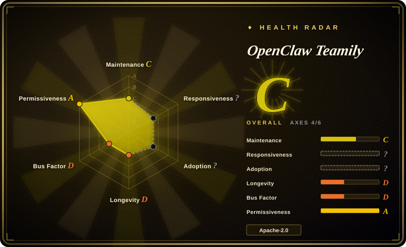
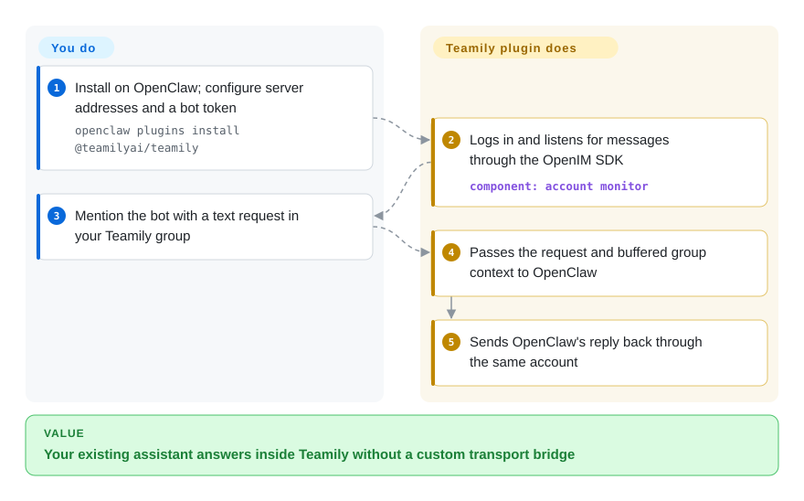
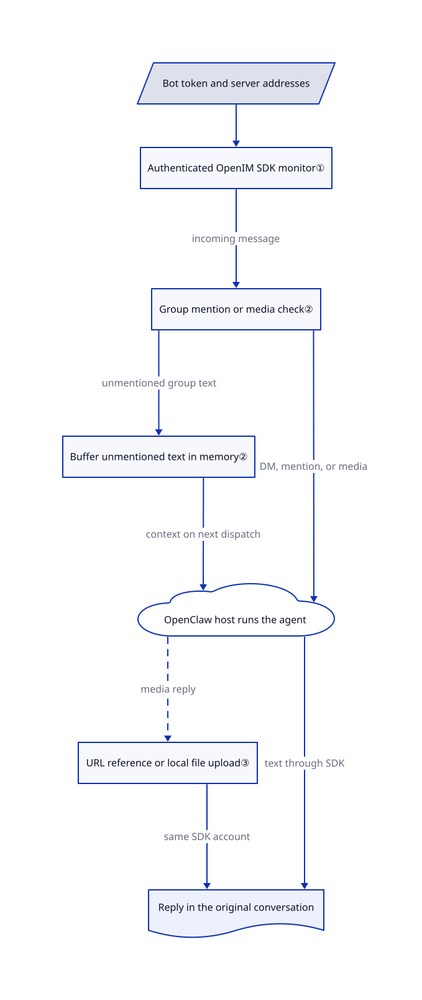

# OpenClaw Teamily

Your OpenClaw assistant cannot answer colleagues inside Teamily without a channel adapter. This plugin connects their messages and media to an existing OpenClaw Gateway; it does not contain the Teamily application or messaging server.

The [README](https://github.com/Teamily-Inc/openclaw-teamily/blob/8794b3cc2c3112a3b21c9a0c643cbaeb353f0941/README.md#L1-L3) directly links `teamily.ai`, and its example uses `imserver.teamily.ai`. That establishes the repository's stated integration target, not proof that a particular article describes this exact deployment. **License conflict:** the root [LICENSE](https://github.com/Teamily-Inc/openclaw-teamily/blob/8794b3cc2c3112a3b21c9a0c643cbaeb353f0941/LICENSE) is Apache-2.0, but README and package metadata say MIT. The frontmatter records the root text, not a resolved dual-license grant.

## When to use

You already operate an OpenClaw assistant and your team uses Teamily: colleagues paste a screenshot or mention the bot in a group, but the assistant only answers through another chat app. You can supply a bot user ID, token and compatible messaging endpoints. Choose this adapter rather than replacing the assistant or building the OpenIM-to-OpenClaw translation yourself: it supplies account configuration, real-time reception, session routing and outbound text/media delivery.

The deciding constraint is the existing Teamily deployment. For a new assistant with no such commitment, OpenClaw's other supported channels avoid this additional, quiet-since-April plugin. This is an integration component, not a way to obtain Teamily's client, server or built-in agent platform as open source.

## When NOT to use

- **You want the complete chat platform source.** Use [Rocket.Chat](../team-chat/rocket-chat.md) for an indexed self-hosted team-chat application. This repository contains a channel plugin, not Teamily's main program or a server deployment recipe.
- **A strict “no response unless mentioned” rule protects a busy group.** Prefer an OpenClaw channel whose mention and authorization behavior you have tested. Here, unmentioned text is buffered, but images, video and audio bypass that branch and reach reply dispatch; the README's blanket mention-only description is too strong.
- **Unknown senders must never reach host tools or private files.** Use an isolated [OpenClaw](../agent-frameworks/agent-runtimes/personal-assistants/messaging-daemons/openclaw.md) deployment with a verified channel policy and restricted tools. This plugin declares DM policy helpers, but its custom inbound path does not explicitly check an allowlist before dispatch. Do not treat configuration fields as proof of enforcement.
- **You need an independent Python assistant or an embeddable cross-platform bot API.** Choose [CowAgent](wechat/cowagent.md) for the former, or [Wechaty](wechat/wechaty.md) for the latter after checking its provider status. Neither is a drop-in Teamily transport; this plugin requires the OpenClaw host.
- **You require unambiguous permissive redistribution.** Evaluate an OpenClaw-supported channel whose complete dependency licenses fit your distribution. Resolve this repository's Apache/MIT disagreement first; its required `@openim/client-sdk@3.8.3` also [declares GPL-3.0-only](https://registry.npmjs.org/@openim%2Fclient-sdk/3.8.3).

## Comparison

These are alternative integration strategies, not three interchangeable Teamily adapters.

| Alternative | In index | Our verdict | Tradeoff |
|---|---|---|---|
| [OpenClaw, another supported channel](../agent-frameworks/agent-runtimes/personal-assistants/messaging-daemons/openclaw.md) | ✅ | Keep this plugin when users must stay in Teamily; choose another supported OpenClaw channel when changing the chat surface is acceptable and avoiding this stale adapter matters more. | The agent host stays the same, but users and credentials move to another platform; this repository adds no independent assistant runtime. |
| [CowAgent](wechat/cowagent.md) | ✅ | Choose CowAgent when you want to replace the assistant with a Python service and documented multi-channel setup; keep this plugin when preserving OpenClaw plus Teamily is the requirement. | CowAgent includes models, tools, memory and a web console, so migration replaces much more than transport; its indexed channel list does not establish Teamily support. |
| [Wechaty](wechat/wechaty.md) | ✅ | Choose Wechaty when you own bot logic above replaceable messaging providers; choose this adapter when OpenClaw should own reasoning and Teamily is already fixed. | Wechaty leaves application logic and provider selection to you, has an old stable release line, and is not evidence of a ready-made Teamily provider. |

## Quick start

On an existing OpenClaw installation, the README gives `openclaw plugins install @teamilyai/teamily`, then `openclaw channel configure teamily`. Supply the server addresses, bot `userID` and `token` under `channels.teamily`, and keep the Gateway, OpenClaw's always-on host process, running. Set addresses explicitly: the README shows hosted Teamily endpoints, while the configuration schema defaults to localhost; this plugin does not provision either server. After adding the bot to a group, mention it with a text request; the plugin passes the conversation to OpenClaw and sends the resulting reply back. You provide account access, model credentials and budget, host isolation and channel-policy testing; the plugin supplies transport, not a model or a security guarantee. These are source-verified instructions, not a live installation test.

<!-- flow-steps:begin (generated from flows/openclaw-teamily.json by tools/flow_card.py — do not edit) -->

Text version of the flow

1. **You**: Install on OpenClaw; configure server addresses and a bot token — `openclaw plugins install @teamilyai/teamily`
2. **OpenClaw Teamily**: Logs in and listens for messages through the OpenIM SDK — component: `account monitor`
3. **You**: Mention the bot with a text request in your Teamily group
4. **OpenClaw Teamily**: Passes the request and buffered group context to OpenClaw
5. **OpenClaw Teamily**: Sends OpenClaw's reply back through the same account

**Value**: Your existing assistant answers inside Teamily without a custom transport bridge

<!-- flow-steps:end -->

## Key techniques

<!-- mechanism:begin (generated from mechanisms/openclaw-teamily.json by tools/mechanism_card.py; do not edit) -->

Text version of the mechanism

- Bot token and server addresses
- Authenticated OpenIM SDK monitor①
- Group mention or media check②
- Buffer unmentioned text in memory②
- OpenClaw host runs the agent
- URL reference or local file upload③
- Reply in the original conversation

- Bot token and server addresses → Authenticated OpenIM SDK monitor①
- Authenticated OpenIM SDK monitor① → Group mention or media check② (incoming message)
- Group mention or media check② → Buffer unmentioned text in memory② (unmentioned group text)
- Group mention or media check② → OpenClaw host runs the agent (DM, mention, or media)
- Buffer unmentioned text in memory② → OpenClaw host runs the agent (context on next dispatch)
- OpenClaw host runs the agent → URL reference or local file upload③ (media reply) [optional/fallback]
- URL reference or local file upload③ → Reply in the original conversation (same SDK account)
- OpenClaw host runs the agent → Reply in the original conversation (text through SDK)

<!-- mechanism:end -->

### 1. Reuse one authenticated SDK connection for reception and sending

- **Problem:** A channel bridge needs a persistent connection, login state and a way to return results to the original conversation.
- **How:** The monitor loads the OpenIM client SDK, registers connection and incoming-message callbacks, then logs in with the configured REST and WebSocket addresses. An account-keyed monitor registry lets outbound methods reuse that SDK; the Gateway waits for login readiness before entering its long-running wait.
- **Limits:** Reconnection is delegated to the SDK, not implemented as a plugin-owned durable queue. Outbound sends require an active monitor; the repository has no tests or lockfile, and declares only a minimum OpenClaw peer version rather than proving compatibility with today's host.
- **Source:** [SDK callbacks and login](https://github.com/Teamily-Inc/openclaw-teamily/blob/8794b3cc2c3112a3b21c9a0c643cbaeb353f0941/src/monitor.ts#L105-L164), [monitor registry](https://github.com/Teamily-Inc/openclaw-teamily/blob/8794b3cc2c3112a3b21c9a0c643cbaeb353f0941/src/monitor.ts#L449-L485), [Gateway readiness](https://github.com/Teamily-Inc/openclaw-teamily/blob/8794b3cc2c3112a3b21c9a0c643cbaeb353f0941/src/channel.ts#L448-L461).

### 2. Buffer unmentioned text, but dispatch group media immediately

- **Problem:** A bot needs the group's preceding conversation without answering every ordinary text message.
- **How:** Each account keeps an in-memory map of group histories using OpenClaw's history-limit helper. Unmentioned text enters that map and returns early; a mention or media message proceeds to reply dispatch with buffered context, after which the history is cleared.
- **Limits:** The gate explicitly exempts pictures, video and audio. Context is not durable across process restarts, and the plugin does not establish a strict mention-only boundary or tenant isolation. Its DM security helper declaration is separate from this custom dispatch path; end-to-end enforcement remains untested.
- **Source:** [history, media exception and early return](https://github.com/Teamily-Inc/openclaw-teamily/blob/8794b3cc2c3112a3b21c9a0c643cbaeb353f0941/src/channel.ts#L271-L315), [context and dispatch](https://github.com/Teamily-Inc/openclaw-teamily/blob/8794b3cc2c3112a3b21c9a0c643cbaeb353f0941/src/channel.ts#L351-L445), [declared DM policy helper](https://github.com/Teamily-Inc/openclaw-teamily/blob/8794b3cc2c3112a3b21c9a0c643cbaeb353f0941/src/channel.ts#L153-L165).

### 3. Separate remote media references from local SDK uploads

- **Problem:** Returning a local artifact needs an upload, while an already hosted image can be sent by URL; video additionally needs metadata and a thumbnail.
- **How:** Outbound handlers distinguish local paths from HTTP URLs and choose SDK file or URL message constructors. Local video parses MP4/MOV duration and dimensions, invokes `ffmpeg` for a thumbnail, and falls back to a nonempty one-pixel JPEG; incoming media is fetched through host helpers with a 5 MiB limit.
- **Limits:** This is not a general media converter. Failed MP4 parsing gives zero metadata, thumbnail failure gives a placeholder, and inbound file messages are not converted despite outbound file support. Agent hints recommend copying otherwise blocked files into the workspace for sending, including OpenClaw configuration; do not follow that advice with secrets or treat workspace copying as authorization.
- **Source:** [outbound path split](https://github.com/Teamily-Inc/openclaw-teamily/blob/8794b3cc2c3112a3b21c9a0c643cbaeb353f0941/src/channel.ts#L189-L219), [inbound limit](https://github.com/Teamily-Inc/openclaw-teamily/blob/8794b3cc2c3112a3b21c9a0c643cbaeb353f0941/src/channel.ts#L328-L348), [video upload fallback](https://github.com/Teamily-Inc/openclaw-teamily/blob/8794b3cc2c3112a3b21c9a0c643cbaeb353f0941/src/monitor.ts#L267-L308), [inbound conversion](https://github.com/Teamily-Inc/openclaw-teamily/blob/8794b3cc2c3112a3b21c9a0c643cbaeb353f0941/src/monitor.ts#L409-L436), [unsafe file-copy hint](https://github.com/Teamily-Inc/openclaw-teamily/blob/8794b3cc2c3112a3b21c9a0c643cbaeb353f0941/src/channel.ts#L75-L79).

## Tech stack

- TypeScript ES modules, loaded through OpenClaw's plugin SDK; the entry registers one `teamily` channel.
- `@openim/client-sdk` for message transport and uploads; Zod for configuration validation.
- Node file and binary-buffer APIs; optional `ffmpeg` subprocess for local video thumbnails. No database or independent model runtime is implemented here.

## Dependencies

- OpenClaw peer requirement `>=2026.3.22`, plus a Node runtime compatible with the chosen host. The package has no independent `engines` declaration.
- A compatible Teamily/OpenIM messaging service, reachable REST and WebSocket endpoints, and a bot user/token; a self-hosted label does not supply the server source or deployment.
- Runtime packages `@openim/client-sdk ^3.8.3` and `zod ^4.3.6`. The SDK's registry license is GPL-3.0-only at 3.8.3; inspect the resolved package and distribution obligations separately from the plugin's root license.
- OpenClaw's model access, tool permissions and storage. Local video thumbnails optionally need `ffmpeg`; SDK uploads also use `File`, `Blob` and a plugin-provided global `FileReader` fallback.

## Ops difficulty

**Medium on an existing Gateway; higher if you also operate the messaging service.** Maintain bot tokens, endpoint availability, SDK/host compatibility and media storage access. Status probes use a five-second REST timeout, but channel status only checks `connected`, not the returned `userExists` flag. There are no reactions, threads or polls; message retries, retention, backups and secure tool access must not be assumed from the small plugin surface. Stop the channel before removal and revoke unused bot credentials; removal does not establish deletion of chat history, downloaded media or provider-held uploads.

## Health & viability

- **Maintenance, 2026-10-30:** all four visible commits are from 2026-04-02; the repository is not archived but has been quiet for about seven months. There are two version-named tags and no GitHub releases; manifest and npm latest both say `1.1.0`, while npm records the preceding commit as its `gitHead`.
- **Governance and adoption:** one GitHub contributor, four attributed commits, zero stars/forks, no issues or PRs, and no governance, contributing or security-policy files in the reviewed tree. Organization ownership is visible; it does not establish staffing, funding, support or production adoption.
- **Age and Lindy:** created 2026-04-02, only 211 days before verification. [推断：based on young age, one-day commit history and no subsequent maintenance] Treat it as inspectable integration code requiring a compatibility trial, not a durable platform commitment.
- **License and security:** the root Apache text conflicts with MIT metadata; the required SDK has a different copyleft declaration. The workspace-copy hint and media exception matter more to selection than the automated license-axis grade. Small source size makes review feasible, not unnecessary.

## Caveats (unverified)

- [未验证：static review only; no installation, login or model calls were authorized] Current OpenClaw compatibility, DM policy enforcement, multi-account SDK isolation, reconnection behavior and end-to-end text/media delivery were not reproduced.
- [未验证：no maintainer clarification or complete distribution rights audit] The Apache/MIT disagreement, dependency redistribution obligations and original authorship beyond exact-blob comparison remain unresolved; this is not legal clearance or a claim of deliberate mislicensing.
- [未验证：the specific article was not provided] README links establish `teamily.ai` as the stated integration target, not the identity of an article's product version, its internal architecture, source availability or self-hosted server offering.
- [推断：young repository, single contributor and no post-April commits] Treat the plugin as an integration candidate rather than a proven long-lived dependency; future maintenance could change that assessment.
