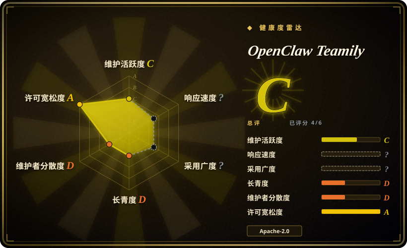
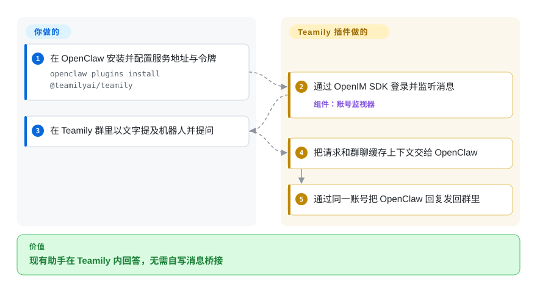
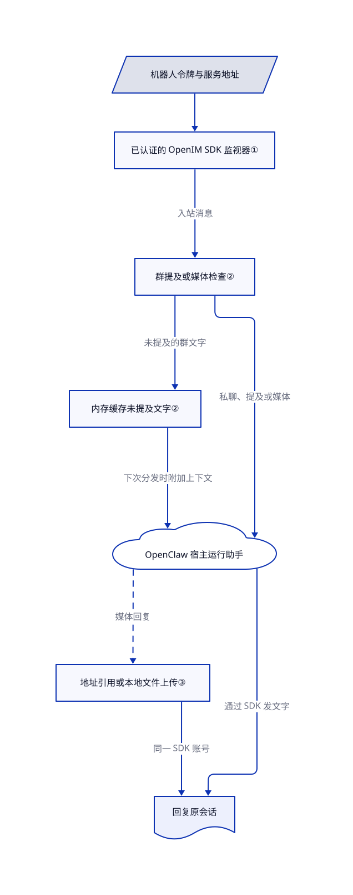

# OpenClaw Teamily

同事在 Teamily 群里提问，现有 OpenClaw 助手却收不到。这个插件把消息和媒体接进已有助手，不包含 Teamily 主程序或聊天服务器。

[README](https://github.com/Teamily-Inc/openclaw-teamily/blob/8794b3cc2c3112a3b21c9a0c643cbaeb353f0941/README.md#L1-L3) 直接链接 `teamily.ai`，示例端点使用 `imserver.teamily.ai`。这能确认仓库自述的集成对象，不能证明某篇文章说的就是这套部署。**许可有冲突：**根目录 [LICENSE](https://github.com/Teamily-Inc/openclaw-teamily/blob/8794b3cc2c3112a3b21c9a0c643cbaeb353f0941/LICENSE) 是 Apache-2.0，README 和包元数据却写 MIT。页头记录根许可正文，不代表已确认双重授权。

## 何时使用

你已经运行 OpenClaw 助手，团队又在使用 Teamily。同事往群里发截图、提及机器人，助手却只能在另一个聊天软件回答。你能提供机器人用户编号、令牌和兼容的聊天服务地址。此时选这个适配器，不必替换助手，也不必自己写 OpenIM 到 OpenClaw 的消息转换；它负责账号配置、实时接收、会话路由和文字／媒体发送。

决定性条件是已有 Teamily 部署。如果从零选助手且不绑定这个平台，OpenClaw 的其他受支持通道可以少维护一个自四月后未更新的插件。这是集成组件，不是获取 Teamily 客户端、服务器或内置智能体平台开源源码的途径。

## 何时不用

- **你要完整聊天平台的源码。** 选已收录的 [Rocket.Chat](../team-chat/rocket-chat.zh.md)，它才是可自托管的团队聊天应用。此仓只有通道插件，没有 Teamily 主程序或服务器部署方案。
- **群里必须严格做到“不提及就不响应”。** 优先选经过你实测提及与授权行为的 OpenClaw 通道。本插件缓存未提及机器人的文字，但图片、视频和音频会绕过这一分支，直接进入回复分发；README 的统一提及门控描述过强。
- **陌生人绝不能触及宿主工具和私密文件。** 选隔离的 [OpenClaw](../agent-frameworks/agent-runtimes/personal-assistants/messaging-daemons/openclaw.zh.md) 部署，验证通道策略并限制工具。本插件声明私聊策略辅助函数，但自定义入站路径没有在分发前显式检查允许名单；配置字段不等于执行证明。
- **你要独立 Python 助手，或可嵌入的跨平台机器人接口。** 前者选 [CowAgent](wechat/cowagent.zh.md)，后者在核查传输提供方状态后选 [Wechaty](wechat/wechaty.zh.md)。二者都不是即插即用的 Teamily 通道；本插件必须依赖 OpenClaw 宿主。
- **再分发必须具有明确的宽松许可。** 评估完整依赖许可符合交付要求的其他 OpenClaw 通道。先解决此仓 Apache／MIT 声明冲突；必需依赖 `@openim/client-sdk@3.8.3` 还[声明 GPL-3.0-only](https://registry.npmjs.org/@openim%2Fclient-sdk/3.8.3)。

## 横向对比

以下比较集成路线，不表示存在三个可以互换的 Teamily 适配器。

| 替代品 | 是否收录 | 我们的评价 | 取舍 |
|---|---|---|---|
| [OpenClaw 的其他受支持通道](../agent-frameworks/agent-runtimes/personal-assistants/messaging-daemons/openclaw.zh.md) | 已收录 | 用户必须留在 Teamily 时保留本插件；允许换聊天入口、又想少维护陈旧适配器时，选其他受支持通道。 | 助手宿主不变，但用户和凭据要迁到另一个平台；本仓不增加独立助手运行时。 |
| [CowAgent](wechat/cowagent.zh.md) | 已收录 | 想换成 Python 助手服务并使用文档列出的多通道配置时选 CowAgent；必须保留 OpenClaw 加 Teamily 时选本插件。 | CowAgent 连模型、工具、记忆和网页控制台一起提供，迁移范围远大于传输层；已收录通道清单不能证明它支持 Teamily。 |
| [Wechaty](wechat/wechaty.zh.md) | 已收录 | 想在可替换的聊天传输层之上自己写机器人逻辑时选 Wechaty；推理交给 OpenClaw、聊天平台已固定时选本插件。 | Wechaty 把应用逻辑与提供方选择交给你，但稳定版发布线较旧，也不能据此认为已有可用的 Teamily 提供方。 |

## 快速上手

在已有 OpenClaw 环境中，README 给出的安装命令是 `openclaw plugins install @teamilyai/teamily`，再运行 `openclaw channel configure teamily`。在 `channels.teamily` 下配置服务地址、机器人 `userID` 和 `token`，并保持 Gateway（OpenClaw 的常驻宿主进程）运行。请显式填写地址：README 使用 Teamily 托管端点，配置校验却默认指向本机；本插件不会替你部署任一服务器。把机器人加入群后，以文字提及它并提问；插件将对话交给 OpenClaw，再把回复发回群里。你负责账号权限、模型凭据与费用、宿主隔离和通道策略测试；插件只提供传输，不提供模型或安全保证。这些步骤经过源码核对，未作真实安装测试。

<!-- flow-steps:begin (generated from flows/openclaw-teamily.json by tools/flow_card.py — do not edit) -->

流程文字版

1. **你**：在 OpenClaw 安装并配置服务地址与令牌 — `openclaw plugins install @teamilyai/teamily`
2. **OpenClaw Teamily**：通过 OpenIM SDK 登录并监听消息 — 组件：`账号监视器`
3. **你**：在 Teamily 群里以文字提及机器人并提问
4. **OpenClaw Teamily**：把请求和群聊缓存上下文交给 OpenClaw
5. **OpenClaw Teamily**：通过同一账号把 OpenClaw 回复发回群里

**价值**：现有助手在 Teamily 内回答，无需自写消息桥接

<!-- flow-steps:end -->

## 技术要点

<!-- mechanism:begin (generated from mechanisms/openclaw-teamily.json by tools/mechanism_card.py; do not edit) -->

机制文字版

- 机器人令牌与服务地址
- 已认证的 OpenIM SDK 监视器①
- 群提及或媒体检查②
- 内存缓存未提及文字②
- OpenClaw 宿主运行助手
- 地址引用或本地文件上传③
- 回复原会话

- 机器人令牌与服务地址 → 已认证的 OpenIM SDK 监视器①
- 已认证的 OpenIM SDK 监视器① → 群提及或媒体检查②（入站消息）
- 群提及或媒体检查② → 内存缓存未提及文字②（未提及的群文字）
- 群提及或媒体检查② → OpenClaw 宿主运行助手（私聊、提及或媒体）
- 内存缓存未提及文字② → OpenClaw 宿主运行助手（下次分发时附加上下文）
- OpenClaw 宿主运行助手 → 地址引用或本地文件上传③（媒体回复）〔可选／兜底〕
- 地址引用或本地文件上传③ → 回复原会话（同一 SDK 账号）
- OpenClaw 宿主运行助手 → 回复原会话（通过 SDK 发文字）

<!-- mechanism:end -->

### 1. 收发复用已认证的 SDK 连接

- **解决：** 聊天桥接需要保持连接和登录状态，并把结果送回原会话。
- **做法：** 监视器加载 OpenIM 客户端 SDK，注册连接和入站消息回调，再用配置的接口与长连接地址登录。按账号索引的监视器表让发送方法复用同一 SDK；Gateway 等待登录就绪后才进入常驻等待。
- **边界：** 重连交给 SDK，不是插件自己实现的持久队列。发送依赖正在运行的监视器；仓库没有测试或锁文件，只声明 OpenClaw 最低版本，不能证明兼容当前宿主。
- **源码：** [SDK 回调与登录](https://github.com/Teamily-Inc/openclaw-teamily/blob/8794b3cc2c3112a3b21c9a0c643cbaeb353f0941/src/monitor.ts#L105-L164)、[监视器注册表](https://github.com/Teamily-Inc/openclaw-teamily/blob/8794b3cc2c3112a3b21c9a0c643cbaeb353f0941/src/monitor.ts#L449-L485)、[Gateway 就绪等待](https://github.com/Teamily-Inc/openclaw-teamily/blob/8794b3cc2c3112a3b21c9a0c643cbaeb353f0941/src/channel.ts#L448-L461)。

### 2. 缓存未提及文字，却立即分发群媒体

- **解决：** 机器人需要群聊前文，但不应该回答每条普通文字。
- **做法：** 每个账号维护内存中的群历史表，沿用 OpenClaw 的历史条数限制辅助函数。未提及机器人的纯文字写入缓存并提前返回；提及或媒体消息则携带缓存上下文进入回复分发，之后清除历史。
- **边界：** 这一条件明确排除图片、视频和音频。进程重启不保留缓存，插件也不构成严格的提及边界或租户隔离。私聊策略辅助函数的声明独立于自定义分发路径，端到端执行效果未实测。
- **源码：** [历史、媒体例外与提前返回](https://github.com/Teamily-Inc/openclaw-teamily/blob/8794b3cc2c3112a3b21c9a0c643cbaeb353f0941/src/channel.ts#L271-L315)、[上下文与分发](https://github.com/Teamily-Inc/openclaw-teamily/blob/8794b3cc2c3112a3b21c9a0c643cbaeb353f0941/src/channel.ts#L351-L445)、[私聊策略辅助函数声明](https://github.com/Teamily-Inc/openclaw-teamily/blob/8794b3cc2c3112a3b21c9a0c643cbaeb353f0941/src/channel.ts#L153-L165)。

### 3. 区分远端媒体引用与本地 SDK 上传

- **解决：** 返回本地产物需要上传，已经托管的图片可以直接发地址；视频还需要时长、尺寸和缩略图。
- **做法：** 发送处理器区分本地路径与 HTTP 地址，再选择 SDK 的文件或地址消息构造器。本地视频解析 MP4／MOV 时长和尺寸，调用 `ffmpeg` 取缩略图，失败时用非空的单像素 JPEG；入站媒体通过宿主辅助函数下载，上限为 5 MiB。
- **边界：** 这不是通用转码器。MP4 解析失败得到零元数据，缩略图失败使用占位图；支持发送文件，却不转换入站文件消息。给模型的提示建议把被阻止的文件复制进工作区再发送，示例包含 OpenClaw 配置；不能对密钥照做，也不能把复制当成授权。
- **源码：** [发送路径分流](https://github.com/Teamily-Inc/openclaw-teamily/blob/8794b3cc2c3112a3b21c9a0c643cbaeb353f0941/src/channel.ts#L189-L219)、[入站上限](https://github.com/Teamily-Inc/openclaw-teamily/blob/8794b3cc2c3112a3b21c9a0c643cbaeb353f0941/src/channel.ts#L328-L348)、[视频上传回退](https://github.com/Teamily-Inc/openclaw-teamily/blob/8794b3cc2c3112a3b21c9a0c643cbaeb353f0941/src/monitor.ts#L267-L308)、[入站转换](https://github.com/Teamily-Inc/openclaw-teamily/blob/8794b3cc2c3112a3b21c9a0c643cbaeb353f0941/src/monitor.ts#L409-L436)、[不安全的复制提示](https://github.com/Teamily-Inc/openclaw-teamily/blob/8794b3cc2c3112a3b21c9a0c643cbaeb353f0941/src/channel.ts#L75-L79)。

## 技术栈

- TypeScript ES 模块，通过 OpenClaw 插件 SDK 加载；入口注册一个 `teamily` 通道。
- `@openim/client-sdk` 处理消息传输与上传，Zod 校验配置。
- Node 文件和二进制缓冲区接口；可选调用 `ffmpeg` 子进程生成本地视频缩略图。此仓不实现数据库或独立模型运行时。

## 依赖

- OpenClaw 对等依赖要求 `>=2026.3.22`，Node 版本按所选宿主要求配置。本包没有独立的 `engines` 声明。
- 兼容的 Teamily／OpenIM 聊天服务、可达的接口和长连接地址，以及机器人账号和令牌。“自托管”标签不等于提供服务器源码或部署方案。
- 运行依赖 `@openim/client-sdk ^3.8.3` 与 `zod ^4.3.6`。SDK 在 3.8.3 的包登记许可是 GPL-3.0-only；须独立核查解析后的依赖包与再分发义务，不能只看插件根许可。
- OpenClaw 的模型接入、工具权限和存储。本地视频缩略图可选依赖 `ffmpeg`；SDK 上传还使用 `File`、`Blob` 和插件补入全局的 `FileReader` 回退实现。

## 运维难度

**已有 Gateway 时中等，同时维护聊天服务时更高。** 要维护机器人令牌、端点可用性、SDK／宿主兼容和媒体存储访问。状态探测设置五秒接口超时，但通道状态只检查 `connected`，不检查返回的 `userExists`。不支持表情回应、话题串或投票；不能从插件体量小推导出已有消息重试、留存、备份或安全工具边界。移除前先停通道并撤销闲置令牌；移除插件不代表会删除聊天历史、下载媒体或服务端上传产物。

## 健康度与可持续性

- **维护情况，截至 2026-10-30：**四次可见提交都在 2026-04-02。仓库未归档，但已约七个月没有新提交。有两个版本命名标签，没有 GitHub release；清单和 npm 最新版本均为 `1.1.0`，但 npm 的 `gitHead` 指向前一提交。
- **治理与采用：**GitHub 只有一位贡献者、四次归属提交、零星标和分叉，没有 issue 或 PR。所读树没有治理、贡献或安全政策文件。只能确认组织持有，不能据此证明人员、资金、支持承诺或生产采用。
- **年龄与林迪判断：**仓库创建于 2026-04-02，距核验日仅 211 天。[推断：依据是年轻仓龄、集中在一天的提交与后续静默] 应把它当作待兼容性试验的集成代码，而非长期平台承诺。
- **许可与安全：**根 Apache 正文和 MIT 元数据冲突，必需 SDK 另有 copyleft 声明。工作区复制提示和群媒体例外，比自动许可轴分数更影响选型。源码少便于检查，不代表无需检查。

## 存疑（未验证）

- [未验证：仅静态阅读，未获安装、登录或模型调用授权] 未复现当前 OpenClaw 兼容性、私聊策略执行、多账号 SDK 隔离、重连和文字／媒体端到端收发。
- [未验证：没有维护者澄清，也未完成完整分发权利审计] Apache／MIT 冲突、依赖再分发义务及精确文件比对之外的原始作者链尚未解决；本页不是法律放行，也不指控蓄意错标许可。
- [未验证：未提供具体文章] README 能证明仓库自述接入 `teamily.ai`，不能确认文章对应的产品版本、内部架构、主程序源码可用性或自托管服务器供给。
- [推断：依据是年轻仓龄、单贡献者与四月后无提交] 当前把插件视为集成候选，而非已证实的长期依赖；后续维护可能改变判断。
