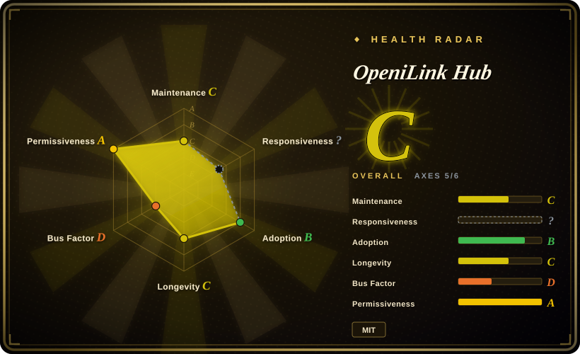
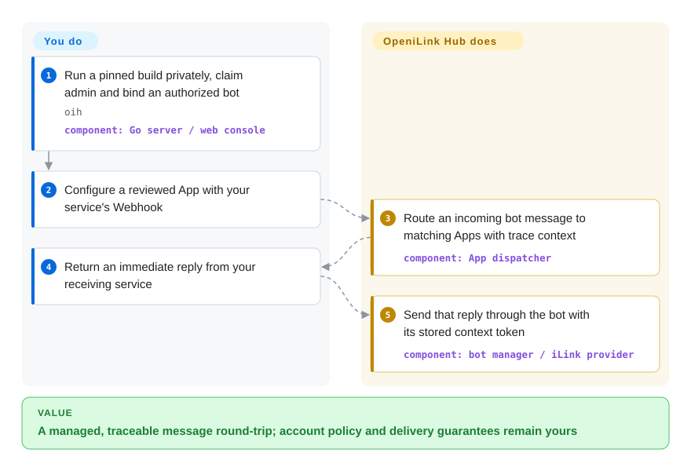
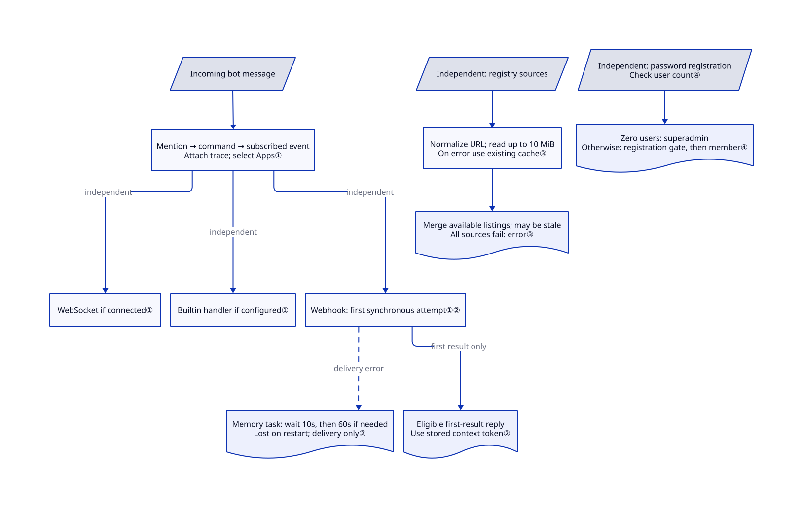

# OpeniLink Hub

Several WeChat bots forward messages to different services and you cannot see which handoff failed; OpeniLink Hub centralizes their routing and traces, but adds a sensitive management plane without official iLink affiliation.

## When to use

You're operating several iLink-connected WeChat bots and need more than a raw SDK loop. You want one web console for QR binding, users, bot status, message history, trace inspection, AI replies, WebSocket/Webhook delivery, and installable Apps. You also want to begin with an embedded SQLite database and local storage, then move to PostgreSQL and S3-compatible storage when the deployment grows.

Choose OpeniLink Hub over `openilink-sdk-go` or a focused relay when the management plane and App lifecycle are the deciding requirements. Choose a raw SDK when you have one integration and want to own the smallest possible trust boundary; Hub's value comes from centralization, and so do its authentication, registry, storage, and multi-user risks.

## When NOT to use

- **You need an officially affiliated or vendor-supported product.** Use WeCom or another documented Tencent API surface instead; OpeniLink Hub states that it is independently developed from publicly available iLink information and is neither affiliated with nor endorsed by iLink's official team.
- **Your workflow must send proactively after the iLink context window expires.** Use an official Tencent channel whose outbound-message policy matches the requirement; Hub treats context tokens older than 24 hours as unsendable and can only remind an operator before expiry, not renew the window silently.
- **You only need one narrow bridge or a library inside your own service.** Use `openilink-sdk-go`, another language SDK, or `openilink-tg` instead; Hub adds a web application, database schema, auth system, message broker, tracing, and App lifecycle that a single relay may not need.
- **You want a turnkey public multi-tenant service with safe defaults.** Put an identity-aware proxy such as oauth2-proxy or a VPN in front and complete bootstrap privately before exposing Hub; public registration defaults to enabled, the first registrant becomes `superadmin`, `RP_ORIGIN`/`RP_ID` must match the external origin, and `SECRET` defaults to `change-me-in-production`.
- **You cannot audit third-party integrations or let remote manifests expand the trust boundary.** Use a pinned custom Webhook/App or a hand-reviewed local service instead of enabling arbitrary Registry sources; Registry records can introduce remote app metadata, webhook and OAuth endpoints, tools, events, and scopes.
- **You need a mature platform with years of protocol and upgrade history.** Use an official WeCom integration or another established messaging stack; OpeniLink Hub was created in 2026-03, remains on `v0.1.x`, and has not yet earned a long-lived compatibility record.
- **You need native Windows without containers or WSL.** Use a platform-native service or run the relevant SDK inside your existing Windows application; the project documents Linux/macOS binaries and Docker or WSL2 for Windows.

## Comparison

| Alternative | In index | Our verdict | Tradeoff |
|---|---|---|---|
| [openilink-sdk-go](openilink-sdk-go.md) | ✅ | When you need iLink transport inside an existing Go service, choose the SDK; choose OpeniLink Hub when users, multiple bots, traces, Apps, and a web control plane are requirements rather than code you want to build. | The SDK keeps the process and trust boundary small but leaves persistence, auth, routing, and operations to you; Hub supplies those layers and makes them your operational responsibility. |
| [openilink-tg](https://github.com/openilink/openilink-tg) | not indexed | Choose it when an existing client speaks Telegram-Bot-style HTTP and must send text through iLink; choose Hub for users, multiple bots and installable Apps. | Its documented initial scope is an HTTP compatibility adapter, not a complete WeChat-to-Telegram conversation relay. Hub has a much broader administration boundary. |
| [WeChat Bot](wechat/wechat-bot.md) | ✅ | When you want a developer-operated CLI that sends IM messages directly to several LLM backends and channels, choose WeChat Bot; choose OpeniLink Hub when persistent multi-user administration and App distribution matter more. | WeChat Bot is a lighter assistant application but uses an unofficial Wechaty personal-account path; Hub has a broader control plane and iLink dependency, with more database and auth surface. |
| WeCom / Official WeChat APIs | not a repo | When an official enterprise or public-account contract decides the choice, evaluate the official API surface rather than assuming Hub is endorsed. | These are platform API offerings, not one open-source repository; they cover different account and messaging workflows. |

## Quick start

Obtain a pinned release binary, or use the frontend build and `go build -o oih .` sequence in [README.md:334–339](https://github.com/openilink/openilink-hub/blob/1df2ebebb69a5099e94b3f254f069aca5e272eed/README.md#L334-L339), then run `oih`. Set `LISTEN` to a private/loopback boundary and claim the first administrator before exposing it: the documented default listens on `:9800`, and first registration grants `superadmin`; configure `RP_ORIGIN` and `RP_ID` for the address your browser actually uses. In an authorized account workflow, bind the bot, create or install a reviewed App, and supply its Webhook—your service's HTTP callback—or WebSocket connection. An incoming message is routed to matching Apps with a trace, and an immediate Webhook result can be sent back through the bot using stored context. Hub does the management and delivery plumbing; you own account permission, App services, recipient deduplication, retention and the 24-hour reply window, which reminders cannot silently renew. For App development without an account, the README also documents `cmd/appmock`; this entry ran neither it nor a real binding.

<!-- flow-steps:begin (generated from flows/openilink-hub.json by tools/flow_card.py — do not edit) -->

Text version of the flow

1. **You**: Run a pinned build privately, claim admin and bind an authorized bot — `oih` — component: `Go server / web console`
2. **You**: Configure a reviewed App with your service's Webhook
3. **OpeniLink Hub**: Route an incoming bot message to matching Apps with trace context — component: `App dispatcher`
4. **You**: Return an immediate reply from your receiving service
5. **OpeniLink Hub**: Send that reply through the bot with its stored context token — component: `bot manager / iLink provider`

**Value**: A managed, traceable message round-trip; account policy and delivery guarantees remain yours

<!-- flow-steps:end -->

## Key techniques

<!-- mechanism:begin (generated from mechanisms/openilink-hub.json by tools/mechanism_card.py; do not edit) -->

Text version of the mechanism

- Incoming bot message
- Mention → command → subscribed event; Attach trace; select Apps①
- WebSocket if connected①
- Builtin handler if configured①
- Webhook: first synchronous attempt①②
- Memory task: wait 10s, then 60s if needed; Lost on restart; delivery only②
- Eligible first-result reply; Use stored context token②
- Independent: registry sources
- Normalize URL; read up to 10 MiB; On error use existing cache③
- Merge available listings; may be stale; All sources fail: error③
- Independent: password registration; Check user count④
- Zero users: superadmin; Otherwise: registration gate, then member④

- Incoming bot message → Mention → command → subscribed event; Attach trace; select Apps①
- Mention → command → subscribed event; Attach trace; select Apps① → WebSocket if connected① (independent)
- Mention → command → subscribed event; Attach trace; select Apps① → Builtin handler if configured① (independent)
- Mention → command → subscribed event; Attach trace; select Apps① → Webhook: first synchronous attempt①② (independent)
- Webhook: first synchronous attempt①② → Memory task: wait 10s, then 60s if needed; Lost on restart; delivery only② (delivery error) [optional/fallback]
- Webhook: first synchronous attempt①② → Eligible first-result reply; Use stored context token② (first result only)
- Independent: registry sources → Normalize URL; read up to 10 MiB; On error use existing cache③
- Normalize URL; read up to 10 MiB; On error use existing cache③ → Merge available listings; may be stale; All sources fail: error③
- Independent: password registration; Check user count④ → Zero users: superadmin; Otherwise: registration gate, then member④

<!-- mechanism:end -->

### 1. Prioritize directed messages, then fan out through independent channels

- **Problem:** A message addressed to one App should not also take the generic subscription route, while each configured transport still needs its own delivery attempt.
- **How:** The dispatcher tries a specific mention, then a slash command, then subscribed message events, stopping route selection when a directed match is handled. For each selected App, WebSocket, the builtin handler and Webhook run independently when configured, with trace data that links the handoff records.
- **Limits:** Independent channels can deliver the same event more than once, so recipients need deduplication. A trace helps locate failure; it is not an end-to-end delivery guarantee.
- **Source:** [app_dispatch.go:25–114](https://github.com/openilink/openilink-hub/blob/1df2ebebb69a5099e94b3f254f069aca5e272eed/internal/bot/app_dispatch.go#L25-L114), [independent channels:117–200](https://github.com/openilink/openilink-hub/blob/1df2ebebb69a5099e94b3f254f069aca5e272eed/internal/bot/app_dispatch.go#L117-L200).

### 2. Retry delivery without extending the immediate reply path

- **Problem:** Waiting through every Webhook retry would delay the original message handler.
- **How:** Hub makes one synchronous attempt; on failure a background goroutine, a lightweight Go task, waits 10 seconds and retries, then waits another 60 seconds if needed. The dispatcher processes the first result separately and uses the stored context token for an eligible immediate reply.
- **Limits:** Scheduled retries live only in memory and disappear on process restart; successful retry delivery does not invoke that immediate-reply handler. Async results and empty text replies are also not sent through its synchronous text path.
- **Source:** [retry.go:14–81](https://github.com/openilink/openilink-hub/blob/1df2ebebb69a5099e94b3f254f069aca5e272eed/internal/app/retry.go#L14-L81), [first-result handling:179–200](https://github.com/openilink/openilink-hub/blob/1df2ebebb69a5099e94b3f254f069aca5e272eed/internal/bot/app_dispatch.go#L179-L200), [reply handling:259–290](https://github.com/openilink/openilink-hub/blob/1df2ebebb69a5099e94b3f254f069aca5e272eed/internal/bot/app_dispatch.go#L259-L290).

### 3. Keep discovery available with bounded reads and stale-cache fallback

- **Problem:** One unavailable App registry should not erase every other source's listings.
- **How:** The client normalizes registry URLs, reads at most 10 MiB and caches parsed manifests, the lists describing available Apps. Fetch/HTTP/read/parse failures return an existing cache; aggregation skips failed sources and errors if all sources fail without a usable result.
- **Limits:** Cached success can hide stale listings, and the byte limit is not a trust check. Discovering an App does not audit its remote endpoints, tools or permission scopes.
- **Source:** [client.go:79–108](https://github.com/openilink/openilink-hub/blob/1df2ebebb69a5099e94b3f254f069aca5e272eed/internal/registry/client.go#L79-L108), [cache/fetch handling:130–183](https://github.com/openilink/openilink-hub/blob/1df2ebebb69a5099e94b3f254f069aca5e272eed/internal/registry/client.go#L130-L183).

### 4. Assign bootstrap authority from the user count

- **Problem:** A fresh instance needs an initial administrator before ordinary membership exists.
- **How:** Password registration assigns `superadmin` when the user count is zero; later registrations become members and check the registration switch. That switch defaults to enabled unless its stored value is exactly `false`, and the first-user path bypasses the closed-registration check.
- **Limits:** This is convenient bootstrap, not public hardening; claim the instance privately before exposing it. Registry discovery and administrator bootstrap are separate mechanisms, not mandatory steps of each message delivery.
- **Source:** [auth_password.go:37–61](https://github.com/openilink/openilink-hub/blob/1df2ebebb69a5099e94b3f254f069aca5e272eed/internal/api/auth_password.go#L37-L61), [config_handler.go:236–243](https://github.com/openilink/openilink-hub/blob/1df2ebebb69a5099e94b3f254f069aca5e272eed/internal/api/config_handler.go#L236-L243).

## Tech stack

- **Backend:** Go 1.25 with a single `oih` server binary, `gorilla/websocket`, the OpeniLink Go SDK, WebAuthn, OAuth/OIDC, and an internal message broker and App dispatcher.
- **Frontend:** embedded React 19, Vite, TypeScript, and Tailwind CSS web console.
- **Data stores:** embedded SQLite through `modernc.org/sqlite` by default, or PostgreSQL through `pgx`; schema changes are represented by migrations for both paths.
- **Media storage:** optional local filesystem storage through `STORAGE_PATH`, optional MinIO/S3-compatible storage, or provider CDN proxy fallback when neither is configured.
- **Extension plane:** built-in Apps, custom Apps, remote Registry sources, WebSocket and Webhook event delivery, App OAuth with PKCE, commands/tools, and AI auto-reply.
- **Observability:** persisted messages, webhook/App logs, and per-message trace data exposed through the web console and APIs.

## Dependencies

- **Minimal local deployment:** the released binary or Docker image, a browser, writable local data storage, and the embedded SQLite database.
- **iLink connection:** a compatible WeChat/iLink account that can complete QR binding, plus outbound network access to the provider service.
- **Public deployment:** HTTPS termination and correctly configured `RP_ORIGIN` and `RP_ID` for WebAuthn, OAuth callbacks, generated media URLs, and browser-origin checks.
- **Production database:** PostgreSQL is optional through `DATABASE_URL`; SQLite remains the lowest-ops path for a single-node installation.
- **Media:** local filesystem storage is optional through `STORAGE_PATH`; S3/MinIO requires endpoint, access key, secret key, bucket, and public/proxy URL decisions.
- **Apps and AI:** remote Apps may require their own services, OAuth credentials, webhook reachability, and third-party platform permissions; AI replies require an OpenAI-compatible endpoint and key.

## Ops difficulty

**Medium for a private single-node install; high for an internet-facing multi-user platform.** The binary plus SQLite path is unusually simple for the feature set. Production operation adds HTTPS and origin correctness, database backup and migration, media retention, optional PostgreSQL/S3, bot reconnection and 24-hour-window reminders, OAuth credentials, App and Registry review, webhook reachability, message privacy, and role administration. Bootstrap deserves special handling: registration is enabled when the setting is absent, and the first created user is promoted to `superadmin`, so the service should not be exposed before the operator claims and hardens it.

## Health & viability

- **Measured signals (2026-10-14):** C/?/B/C/D/A, overall C with 5/6 axes scored, down from B. Responsiveness changed from A to natural `no_window_signal`: the 90-day window ending 13 days before scoring has traffic but no qualifying response; no API failure was reported.
- **Maintenance:** created in 2026-03, latest release v0.1.36 on 2026-06-18, and no default-branch change since then. At 118 days since the last commit, early release history is not evidence of current active iteration.
- **Adoption:** 1589 stars show attention, not deployment success. The machine's B adoption combines a registry-dependent signal with D release/container install signals; do not turn its 1200 dependent-repository count into a count of operating Hub instances.
- **Governance:** the repository is under an organization and has several contributors, but GitHub contribution counts are heavily dominated by one maintainer. There is no foundation governance or long operating record to reduce bus-factor risk yet.
- **Age and Lindy:** measured age 206 days, with recent silence. The short public record and v0.1.x line do not establish long-lived protocol or upgrade stability.
- **Risk posture:** the decisive risks are the project's explicit non-affiliation disclaimer, the 24-hour send window, first-user-superadmin bootstrap, public-registration default, WebAuthn origin configuration, remote App Registry trust, and the amount of sensitive message and credential state centralized in one service.

## Caveats (unverified)

- [未验证：抽样窗口无合格首响] Current support speed is unknown in the 90-day window ending 13 days before 2026-10-14 scoring. Keep natural `no_window_signal`, not the old A, under the explicit phase ruling.
- [未验证：未运行App或绑定微信] Delivery retry/restart behavior, receiving-service deduplication and current account compatibility were not exercised; source-visible traces and retries are not an end-to-end delivery guarantee.

- [未验证] No independent production deployment, sustained throughput test, disaster-recovery exercise, or multi-version upgrade test was performed for this page.
- [未验证] The current policy stability and long-term availability of the underlying iLink surface were not verified from an official protocol specification; the repository itself disclaims official affiliation or endorsement.
- [未验证] Registry Apps, their OAuth scopes, remote services, data retention, and maintainers were not audited individually. An enabled Registry is a discovery mechanism, not a security review.
- [未验证] The v0.1.36 tree defines `SECRET` as a server secret for token encryption and defaults it to `change-me-in-production`, but a text-level source search did not establish an active consumer outside configuration; its effective security role requires version-specific review.
- [推断] Exposing an unclaimed instance creates a bootstrap takeover risk because registration defaults to enabled and the first user becomes `superadmin`; operators should claim the instance on a private boundary before public routing.
- [推断] The project's rapid early release cadence may include breaking behavior despite version tags; no compatibility policy or long-term support commitment was found in the reviewed repository.
