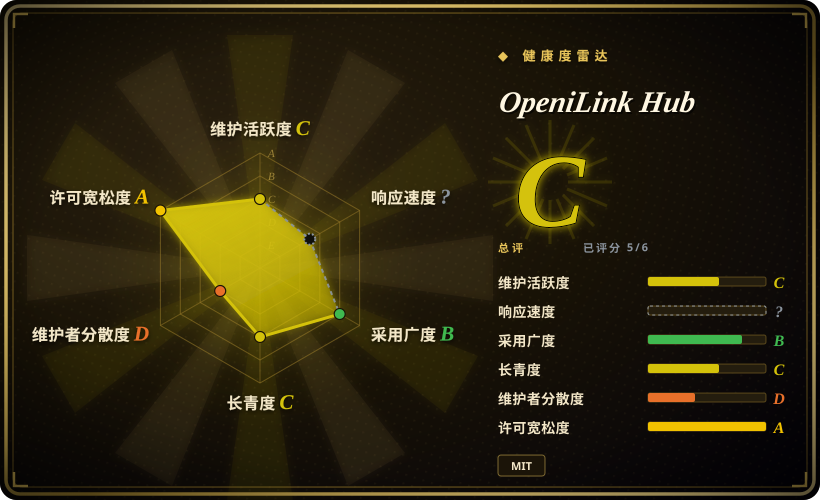
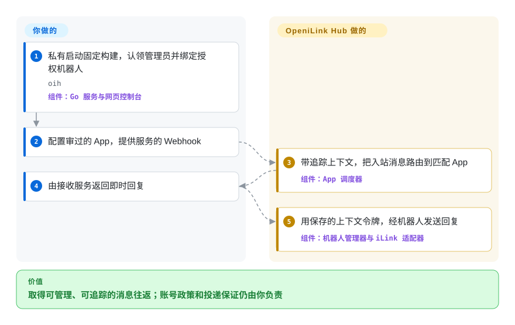
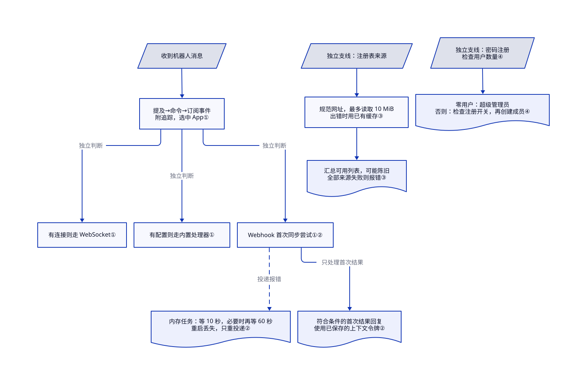

# OpeniLink Hub

几个微信机器人各自转发消息，失败时你不知道卡在哪；OpeniLink Hub 集中路由和追踪，但增加了敏感管理面，也没有 iLink 官方关联。

## 何时使用

你在运行多个接入 iLink 的微信 Bot，需要的不只是一个 SDK 收发循环。你希望用同一个 Web 控制台完成扫码绑定、用户管理、Bot 状态、消息历史、链路追踪、AI 回复、WebSocket／Webhook 分发和 App 安装。你还想先用内嵌 SQLite 与本地存储起步，规模扩大后再切到 PostgreSQL 和 S3-compatible storage。

当管理面与 App lifecycle 是决定条件时，才应在 `openilink-sdk-go` 或专用 relay 之上选择 OpeniLink Hub。如果只有一个 integration，并希望自己控制最小信任边界，直接使用 SDK 更合适；Hub 的价值来自集中化，认证、Registry、存储与多用户风险也来自同一处。

## 何时不用

- **你需要官方关联或厂商支持的产品。** 改用企业微信或其他有腾讯文档支持的 API 面；OpeniLink Hub 声明它根据公开 iLink 信息独立开发，与 iLink 官方团队没有关联，也没有获得背书。
- **流程必须在 iLink context window 过期后主动发消息。** 改用 outbound policy 符合需求的腾讯官方通道；Hub 会把超过 24 小时的 context token 判为不可发送，只能在到期前提醒运营者，不能静默续期。
- **你只需要一个窄桥接或嵌入现有服务的 library。** 改用 `openilink-sdk-go`、其他语言 SDK，或 `openilink-tg`；Hub 会额外引入 Web 应用、数据库 schema、认证系统、消息 broker、trace 和 App lifecycle。
- **你想把它当作默认安全的公网多租户服务。** 先用 oauth2-proxy 这类 identity-aware proxy 或 VPN 隔离，并在私有边界完成 bootstrap；公开注册默认启用，首个注册者会成为 `superadmin`，`RP_ORIGIN`／`RP_ID` 必须匹配外部 origin，`SECRET` 默认还是 `change-me-in-production`。
- **你无法审计第三方 integration，也不能让远程 manifest 扩大信任边界。** 改用 pin 版本的 custom Webhook／App，或人工审过的本地服务，不要启用任意 Registry source；Registry record 可以引入远程 App metadata、webhook 与 OAuth endpoint、tools、events 和 scopes。
- **你需要已经积累多年协议与升级历史的平台。** 改用企业微信官方 integration 或其他成熟消息栈；OpeniLink Hub 创建于 2026-03，仍处于 `v0.1.x`，尚未形成长期 compatibility record。
- **你需要不借助 container 或 WSL 的原生 Windows 运行。** 改用 platform-native service，或把相关 SDK 嵌入已有 Windows 应用；项目文档只提供 Linux／macOS binary，以及 Windows 上的 Docker 或 WSL2 路径。

## 横向对比

| 替代品 | 是否收录 | 我们的评价 | 取舍 |
|---|---|---|---|
| [openilink-sdk-go](openilink-sdk-go.zh.md) | ✅ | 如果只要把 iLink transport 嵌入现有 Go 服务，选 SDK；如果用户、多 Bot、trace、App 和 Web 控制面都是需求，选 OpeniLink Hub。 | SDK 保持较小的进程与信任边界，但持久化、认证、routing 和运维都要自己实现；Hub 提供这些层，也把它们变成你的运维责任。 |
| [openilink-tg](https://github.com/openilink/openilink-tg) | 未收录 | 现有客户端使用 Telegram Bot 风格 HTTP，却要经 iLink 发文本时选它；需要用户、多机器人和可安装 App 时选 Hub。 | 文档首版是 HTTP 兼容适配器，不是完整的微信到 Telegram 对话转发器；Hub 管理边界宽得多。 |
| [WeChat Bot](wechat/wechat-bot.zh.md) | 已收录 | 如果要开发者自己操作的 CLI，把多个 IM 通道直接接到多个 LLM backend，选 WeChat Bot；如果更看重持久化多用户管理和 App 分发，选 OpeniLink Hub。 | WeChat Bot 是较轻的 assistant application，但个人微信走非官方 Wechaty 路径；Hub 控制面更广，并承担 iLink、数据库和认证风险。 |
| 企业微信／微信官方 API | 非仓库 | 官方企业或公众账号契约决定选型时，评估官方接口，不要假定 Hub 得到背书。 | 这是平台接口产品，不是一个开源仓库；账号和消息工作流不同。 |

## 快速上手

取得固定发布版二进制，或按 [README.md:334–339](https://github.com/openilink/openilink-hub/blob/1df2ebebb69a5099e94b3f254f069aca5e272eed/README.md#L334-L339) 构建前端并执行 `go build -o oih .`，再运行 `oih`。把 `LISTEN` 设为私有或回环边界，先认领首个管理员再公开服务：文档默认监听 `:9800`，首次注册授予 `superadmin`；`RP_ORIGIN`、`RP_ID` 必须匹配浏览器实际地址。在授权账号流程中绑定机器人，创建或安装审过的 App，提供 Webhook——你的服务接收消息的 HTTP 回调——或 WebSocket 连接。入站消息带追踪路由到匹配 App，即时 Webhook 结果可通过保存的上下文发回机器人。Hub 提供管理与投递管道；账号权限、App 服务、接收端去重、留存和 24 小时回复窗口由你负责，提醒不能静默续期。不绑定账号的 App 开发还可用 README 中的 `cmd/appmock`；本页没有运行它或实际绑定。

<!-- flow-steps:begin (generated from flows/openilink-hub.json by tools/flow_card.py — do not edit) -->

流程文字版

1. **你**：私有启动固定构建，认领管理员并绑定授权机器人 — `oih` — 组件：`Go 服务与网页控制台`
2. **你**：配置审过的 App，提供服务的 Webhook
3. **OpeniLink Hub**：带追踪上下文，把入站消息路由到匹配 App — 组件：`App 调度器`
4. **你**：由接收服务返回即时回复
5. **OpeniLink Hub**：用保存的上下文令牌，经机器人发送回复 — 组件：`机器人管理器与 iLink 适配器`

**价值**：取得可管理、可追踪的消息往返；账号政策和投递保证仍由你负责

<!-- flow-steps:end -->

## 技术要点

<!-- mechanism:begin (generated from mechanisms/openilink-hub.json by tools/mechanism_card.py; do not edit) -->

机制文字版

- 收到机器人消息
- 提及→命令→订阅事件； 附追踪，选中 App①
- 有连接则走 WebSocket①
- 有配置则走内置处理器①
- Webhook 首次同步尝试①②
- 内存任务：等 10 秒，必要时再等 60 秒； 重启丢失，只重投递②
- 符合条件的首次结果回复； 使用已保存的上下文令牌②
- 独立支线：注册表来源
- 规范网址，最多读取 10 MiB； 出错时用已有缓存③
- 汇总可用列表，可能陈旧； 全部来源失败则报错③
- 独立支线：密码注册； 检查用户数量④
- 零用户：超级管理员； 否则：检查注册开关，再创建成员④

- 收到机器人消息 → 提及→命令→订阅事件； 附追踪，选中 App①
- 提及→命令→订阅事件； 附追踪，选中 App① → 有连接则走 WebSocket①（独立判断）
- 提及→命令→订阅事件； 附追踪，选中 App① → 有配置则走内置处理器①（独立判断）
- 提及→命令→订阅事件； 附追踪，选中 App① → Webhook 首次同步尝试①②（独立判断）
- Webhook 首次同步尝试①② → 内存任务：等 10 秒，必要时再等 60 秒； 重启丢失，只重投递②（投递报错）〔可选／兜底〕
- Webhook 首次同步尝试①② → 符合条件的首次结果回复； 使用已保存的上下文令牌②（只处理首次结果）
- 独立支线：注册表来源 → 规范网址，最多读取 10 MiB； 出错时用已有缓存③
- 规范网址，最多读取 10 MiB； 出错时用已有缓存③ → 汇总可用列表，可能陈旧； 全部来源失败则报错③
- 独立支线：密码注册； 检查用户数量④ → 零用户：超级管理员； 否则：检查注册开关，再创建成员④

<!-- mechanism:end -->

### 1. 优先处理定向消息，再向独立通道投递

- **解决：** 指向某个 App 的消息不应再走通用订阅路径，但各个已配置的传输通道仍需分别尝试。
- **做法：** 调度器依次尝试指定提及、斜杠命令、订阅消息事件，定向匹配被处理后就结束选路；对选中的每个 App，WebSocket、内置处理器和 Webhook 按各自条件独立运行，并附上能串联各次交接记录的追踪数据。
- **边界：** 独立通道可能多次投递同一事件，接收端仍须去重；追踪能帮助定位失败，不是端到端送达保证。
- **源码：** [app_dispatch.go:25–114](https://github.com/openilink/openilink-hub/blob/1df2ebebb69a5099e94b3f254f069aca5e272eed/internal/bot/app_dispatch.go#L25-L114)、[独立通道：117–200](https://github.com/openilink/openilink-hub/blob/1df2ebebb69a5099e94b3f254f069aca5e272eed/internal/bot/app_dispatch.go#L117-L200)。

### 2. 后台重试投递，不延长即时回复链

- **解决：** 如果等完所有 Webhook 重试，原始消息处理会被拖住。
- **做法：** Hub 先同步尝试一次，失败后交给后台 goroutine，也就是 Go 的轻量任务，等 10 秒重试，仍失败再等 60 秒；调度器另行处理首次结果，对符合条件的即时回复使用已保存的上下文令牌。
- **边界：** 已调度重试只在内存中，进程重启就会丢失；重试投递成功不会调用这条即时回复处理器。异步结果和空文本回复也不会通过它的同步文本路径发送。
- **源码：** [retry.go:14–81](https://github.com/openilink/openilink-hub/blob/1df2ebebb69a5099e94b3f254f069aca5e272eed/internal/app/retry.go#L14-L81)、[首次结果处理：179–200](https://github.com/openilink/openilink-hub/blob/1df2ebebb69a5099e94b3f254f069aca5e272eed/internal/bot/app_dispatch.go#L179-L200)、[回复处理：259–290](https://github.com/openilink/openilink-hub/blob/1df2ebebb69a5099e94b3f254f069aca5e272eed/internal/bot/app_dispatch.go#L259-L290)。

### 3. 限量读取并在失败时返回旧缓存

- **解决：** 一个 App 注册表不可用，不应把其它来源的列表也全部抹掉。
- **做法：** 客户端规范注册表网址，最多读取 10 MiB，再缓存解析后的清单，也就是可用 App 的描述列表；获取、HTTP、读取或解析失败时返回已有缓存。汇总时跳过失败来源，全部来源都失败且无可用结果才报错。
- **边界：** 缓存成功可能掩盖列表已经过期，字节上限也不是信任检查；发现 App 不等于审计远端地址、工具和权限范围。
- **源码：** [client.go:79–108](https://github.com/openilink/openilink-hub/blob/1df2ebebb69a5099e94b3f254f069aca5e272eed/internal/registry/client.go#L79-L108)、[缓存与获取：130–183](https://github.com/openilink/openilink-hub/blob/1df2ebebb69a5099e94b3f254f069aca5e272eed/internal/registry/client.go#L130-L183)。

### 4. 按用户数量授予初始管理权

- **解决：** 全新实例还没有普通成员时，必须先有人取得管理权。
- **做法：** 密码注册在用户数为零时授予 `superadmin`，之后注册才按普通成员处理并检查注册开关；开关只有存储值恰为 `false` 才关闭，首用户路径还会绕过关闭注册的检查。
- **边界：** 这只是便于首次认领，不是公网加固；必须先在私有边界认领，再对外开放。注册表发现和管理员初始化各自独立，不是每次消息投递的必经步骤。
- **源码：** [auth_password.go:37–61](https://github.com/openilink/openilink-hub/blob/1df2ebebb69a5099e94b3f254f069aca5e272eed/internal/api/auth_password.go#L37-L61)、[config_handler.go:236–243](https://github.com/openilink/openilink-hub/blob/1df2ebebb69a5099e94b3f254f069aca5e272eed/internal/api/config_handler.go#L236-L243)。

## 技术栈

- **后端：** Go 1.25 单一 `oih` server binary，使用 `gorilla/websocket`、OpeniLink Go SDK、WebAuthn、OAuth／OIDC，以及内部 message broker 与 App dispatcher。
- **前端：** 内嵌 React 19、Vite、TypeScript 和 Tailwind CSS Web 控制台。
- **数据存储：** 默认通过 `modernc.org/sqlite` 使用内嵌 SQLite，也可通过 `pgx` 使用 PostgreSQL；两条路径都有 schema migration。
- **媒体存储：** 通过 `STORAGE_PATH` 使用可选本地 filesystem storage，或使用 MinIO／S3-compatible storage；两者都未配置时回退到 provider CDN proxy。
- **扩展面：** built-in App、custom App、远程 Registry source、WebSocket 与 Webhook event delivery、带 PKCE 的 App OAuth、commands／tools 和 AI auto-reply。
- **可观测性：** 持久化 message、webhook／App log 和逐消息 trace，并通过 Web 控制台与 API 暴露。

## 依赖

- **最小本地部署：** release binary 或 Docker image、浏览器、可写本地数据目录，以及内嵌 SQLite。
- **iLink 连接：** 一个能完成二维码绑定的兼容微信／iLink 账号，并能访问 provider service。
- **公网部署：** HTTPS termination，以及正确配置的 `RP_ORIGIN` 与 `RP_ID`，供 WebAuthn、OAuth callback、媒体 URL 和 browser origin 使用。
- **生产数据库：** 可通过 `DATABASE_URL` 选择 PostgreSQL；单节点最低运维路径仍是 SQLite。
- **媒体：** 可通过 `STORAGE_PATH` 使用本地 filesystem；S3／MinIO 需要 endpoint、access key、secret key、bucket，以及 public／proxy URL 决策。
- **App 与 AI：** 远程 App 可能需要自己的 service、OAuth credential、可达 webhook 和第三方 platform permission；AI reply 需要 OpenAI-compatible endpoint 与 key。

## 运维难度

**私有单节点为中等，公网多用户平台为高。** Binary 加 SQLite 对这组功能来说很简单。生产运维还要处理 HTTPS 与 origin 正确性、数据库 backup 和 migration、媒体 retention、可选 PostgreSQL／S3、Bot reconnect 与 24 小时窗口提醒、OAuth credential、App 与 Registry review、webhook reachability、消息隐私和角色管理。Bootstrap 必须单独处置：配置缺失时 registration 会启用，第一个创建的用户会被提升为 `superadmin`，因此运营者认领并完成 hardening 前不应把服务暴露到公网。

## 健康度与可持续性

- **实测信号（2026-10-14）：** C/?/B/C/D/A，整体由 B 降为 C，覆盖 5/6 轴。响应由 A 变自然 `no_window_signal`：截止评分前 13 天的 90 天窗口有流量却无合格首响，没有报告接口失败。
- **维护：** 创建于 2026-03，最新 v0.1.36 发布于 2026-06-18，主分支从那时起未变。最近提交距今 118 天，早期发布历史不能证明当前仍在活跃迭代。
- **采用：** 1589 star 说明关注，不证明部署成功。机器采用 B 来自注册表依赖信号与 D 级发布／容器安装信号；不能把其 1200 个依赖仓库当作实际 Hub 运行实例数。
- **治理：** 仓库位于 organization 下，也有多名 contributor，但 GitHub contribution count 仍由一名 maintainer 大幅主导。目前没有基金会治理或长期运行记录来降低 bus-factor risk。
- **年龄与 Lindy：** 实测年龄 206 天，近期沉默；短公开记录和 v0.1.x 版本线不能证明长期协议或升级稳定性。
- **风险姿态：** 决定性风险包括项目明确的无官方关联声明、24 小时发送窗口、首用户 `superadmin` bootstrap、公开注册默认值、WebAuthn origin 配置、远程 App Registry 信任，以及把敏感消息与 credential state 集中到单一服务。

## 存疑（未验证）

- [未验证：抽样窗口无合格首响] 截止 2026-10-14 评分前 13 天的 90 天窗口无法度量当前支持速度；按本 phase 明确裁决保留自然 `no_window_signal`，不保留过期 A。
- [未验证：未运行App或绑定微信] 没有实测投递重试、重启、接收端去重和当前账号兼容性；源码可见的追踪与重试不是端到端投递保证。

- [未验证] 本页没有执行独立生产部署、持续吞吐测试、灾难恢复演练或跨版本升级测试。
- [未验证] 本次没有从官方 protocol specification 核验底层 iLink 面的当前政策稳定性与长期可用性；仓库本身明确声明没有官方关联或背书。
- [未验证] 本次没有逐个审计 Registry App 的 OAuth scope、远程 service、data retention 与 maintainer。启用 Registry 只提供 discovery，不代表完成安全 review。
- [未验证] `v0.1.36` 源码把 `SECRET` 定义为用于 token encryption 的 server secret，默认值为 `change-me-in-production`，但文本级源码检索没有确认 configuration 之外的有效 consumer；它的实际安全作用需要按具体版本复核。
- [推断] 未认领实例暴露到公网会形成 bootstrap takeover risk，因为 registration 默认启用，第一个用户会成为 `superadmin`；运营者应先在私有边界认领实例，再接入公网 routing。
- [推断] 项目早期 release cadence 很快，即使有 version tag 也可能包含 breaking behavior；实读仓库中没有找到 compatibility policy 或长期支持承诺。
