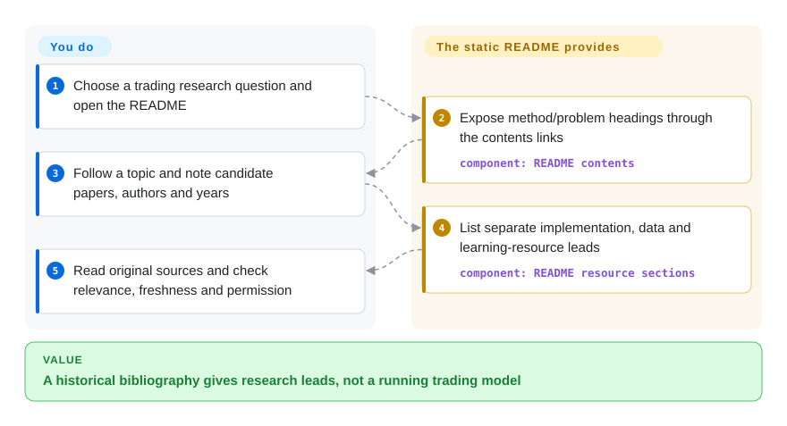

# awesome-deep-trading

You need starting papers on neural-network trading, but searches mix methods, markets and tutorial code. This README groups older literature and implementation/data leads; it does not train a model or place a trade.

## When to use

You are framing a literature review on reinforcement learning, portfolio methods or sentiment-based trading and need titles, authors and years to begin a search. Use this as a historical seed map when you want several method families in one short README, rather than a broad quant-software catalog or one executable tutorial's approach. Its entries are primarily 2016–2020 work, and the default branch has not changed since 2021; follow original sources and supplement it with current research.

## When NOT to use

- **You need current coverage or maintained recommendations.** Use a fresh literature search and [Awesome Quant](https://github.com/wilsonfreitas/awesome-quant) for broader software discovery. This default branch has been unchanged for over five years; its 2023 push timestamp does not establish updated content.
- **You need to train and evaluate a policy.** Investigate [FinRL](finrl.md) and its actual examples, not this list. Its indexed page is still an intake stub; current upstream distinguishes classic educational/research FinRL from its newer production-oriented repository.
- **You need a guided executable research workflow.** Use [Machine Learning for Trading](https://github.com/stefan-jansen/machine-learning-for-trading) with its edition/data environment. Here there are links, not notebooks or an experiment pipeline.
- **You need live profitability evidence or deployable risk controls.** Use independently validated backtests, paper trading and a reviewed execution/risk stack. Paper titles and GitHub implementations do not establish out-of-sample returns.
- **You want one MIT grant for every linked work.** Check each original publisher/repository's license instead. Root MIT covers this repo, not outside articles, data or code.

## Comparison

| Alternative | In index | Our verdict | Tradeoff |
|---|---|---|---|
| [Awesome Quant](https://github.com/wilsonfreitas/awesome-quant) | not indexed | Choose it for software/data across quantitative finance; use this dormant list only to seed an older deep-trading literature review. | A broader catalog versus a narrow historical paper map; entries still need individual review. |
| [Machine Learning for Trading](https://github.com/stefan-jansen/machine-learning-for-trading) | not indexed | Choose its edition-specific code to work through a research pipeline; use this list for bibliographic leads only. | Chapter/case-study environments versus low-setup browsing; neither proves profitable deployment. |
| [FinRL](finrl.md) | ✅ | Choose classic FinRL for educational reinforcement-learning experiments after reading upstream and rechecking its stub page; use this list for preliminary reading. | Training/evaluation code versus a static list; current FinRL routes newer production work elsewhere. |

## Quick start

Open the [pinned README contents](https://github.com/cbailes/awesome-deep-trading/blob/91eee433ec7791915ad20b15330f0eee04798f07/README.md#L10-L33); reading needs no package installation or credentials. Pick a method/problem such as reinforcement learning or portfolio allocation, then record candidate papers' titles, authors and years from that section. Follow repository, dataset or course links for an implementation lead and independently confirm that it matches the paper and still works. This repo supplies navigation and bibliography; you supply source reading, licensing checks, newer literature and any experiment environment/data budget. External services/courses have their own terms, costs and dependencies; this list supplies no data API, automated evaluation or trading engine.

<!-- flow-steps:begin (generated from flows/awesome-deep-trading.json by tools/flow_card.py — do not edit) -->

Text version of the flow

1. **You**: Choose a trading research question and open the README
2. **awesome-deep-trading**: Expose method/problem headings through the contents links — component: `README contents`
3. **You**: Follow a topic and note candidate papers, authors and years
4. **awesome-deep-trading**: List separate implementation, data and learning-resource leads — component: `README resource sections`
5. **You**: Read original sources and check relevance, freshness and permission

**Value**: A historical bibliography gives research leads, not a running trading model

<!-- flow-steps:end -->

## Key techniques

These are static content-organization mechanisms in README, not runtime algorithms.

- **Expose method/problem anchors.** [`README.md:10–33`](https://github.com/cbailes/awesome-deep-trading/blob/91eee433ec7791915ad20b15330f0eee04798f07/README.md#L10-L33) navigates neural-network families, markets/problems and resource types. It narrows reading without executing retrieval or ranking; overlapping topics are not a formal taxonomy.
- **Keep metadata beside papers.** [`README.md:66–86`](https://github.com/cbailes/awesome-deep-trading/blob/91eee433ec7791915ad20b15330f0eee04798f07/README.md#L66-L86) groups survey/CNN/LSTM entries with titles, authors, years and original links. It makes older work traceable, but attaches no quality score or replication result.
- **Separate implementation/data leads from papers.** [`README.md:142–175`](https://github.com/cbailes/awesome-deep-trading/blob/91eee433ec7791915ad20b15330f0eee04798f07/README.md#L142-L175) lists outside repositories and task descriptions, then data/simulation resources. This is not a verified one-to-one paper/code mapping; algorithms and datasets belong to the linked sources, not this repo.

## Tech stack

- **Markdown content:** README is the functional artifact, alongside LICENSE and `.github/FUNDING.yml`. There is no runtime implementation or dependency manifest.
- **Distribution:** GitHub-rendered headings/links or a local Markdown viewer; no releases or package entry point.

## Dependencies

- A browser or Markdown viewer; Git is optional for retaining a snapshot.
- Internet access and original-source permissions for outside links. Linked projects need their own environment/data, not dependencies supplied by this list.

## Ops difficulty

**Low for reading, significant for research upkeep.** No service needs deployment. The work is checking stale links, matching papers to implementations and updating the bibliography; reproducing/trading with linked work is a separate operational task.

## Health & viability

- **Maintenance (2026-10-13):** unarchived but dormant; last default-branch commit 2021-01-01, 2111 days ago, no releases. The later `pushed_at` does not indicate a newer default-branch content commit.
- **Machine profile:** overall D (4/6 scored axes), maintenance/adoption/longevity E, license risk A. Responsiveness remains unknown (`no_window_signal`); governance is unknown (`unattributable`) with no active author after recent-window filtering. Old copyright ownership is not current response coverage.
- **Age / backing:** created 2018-11-26, 2879 days old; Craig Bailes and funding links appear in the source. [推断：old unchanged main and missing recent response/governance signals] Age alone does not give this list an active-maintenance Lindy advantage.
- **Attention / permission:** 2049 stars; the tool scorer's empty package lookup is E, not a reader census. LICENSE verifies MIT; README also offers CC-BY without a version, so this page records the explicit MIT grant.

## Caveats (unverified)

- [未验证：outside sources were not individually reproduced] Paper/code correspondence, dataset access/licenses, live links and experimental returns need separate verification; the list supplies no results.
- [未验证：README omits the CC-BY version] Its alternative CC-BY offer cannot identify specific terms; root MIT is the verified grant and does not license outside works.
- [推断：2111-day inactivity and absent recent response/governance measurements] Treat it as historical bibliography, not maintained research advice or a deployable trading stack.
