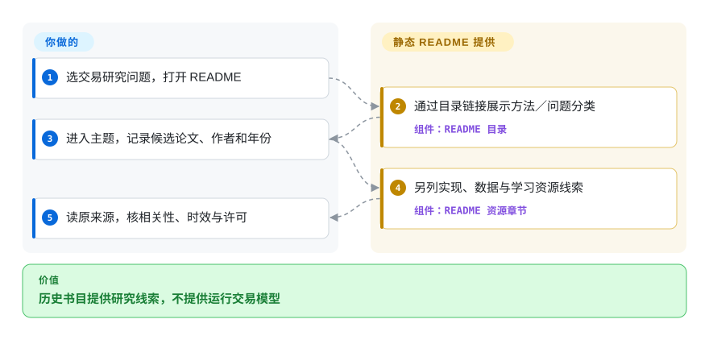
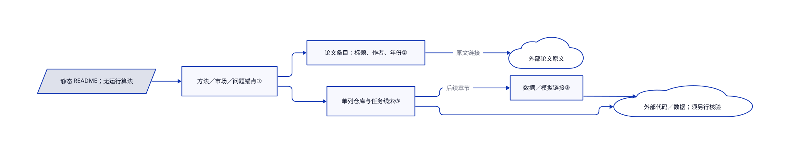

# awesome-deep-trading

你要找神经网络交易论文，搜索却把方法、市场和教程代码混在一起。这份 README 分类整理旧文献，附实现／数据线索；它不训练模型，也不下单。

## 何时使用

你准备做强化学习、投资组合或情绪交易的文献综述，需要先找到论文名、作者和年份。要在短 README 里看几个方法族时，可把它当历史检索起点，而非宽泛量化软件目录或单个可执行教程。这些条目主要来自 2016–2020 年，默认分支自 2021 年没变；应读原文，并补当前研究。

## 何时不用

- **你要当前覆盖或持续维护的推荐。** 做新文献检索，软件发现可读更广的 [Awesome Quant](https://github.com/wilsonfreitas/awesome-quant)。本清单默认分支五年多没变，2023 年 push 时间不证明内容更新。
- **你要训练并评估策略。** 研究 [FinRL](finrl.zh.md) 的实际例子，不用此清单。索引的 FinRL 页仍是桩页；当前上游区分经典教学／研究 FinRL 与较新的生产导向仓库。
- **你要执行研究流程。** 用 [Machine Learning for Trading](https://github.com/stefan-jansen/machine-learning-for-trading) 对应版次的代码与数据环境；这里只有外链，没有 notebook 或实验流水线。
- **你要实盘盈利证据或可部署风控。** 用独立验证的回测、模拟交易和审过的执行／风控栈。论文标题和 GitHub 实现不证明样本外收益。
- **你想用一个 MIT 授权覆盖所有外链作品。** 应分别核原发布方／仓库的许可；本仓 MIT 不覆盖外部文章、数据和代码。

## 横向对比

| 替代品 | 是否收录 | 我们的评价 | 取舍 |
|---|---|---|---|
| [Awesome Quant](https://github.com/wilsonfreitas/awesome-quant) | 未收录 | 全量化领域找软件／数据选它；这份停滞清单只适合旧深度交易文献的初步检索。 | 更宽的目录对比窄的历史论文地图，条目仍需逐个核验。 |
| [Machine Learning for Trading](https://github.com/stefan-jansen/machine-learning-for-trading) | 未收录 | 要执行研究流程时选对应版次代码；只要书目线索时才用本清单。 | 章节／案例环境对比低门槛浏览，两者都不证明能盈利部署。 |
| [FinRL](finrl.zh.md) | ✅ | 教学强化学习实验可选经典 FinRL，但先读上游并复核桩页；此清单只用于前期阅读。 | 真正训练／评估框架对比静态清单，当前 FinRL 把较新生产工作导向别仓。 |

## 快速上手

打开 [固定 README 目录](https://github.com/cbailes/awesome-deep-trading/blob/91eee433ec7791915ad20b15330f0eee04798f07/README.md#L10-L33)，阅读不需要安装包或凭据。选强化学习、投资组合等方法／问题，从对应节记录论文名、作者和年份。需要实现线索时，再跟到仓库、数据或课程链接，自行确认它对应论文且仍可用。本仓提供导航和书目线索，你负责读原文、核许可、补新文献及实验环境／数据预算。外部服务／课程另有条款、费用与依赖；此清单没有数据 API、自动评估或交易引擎。

<!-- flow-steps:begin (generated from flows/awesome-deep-trading.json by tools/flow_card.py — do not edit) -->

流程文字版

1. **你**：选交易研究问题，打开 README
2. **awesome-deep-trading**：通过目录链接展示方法／问题分类 — 组件：`README 目录`
3. **你**：进入主题，记录候选论文、作者和年份
4. **awesome-deep-trading**：另列实现、数据与学习资源线索 — 组件：`README 资源章节`
5. **你**：读原来源，核相关性、时效与许可

**价值**：历史书目提供研究线索，不提供运行交易模型

<!-- flow-steps:end -->

## 技术要点

<!-- mechanism:begin (generated from mechanisms/awesome-deep-trading.json by tools/mechanism_card.py; do not edit) -->

机制文字版

- 静态 README；无运行算法
- 方法／市场／问题锚点①
- 论文条目：标题、作者、年份②
- 外部论文原文
- 单列仓库与任务线索③
- 数据／模拟链接③
- 外部代码／数据；须另行核验

- 静态 README；无运行算法 → 方法／市场／问题锚点①
- 方法／市场／问题锚点① → 论文条目：标题、作者、年份②
- 论文条目：标题、作者、年份② → 外部论文原文（原文链接）
- 方法／市场／问题锚点① → 单列仓库与任务线索③
- 单列仓库与任务线索③ → 数据／模拟链接③（后续章节）
- 单列仓库与任务线索③ → 外部代码／数据；须另行核验
- 数据／模拟链接③ → 外部代码／数据；须另行核验

<!-- mechanism:end -->

### 1. 给静态书目保留多个入口

- **解决：** 交易问题可能指向神经网络族、市场或投资组合，而不是某篇论文名。
- **做法：** README 目录直接链接这些主题标题，也链接单列的资源章节。这是静态 Markdown 导航，不是检索或排序算法。
- **边界：** 方法／问题标题帮助缩小阅读范围，但彼此重叠，不构成正式分类学。
- **源码：** 无公开运行代码；本招的实际实现是 [README 目录第 10–33 行](https://github.com/cbailes/awesome-deep-trading/blob/91eee433ec7791915ad20b15330f0eee04798f07/README.md#L10-L33)。

### 2. 把书目信息留在论文旁

- **解决：** 多篇研究讨论相似交易方法，单靠标题不容易确认是哪一篇。
- **做法：** 综述和神经网络章节把标题、作者、年份与原文链接放在一起。读者不运行数据库查询，也能定位并追溯旧研究。
- **边界：** 条目没有质量分或复现结果；书目信息不证明交易能盈利。
- **源码：** 无公开运行代码；参见真实的[综述／卷积网络／长短期记忆网络条目第 66–86 行](https://github.com/cbailes/awesome-deep-trading/blob/91eee433ec7791915ad20b15330f0eee04798f07/README.md#L66-L86)。

### 3. 单列实现和数据线索

- **解决：** 找到论文不等于找到可获取的代码和输入数据。
- **做法：** 仓库章节给外部实现附上简短任务说明，后面再列数据与模拟资源。算法和数据仍属于这些外链源，不是本仓实现。
- **边界：** 这种组织方式不核验论文／代码一一对应、环境可运行或外部数据可复用权限。
- **源码：** 无公开运行代码；参见[仓库／数据／模拟清单第 142–175 行](https://github.com/cbailes/awesome-deep-trading/blob/91eee433ec7791915ad20b15330f0eee04798f07/README.md#L142-L175)。

## 技术栈

- **Markdown 内容：** README 是功能产物，另有 LICENSE 和 `.github/FUNDING.yml`，没有运行实现或依赖清单。
- **分发：** GitHub 渲染标题／链接，或本地 Markdown 查看器；没有 release 或包入口。

## 依赖

- 阅读只需浏览器或 Markdown 查看器；留存快照时可选 Git。
- 跟外链需要联网及原资源的访问许可。外链项目需要它自己的环境／数据，不是本清单提供的依赖。

## 运维难度

**阅读成本低，研究维护成本另计。** 不需要部署服务，真正工作是查陈旧链接、匹配论文与实现、更新书目。复现或交易外链工作属于另一项运维任务。

## 健康度与可持续性

- **维护（2026-10-13）：** 未归档但已停滞，默认分支最后提交是 2021-01-01，距今 2111 天，无 release。之后的 `pushed_at` 不表示默认分支内容更新。
- **机器画像：** 综合 D（4/6 轴有分），维护／采用／长青度 E，许可风险 A。响应未知为 `no_window_signal`，治理未知为 `unattributable`，近期统计窗口筛后没有活跃作者。旧版权归属不等于当前响应覆盖。
- **年龄与支持：** 创建于 2018-11-26，已有 2879 天；源码有 Craig Bailes 名字及资助链接。[推断：依据是旧主线未更新及缺近期响应／治理信号] 年龄不能单独给此清单仍在维护的长青优势。
- **关注与许可：** 2049 个 star；工具评分器包查询为空给 E，不是读者普查。LICENSE 确认 MIT；README 另提供未指明版号的 CC-BY，所以本页登记明确 MIT 授权。

## 存疑（未验证）

- [未验证：未逐个复现外部来源] 论文／代码对应、数据访问／许可、链接存活和实验收益需另核；本仓没有这些结果。
- [未验证：README 没有 CC-BY 版号] 另选声明不能唯一定位具体条款；根 MIT 是已核授权，不授权外部作品。
- [推断：依据是 2111 天无提交及缺近期响应／治理测量] 应当作历史书目，不当持续维护的研究建议或可部署交易栈。
