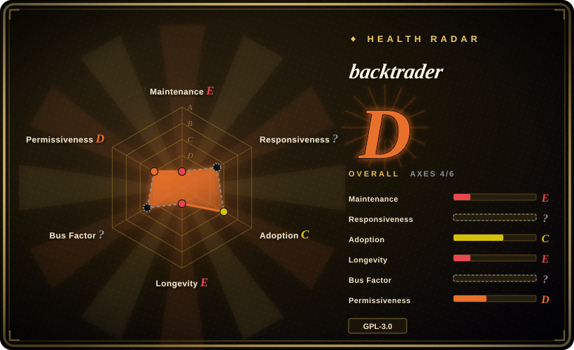
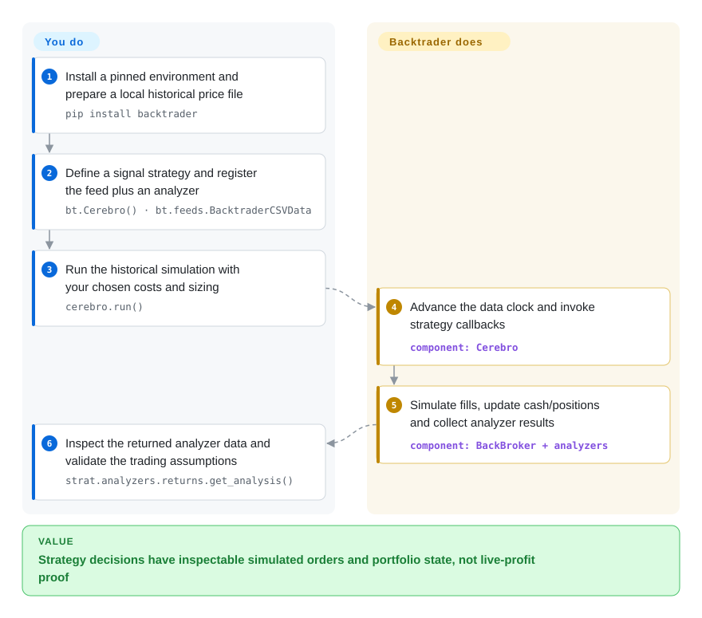

# backtrader

Your trading rule needs to react to each price bar and track orders, positions and cash, not just draw a buy/sell column. Backtrader supplies that Python simulation loop, but you must own maintenance of its dormant upstream and validate the trading assumptions.

## When to use

You have historical price files and want to model a strategy's sequence of signals, orders and fills, possibly across feeds/timeframes, while inspecting cash, trades and analyzers in Python. Choose Backtrader for that callback-driven simulation or to maintain an existing Backtrader strategy, rather than representing every experiment as a vectorized signal matrix. Its core is self-contained, but main has not changed since 2023; a new long-lived platform should weigh that maintenance cost before adopting its broad API.

## When NOT to use

- **You need upstream fixes and current brokerage connectivity for a new production system.** Evaluate [LEAN](https://github.com/QuantConnect/Lean) or a reviewed maintained alternative. This main has no commits since 2023-04-19 and GitHub issues are disabled; old IB/Oanda adapters are not evidence of present-day live compatibility.
- **You need thousands of parameter/asset combinations as arrays.** Evaluate [vectorbt](https://github.com/polakowo/vectorbt) for matrix-oriented experimentation, checking its current Fair Code/PRO boundaries. Backtrader's event/strategy object model favors temporal control rather than that workflow.
- **You only need a compact single-strategy experiment.** Evaluate [Backtesting.py](https://github.com/kernc/backtesting.py), whose small documented API may be enough. Its AGPL license is not a permissive escape from Backtrader's GPL.
- **You distribute a proprietary combined product and cannot accept GPL obligations.** Review GPL applicability or choose an Apache-2.0 engine such as LEAN after legal review. Backtrader's headers grant GPLv3-or-later; distribution/source obligations are not AGPL's distinct network-use disclosure obligation.
- **You need exchange-accurate execution or proven profits.** Use market-specific execution models, independently validated data and paper trading. OHLC-based fills, configurable slippage and cheat modes do not reconstruct a venue's order book or establish out-of-sample returns.

## Comparison

| Alternative | In index | Our verdict | Tradeoff |
|---|---|---|---|
| [Backtesting.py](https://github.com/kernc/backtesting.py) | not indexed | Choose its compact documented strategy API for a small experiment; keep Backtrader when existing callbacks, feeds and broker behavior are decisive. | A smaller experiment surface versus Backtrader's broader simulation API and dormant-maintenance burden; Backtesting.py is AGPL. |
| [vectorbt](https://github.com/polakowo/vectorbt) | not indexed | Choose vectorbt for matrix-based parameter/asset sweeps; choose Backtrader for callback-controlled order/state transitions, with indicators batch-precomputed by default. | Multi-configuration matrix exploration versus callback strategies with batched indicators; check current Fair Code terms and community/PRO feature boundaries. |
| [LEAN](https://github.com/QuantConnect/Lean) | not indexed | Evaluate LEAN for a new backtest/live platform with Apache-2.0 licensing; keep Backtrader for local or inherited research code whose smaller runtime outweighs upstream inactivity. | A C#/Python engine and Docker/CLI ecosystem versus a self-contained Python library; data/broker integration remains your responsibility. |

## Quick start

Install with `pip install backtrader` as in [README:126–140](https://github.com/mementum/backtrader/blob/b853d7c90b6721476eb5a5ea3135224e33db1f14/README.rst#L126-L140), and pin a Python/package combination you have tested. Use a local CSV first, not the README's old Yahoo download example: [the CSV loader](https://github.com/mementum/backtrader/blob/b853d7c90b6721476eb5a5ea3135224e33db1f14/backtrader/feeds/btcsv.py#L30-L59) reads date, open/high/low/close prices, volume and open interest, with an optional time column. Follow the [local strategy-selection example](https://github.com/mementum/backtrader/blob/b853d7c90b6721476eb5a5ea3135224e33db1f14/samples/strategy-selection/strategy-selection.py#L29-L68) to build indicators/signals, add a `BacktraderCSVData` feed to `bt.Cerebro()`, register a strategy and a Returns analyzer, then call the engine's run method and inspect `get_analysis()`. Backtrader advances the simulation and tracks broker/strategy state; you supply clean time-aligned data, position sizing, costs/slippage and validation against a held-out period. Plotting is optional and adds matplotlib; local-file simulation needs neither a model API nor a brokerage account. This source review did not execute a backtest or establish compatibility with today's Python, plotting packages or live broker APIs.

<!-- flow-steps:begin (generated from flows/backtrader.json by tools/flow_card.py — do not edit) -->

Text version of the flow

1. **You**: Install a pinned environment and prepare a local historical price file — `pip install backtrader`
2. **You**: Define a signal strategy and register the feed plus an analyzer — `bt.Cerebro() · bt.feeds.BacktraderCSVData`
3. **You**: Run the historical simulation with your chosen costs and sizing — `cerebro.run()`
4. **backtrader**: Advance the data clock and invoke strategy callbacks — component: `Cerebro`
5. **backtrader**: Simulate fills, update cash/positions and collect analyzer results — component: `BackBroker + analyzers`
6. **You**: Inspect the returned analyzer data and validate the trading assumptions — `strat.analyzers.returns.get_analysis()`

**Value**: Strategy decisions have inspectable simulated orders and portfolio state, not live-profit proof

<!-- flow-steps:end -->

## Key techniques

- **Precompute indicators by default, then advance per-bar strategies.** [`cerebro.py:275–276`](https://github.com/mementum/backtrader/blob/b853d7c90b6721476eb5a5ea3135224e33db1f14/backtrader/cerebro.py#L275-L276) defaults to `preload=True` and `runonce=True`. The batch path in [`cerebro.py:1649–1704`](https://github.com/mementum/backtrader/blob/b853d7c90b6721476eb5a5ea3135224e33db1f14/backtrader/cerebro.py#L1649-L1704) calls `_once()` for indicator precomputation, then uses `advance_peek()` and the minimum next timestamp to advance feeds and invoke per-bar strategy callbacks, without rewinding ahead feeds; [`lineiterator.py:293–318`](https://github.com/mementum/backtrader/blob/b853d7c90b6721476eb5a5ea3135224e33db1f14/backtrader/lineiterator.py#L293-L318) shows the indicator work. In stepwise next mode, [`cerebro.py:1498–1639`](https://github.com/mementum/backtrader/blob/b853d7c90b6721476eb5a5ea3135224e33db1f14/backtrader/cerebro.py#L1498-L1639) can rewind feeds that are ahead; live/replay/exactbars settings or disabling preload/runonce select that route through [`cerebro.py:1062–1079`](https://github.com/mementum/backtrader/blob/b853d7c90b6721476eb5a5ea3135224e33db1f14/backtrader/cerebro.py#L1062-L1079) and [`cerebro.py:1294–1303`](https://github.com/mementum/backtrader/blob/b853d7c90b6721476eb5a5ea3135224e33db1f14/backtrader/cerebro.py#L1294-L1303). Data alignment and cheat-mode timing still need deliberate review.
- **Share the time-series buffer idiom between data and indicators.** [`linebuffer.py:50–125`](https://github.com/mementum/backtrader/blob/b853d7c90b6721476eb5a5ea3135224e33db1f14/backtrader/linebuffer.py#L50-L125) defines the active item at index zero and selects an unbounded numeric array or a bounded deque for reduced memory. The actual lookup is [`linebuffer.py:162–163`](https://github.com/mementum/backtrader/blob/b853d7c90b6721476eb5a5ea3135224e33db1f14/backtrader/linebuffer.py#L162-L163). Indicators can share cursor-based values, but available history and lookahead discipline remain part of strategy correctness.
- **Model fills explicitly from bar prices and slippage.** [`bbroker.py:853–919`](https://github.com/mementum/backtrader/blob/b853d7c90b6721476eb5a5ea3135224e33db1f14/backtrader/brokers/bbroker.py#L853-L919) distinguishes market/close/limit fills using open/high/low/close and order timing; [`bbroker.py:994–1038`](https://github.com/mementum/backtrader/blob/b853d7c90b6721476eb5a5ea3135224e33db1f14/backtrader/brokers/bbroker.py#L994-L1038) applies percentage/fixed slippage and range policies. This makes assumptions inspectable, not exchange-realistic by default; cheat flags and allowed outside-bar prices need deliberate review.

## Tech stack

- **Python:** Cerebro orchestration, strategies/signals, indicator line buffers, data feeds, broker simulation, sizers and analyzers; main version 1.9.78.123.
- **Packaging:** setuptools/PyPI and `btrun` CLI; plotting extra installs matplotlib. Core setup declares no mandatory external runtime packages.

## Dependencies

- Python and your historical data for local simulation. README's minimum Python 3.2 and old package classifiers are historical documentation, not a verified compatibility promise for current interpreters.
- Optional matplotlib for plotting; pandas/TA-Lib or brokerage SDKs only for the integrations you choose. Old broker SDK names and Yahoo API notes require fresh validation.
- Reproducible data snapshots, timezone/calendar decisions, commissions/slippage and sufficient memory for the chosen preload/history/optimization settings; no database or remote service is required for local-file tests.

## Ops difficulty

**Low for a local experiment, high for maintained/live deployment.** The library needs no daemon, but reproducibility requires pinned environments and realistic fills/costs/data. Upstream inactivity shifts compatibility/security fixes to you or a reviewed fork. Live trading adds broker credentials, connectivity, risk limits and recovery; none is verified by a successful historical simulation.

## Health & viability

- **Maintenance (2026-10-13):** unarchived but dormant; main last committed 2023-04-19, 1273 days ago. There are no GitHub releases; PyPI 1.9.78.123 was uploaded on 2023-04-19 and matches the source version. The 2024 push is not a new main commit.
- **Machine profile:** overall D (4/6 scored axes), maintenance/longevity E, adoption C and license risk D. Responsiveness remains unknown because GitHub issues are disabled; governance remains unknown because the recent window has no attributable active maintainer.
- **Adoption / age:** 23469 stars, 173743 measured PyPI downloads last month and 231 dependent repositories. Created 2015-01-10, 4295 days old; [推断：long existence but 1273-day main inactivity] its legacy footprint is real, but age does not supply a still-active Lindy advantage.
- **Permission:** LICENSE, source headers, setup and PyPI confirm GPLv3-or-later. The existing scorer stores GitHub's `GPL-3.0` in its merged `strong_network_copyleft` bucket; that bucket name does not make this an AGPL network-disclosure license. Assess distribution-related source obligations for your actual integration.

## Caveats (unverified)

- [未验证：no library/sample execution was performed] Current Python/matplotlib compatibility, local results and present-day live broker/Yahoo integrations were not tested; source examples alone do not establish them.
- [推断：1273-day inactivity and disabled issues] New long-lived/live systems should budget for independent maintenance or evaluate a maintained engine, regardless of old adoption.
- [推断：the existing scorer deliberately merges GPL/AGPL categories] The risk bucket is a grading classification, not evidence of AGPL network obligations; actual reuse/distribution needs GPLv3-or-later review.
