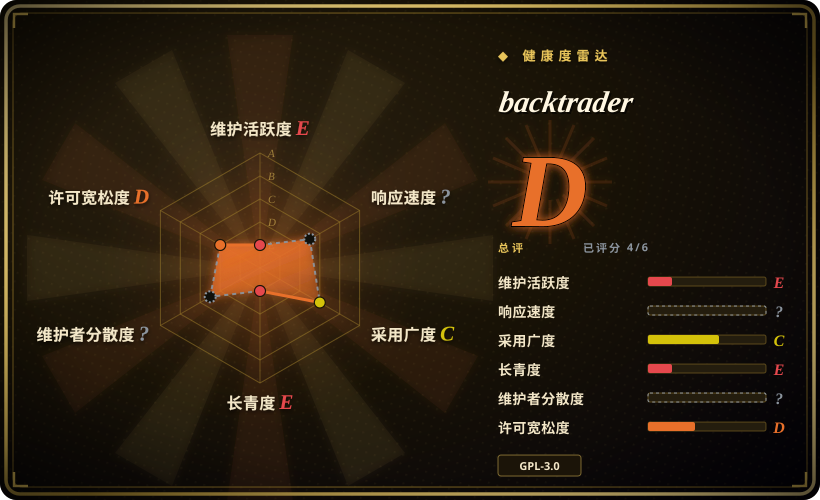
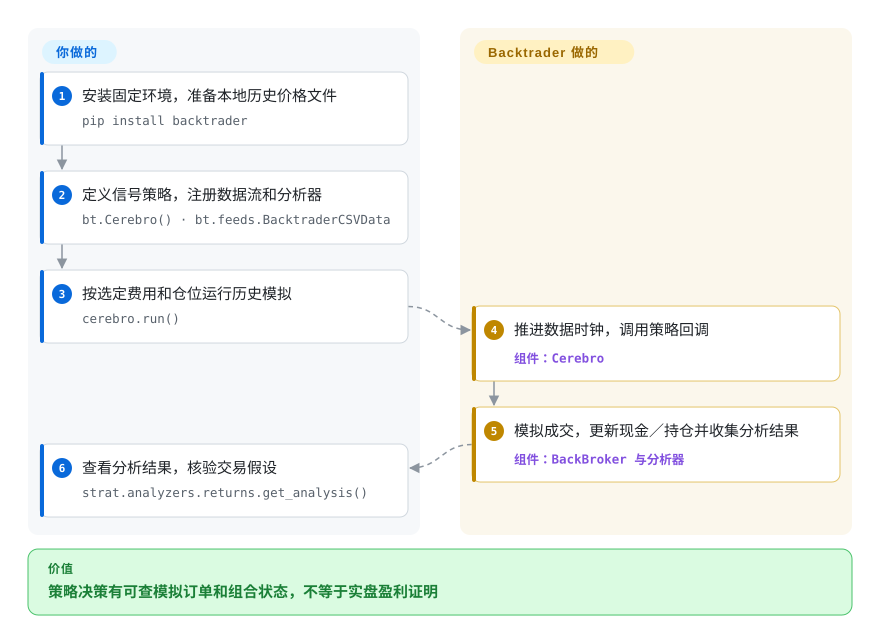

# backtrader

你的交易规则要逐根价格柱响应，还要跟踪订单、持仓和现金，不能只画买卖信号列。Backtrader 提供 Python 模拟循环，但上游已停滞，维护和交易假设核验要由你承担。

## 何时使用

你有历史价格文件，要模拟信号、订单和成交的先后顺序，可能还要跨数据流／周期，并用 Python 查看现金、交易和分析器结果。需要回调驱动模拟或维护已有 Backtrader 策略时选它，而不是把每个实验写成向量化信号矩阵。核心自包含，但 main 自 2023 年没变；新建长期平台应先衡量维护成本，再采用其宽 API。

## 何时不用

- **新生产系统需要上游修复和当前券商连接。** 评估 [LEAN](https://github.com/QuantConnect/Lean) 或审过的维护中替代品。main 自 2023-04-19 没提交，GitHub issue 功能未启用；旧 IB／Oanda 适配器不证明今天还能实盘用。
- **你要把成千上万组参数／资产组合做成数组。** 评估 [vectorbt](https://github.com/polakowo/vectorbt) 的矩阵实验方式，同时核当前 Fair Code／PRO 边界。Backtrader 的事件／策略对象更侧重时间控制。
- **你只做小型单策略实验。** 评估 [Backtesting.py](https://github.com/kernc/backtesting.py) 的精简文档 API。它的 AGPL 不构成绕开 Backtrader GPL 的宽松许可替代。
- **你分发专有组合产品，无法接受 GPL 义务。** 先核 GPL 适用性，或法务审核后选 Apache-2.0 的 LEAN。Backtrader 源码授权 GPLv3 或后续版；分发／源码义务不是 AGPL 特有的网络使用披露义务。
- **你要交易所精确执行或盈利证明。** 用市场专属执行模型、独立验证数据和模拟交易。OHLC 成交、可配置滑点及作弊模式不重建交易所订单簿，也不证明样本外收益。

## 横向对比

| 替代品 | 是否收录 | 我们的评价 | 取舍 |
|---|---|---|---|
| [Backtesting.py](https://github.com/kernc/backtesting.py) | 未收录 | 小实验选其紧凑策略 API；已有回调、数据源和模拟券商行为决定取舍时保留 Backtrader。 | 小实验表面对比宽模拟 API 及停滞上游维护负担；Backtesting.py 为 AGPL。 |
| [vectorbt](https://github.com/polakowo/vectorbt) | 未收录 | 矩阵式参数／资产扫描选 vectorbt；通过回调控制订单／状态转换且默认批量预计算指标时选 Backtrader。 | 多配置矩阵探索对比带批量指标的回调策略；须核当前 Fair Code 条款和社区／PRO 功能边界。 |
| [LEAN](https://github.com/QuantConnect/Lean) | 未收录 | 新回测／实盘平台且要 Apache-2.0 时评估 LEAN；本地或继承研究代码更看重小运行栈时保留 Backtrader。 | C#／Python 引擎与 Docker／CLI 生态，对比自包含 Python 库；数据／券商集成仍归你负责。 |

## 快速上手

按 [README:126–140](https://github.com/mementum/backtrader/blob/b853d7c90b6721476eb5a5ea3135224e33db1f14/README.rst#L126-L140) 用 `pip install backtrader` 安装，并固定你测过的 Python／包版本。先用本地 CSV，不依赖 README 的旧 Yahoo 下载示例；[CSV 加载器](https://github.com/mementum/backtrader/blob/b853d7c90b6721476eb5a5ea3135224e33db1f14/backtrader/feeds/btcsv.py#L30-L59) 读取日期、开高低收价格、成交量和未平仓量，可另有时间列。按 [本地策略选择示例](https://github.com/mementum/backtrader/blob/b853d7c90b6721476eb5a5ea3135224e33db1f14/samples/strategy-selection/strategy-selection.py#L29-L68) 定义指标／信号，将 `BacktraderCSVData` 加到 `bt.Cerebro()`，注册策略与 Returns 分析器，调用运行方法后查看 `get_analysis()`。Backtrader 推进模拟并跟踪券商／策略状态，你负责干净且时间对齐的数据、仓位、费用／滑点和留出时段验证。画图可选，另需 matplotlib；本地文件模拟不需要模型 API 或券商账户。本次只读源码，没有执行回测，也没有证明当前 Python、绘图包或实盘 API 兼容。

<!-- flow-steps:begin (generated from flows/backtrader.json by tools/flow_card.py — do not edit) -->

流程文字版

1. **你**：安装固定环境，准备本地历史价格文件 — `pip install backtrader`
2. **你**：定义信号策略，注册数据流和分析器 — `bt.Cerebro() · bt.feeds.BacktraderCSVData`
3. **你**：按选定费用和仓位运行历史模拟 — `cerebro.run()`
4. **backtrader**：推进数据时钟，调用策略回调 — 组件：`Cerebro`
5. **backtrader**：模拟成交，更新现金／持仓并收集分析结果 — 组件：`BackBroker 与分析器`
6. **你**：查看分析结果，核验交易假设 — `strat.analyzers.returns.get_analysis()`

**价值**：策略决策有可查模拟订单和组合状态，不等于实盘盈利证明

<!-- flow-steps:end -->

## 技术要点

- **默认先预计算指标，再逐根推进策略。** [`cerebro.py:275–276`](https://github.com/mementum/backtrader/blob/b853d7c90b6721476eb5a5ea3135224e33db1f14/backtrader/cerebro.py#L275-L276) 默认启用 `preload=True` 和 `runonce=True`。[`cerebro.py:1649–1704`](https://github.com/mementum/backtrader/blob/b853d7c90b6721476eb5a5ea3135224e33db1f14/backtrader/cerebro.py#L1649-L1704) 的批量路径先调用 `_once()` 预计算指标，再用 `advance_peek()` 和最小下一时间推进数据，逐根调用策略，不回退超前数据；[`lineiterator.py:293–318`](https://github.com/mementum/backtrader/blob/b853d7c90b6721476eb5a5ea3135224e33db1f14/backtrader/lineiterator.py#L293-L318) 展示指标计算。逐步 next 模式的 [`cerebro.py:1498–1639`](https://github.com/mementum/backtrader/blob/b853d7c90b6721476eb5a5ea3135224e33db1f14/backtrader/cerebro.py#L1498-L1639) 才会回退超前数据；实时／重放／exactbars 设置或关闭 preload／runonce，通过 [`cerebro.py:1062–1079`](https://github.com/mementum/backtrader/blob/b853d7c90b6721476eb5a5ea3135224e33db1f14/backtrader/cerebro.py#L1062-L1079) 与 [`cerebro.py:1294–1303`](https://github.com/mementum/backtrader/blob/b853d7c90b6721476eb5a5ea3135224e33db1f14/backtrader/cerebro.py#L1294-L1303) 选择该路径。数据对齐和作弊模式的时间假设仍需明确审核。
- **让数据与指标共享时间序列缓冲接口。** [`linebuffer.py:50–125`](https://github.com/mementum/backtrader/blob/b853d7c90b6721476eb5a5ea3135224e33db1f14/backtrader/linebuffer.py#L50-L125) 用零下标表示当前项，并可选无界数值数组或节省内存的有界队列，实际取值在 [`linebuffer.py:162–163`](https://github.com/mementum/backtrader/blob/b853d7c90b6721476eb5a5ea3135224e33db1f14/backtrader/linebuffer.py#L162-L163)。指标共享游标值，但历史是否可读与避免偷看未来仍是策略正确性的一部分。
- **从价格柱和滑点明确模拟成交。** [`bbroker.py:853–919`](https://github.com/mementum/backtrader/blob/b853d7c90b6721476eb5a5ea3135224e33db1f14/backtrader/brokers/bbroker.py#L853-L919) 按开高低收和订单时间区分市价／收盘／限价成交；[`bbroker.py:994–1038`](https://github.com/mementum/backtrader/blob/b853d7c90b6721476eb5a5ea3135224e33db1f14/backtrader/brokers/bbroker.py#L994-L1038) 应用百分比／固定滑点和区间策略。假设因此可查，不代表默认贴合交易所；作弊选项与允许柱外价格都需明确审核。

## 技术栈

- **Python：** Cerebro 编排、策略／信号、指标线缓冲、数据源、券商模拟、仓位计算与分析器；main 版本为 1.9.78.123。
- **打包：** setuptools／PyPI 与 `btrun` CLI；绘图额外安装 matplotlib。核心 setup 没有必需外部运行包。

## 依赖

- 本地模拟只需 Python 和历史数据。README 的 Python 3.2 最低值与旧分类是历史文档，不是当前解释器的已验证兼容承诺。
- 绘图可选 matplotlib；pandas／TA-Lib 或券商 SDK 取决于所选集成。旧 SDK 名和 Yahoo API 备注都要重新验证。
- 固定数据快照、时区／交易日历、费用／滑点，以及匹配预载／历史／优化设置的内存；本地文件测试不需要数据库或远端服务。

## 运维难度

**本地实验低，长期／实盘部署高。** 库不需要守护服务，但可重复结果需要固定环境和真实费用／数据／成交假设。上游停滞把兼容／安全修复转移给你或审过的 fork。实盘另需券商凭据、连接、风险限额与恢复；一次历史模拟成功不能验证这些。

## 健康度与可持续性

- **维护（2026-10-13）：** 未归档但停滞，main 最后提交于 2023-04-19，距今 1273 天。无 GitHub release；PyPI 1.9.78.123 在 2023-04-19 上传，与源版本相同。2024 年 push 不表示新主线提交。
- **机器画像：** 综合 D（4/6 轴有分），维护／长青度 E，采用 C，许可风险 D。响应未知因为 GitHub issue 功能未启用，治理未知因为近期窗口没有可归属活跃维护者。
- **采用与年龄：** 23469 个 star，本轮 PyPI 月下载 173743 次、依赖仓库 231 个。创建于 2015-01-10，已有 4295 天；[推断：依据是长寿但主线停滞 1273 天] 历史使用足迹真实，但年龄不给仍在维护的长青优势。
- **许可：** LICENSE、源头声明、setup 和 PyPI 确认 GPLv3 或后续版。现有评分器把 GitHub 的 `GPL-3.0` 放入合并的 `strong_network_copyleft` 桶；桶名不让它变成 AGPL 网络披露许可。应按实际集成评估分发相关源码义务。

## 存疑（未验证）

- [未验证：未执行库或示例] 当前 Python／matplotlib 兼容、本地结果及今日券商／Yahoo 集成未实测；源码例子不能单独证明。
- [推断：依据是 1273 天停滞与 GitHub issue 功能未启用] 新长期／实盘系统应预留独立维护成本，或评估维护中的引擎，不依赖历史采用量。
- [推断：依据是现有评分器明确合并 GPL／AGPL 分类] 风险桶是评分分类，不是 AGPL 网络义务证据；实际复用／分发须核 GPLv3 或后续版。
