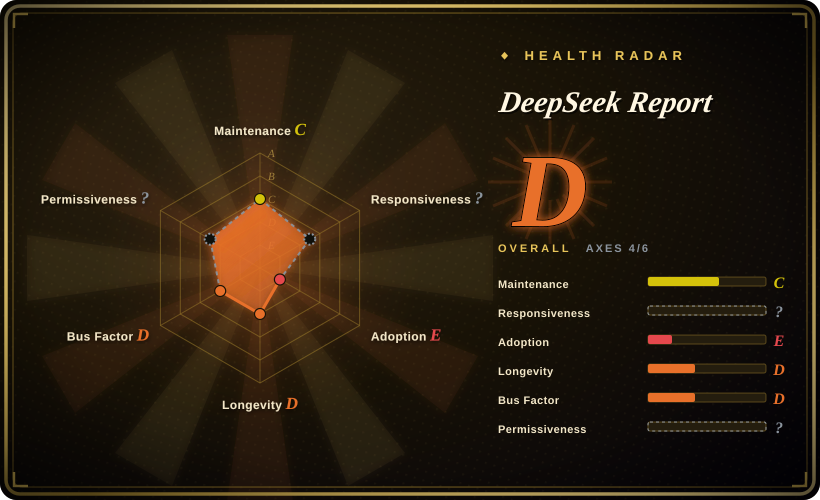
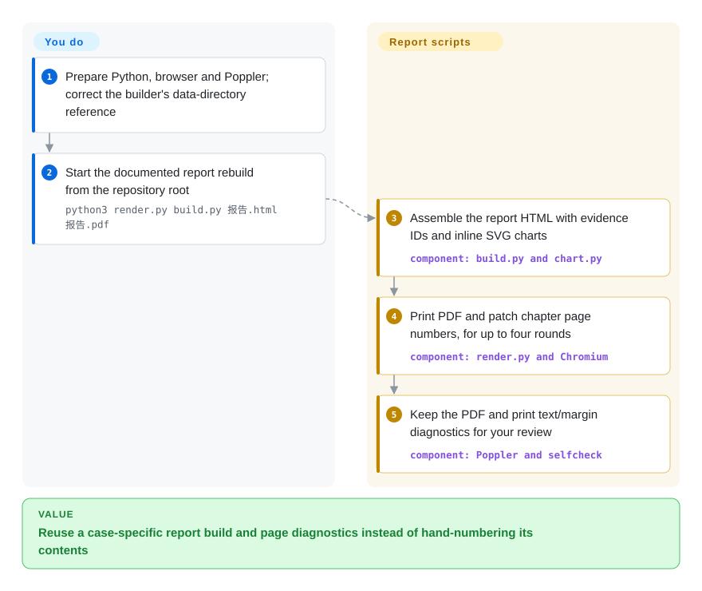
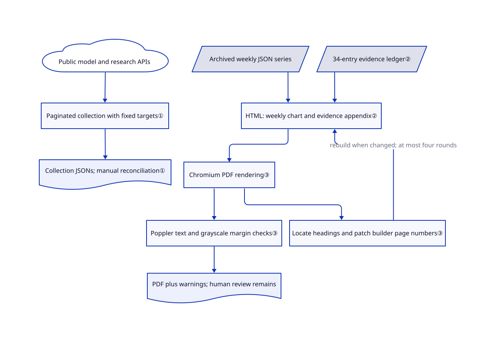

# DeepSeek Report

You want to check the numbers behind a DeepSeek investment narrative, not just read its conclusions. This repository keeps the report, evidence table, collection scripts and archived observations together, but its rebuild path needs repair.

## When to use

You are preparing investment research on model adoption. A slide says “usage share fell after a missed release,” but you cannot find the weekly rows or the denominator. Use this repository as a worked research artifact: it includes 4,386 archived OpenRouter rows, 86 weekly aggregate entries, a 34-entry evidence ledger and six Python files. You can inspect the historical assumptions or adapt the collectors and HTML report layout instead of starting from a blank document.

Choose it over a general converter when the useful part is the *combination* of a specific DeepSeek case, dated source observations and an inspectable report pipeline. Choose a general publishing tool when you need a maintained authoring system instead. The upstream snapshot is dated 2026-08-26/27; this page does not independently endorse its financial or model-ranking claims.

## When NOT to use

- **You need a report that rebuilds untouched.** `build.py:13` opens `数据/OR-deepseek周度份额-复算20260827.json`, but the committed directory is `data/`. Repair that reference before trying the documented command. For a general-purpose PDF authoring system, choose [Typst](../typesetting/typst.md) instead of depending on this case-specific builder.
- **You need an automatically refreshed DeepSeek usage monitor.** The OpenRouter collector reads a key from `~/.claude/.env`, requests fixed 2025–2026 windows and aggregates `qwen/`, not `deepseek/`. There is no separate DeepSeek recomputation script in the tree. For an extensible financial-data service, choose [OpenBB](openbb.md) and implement the required provider; it does not supply this model-adoption series out of the box.
- **You need a research-writing assistant, not a frozen example.** The README credits the author's [huashu-skills](../agent-skills/ai-writing/content-production/huashu-skills.md). Read that collection for reusable authoring workflows; this repository contains the completed case and scripts, not an installable report skill.
- **You need Word/EPUB output or citation-format conversion.** Choose [Pandoc](../markdown-tools/pandoc.md). Here the prose and several chart series are embedded in Python strings; the supported reproduction path generates HTML and PDF.
- **A green process exit must certify publication quality.** The renderer prints detected issues and returns them from `selfcheck`, but `main` does not turn them into a failing exit code. Use a dedicated publishing tool such as Typst for document generation and add your own acceptance checks; neither tool verifies investment claims.

## Comparison

These alternatives replace the authoring, rendering or data-service portion, not the archived DeepSeek observations.

| Alternative | In index | Our verdict | Tradeoff |
|---|---|---|---|
| [Typst](../typesetting/typst.md) | ✅ | For new, regularly maintained print reports, choose Typst's dedicated layout engine; choose this artifact when studying its specific evidence-to-report workflow is the goal. | Typst avoids this custom browser/TOC patch loop, but you must recreate the research ledger, collectors and case content. |
| [Pandoc](../markdown-tools/pandoc.md) | ✅ | For one source delivered as Word, HTML and EPUB, choose Pandoc; choose this artifact when its existing Python-generated figures and DeepSeek archive save the work. | Pandoc broadens output formats but does not collect model-adoption evidence or supply a report-specific visual design. |
| [OpenBB](openbb.md) | ✅ | For a reusable financial-data API, choose OpenBB's provider architecture; choose this artifact for a bounded historical model-adoption case with local JSON evidence. | OpenBB provides a data-service foundation, not these Hugging Face/OpenRouter collectors or this ready-written report. |

## Quick start

For the report-rebuild path, obtain the repository, install Python 3, Playwright with Chromium, Poppler tools and suitable Chinese fonts. First correct the `数据/` reference in `build.py` to the committed `data/` location; the command below is documented upstream, but the unmodified tree has that missing input path. From the repository root, the documented invocation is `python3 render.py build.py 报告.html 报告.pdf`. The project builds HTML, prints it to PDF, patches chapter page numbers back into the builder and prints text/geometry diagnostics; you must review warnings and inspect pages yourself. Running the two public-data collectors is a separate operation: they write dated JSON filenames into the current directory and do not automatically refresh the hard-coded narrative or chart series. Verification here was static only; no upstream code, API-key file or browser renderer was executed.

<!-- flow-steps:begin (generated from flows/deepseek-influence-report.json by tools/flow_card.py — do not edit) -->

Text version of the flow

1. **You**: Prepare Python, browser and Poppler; correct the builder's data-directory reference
2. **You**: Start the documented report rebuild from the repository root — `python3 render.py build.py 报告.html 报告.pdf`
3. **DeepSeek Report**: Assemble the report HTML with evidence IDs and inline SVG charts — component: `build.py and chart.py`
4. **DeepSeek Report**: Print PDF and patch chapter page numbers, for up to four rounds — component: `render.py and Chromium`
5. **DeepSeek Report**: Keep the PDF and print text/margin diagnostics for your review — component: `Poppler and selfcheck`

**Value**: Reuse a case-specific report build and page diagnostics instead of hand-numbering its contents

<!-- flow-steps:end -->

## Key techniques

<!-- mechanism:begin (generated from mechanisms/deepseek-influence-report.json by tools/mechanism_card.py; do not edit) -->

Text version of the mechanism

- Public model and research APIs
- Paginated collection with fixed targets①
- Collection JSONs; manual reconciliation①
- Archived weekly JSON series
- 34-entry evidence ledger②
- HTML: weekly chart and evidence appendix②
- Chromium PDF rendering③
- Locate headings and patch builder page numbers③
- Poppler text and grayscale margin checks③
- PDF plus warnings; human review remains

- Public model and research APIs → Paginated collection with fixed targets①
- Paginated collection with fixed targets① → Collection JSONs; manual reconciliation①
- Archived weekly JSON series → HTML: weekly chart and evidence appendix②
- 34-entry evidence ledger② → HTML: weekly chart and evidence appendix②
- HTML: weekly chart and evidence appendix② → Chromium PDF rendering③
- Chromium PDF rendering③ → Locate headings and patch builder page numbers③
- Locate headings and patch builder page numbers③ → HTML: weekly chart and evidence appendix② (rebuild when changed; at most four rounds)
- Chromium PDF rendering③ → Poppler text and grayscale margin checks③
- Poppler text and grayscale margin checks③ → PDF plus warnings; human review remains

<!-- mechanism:end -->

### 1. Collect explicitly scoped adoption indicators

- **Problem:** Downloads, repository stars and paper citations measure different things; treating them as one usage number hides coverage gaps.
- **How:** The Hugging Face collector follows pagination and sums lifetime/30-day downloads for seven organizations. A second collector records base-model-tag derivatives, GitHub organization stars, paper-search results and arXiv counts, with collection timestamps and scope descriptions.
- **Limits:** Targets are hard-coded, errors can become strings in the output, and paper identity still needs human checking. The OpenRouter script is a Qwen collector with fixed windows and a local key-file dependency, not a complete DeepSeek refresh path.
- **Source:** [Download collector](https://github.com/alchaincyf/deepseek-influence-report/blob/0c849ab51e81b2e04d48e8c22af2a4c060e2c569/data/采集-hf下载量.py#L8-L42), [multi-source collector](https://github.com/alchaincyf/deepseek-influence-report/blob/0c849ab51e81b2e04d48e8c22af2a4c060e2c569/data/采集-衍生与学术.py#L21-L126), [OpenRouter collector](https://github.com/alchaincyf/deepseek-influence-report/blob/0c849ab51e81b2e04d48e8c22af2a4c060e2c569/data/采集-OR周度.py#L8-L42).

### 2. Keep an evidence ledger beside the generated report

- **Problem:** A report's headline number is difficult to challenge when its source, measurement scope and confidence level disappear during writing.
- **How:** `数据表.json` stores numbered observations with value, basis, sample size, source, date, evidence tier and a verification flag. The builder adds evidence-ID superscripts and generates appendix rows from that table; the OpenRouter chart uses the archived weekly series, while several other chart series remain literal arrays.
- **Limits:** Superscripts are not validated references, source fields often name publications rather than link articles, and updating the ledger alone does not update hard-coded prose or figures. The committed QC notes document earlier arithmetic and sampling errors; their presence is not independent proof that every current claim is correct.
- **Source:** [Evidence table](https://github.com/alchaincyf/deepseek-influence-report/blob/0c849ab51e81b2e04d48e8c22af2a4c060e2c569/数据表.json), [citations and figure inputs](https://github.com/alchaincyf/deepseek-influence-report/blob/0c849ab51e81b2e04d48e8c22af2a4c060e2c569/build.py#L11-L102), [appendix construction](https://github.com/alchaincyf/deepseek-influence-report/blob/0c849ab51e81b2e04d48e8c22af2a4c060e2c569/build.py#L627-L646), [data QC record](https://github.com/alchaincyf/deepseek-influence-report/blob/0c849ab51e81b2e04d48e8c22af2a4c060e2c569/qc/质控-数据核查-20260827.md).

### 3. Reconcile PDF page numbers and measure margins

- **Problem:** A content edit changes chapter pages, while browser printing can leave thin pages or push content against an edge.
- **How:** The renderer rebuilds HTML every round, prints through Chromium, locates chapter headings in PDF text and patches `toc_row` page numbers in the builder, for up to four rounds. Poppler then produces grayscale pages; a local parser estimates ink bounds and flags insufficient margins, thin pages, duplicate figure numbers and placeholder text.
- **Limits:** TOC patching requires single-line calls. Four-round non-convergence and detected QC issues only print warnings. Geometry skips high-coverage pages and excludes a footer band; it cannot judge column collisions or claim accuracy. The builder itself is executed as Python, so only run a trusted local copy.
- **Source:** [PDF rendering and TOC patching](https://github.com/alchaincyf/deepseek-influence-report/blob/0c849ab51e81b2e04d48e8c22af2a4c060e2c569/render.py#L61-L119), [geometry and text checks](https://github.com/alchaincyf/deepseek-influence-report/blob/0c849ab51e81b2e04d48e8c22af2a4c060e2c569/render.py#L122-L257), [bounded rebuild loop](https://github.com/alchaincyf/deepseek-influence-report/blob/0c849ab51e81b2e04d48e8c22af2a4c060e2c569/render.py#L261-L287).

## Tech stack

- Python standard-library collectors and report assembly; a local `chart.py` produces inline SVG.
- HTML/CSS report layout; Playwright Chromium prints PDF, while Poppler supplies text and grayscale image measurements.
- JSON evidence and archived API observations. There is no package manifest, database, web server or agent runtime in the reviewed 25-file tree.

## Dependencies

- Reading the committed HTML, JSON and research notes needs no service account.
- Rebuilding PDF needs Python 3, Playwright/Chromium, `pdfinfo`, `pdftotext`, `pdftoppm` and fonts. The repository does not pin their versions.
- Collection uses Hugging Face, GitHub, Semantic Scholar, arXiv and Ollama over the network. The separate OpenRouter collector sends the locally read `OPENROUTER_API_KEY` to OpenRouter's dataset endpoint.
- README declares MIT for Python/CSS and CC BY 4.0 for report content. No separate LICENSE file or complete MIT notice is committed; preserve the distinction and seek clarification for redistribution-sensitive use.

## Ops difficulty

**Medium for adaptation; low for reading the archive.** Reproduction requires repairing the input path and assembling an unpinned browser/Poppler/font environment. Maintaining a new edition also requires reconciling collector outputs, literal chart values, prose, evidence tiers and chapter anchors. There is no scheduler, retry/checkpoint framework or release/test pipeline; do not treat printed QC success as a financial fact-check.

## Health & viability

- **Maintenance, 2026-10-22:** public, not archived, created and last committed on 2026-08-27; one commit, one contributor, no releases and no issues in the queried history. Treat it as a published snapshot, not an established maintained product.
- **Governance and longevity:** the author's personal account owns the repository. At 56 days old with only the publication commit, age plus continued maintenance does not yet establish a Lindy durability signal. No governance or funding files appear in the tree.
- **Adoption:** 35 stars and four forks show attention, not validated institutional use. The useful evidence is the committed code and data, not the README's “institutional-grade” description.
- **Reuse and license:** the artifact contains six Python files totaling 1,486 lines and nine JSON files. Its seven Python/CSS blob hashes do not match the credited author's skill repository at the reviewed tree; this limited comparison is not a general originality audit. README gives split license declarations, but GitHub reports no detected license and `/license` returns 404.
- **Selection verdict:** use it as a transparent research-pattern source with known repair work. The wrong input directory, mismatched OpenRouter aggregation and warning-only checks block treating it as an unattended reproducible-report service.

## Caveats (unverified)

- [未验证：static inspection only; upstream programs were not run] The repaired PDF build, rendering appearance, installed-font behavior and current collector/API compatibility were not exercised. Python syntax was parsed without executing the six source files.
- [未验证：external reporting was not individually checked or platform data recollected] Historical investment terms, model rankings, causal interpretations and the ledger's `verified` flags are upstream research claims, not independently verified facts of this selection page. Archived row counts verify file contents, not their external authenticity.
- [未验证：README declarations exist but complete license files are absent] Legal completeness of the split MIT/CC BY 4.0 grant and third-party data redistribution rights remain unresolved; the frontmatter records the declared scopes, not legal clearance.
