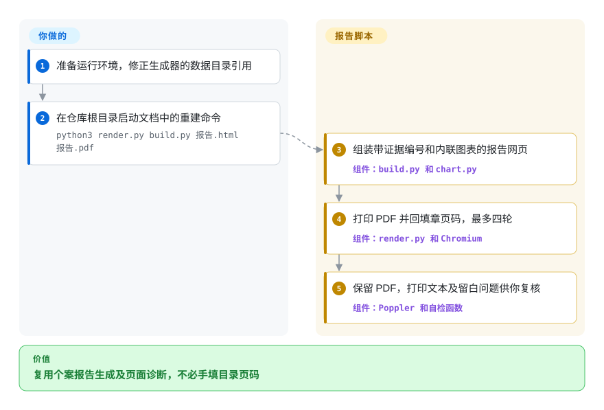
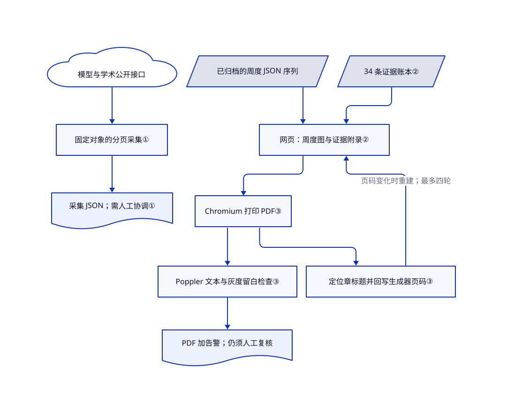

# DeepSeek Report

你想追查 DeepSeek 投研结论背后的数字，而不只读结论。仓库把报告、证据表、采集脚本和历史数据放在一起，但重建报告前要修一处路径。

## 何时使用

你正在研究模型采用情况。幻灯片写着“错过发布后，使用份额下滑”，却找不到逐周原始行和分母。本仓库提供一份可拆解的研究成品：包含 OpenRouter 原始档中的 4,386 行、周度汇总中的 86 个条目、34 条证据账本，以及六个 Python 文件。你可以检查历史口径，也可以复用采集器和 HTML 报告版式，不必从空白文档开始。

当你需要的是“DeepSeek 个案、带日期的观测档案、可读的报告流水线”这组组合时，选它而不是通用转换器。当你需要长期维护的写作系统时，换用通用出版工具。上游数据快照为 2026-08-26／27；本页不独立背书其中的融资、排名或投资判断。

## 何时不用

- **要求下载后直接重建报告。** `build.py` 第 13 行读取 `数据/OR-deepseek周度份额-复算20260827.json`，实际提交的目录却是 `data/`。先修路径再尝试文档命令。若要通用 PDF 写作系统，选 [Typst](../typesetting/typst.zh.md)，不要依赖这个定制生成器。
- **需要自动更新的 DeepSeek 使用量监控。** OpenRouter 采集器从 `~/.claude/.env` 读取密钥，使用固定的 2025—2026 时间窗，聚合的还是 `qwen/`，不是 `deepseek/`。目录里没有独立的 DeepSeek 复算脚本。若要可扩展的金融数据服务，选 [OpenBB](openbb.zh.md)，再自行实现所需数据源；它也不直接提供这条模型采用序列。
- **需要研究写作助手，而不是一次成品。** README 署名了作者的 [huashu-skills](../agent-skills/ai-writing/content-production/huashu-skills.zh.md)。可复用的写作工作流应去读那个合集；本仓库交付的是个案和脚本，不是可安装的报告技能。
- **需要 Word、EPUB 或引文格式转换。** 选 [Pandoc](../markdown-tools/pandoc.zh.md)。这里的正文和多组图表数据嵌在 Python 字符串中，文档给出的复现路径只生成 HTML 和 PDF。
- **要求进程成功退出就代表达到发表标准。** 渲染器打印缺陷，`selfcheck` 返回问题列表，但主函数不据此返回失败码。可用 Typst 等专用出版工具生成文档，再加自己的验收检查；两者都不会替你核验投资结论。

## 横向对比

下列替代品替换写作、渲染或数据服务部分，不替换这份 DeepSeek 历史观测档案。

| 替代品 | 是否收录 | 我们的评价 | 取舍 |
|---|---|---|---|
| [Typst](../typesetting/typst.zh.md) | ✅ | 新建并持续维护印刷报告时，选 Typst 的专用排版引擎；只有需要研究这个具体证据到报告的工作流时，才选本仓库。 | Typst 避开定制浏览器和目录回填循环，但你要另建研究账本、采集器和个案内容。 |
| [Pandoc](../markdown-tools/pandoc.zh.md) | ✅ | 一份源要交付 Word、HTML、EPUB 时，选 Pandoc；已有 Python 图表和 DeepSeek 档案能直接省工时，才选本仓库。 | Pandoc 扩展输出格式，但不替你采集模型采用证据，也不提供这份报告的专用版式。 |
| [OpenBB](openbb.zh.md) | ✅ | 要可复用的金融数据接口，选 OpenBB 的数据源扩展架构；要有边界的历史模型采用个案和本地 JSON 证据，选本仓库。 | OpenBB 提供数据服务底座，不包含这里的 Hugging Face／OpenRouter 采集器，也不附这篇成稿。 |

## 快速上手

若走报告重建路径，先取得仓库，准备 Python 3、Playwright 及 Chromium、Poppler 工具和合适的中文字体。先把 `build.py` 中的 `数据/` 改为实际提交的 `data/`；下面命令来自上游文档，但未修改的源码找不到那份输入文件。然后在仓库根目录运行文档命令 `python3 render.py build.py 报告.html 报告.pdf`。项目会生成 HTML、打印 PDF、把章起始页码回写生成器，并打印文本和几何检查结果；你负责处理告警和逐页目测。两个公开数据采集器是另一条独立操作：它们把带固定日期文件名的 JSON 写到当前目录，不会自动更新正文或硬编码图表。本次只静态检查源码，没有执行上游代码、读取密钥文件或运行浏览器渲染。

<!-- flow-steps:begin (generated from flows/deepseek-influence-report.json by tools/flow_card.py — do not edit) -->

流程文字版

1. **你**：准备运行环境，修正生成器的数据目录引用
2. **你**：在仓库根目录启动文档中的重建命令 — `python3 render.py build.py 报告.html 报告.pdf`
3. **DeepSeek Report**：组装带证据编号和内联图表的报告网页 — 组件：`build.py 和 chart.py`
4. **DeepSeek Report**：打印 PDF 并回填章页码，最多四轮 — 组件：`render.py 和 Chromium`
5. **DeepSeek Report**：保留 PDF，打印文本及留白问题供你复核 — 组件：`Poppler 和自检函数`

**价值**：复用个案报告生成及页面诊断，不必手填目录页码

<!-- flow-steps:end -->

## 技术要点

<!-- mechanism:begin (generated from mechanisms/deepseek-influence-report.json by tools/mechanism_card.py; do not edit) -->

机制文字版

- 模型与学术公开接口
- 固定对象的分页采集①
- 采集 JSON；需人工协调①
- 已归档的周度 JSON 序列
- 34 条证据账本②
- 网页：周度图与证据附录②
- Chromium 打印 PDF③
- 定位章标题并回写生成器页码③
- Poppler 文本与灰度留白检查③
- PDF 加告警；仍须人工复核

- 模型与学术公开接口 → 固定对象的分页采集①
- 固定对象的分页采集① → 采集 JSON；需人工协调①
- 已归档的周度 JSON 序列 → 网页：周度图与证据附录②
- 34 条证据账本② → 网页：周度图与证据附录②
- 网页：周度图与证据附录② → Chromium 打印 PDF③
- Chromium 打印 PDF③ → 定位章标题并回写生成器页码③
- 定位章标题并回写生成器页码③ → 网页：周度图与证据附录②（页码变化时重建；最多四轮）
- Chromium 打印 PDF③ → Poppler 文本与灰度留白检查③
- Poppler 文本与灰度留白检查③ → PDF 加告警；仍须人工复核

<!-- mechanism:end -->

### 1. 采集明确口径的采用指标

- **解决：** 下载量、仓库星数和论文引用衡量不同事物，混成一个使用量数字会掩盖覆盖缺口。
- **做法：** Hugging Face 采集器跟随分页链接，汇总七个组织的累计和近 30 日下载量。另一脚本记录底座标签衍生数、组织星数、论文搜索结果和 arXiv 计数，并写入采集时间及口径。
- **边界：** 对象写死在源码里，部分错误会变成输出字符串，论文身份仍需人工核对。OpenRouter 脚本固定时间窗并依赖本地密钥文件，而且聚合 Qwen，不是完整的 DeepSeek 更新路径。
- **源码：** [下载量采集器](https://github.com/alchaincyf/deepseek-influence-report/blob/0c849ab51e81b2e04d48e8c22af2a4c060e2c569/data/采集-hf下载量.py#L8-L42)、[多源采集器](https://github.com/alchaincyf/deepseek-influence-report/blob/0c849ab51e81b2e04d48e8c22af2a4c060e2c569/data/采集-衍生与学术.py#L21-L126)、[OpenRouter 采集器](https://github.com/alchaincyf/deepseek-influence-report/blob/0c849ab51e81b2e04d48e8c22af2a4c060e2c569/data/采集-OR周度.py#L8-L42)。

### 2. 把证据账本放在生成报告旁边

- **解决：** 报告数字一旦丢了来源、测量范围和置信层级，读者就难以追问。
- **做法：** `数据表.json` 为每条编号观测保存数值、口径、样本、来源、日期、证据层级和核验标记。生成器加入证据编号上标，并从表中生成附录；OpenRouter 图读取归档周序列，其他多组图表仍使用字面量数组。
- **边界：** 上标不是经过校验的引用，来源字段常只有媒体名而无文章链接；只改账本不会同步更新正文和图表。已提交的质控记录保留了早期算术和抽样错误，但记录存在不代表当前每条结论都正确。
- **源码：** [证据表](https://github.com/alchaincyf/deepseek-influence-report/blob/0c849ab51e81b2e04d48e8c22af2a4c060e2c569/数据表.json)、[引用和图表输入](https://github.com/alchaincyf/deepseek-influence-report/blob/0c849ab51e81b2e04d48e8c22af2a4c060e2c569/build.py#L11-L102)、[附录生成](https://github.com/alchaincyf/deepseek-influence-report/blob/0c849ab51e81b2e04d48e8c22af2a4c060e2c569/build.py#L627-L646)、[数据质控记录](https://github.com/alchaincyf/deepseek-influence-report/blob/0c849ab51e81b2e04d48e8c22af2a4c060e2c569/qc/质控-数据核查-20260827.md)。

### 3. 回填 PDF 页码并实测留白

- **解决：** 改正文会改变章起始页，浏览器打印还可能产生内容过少的页或贴边内容。
- **做法：** 每轮先重建 HTML，再用 Chromium 打印，通过 PDF 文本定位章标题，回写生成器的 `toc_row` 页码，最多四轮。随后用 Poppler 生成灰度图，本地解析器估算墨迹边界，检查留白不足、薄页、重复图号和占位文字。
- **边界：** 目录回填要求调用写在单行内。四轮不收敛或检查发现问题，都只打印告警。几何检查跳过高覆盖率页面并排除页脚带，不能判定列间粘连或事实准确性。生成器作为 Python 执行，只能运行可信副本。
- **源码：** [渲染和目录回填](https://github.com/alchaincyf/deepseek-influence-report/blob/0c849ab51e81b2e04d48e8c22af2a4c060e2c569/render.py#L61-L119)、[几何和文本检查](https://github.com/alchaincyf/deepseek-influence-report/blob/0c849ab51e81b2e04d48e8c22af2a4c060e2c569/render.py#L122-L257)、[有界重建循环](https://github.com/alchaincyf/deepseek-influence-report/blob/0c849ab51e81b2e04d48e8c22af2a4c060e2c569/render.py#L261-L287)。

## 技术栈

- Python 标准库负责采集和报告组装，本地 `chart.py` 生成内联 SVG。
- HTML／CSS 控制版式，Playwright Chromium 打印 PDF，Poppler 提供文本和灰度图测量输入。
- JSON 保存证据与 API 观测档案。已检查的 25 个文件没有包清单、数据库、服务器或 agent 运行时。

## 依赖

- 阅读提交的 HTML、JSON 和研究底稿不需要服务账号。
- 重建 PDF 需要 Python 3、Playwright／Chromium、`pdfinfo`、`pdftotext`、`pdftoppm` 和字体，仓库没有锁定版本。
- 采集要联网访问 Hugging Face、GitHub、Semantic Scholar、arXiv 和 Ollama。独立的 OpenRouter 采集器将本地读取的 `OPENROUTER_API_KEY` 发给 OpenRouter 数据接口。
- README 声明 Python／CSS 使用 MIT，报告内容使用 CC BY 4.0；没有独立 LICENSE 文件或完整 MIT 声明。复用时保留两类边界，对再分发敏感的用途应先澄清许可。

## 运维难度

**改造为中，阅读档案为低。** 复现先要修输入路径，再自行组合未锁版的浏览器、Poppler 和字体环境。维护新版还要协调采集输出、硬编码图表、正文、证据层级和章标题锚点。仓库没有调度、重试断点或发布测试流水线；不要把打印的质控通过当作投资事实核验。

## 健康度与可持续性

- **维护快照，2026-10-22：** 公开且未归档，2026-08-27 创建并提交最后一次变更；查询历史只有一次提交、一位贡献者、零发布和零议题。把它当发表快照，不当成熟维护中的产品。
- **治理与寿命：** 仓库归作者个人账号所有。年龄仅 56 天，且只有发表提交，还没有“存在够久且持续维护”的林迪信号。目录中未见治理或资助文件。
- **采用信号：** 35 个 star、四个 fork 只能证明受到关注，不能证明机构实际采用。选型依据是提交的代码与数据，不是 README 的“机构级”自评。
- **复用与许可：** 六个 Python 文件共 1,486 行，另有九个 JSON 文件。七个 Python／CSS 文件的 blob 哈希均未命中署名作者技能仓库的已查树；这项有限比对不等于完整原创性审计。README 声明两类许可，但 GitHub 未识别许可证，许可接口返回 404。
- **选型裁决：** 适合提取透明研究模式，并接受明确修补工作。输入目录错误、OpenRouter 聚合对象不符、检查不影响退出码，阻止它直接成为无人值守的报告服务。

## 存疑（未验证）

- [未验证：仅静态读取源码，未运行上游程序] 未执行修正后的 PDF 构建，也未验证渲染外观、字体表现或当前采集接口兼容性。只解析了六个 Python 文件的语法，没有执行它们。
- [未验证：未逐条回访外部报道或重采平台数据] 历史融资条款、模型排名、因果解释和账本核验标记属于上游研究主张，不是本选型页独立核实的事实。原始行数只证明文件内容，不证明外部真实性。
- [未验证：仓库只有 README 许可声明，缺完整许可文件] MIT／CC BY 4.0 分域授权的法律完备性，以及第三方数据再分发权仍未解决；元数据记录声明范围，不代表法律放行。
