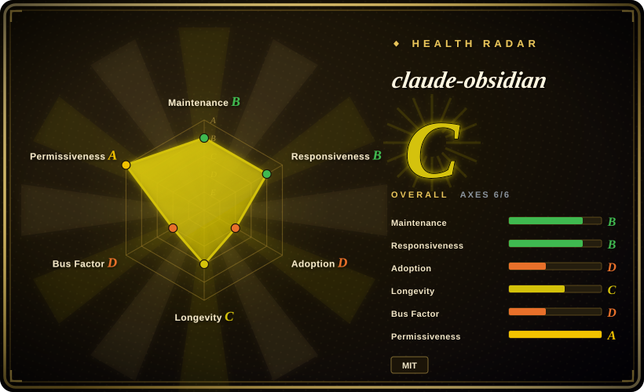
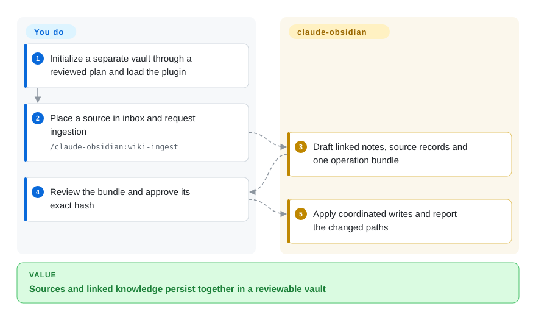
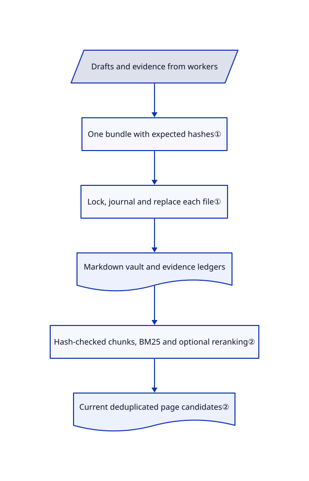

# claude-obsidian

An agent's summary can lose its source, and parallel note edits can overwrite one another. claude-obsidian combines evidence ledgers with reviewed, recoverable writes to a separate Markdown vault.

## When to use

You already work in a coding agent and keep research in Obsidian-compatible files. A source changes, but last month's summary still looks authoritative; two agents also edit the same index. Choose claude-obsidian when explicit capture, claim provenance and one coordinated write transaction matter more than a standalone note-app interface. Its Python core implements writes; its skills guide ingestion, querying and upkeep.

## When NOT to use

- For an integrated desktop editor and graph, choose [LLM Wiki](llm-wiki.md). This project relies on a host agent and an external editor.
- For headless document compilation with packaged conversion paths, examine [OpenKB](openkb.md). Here PDF/EPUB capture preserves metadata and bytes, not built-in semantic extraction; URL/OCR paths require external adapters.
- For browser and multi-device chat over your corpus, choose [Khoj](khoj.md), accepting its server and database burden.
- For native Windows writes, use WSL or a different note tool. The documented portable core fails closed for writes on native Windows; inspection and dry-run support are broader.

## Comparison

| Alternative | In index | Our verdict | Tradeoff |
|---|---|---|---|
| [LLM Wiki](llm-wiki.md) | ✅ | Choose LLM Wiki for desktop authoring; choose claude-obsidian to keep your existing agent and review each vault operation. | A packaged UI versus explicit transaction and evidence contracts. |
| [OpenKB](openkb.md) | ✅ | Choose OpenKB for a headless document-to-wiki CLI; choose this for an agent-led Obsidian workflow with coordinated mutation. | More document-conversion integration versus a stronger focus on vault boundaries and source ledgers. |
| [Khoj](khoj.md) | ✅ | Choose Khoj for multi-client retrieval and chat; choose this when the persistent, reviewable Markdown vault is the product. | Server-backed reach versus files without a mandatory vector database. |

## Quick start

Clone the product separately from your notes and use Python 3.11 or newer. Run the documented `init` command with a fixed timestamp and operation ID, review its JSON plan, then repeat with the returned approval hash and `--apply`. Start Claude Code from the vault using `claude --plugin-dir /absolute/path/to/claude-obsidian`. Place a source in `inbox/` and invoke `/claude-obsidian:wiki-ingest`; the host drafts linked notes and provenance while the core applies the reviewed bundle. You provide model access, consent for network use and backups; the plugin is not automatic transcript capture.

<!-- flow-steps:begin (generated from flows/claude-obsidian.json by tools/flow_card.py — do not edit) -->

Text version of the flow

1. **You**: Initialize a separate vault through a reviewed plan and load the plugin
2. **You**: Place a source in inbox and request ingestion — `/claude-obsidian:wiki-ingest`
3. **claude-obsidian**: Draft linked notes, source records and one operation bundle
4. **You**: Review the bundle and approve its exact hash
5. **claude-obsidian**: Apply coordinated writes and report the changed paths

**Value**: Sources and linked knowledge persist together in a reviewable vault

<!-- flow-steps:end -->

## Key techniques

<!-- mechanism:begin (generated from mechanisms/claude-obsidian.json by tools/mechanism_card.py; do not edit) -->

Text version of the mechanism

- Drafts and evidence from workers
- One bundle with expected hashes①
- Lock, journal and replace each file①
- Markdown vault and evidence ledgers
- Hash-checked chunks, BM25 and optional reranking②
- Current deduplicated page candidates②

- Drafts and evidence from workers → One bundle with expected hashes①
- One bundle with expected hashes① → Lock, journal and replace each file①
- Lock, journal and replace each file① → Markdown vault and evidence ledgers
- Markdown vault and evidence ledgers → Hash-checked chunks, BM25 and optional reranking②
- Hash-checked chunks, BM25 and optional reranking② → Current deduplicated page candidates②

<!-- mechanism:end -->

### 1. Review one operation, then mutate under a lock

- **Problem:** A multi-file ingest can leave pages, indexes and ledgers inconsistent after a conflict or crash.
- **How:** A transaction binds writes to expected hashes, obtains a vault mutation lock, journals backups and atomically replaces each file. Applying checks approval when supplied and verifies current hashes; exceptions trigger restoration. Workers are instructed to return drafts only.
- **Limits:** Multiple filesystem files are not one atomic database commit. Recovery and backups still matter, and the single-writer rule applies only to cooperating clients using the core.
- **Source:** [Apply and rollback](https://github.com/AgriciDaniel/claude-obsidian/blob/b0d8867eec8c8ff22f5d927b3725b1123459fe3d/claude_obsidian/transaction.py#L4465-L4803), [ingest coordination](https://github.com/AgriciDaniel/claude-obsidian/blob/b0d8867eec8c8ff22f5d927b3725b1123459fe3d/skills/wiki-ingest/SKILL.md#L95-L146).

### 2. Reject stale retrieval chunks before ranking

- **Problem:** A search index can confidently return text from a page that has since changed.
- **How:** Retrieval checks chunk identifiers, chunk hashes, index hashes and the current page-body hash. It ranks current BM25 candidates, optionally reranks using Ollama embeddings, then deduplicates pages before applying the result count.
- **Limits:** Missing indexes return an explicit unavailable exit code; embeddings are optional. Fresh bytes do not prove that a note's claims are correct.
- **Source:** [Retrieval checks and ranking](https://github.com/AgriciDaniel/claude-obsidian/blob/b0d8867eec8c8ff22f5d927b3725b1123459fe3d/scripts/retrieve.py#L191-L346).

## Tech stack

Python 3.11+ portable core, Bash setup helpers, JSON operation bundles and ledgers, Markdown pages and Agent Skills prompts. Optional Obsidian CLI and Ollama integrations extend the filesystem path.

## Dependencies

A compatible agent host and model access for synthesis; Python for the core, Bash for shell helpers, and Obsidian only for its visual experience. Native Windows mutations require WSL. Optional network capture, OCR and model-based retrieval need configured adapters and explicit egress consent.

## Ops difficulty

**Medium.** There is no mandatory database, but you own vault backups, approval plans, recovery and cache rebuilds. Keep product upgrades separate from the vault. Review session hooks and host-specific skill links before enabling them.

## Health & viability

- On 2026-10-18, the default branch's latest commit was 2026-10-17; v2.2.0 was released 2026-09-10. The tree includes Python/shell tests and CI.
- Created 2026-04-07, with `AgriciDaniel` dominating contributions: six months is a short Lindy history despite 15,605 stars.
- MIT text credits AgriciDaniel. Attribution distinguishes design inspiration from copied code and excludes historical third-party vault plugins from the product artifact.
- [推断：依据是单维护者主导及半年历史] Prefer a reversible pilot vault before entrusting an irreplaceable research archive.

## Caveats (unverified)

- [未验证：本任务禁止执行上游] Recovery, cross-platform behavior and plugin integration were inspected, not exercised.
- [未验证：未运行模型对照评测] Source/claim ledgers improve traceability but do not establish factual accuracy or retrieval quality.
- [推断：依据是单维护者主导及半年历史] Durability remains less proven than the plain Markdown storage format.
