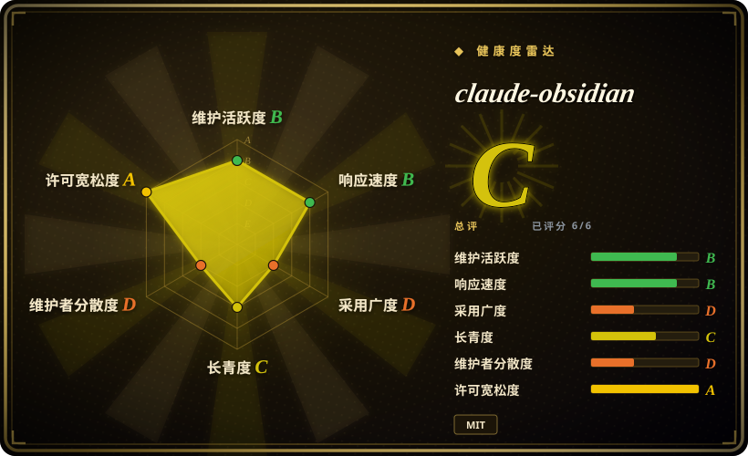
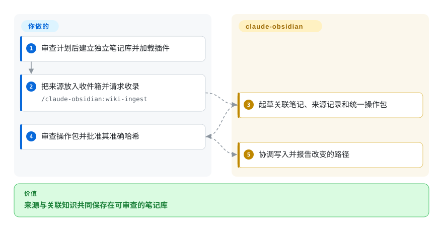
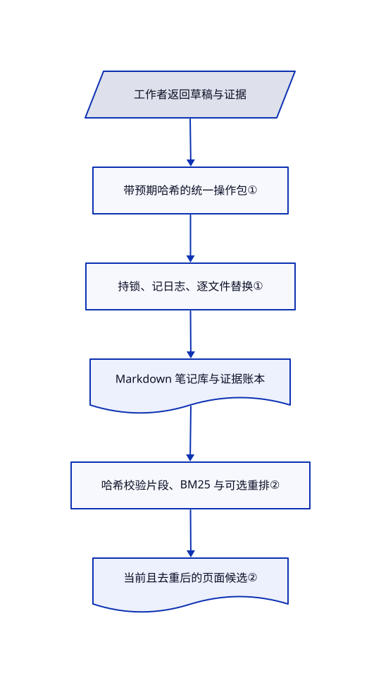

# claude-obsidian

代理写的摘要丢了来源，并行整理还会互相覆盖。claude-obsidian 用证据账本保留出处，再把整次改动作为可审查、可恢复的操作写入独立笔记库。

## 何时使用

你已在编码代理中工作，用兼容 Obsidian 的文件保存研究。来源已经更新，上月摘要却仍显得权威；两个代理还会同时改同一索引。若你看重显式采集、主张溯源和统一写入事务，而不是独立笔记应用的界面，选 claude-obsidian。Python 核心负责写入，技能指导收录、问答和维护。

## 何时不用

- 要集成桌面编辑器和关系图，选 [LLM Wiki](llm-wiki.zh.md)。本项目依赖代理宿主和外部编辑器。
- 要无界面的文档编译与现成转换链路，先看 [OpenKB](openkb.zh.md)。这里 PDF／EPUB 采集保留元数据和原始字节，不自带语义提取；网址与 OCR 需外部适配器。
- 要从浏览器和多设备聊天访问资料，选 [Khoj](khoj.zh.md)，接受服务端和数据库负担。
- 要原生 Windows 写入，改用 WSL 或其他笔记工具。核心在原生 Windows 拒绝写入，检查和预演支持范围更广。

## 横向对比

| 替代品 | 是否收录 | 我们的评价 | 取舍 |
|---|---|---|---|
| [LLM Wiki](llm-wiki.zh.md) | ✅ | 桌面创作选 LLM Wiki；保留现有代理并逐次审查笔记操作选本项目。 | 成品界面与显式事务、证据合同之间取舍。 |
| [OpenKB](openkb.zh.md) | ✅ | 无界面文档编译选 OpenKB；代理主导且要协调笔记写入时选本项目。 | 文档转换集成更广，换成更聚焦的笔记边界和来源账本。 |
| [Khoj](khoj.zh.md) | ✅ | 多客户端检索聊天选 Khoj；产物应是可审查的持久 Markdown 笔记库时选本项目。 | 服务端覆盖面，换成无需强制向量数据库的文件。 |

## 快速上手

把产品克隆到笔记库之外，准备 Python 3.11 以上版本。按文档运行带固定时间和操作标识的 `init`，审查 JSON 计划，再带返回的批准哈希和 `--apply` 重跑。从笔记库目录以 `claude --plugin-dir /absolute/path/to/claude-obsidian` 启动 Claude Code。将来源放入 `inbox/`，调用 `/claude-obsidian:wiki-ingest`；宿主生成关联笔记和溯源记录，核心应用已审查的操作包。你负责模型访问、联网同意和备份；插件不会自动录入整段会话。

<!-- flow-steps:begin (generated from flows/claude-obsidian.json by tools/flow_card.py — do not edit) -->

流程文字版

1. **你**：审查计划后建立独立笔记库并加载插件
2. **你**：把来源放入收件箱并请求收录 — `/claude-obsidian:wiki-ingest`
3. **claude-obsidian**：起草关联笔记、来源记录和统一操作包
4. **你**：审查操作包并批准其准确哈希
5. **claude-obsidian**：协调写入并报告改变的路径

**价值**：来源与关联知识共同保存在可审查的笔记库

<!-- flow-steps:end -->

## 技术要点

<!-- mechanism:begin (generated from mechanisms/claude-obsidian.json by tools/mechanism_card.py; do not edit) -->

机制文字版

- 工作者返回草稿与证据
- 带预期哈希的统一操作包①
- 持锁、记日志、逐文件替换①
- Markdown 笔记库与证据账本
- 哈希校验片段、BM25 与可选重排②
- 当前且去重后的页面候选②

- 工作者返回草稿与证据 → 带预期哈希的统一操作包①
- 带预期哈希的统一操作包① → 持锁、记日志、逐文件替换①
- 持锁、记日志、逐文件替换① → Markdown 笔记库与证据账本
- Markdown 笔记库与证据账本 → 哈希校验片段、BM25 与可选重排②
- 哈希校验片段、BM25 与可选重排② → 当前且去重后的页面候选②

<!-- mechanism:end -->

### 1. 审查整次操作，再持锁写入

- **解决：** 多文件收录遇到冲突或崩溃，会让页面、索引和账本不一致。
- **做法：** 事务绑定预期哈希，获取笔记库写锁，记录备份日志，再逐文件原子替换。提供批准哈希时会核对，并检查当前内容哈希；异常触发恢复。并行工作者被要求只返回草稿。
- **边界：** 多个文件不是一个数据库原子提交，仍需恢复和备份。单写者规则只覆盖通过核心协作的客户端。
- **源码：** [写入与恢复](https://github.com/AgriciDaniel/claude-obsidian/blob/b0d8867eec8c8ff22f5d927b3725b1123459fe3d/claude_obsidian/transaction.py#L4465-L4803)、[收录协调](https://github.com/AgriciDaniel/claude-obsidian/blob/b0d8867eec8c8ff22f5d927b3725b1123459fe3d/skills/wiki-ingest/SKILL.md#L95-L146)。

### 2. 先拒绝过期片段，再排序

- **解决：** 页面已经修改，搜索索引却仍返回旧内容。
- **做法：** 检索核对片段标识、片段哈希、索引哈希和当前页面正文哈希。先用 BM25 排当前候选，可选用 Ollama 向量重排，再按页面去重并截取结果数。
- **边界：** 缺索引会明确返回不可用退出码；向量阶段可选。字节新鲜不证明笔记中的主张正确。
- **源码：** [检索检查与排序](https://github.com/AgriciDaniel/claude-obsidian/blob/b0d8867eec8c8ff22f5d927b3725b1123459fe3d/scripts/retrieve.py#L191-L346)。

## 技术栈

Python 3.11 以上的可移植核心、Bash 安装助手、JSON 操作包和账本、Markdown 页面，以及 Agent Skills 提示词。可选 Obsidian CLI 和 Ollama 集成扩展文件路线。

## 依赖

生成内容需要兼容代理宿主和模型；核心需要 Python，脚本助手需要 Bash。Obsidian 只负责可视化体验。原生 Windows 写入需要 WSL；联网采集、OCR 和模型检索还需要适配器及明确外发同意。

## 运维难度

**中等。** 无强制数据库，但要维护备份、批准计划、恢复和缓存重建。产品升级与笔记库分离。启用会话 hook 和宿主技能链接前先审查。

## 健康度与可持续性

- 截至 2026-10-18，默认分支最近提交为 2026-10-17；v2.2.0 发布于 2026-09-10。仓库包含 Python／Shell 测试和持续集成。
- 创建于 2026-04-07，贡献由 `AgriciDaniel` 主导。15,605 颗星不能替代仅半年的存续记录。
- MIT 实文署名 AgriciDaniel。归属声明区分设计启发和代码复制，并将历史第三方笔记插件排除在产品包外。
- [推断：依据是单维护者主导及半年历史] 应先用可回退的试验笔记库，再托付不可替代的研究档案。

## 存疑（未验证）

- [未验证：本任务禁止执行上游] 已阅读恢复、跨平台和插件集成路径，未实际运行。
- [未验证：未运行模型对照评测] 来源和主张账本改善可追查性，不证明事实准确或检索质量。
- [推断：依据是单维护者主导及半年历史] 软件持久性证据弱于 Markdown 格式本身。
