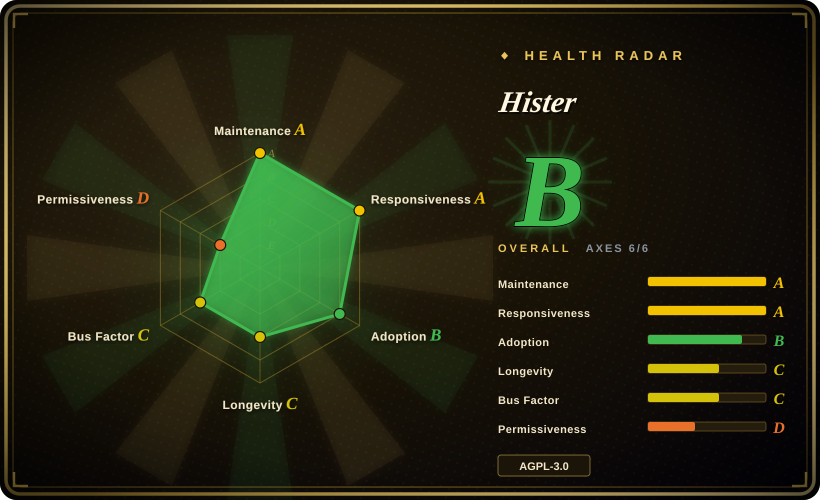
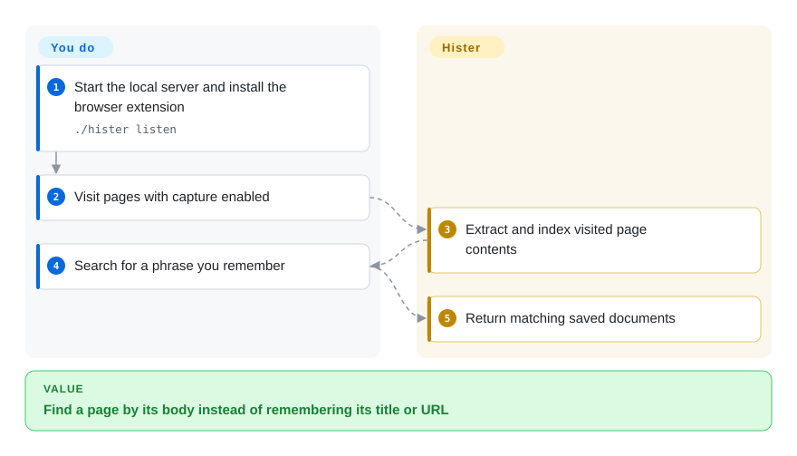
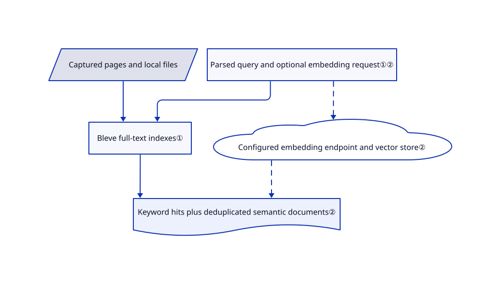

# Hister

You remember a sentence from a page but not its title or address. Hister indexes visited-page contents and local files so that sentence becomes searchable on your own server.

## When to use

You read many technical pages and later find that browser history only matches titles and URLs. Choose Hister when automatic browser capture plus private full-text search is the goal, rather than manually curating bookmarks or asking a chat assistant to synthesize answers. Its web, terminal and MCP clients share the same personal corpus.

## When NOT to use

- To preserve rich snapshots and media as archival artifacts, compare ArchiveBox; search indexing is not preservation fidelity.
- To maintain a small curated bookmark list, use linkding rather than recording everything you visit.
- To ask synthesized questions across documents and devices, choose [Khoj](khoj.md), accepting model and database overhead.
- If indexed page text must never reach a model service, keep semantic search disabled or use an audited local endpoint. Ordinary browser history is safer when even storing page contents is unacceptable.

## Comparison

| Alternative | In index | Our verdict | Tradeoff |
|---|---|---|---|
| [Khoj](khoj.md) | ✅ | Choose Khoj for generated answers across clients; choose Hister to retrieve the original page text without a mandatory model. | A chat/retrieval service versus a personal search engine. |
| [ArchiveBox](https://github.com/ArchiveBox/ArchiveBox) | not indexed | Choose ArchiveBox when saved HTML, PDFs and media are the deliverable; choose Hister for continuous re-finding. | Archival artifacts versus search-first capture; not added in this tab batch. |
| [linkding](https://github.com/sissbruecker/linkding) | not indexed | Choose linkding for intentionally saved bookmarks; choose Hister when a remembered body phrase must find an unbookmarked visit. | Manual curation reduces retention volume; not added in this tab batch. |

## Quick start

Download the release binary, make it executable and run `./hister listen`. Open `http://127.0.0.1:4433` and install the official Chrome or Firefox extension. Visit a page with capture enabled, then search for a phrase from its body in Hister. The extension supplies page content and the server maintains the searchable corpus; you decide capture rules, retention and backups. Optional semantic search needs a separately configured embedding endpoint and can send document text there.

<!-- flow-steps:begin (generated from flows/hister.json by tools/flow_card.py — do not edit) -->

Text version of the flow

1. **You**: Start the local server and install the browser extension — `./hister listen`
2. **You**: Visit pages with capture enabled
3. **Hister**: Extract and index visited page contents
4. **You**: Search for a phrase you remember
5. **Hister**: Return matching saved documents

**Value**: Find a page by its body instead of remembering its title or URL

<!-- flow-steps:end -->

## Key techniques

<!-- mechanism:begin (generated from mechanisms/hister.json by tools/mechanism_card.py; do not edit) -->

Text version of the mechanism

- Captured pages and local files
- Bleve full-text indexes①
- Parsed query and optional embedding request①②
- Configured embedding endpoint and vector store②
- Keyword hits plus deduplicated semantic documents②

- Captured pages and local files → Bleve full-text indexes①
- Parsed query and optional embedding request①② → Bleve full-text indexes①
- Parsed query and optional embedding request①② → Configured embedding endpoint and vector store② [optional/fallback]
- Bleve full-text indexes① → Keyword hits plus deduplicated semantic documents②
- Configured embedding endpoint and vector store② → Keyword hits plus deduplicated semantic documents② [optional/fallback]

<!-- mechanism:end -->

### 1. Query embedded full-text indexes

- **Problem:** URL and title history cannot recover an arbitrary paragraph you remember.
- **How:** The Go indexer owns Bleve indexes and document storage, parses a query language into search requests and returns stored documents, highlights, facets and pagination keys.
- **Limits:** Results depend on what was actually captured and extracted. It is not a general web search engine and cannot retrieve pages never indexed.
- **Source:** [Indexer and search](https://github.com/asciimoo/hister/blob/dce14327638b4177fcaad7cd11827c26b6cd17cd/server/indexer/indexer.go#L1957-L2062).

### 2. Add semantic retrieval without replacing keywords

- **Problem:** The phrase in your query may differ from the wording in the saved page.
- **How:** An optional OpenAI-compatible embedding client turns query text into vectors. The search path keeps keyword results, queries the vector store, aggregates chunks by document and avoids duplicate URLs.
- **Limits:** Endpoint or vector-store failure logs a warning rather than removing keyword results. Remote embeddings change the privacy boundary and add latency.
- **Source:** [Optional semantic path](https://github.com/asciimoo/hister/blob/dce14327638b4177fcaad7cd11827c26b6cd17cd/server/indexer/indexer.go#L2064-L2116), [embedding client](https://github.com/asciimoo/hister/blob/dce14327638b4177fcaad7cd11827c26b6cd17cd/server/vectorstore/embedder.go#L20-L125).

## Tech stack

Go 1.26, Bleve full-text search, SQLite/PostgreSQL support, Cobra CLI and Bubble Tea terminal UI. Browser extensions feed the server; frontend assets require npm when building from source.

## Dependencies

The server must keep running for capture and search. A release binary avoids the Go/npm/C compiler build toolchain. Browser capture needs the extension; semantic search optionally needs an embedding service and vector-store configuration.

## Ops difficulty

**Low locally, medium when shared.** Protect captured authenticated pages, exclude sensitive sites and back up the data directory. A network deployment adds authentication, TLS and user-separation checks. No mandatory cloud account is required.

## Health & viability

- On 2026-10-18, the branch last changed on 2026-10-16; stable v0.20.0 dates to 2026-09-24. A separate rolling release also exists.
- Created 2026-01-04, with `asciimoo` leading contributions and additional contributors. Nine months of history is still a weak Lindy prior; 6,075 stars are interest, not retention-safety evidence.
- License text is GNU AGPL v3; the README explicitly permits later versions. Network redistribution obligations deserve review.
- [推断：依据是活跃提交、测试布局及不足一年历史] A credible personal-use pilot, with upgrades and sensitive-page retention requiring care.

## Caveats (unverified)

- [未验证：本任务禁止执行上游] Capture exclusions, extraction fidelity and multi-user isolation were not exercised.
- [推断：依据是活跃提交、测试布局及不足一年历史] Long-term index compatibility and maintenance continuity remain unproven.
